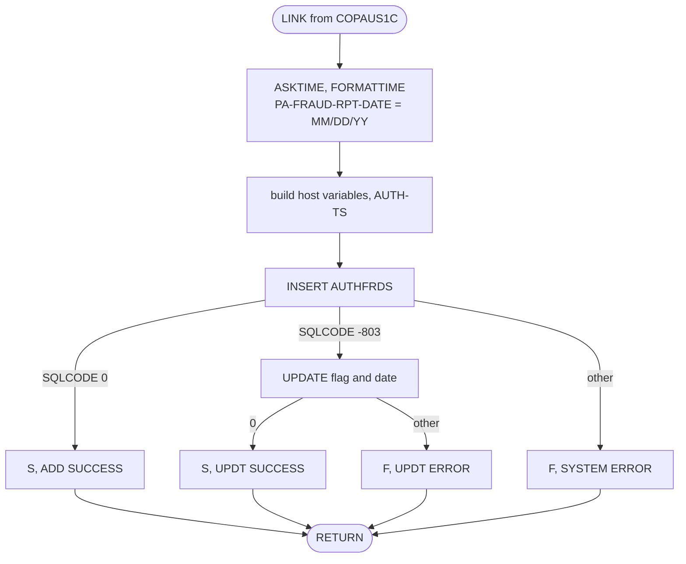
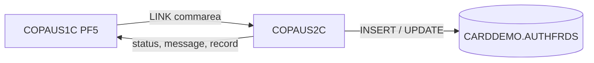

# COPAUS2C: Fraud record in Db2 (linked from the authorization detail screen)

## 1. Summary

A CICS program without a screen. COPAUS1C links to it when the user presses PF5 on an authorization (COPAUS1C BR-AUDT-007). It receives the account ID, customer ID, the authorization detail record (ENT-AUTH-DETAIL layout, with the fraud flag already toggled) and the action (`F` report fraud, `R` remove fraud). It stamps today's date into the record's fraud report date, then inserts a row for the authorization into the Db2 table `CARDDEMO.AUTHFRDS` (ENT-AUTH-FRAUD), or, when the row already exists, updates its fraud flag and report date. It returns a status and a message in the commarea. It does not commit; COPAUS1C commits or rolls back.

## 2. Rules at a glance

| ID | Rule |
| :-- | :-- |
| FLOW-AUFR-001 | Stamp the date, build the row, insert; on duplicate key update; return. |
| BR-AUFR-001 | The record returned to COPAUS1C carries today's date as fraud report date (`MM/DD/YY`). |
| BR-AUFR-002 | The row copies the authorization detail, the action as fraud flag, the account and customer IDs. |
| BR-AUFR-003 | A row that already exists (same card and timestamp) gets only its flag and report date updated. |

## 3. Actors and triggers

- **Caller:** COPAUS1C, `EXEC CICS LINK PROGRAM('COPAUS2C') COMMAREA(WS-FRAUD-DATA)` in the `CPVD` task (`COPAUS1C.cbl:248-252`). The commarea length is not checked; started any other way (no commarea) the linkage fields are not addressable (platform-inferred).
- **CICS definition:** `PROGRAM(COPAUS2C)` with `TRANSID(CPVD)` (`CRDDEMO2.csd:32-38`); the Db2 plan comes from the `CPVD` transaction's `DB2TRAN` (`CRDDEMO2.csd:69-79`, COPAUS1C Q-AUDT-004).
- **Table:** `CARDDEMO.AUTHFRDS`; the schema is hard-coded, and the module README asks installers to change it in the program (`app/app-authorization-ims-db2-mq/README.md:150`).

## 4. Interfaces

### 4.1 Commarea (`DFHCOMMAREA`, 272 bytes)

| Field | PIC | Direction | Content |
| :-- | :-- | :-- | :-- |
| `WS-ACCT-ID` | `9(11)` | in | account ID |
| `WS-CUST-ID` | `9(09)` | in | customer ID |
| `WS-FRAUD-AUTH-RECORD` | `CIPAUDTY` (200) | in/out | authorization detail; `PA-FRAUD-RPT-DATE` is set (BR-AUFR-001) |
| `WS-FRD-ACTION` | `X(01)` | in | `F` report, `R` remove |
| `WS-FRD-UPDATE-STATUS` | `X(01)` | out | `S` success, `F` failed |
| `WS-FRD-ACT-MSG` | `X(50)` | out | `ADD SUCCESS`, `UPDT SUCCESS` or an error text (ERR-AUFR-001, ERR-AUFR-002) |

Source: `:73-86`, `CIPAUDTY.cpy:19-54`.

### 4.2 Table `CARDDEMO.AUTHFRDS`

Defined in `AUTHFRDS.ddl:1-28` with primary key (`CARD_NUM`, `AUTH_TS`) and the unique index `XAUTHFRD` on (`CARD_NUM ASC`, `AUTH_TS DESC`) (`XAUTHFRD.ddl:1-4`). Host variables from the DCLGEN `AUTHFRDS.dcl:55-86`. Column content: BR-AUFR-002.

## 5. Data used

| Entity field | Read | Written | Use |
| :-- | :-- | :-- | :-- |
| ENT-AUTH-DETAIL (commarea copy): every field except `PA-AUTH-DATE-9C`, `PA-AUTH-FRAUD` and `PA-FRAUD-RPT-DATE` | yes | - | BR-AUFR-002 |
| ENT-AUTH-DETAIL.PA-AUTH-TIME-9C, PA-AUTH-ORIG-DATE | yes | - | NUM-AUFR-002 |
| ENT-AUTH-DETAIL.PA-FRAUD-RPT-DATE (commarea copy) | - | yes | BR-AUFR-001 |
| ENT-AUTH-FRAUD (all 26 columns) | - | insert | SE-AUFR-001 |
| ENT-AUTH-FRAUD.AUTH_FRAUD, FRAUD_RPT_DATE | - | update | SE-AUFR-002 |

## 6. Processing flow

## 7. Business rules

#### FLOW-AUFR-001 · Fraud record flow
- **When:** linked by COPAUS1C.
- **Then:** BR-AUFR-001; build the host variables (BR-AUFR-002, NUM-AUFR-002); `INSERT` (SE-AUFR-001). `SQLCODE = 0`: status `S`, message `ADD SUCCESS`. `SQLCODE = -803` (duplicate key): BR-AUFR-003. Other: ERR-AUFR-001. Then `EXEC CICS RETURN` to COPAUS1C. No `COMMIT` or `SYNCPOINT` is issued here.
- **Source:** `:89-220`
- **Fidelity:** must-preserve · **Confidence:** reviewed

#### BR-AUFR-001 · Fraud report date in the returned record
- **When:** always, first step.
- **Then:** `ASKTIME` and `FORMATTIME MMDDYY DATESEP` give today as `MM/DD/YY` (8 characters, separator `/`), moved to `PA-FRAUD-RPT-DATE` of the commarea record. COPAUS1C stores that record in IMS on success (COPAUS1C BR-AUDT-008). The date is set even when the Db2 change fails; COPAUS1C then does not store it.
- **Source:** `:91-101`
- **Fidelity:** must-preserve · **Confidence:** reviewed (default separator `/`: platform-inferred)

#### BR-AUFR-002 · Row content
- **When:** before the insert.
- **Then:** the row's columns are set as follows:

  | Column | Value |
  | :-- | :-- |
  | `CARD_NUM` | `PA-CARD-NUM` |
  | `AUTH_TS` | NUM-AUFR-002 |
  | `AUTH_TYPE`, `CARD_EXPIRY_DATE`, `MESSAGE_TYPE`, `MESSAGE_SOURCE`, `AUTH_ID_CODE`, `AUTH_RESP_CODE`, `AUTH_RESP_REASON`, `PROCESSING_CODE` | the detail fields of the same name |
  | `TRANSACTION_AMT`, `APPROVED_AMT` | the detail amounts (`S9(10)V99 COMP-3` to `DECIMAL(12,2)`) |
  | `MERCHANT_CATAGORY_CODE`, `ACQR_COUNTRY_CODE`, `MERCHANT_ID`, `MERCHANT_CITY`, `MERCHANT_STATE`, `MERCHANT_ZIP`, `TRANSACTION_ID`, `MATCH_STATUS` | the detail fields of the same name |
  | `POS_ENTRY_MODE` | `PA-POS-ENTRY-MODE` `9(02)` as `SMALLINT` |
  | `MERCHANT_NAME` | `PA-MERCHANT-NAME` with length always 22 (NUM-AUFR-001) |
  | `AUTH_FRAUD` | the action `WS-FRD-ACTION` (`F` or `R`), which equals the toggled `PA-AUTH-FRAUD` |
  | `FRAUD_RPT_DATE` | Db2 `CURRENT DATE` |
  | `ACCT_ID`, `CUST_ID` | `WS-ACCT-ID`, `WS-CUST-ID` |

- **Source:** `:113-139, 141-198`, `AUTHFRDS.ddl:1-28`
- **Fidelity:** must-preserve · **Confidence:** reviewed

#### BR-AUFR-003 · Existing row: update flag and date
- **When:** the insert returns `SQLCODE = -803`.
- **Then:** `UPDATE CARDDEMO.AUTHFRDS SET AUTH_FRAUD = action, FRAUD_RPT_DATE = CURRENT DATE WHERE CARD_NUM = card AND AUTH_TS = the same timestamp` (SE-AUFR-002). `SQLCODE = 0`: status `S`, message `UPDT SUCCESS`. Other (including `+100`, no row): ERR-AUFR-002. The other columns keep the values of the first insert. Removing fraud therefore keeps the row with `AUTH_FRAUD = 'R'`; it is never deleted.
- **Source:** `:203-204, 221-244`
- **Fidelity:** must-preserve · **Confidence:** reviewed

## 8. Validations and messages

The program validates nothing: the action, the IDs and the record are used as received.

## 9. Side effects

#### SE-AUFR-001 · Insert the fraud row
- One row in `CARDDEMO.AUTHFRDS` per card and timestamp (BR-AUFR-002), in the caller's unit of work.
- **Source:** `:141-198`
- **Fidelity:** must-preserve · **Confidence:** reviewed (commit by the caller's `SYNCPOINT`: platform-inferred)

#### SE-AUFR-002 · Update the fraud row
- `AUTH_FRAUD` and `FRAUD_RPT_DATE` of the existing row (BR-AUFR-003), in the caller's unit of work.
- **Source:** `:221-229`
- **Fidelity:** must-preserve · **Confidence:** reviewed (commit by the caller: platform-inferred)

## 10. Error handling

#### ERR-AUFR-001 · Insert failed
- `SQLCODE` not 0 and not -803: status `F`, message ` SYSTEM ERROR DB2: CODE:` + `SQLCODE` + `, STATE: ` + `SQLSTATE`, formatted by NUM-AUFR-003 (exactly 50 characters, for example ` SYSTEM ERROR DB2: CODE:-000530, STATE: +000023503`). COPAUS1C shows it and rolls back (COPAUS1C ERR-AUDT-004).
- **Source:** `:205-215`
- **Fidelity:** must-preserve (failure status); incidental (text) · **Confidence:** reviewed

#### ERR-AUFR-002 · Update failed
- Status `F`, message ` UPDT ERROR DB2: CODE:` + `SQLCODE` + `, STATE: ` + `SQLSTATE` (48 characters). The message field is not cleared first, so its last 2 characters keep what was there before.
- **Source:** `:233-243`
- **Fidelity:** must-preserve (failure status); incidental (text) · **Confidence:** reviewed

## 11. Interactions

- **Upstream:** COPAUS1C only.
- **Downstream:** none; nothing in the repository reads `AUTHFRDS` (the module README describes it as the table "for fraud analytics", `app/app-authorization-ims-db2-mq/README.md:55`).
- **Unit of work:** the Db2 change is committed or backed out by COPAUS1C together with the IMS replace (COPAUS1C SE-AUDT-002).

## 12. Numeric, date and format details

#### NUM-AUFR-001 · Column conversions
- `MERCHANT_NAME` is `VARCHAR(22)`; the length is set to `LENGTH OF PA-MERCHANT-NAME` (22), so trailing spaces are stored. `POS_ENTRY_MODE` `SMALLINT` from `9(02)` through `S9(4) COMP`. `ACCT_ID` `DECIMAL(11)` and `CUST_ID` `DECIMAL(9)` from unsigned display numbers.
- **Source:** `:128-131, 138-139`, `AUTHFRDS.dcl:71-86`
- **Fidelity:** must-preserve (values); incidental (trailing spaces) · **Confidence:** reviewed

#### NUM-AUFR-002 · Authorization timestamp
- `AUTH_TS` is built from two different sources:
  - date: `PA-AUTH-ORIG-DATE` (`YYMMDD`, the request's date from the MQ message);
  - time: `999999999 - PA-AUTH-TIME-9C`, which recovers the processing time `HHMMSSmmm` that COPAUA0C put into the key (COPAUA0C NUM-AUTH-005).
- The string `YY-MM-DD HH.MI.SSmmm000` (23 characters, padded to 26 with spaces) is converted with `TIMESTAMP_FORMAT(..., 'YY-MM-DD HH24.MI.SSNNNNNN')`; the milliseconds become the first 3 of 6 fraction digits. Example: request date `240405`, key time `856984749` → time `143015250` → `24-04-05 14.30.15250000` → `2024-04-05-14.30.15.250000`. The century of the 2-digit year is chosen by Db2 (platform-inferred).
- The same expression is used for the `UPDATE`'s `WHERE`, so the same detail always maps to the same row.
- **Source:** `:35-51, 103-114, 171-172, 227-228`
- **Fidelity:** must-preserve (row identity); defect-decide (DEF-AUFR-001) · **Confidence:** reviewed (`TIMESTAMP_FORMAT` result: platform-inferred)

#### NUM-AUFR-003 · Error code format
- `SQLCODE` is moved to `+9(06)` (sign and 6 digits, for example `-000803`) and `SQLSTATE` (5 characters) to `+9(09)` (for example `+000023505`). A `SQLSTATE` with letters (for example `5UA0K`) is not a valid number for this move and its text is unpredictable (DEF-AUFR-003).
- **Source:** `:55-56, 208-212, 236-240`
- **Fidelity:** incidental · **Confidence:** reviewed (non-digit SQLSTATE result: platform-inferred)

## 13. Known defects and oddities

#### DEF-AUFR-001 · Timestamp mixes the request date with the processing time
- NUM-AUFR-002 combines the request's date with the time at which COPAUA0C processed it, not the request's own time (`PA-AUTH-ORIG-TIME`) or the processing date (`PA-AUTH-DATE-9C`). Two authorizations of the same card with the same request date and the same processing time of day (different processing days) map to the same row: the second one's PF5 updates the first one's row (BR-AUFR-003) and keeps the first one's amounts and merchant.
- **Source:** `:103-111` · **Status:** open · **Fidelity:** defect-decide (Q-AUFR-001) · **Confidence:** reviewed

#### DEF-AUFR-002 · NOHANDLE coded twice
- `EXEC CICS ASKTIME NOHANDLE ABSTIME(...) NOHANDLE` repeats the option. Whether the CICS translator accepts it with a warning or rejects it is not known (Q-AUFR-002).
- **Source:** `:91-94` · **Status:** open · **Confidence:** platform-inferred

#### DEF-AUFR-003 · SQLSTATE shown as a number
- NUM-AUFR-003: the 5-character `SQLSTATE` is moved into a numeric edited field; states with letters give an unpredictable text.
- **Source:** `:56, 209` · **Status:** open (incidental) · **Confidence:** platform-inferred

#### DEF-AUFR-004 · Two different report dates
- The IMS detail gets the CICS date (`MM/DD/YY`, BR-AUFR-001) and the Db2 row gets Db2 `CURRENT DATE`. They agree unless the two clocks differ or the call spans midnight.
- **Source:** `:95-101, 194, 225` · **Status:** open (incidental) · **Confidence:** reviewed

## 14. Open questions

| ID | Question | For |
| :-- | :-- | :-- |
| Q-AUFR-001 | Which date and time should identify an authorization in `AUTHFRDS`: the request's date and time, the processing date and time of the key, or the key itself (DEF-AUFR-001)? | business |
| Q-AUFR-002 | Does the CICS translator accept the duplicated `NOHANDLE` in `ASKTIME` (DEF-AUFR-002)? | mainframe team |

## 15. Equivalence contract

A reimplementation is equivalent when, for the same commarea and table content:

- the returned record has today's date in `PA-FRAUD-RPT-DATE` (`MM/DD/YY`);
- a new authorization gives one row with the columns of BR-AUFR-002 and status `S`, `ADD SUCCESS`; an existing row gets the new flag and today's date and status `S`, `UPDT SUCCESS`;
- other Db2 errors give status `F`; the change is left to the caller to commit or back out;
- incidental: the exact error text (NUM-AUFR-003), trailing spaces in `MERCHANT_NAME`.

Not runnable locally (CICS, Db2). Scenario check: detail with card `4111111111111111`, request date `240405`, key time `856984749`, action `F`, no row → insert with `AUTH_TS` `2024-04-05-14.30.15.250000`, `AUTH_FRAUD` `F`; a second call with action `R` → `-803`, update to `R`, `UPDT SUCCESS`. Review record: `docs/modernization/spec/evidence/e-review.md`.

## 16. Paragraph coverage

| Paragraph | Lines | Covered by |
| :-- | :-- | :-- |
| (data division) | 29-86 | §4.1, NUM-AUFR-001, NUM-AUFR-003 |
| (procedure division header) | 88 | §6 |
| `MAIN-PARA` | 89-220 | FLOW-AUFR-001, BR-AUFR-001, BR-AUFR-002, SE-AUFR-001, ERR-AUFR-001, NUM-AUFR-002, DEF-AUFR-002 |
| `FRAUD-UPDATE` | 221-244 | BR-AUFR-003, SE-AUFR-002, ERR-AUFR-002 |

2 of 2 paragraphs plus the procedure division header covered.
