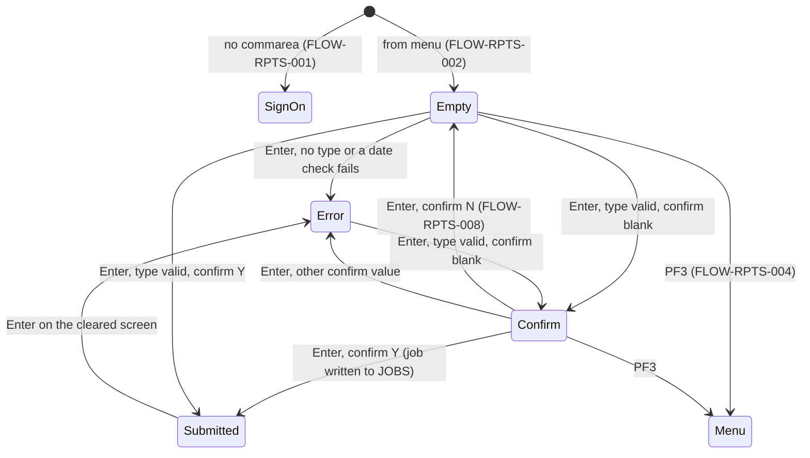
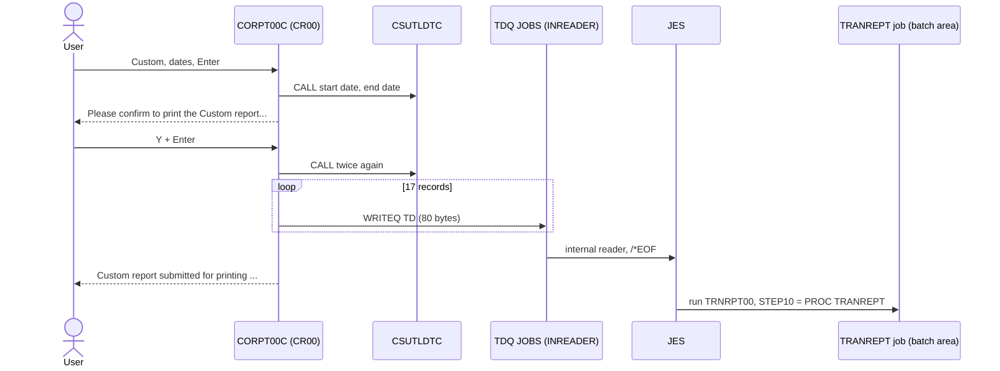

# CORPT00C: Online transaction report request

## 1. Summary

The report request screen lets a user ask for the transaction report for the current month, the current year, or a typed date range. After the user confirms with `Y`, the program writes a 17-line job stream to the transient data queue `JOBS`, which CICS passes to the JES internal reader; JES then runs the batch report job (procedure `TRANREPT`, owned by the batch area) with the chosen start and end date. The program does not read any file, does not wait for the job and gives no feedback on its outcome beyond `<type> report submitted for printing ...`. For a typed range, the parts of each date are required, month and day are range-checked, and each date is checked as a calendar date by `CSUTLDTC`; the program does not check that the start is before the end.

## 2. Rules at a glance

| ID | Rule |
| :-- | :-- |
| BR-RPTS-001 | The first non-blank selection among Monthly, Yearly and Custom decides the report type. |
| BR-RPTS-002 | Monthly: from the first to the last day of the current month. |
| BR-RPTS-003 | Yearly: from 1 January to 31 December of the current year. |
| BR-RPTS-004 | Custom: the typed month, day and year of each date, zero-padded, as `YYYY-MM-DD`. |
| BR-RPTS-005 | The job is submitted only when the confirm field is `Y` or `y`; `N` clears the screen. |
| BR-RPTS-006 | The job stream is 17 fixed records with the two dates filled in. |
| BR-RPTS-007 | The records are written one by one to the queue `JOBS`, up to and including `/*EOF`. |
| BR-RPTS-008 | After submission the screen is cleared and `<type> report submitted for printing ...` is shown in green. |
| VAL-RPTS-001 | A report type must be selected. |
| VAL-RPTS-002 | Custom: all six date parts are required. |
| VAL-RPTS-003 | Custom: month at most 12, day at most 31. |
| VAL-RPTS-004 | Custom: both dates must be calendar dates, except that dates before 1582-10-15 are accepted. |
| VAL-RPTS-005 | The confirm field must be blank, `Y`, `y`, `N` or `n`. |
| VAL-RPTS-006 | Only Enter and PF3 are valid keys. |

## 3. Actors and triggers

- **Actor:** a signed-on CardDemo user, regular or admin (menu user type `U`, `app/cpy/COMEN02Y.cpy:74-78`). The program reads no user identity (DEF-RPTS-007).
- **From the menu:** `COMEN01C` option 9 "Transaction Reports", XCTL with the 160-byte commarea and context 0 (`app/cbl/COMEN01C.cbl:177-187`). The screen starts empty.
- **Re-entry trigger:** CICS starts transaction `CR00` again (`app/csd/CARDDEMO.CSD:409-418`) when the user presses a key on the report screen (FLOW-RPTS-006).
- **Direct start:** typing `CR00` on a blank terminal starts the program with no commarea; it goes to sign-on (FLOW-RPTS-001).

## 4. Interfaces

### 4.1 Screen CORPT0A (mapset CORPT00), 24 x 80

Source: `app/bms/CORPT00.bms:19-228`; symbolic map `app/cpy-bms/CORPT00.CPY:17-224` (output map `CORPT0AO` redefines input map `CORPT0AI` at `:121`, so values received are sent back unless the program changes them). Every input field is unprotected, green, underlined and `FSET`. The six date fields have the `NUM` attribute.

| Row,Col | Field | Len | Direction | Attributes | Content |
| :-- | :-- | --: | :-- | :-- | :-- |
| 1,1-2,71 | header | | out | protected | `Tran:` `CR00`, titles (`app/cpy/COTTL01Y.cpy:18-22`), `Date:` mm/dd/yy, `Prog:` `CORPT00C`, `Time:` hh:mm:ss (`app/bms/CORPT00.bms:29-74`) |
| 4,30 | (label) | 19 | out | protected, bright | `Transaction Reports` |
| 7,10 / 7,15 | `MONTHLY` / label | 1 / 23 | in/out | initial cursor | any character selects; label `Monthly (Current Month)` |
| 9,10 / 9,15 | `YEARLY` / label | 1 / 23 | in/out | | label `Yearly (Current Year)` |
| 11,10 / 11,15 | `CUSTOM` / label | 1 / 23 | in/out | | label `Custom (Date Range)` |
| 13,15 | (label) | 12 | out | protected | `Start Date :` |
| 13,29 / 13,34 / 13,39 | `SDTMM` / `SDTDD` / `SDTYYYY` | 2 / 2 / 4 | in/out | numeric | start month, day, year, separated by `/` labels at 13,32 and 13,37 |
| 13,46 | (label) | 12 | out | blue | `(MM/DD/YYYY)` |
| 14,15 | (label) | 12 | out | protected | `  End Date :` |
| 14,29 / 14,34 / 14,39 | `EDTMM` / `EDTDD` / `EDTYYYY` | 2 / 2 / 4 | in/out | numeric | end month, day, year |
| 14,46 | (label) | 12 | out | blue | `(MM/DD/YYYY)` |
| 19,6 | (label) | 59 | out | protected, turquoise | `The Report will be submitted for printing. Please confirm: ` |
| 19,66 | `CONFIRM` | 1 | in/out | | `Y`/`N` |
| 19,69 | (label) | 5 | out | protected | `(Y/N)` |
| 23,1 | `ERRMSG` | 78 | out | protected, bright, red (green on success) | message (section 8.2) |
| 24,1 | (label) | 23 | out | protected, yellow | `ENTER=Continue  F3=Back` |

Field definitions: `app/bms/CORPT00.bms:80-226`. The two `(MM/DD/YYYY)` labels have no `ATTRB` and get the BMS default (unprotected); they hold no data the program reads.

### 4.2 Transient data queue

| Queue | Definition | Operation | Record | Lines |
| :-- | :-- | :-- | :-- | :-- |
| `JOBS` | extrapartition, output, `DDNAME(INREADER)`, `RECORDSIZE(80)`, fixed, unblocked, `DISPOSITION(MOD)`, `ERROROPTION(IGNORE)`, opened at CICS start (`app/csd/CARDDEMO.CSD:499-505`) | WRITEQ TD, 80 bytes per record | ENT-REPORT-JOB | 515-535 |

The DD `INREADER` belongs to the CICS region's start-up JCL, which is not in this repository; the queue name and description (`SUBMIT JOBS FROM CICS`) show it is a JES internal reader (`SYSOUT=(A,INTRDR)`, Q-RPTS-003). No file is read: the name `TRANSACT` (`:40`) and the layout `CVTRA05Y` (`:146`) are declared but unused.

### 4.3 Commarea

`ENT-COMMAREA` (160 bytes), no extension (`:138`).

| Field | Pos | Len | Read | Written | Use |
| :-- | --: | --: | :-- | :-- | :-- |
| `CDEMO-PGM-CONTEXT` | 34 | 1 | yes | yes | 0 = first entry, 1 = re-entry |
| `CDEMO-FROM-PROGRAM` | 5 | 8 | no | yes | set to `CORPT00C` when leaving |
| `CDEMO-FROM-TRANID` | 1 | 4 | no | yes | set to `CR00` when leaving |
| `CDEMO-TO-PROGRAM` | 17 | 8 | yes | yes | XCTL target |

All other fields pass through unchanged.

### 4.4 Called program

`CSUTLDTC` is called twice for a custom range, with the 10-character date, the picture `YYYY-MM-DD` and an 80-byte result area (`:129-136, 388-426`). The program reads the severity (positions 1-4) and the message number (positions 16-19) of ENT-DATE-CHECK-RESULT (CSUTLDTC BR-DTCK-003).

### 4.5 Console output

Every Enter writes `PROCESS ENTER KEY` to the CICS log (`:210`); a failed queue write writes `RESP:<code>REAS:<code>` (`:529`). Incidental.

## 5. Data used

The program reads no entity. It produces ENT-REPORT-JOB (proposed in `areas/c-transactions-entities.md`). The job it submits reads ENT-TRANSACTION, selecting on `TRAN-PROC-TS` positions 1-10 (record positions 305-314) and sorting on `TRAN-CARD-NUM` (positions 263-278).

Program-local data with behaviour: error flag `WS-ERR-FLG` (`:41-43`), end-of-loop flag `WS-END-LOOP` (`:50-52`), loop index `WS-IDX` (`:57`), report name `WS-REPORT-NAME` (`:58`), the date work fields `WS-START-DATE` and `WS-END-DATE` with fixed `-` separators (`:60-71`), picture `WS-DATE-FORMAT` = `YYYY-MM-DD` (`:72`), normalising fields `WS-NUM-99 PIC 99` and `WS-NUM-9999 PIC 9999` (`:74-75`), the record buffer `JCL-RECORD` (`:79`) and the job template `JOB-DATA` (`:81-127`). `WS-TRANSACT-EOF`, `WS-SEND-ERASE-FLG` (never set to `N`), `WS-REC-COUNT`, `WS-TRAN-AMT` and `WS-TRAN-DATE` have no effect.

## 6. Processing flow

**Entry (MAIN-PARA, lines 163-202)**

1. Clear the error flag and the message (165-170).
2. No commarea: transfer to sign-on (172-174).
3. Copy the received commarea (176).
4. First entry: mark re-entry, clear the map, cursor on Monthly, send (177-181).
5. Re-entry: receive the screen and act on the key (183-195).
6. Return to CICS with next transaction `CR00` (199-202); in practice every path has sent a screen and ended the task before this (FLOW-RPTS-006).

**Enter (PROCESS-ENTER-KEY, lines 208-456)**

1. Choose the report type and compute the date range (BR-RPTS-001 to BR-RPTS-004); for Custom, run VAL-RPTS-002 to VAL-RPTS-004 in this order: required parts, normalise all six parts, month/day ranges (start month, start day, start year, end month, end day, end year), start date calendar check, end date calendar check.
2. Confirm and submit (SUBMIT-JOB-TO-INTRDR, BR-RPTS-005 to BR-RPTS-007).
3. Show the success message (BR-RPTS-008).

The first failing check sends its message and ends the task (FLOW-RPTS-006).

## 7. Business rules

#### BR-RPTS-001 · Report type
- **When:** Enter is processed.
- **Then:** the selection fields are tested in the order Monthly, Yearly, Custom; the first that is not spaces or low-values decides the type, whatever character it holds. Selecting more than one is not an error: Monthly wins over Yearly and Custom, Yearly over Custom (DEF-RPTS-010). None selected: VAL-RPTS-001. The report name used in messages is `Monthly`, `Yearly` or `Custom`.
- **Source:** `:212-214, 239-240, 256, 433, 437-442`
- **Fidelity:** must-preserve · **Confidence:** reviewed

#### BR-RPTS-002 · Monthly range
- **When:** Monthly is selected.
- **Then:** from the current date (`FUNCTION CURRENT-DATE`, local time of the CICS region): start = current year and month, day `01`; end = the day before the first day of the next month (December rolls over to January of the next year), that is the last day of the current month. Examples: on 2022-07-06 the range is `2022-07-01` to `2022-07-31`; on 2024-02-10, `2024-02-01` to `2024-02-29`; on 2023-02-15, `2023-02-01` to `2023-02-28`; on 2022-12-15, `2022-12-01` to `2022-12-31`. The dates are not checked by `CSUTLDTC`.
- **Source:** `:213-238`
- **Fidelity:** must-preserve · **Confidence:** runtime-verified (logic of lines 215-236 run with GnuCOBOL 3.2, `evidence/c-transactions-review.md`)

#### BR-RPTS-003 · Yearly range
- **When:** Yearly is selected (and Monthly is not).
- **Then:** start = current year, `01`, `01`; end = current year, `12`, `31`. On 2022-07-06: `2022-01-01` to `2022-12-31`.
- **Source:** `:239-255`
- **Fidelity:** must-preserve · **Confidence:** reviewed

#### BR-RPTS-004 · Custom range
- **When:** Custom is selected (and neither Monthly nor Yearly) and VAL-RPTS-002 passes.
- **Then:** each of the six parts is converted with `FUNCTION NUMVAL-C` into an unsigned 2-digit (month, day) or 4-digit (year) number and written back into its screen field with leading zeros (NUM-RPTS-001). After VAL-RPTS-003, start = `<start year>-<start month>-<start day>` and end likewise, each 10 characters. After VAL-RPTS-004, the dates go into the job (BR-RPTS-006). The start date may be after the end date (DEF-RPTS-001).
- **Source:** `:256-258, 305-327, 381-386, 429-436`
- **Fidelity:** must-preserve · **Confidence:** reviewed; NUMVAL-C results runtime-verified

#### BR-RPTS-005 · Confirm before submitting
- **When:** a report type is chosen and its dates are valid.
- **Then:**
  1. Confirm field spaces or low-values: message `Please confirm to print the <name> report...` (for example `Please confirm to print the Monthly report...`), cursor on the confirm field, nothing written.
  2. `Y` or `y`: write the job (BR-RPTS-007).
  3. `N` or `n`: clear every input field and the message, cursor on Monthly, send; nothing written and no message shown (FLOW-RPTS-008).
  4. Anything else: VAL-RPTS-005.
- The confirm field is tested after the dates, so a `Y` typed together with the selection submits the job on the first Enter. Monthly and yearly dates are computed again on each Enter, from the clock at that moment.
- **Source:** `:462-494`
- **Fidelity:** must-preserve · **Confidence:** reviewed

#### BR-RPTS-006 · Job stream content
- **When:** the job is about to be written.
- **Then:** the 17 records of ENT-REPORT-JOB, each 80 characters padded with spaces, with `<start>` and `<end>` the 10-character dates of BR-RPTS-002 to BR-RPTS-004:

| # | Record (exact, trailing spaces not shown) |
| --: | :-- |
| 1 | `//TRNRPT00 JOB 'TRAN REPORT',CLASS=A,MSGCLASS=0,` |
| 2 | `// NOTIFY=&SYSUID` |
| 3 | `//*` |
| 4 | `//JOBLIB JCLLIB ORDER=('AWS.M2.CARDDEMO.PROC')` |
| 5 | `//*` |
| 6 | `//STEP10 EXEC PROC=TRANREPT` |
| 7 | `//*` |
| 8 | `//STEP05R.SYMNAMES DD *` |
| 9 | `TRAN-CARD-NUM,263,16,ZD` |
| 10 | `TRAN-PROC-DT,305,10,CH` |
| 11 | `PARM-START-DATE,C'<start>'` |
| 12 | `PARM-END-DATE,C'<end>'` |
| 13 | `/*` |
| 14 | `//STEP10R.DATEPARM DD *` |
| 15 | `<start> <end>` (one space between) |
| 16 | `/*` |
| 17 | `/*EOF` |

  Records 8-13 replace the sort step's symbol definitions in the procedure (`app/proc/TRANREPT.prc:38-42`), so the sort keeps transactions whose processing date (positions 305-314) is between the two dates, inclusive, as text. Records 14-16 replace the procedure's `DATEPARM` data set (`app/proc/TRANREPT.prc:71-72`) with the date pair that the report program reads. Record 17 tells the internal reader that the job is complete.
- **Source:** `:81-125, 220-221, 235-236, 247-248, 252-253, 429-432`
- **Fidelity:** must-preserve (dates and selection); defect-decide (data set names and job card, DEF-RPTS-008) · **Confidence:** reviewed; internal-reader semantics platform-inferred

#### BR-RPTS-007 · Writing the job
- **When:** the confirm field is `Y` or `y`.
- **Then:** for index 1, 2, ... up to 1000: take template record *n*; if it is `/*EOF`, spaces or low-values, mark the loop to end after this record; write the record to `JOBS` (SE-RPTS-001). The loop stops after `/*EOF` (record 17), so 17 records are written, `/*EOF` included. A write error stops the loop (ERR-RPTS-001).
- **Source:** `:496-509, 515-523`
- **Fidelity:** must-preserve · **Confidence:** reviewed

#### BR-RPTS-008 · Success
- **When:** all 17 records were written.
- **Then:** every input field and the confirm field are cleared, the cursor goes to Monthly and the message is shown in green: `<name> report submitted for printing ...`, for example `Monthly report submitted for printing ...`. The message does not mean the job ran or printed anything; the program gets no result from JES (DEF-RPTS-006).
- **Source:** `:445-456, 633-646`
- **Fidelity:** must-preserve · **Confidence:** reviewed

## 8. Validations and messages

Every message is shown in `ERRMSG` (row 23) in red, with the cursor on the field named, except BR-RPTS-008 (green).

#### VAL-RPTS-001 · Report type required
- **When:** Monthly, Yearly and Custom are all spaces or low-values.
- **Then:** `Select a report type to print report...`, cursor on Monthly.
- **Source:** `:437-442`
- **Fidelity:** must-preserve · **Confidence:** reviewed

#### VAL-RPTS-002 · Custom date parts required
- **When:** Custom is chosen and a date part is spaces or low-values. Checked in this order, first failure wins:

| Part | Message (exact) |
| :-- | :-- |
| start month | `Start Date - Month can NOT be empty...` |
| start day | `Start Date - Day can NOT be empty...` |
| start year | `Start Date - Year can NOT be empty...` |
| end month | `End Date - Month can NOT be empty...` |
| end day | `End Date - Day can NOT be empty...` |
| end year | `End Date - Year can NOT be empty...` |

- **Then:** that message, cursor on that part.
- **Source:** `:258-303`
- **Fidelity:** must-preserve · **Confidence:** reviewed

#### VAL-RPTS-003 · Month and day ranges
- **When:** after normalisation (BR-RPTS-004), in this order: start month greater than `12`; start day greater than `31`; start year not numeric; end month greater than `12`; end day greater than `31`; end year not numeric.
- **Then:** `Start Date - Not a valid Month...`, `Start Date - Not a valid Day...`, `Start Date - Not a valid Year...`, `End Date - Not a valid Month...`, `End Date - Not a valid Day...`, `End Date - Not a valid Year...`, cursor on that part. Because normalisation always leaves digits in the fields, the "not numeric" halves of these tests never fire and the two year messages cannot appear (DEF-RPTS-003). Month `00` and day `00` pass here and fail VAL-RPTS-004.
- **Source:** `:329-379`
- **Fidelity:** must-preserve · **Confidence:** reviewed; normalisation runtime-verified

#### VAL-RPTS-004 · Dates are calendar dates
- **When:** `CSUTLDTC` returns a severity other than `0000` for the start date, then for the end date, with picture `YYYY-MM-DD`, and the message number is not `2513`.
- **Then:** `Start Date - Not a valid date...` with the cursor on the start month, or `End Date - Not a valid date...` with the cursor on the end month. `02/30/2022` fails here. Message number 2513 (date before 1582-10-15, year `0000` included) is let through, so a two-digit year such as `22` (stored as `0022`) is accepted (DEF-RPTS-002; CSUTLDTC DEF-DTCK-004).
- **Source:** `:388-426`; date rules CSUTLDTC BR-DTCK-006
- **Fidelity:** must-preserve · **Confidence:** reviewed; validity rules as in CSUTLDTC (runtime-verified against the stand-in)

#### VAL-RPTS-005 · Confirm value
- **When:** the confirm field is not blank and is none of `Y`, `y`, `N`, `n`.
- **Then:** `"<value>" is not a valid value to confirm...` with the typed character between double quotes, for example `"X" is not a valid value to confirm...`; cursor on the confirm field.
- **Source:** `:484-493`
- **Fidelity:** must-preserve · **Confidence:** reviewed

#### VAL-RPTS-006 · Valid keys
- **When:** a key other than Enter or PF3 is pressed.
- **Then:** `Invalid key pressed. Please see below...` (`app/cpy/CSMSG01Y.cpy:20-21`), cursor on Monthly, screen sent with the values as received.
- **Source:** `:190-194`
- **Fidelity:** must-preserve · **Confidence:** reviewed

### 8.1 Flow and keys

#### FLOW-RPTS-001 · No commarea
- **When:** `EIBCALEN` = 0.
- **Then:** transfer to `COSGN00C` (FLOW-RPTS-007).
- **Source:** `:172-174`

#### FLOW-RPTS-002 · First entry
- **When:** `CDEMO-PGM-CONTEXT` is not 1.
- **Then:** set it to 1, clear the map, cursor on Monthly, send the empty screen.
- **Source:** `:177-181`

#### FLOW-RPTS-003 · Enter
- **Then:** section 6, Enter.
- **Source:** `:185-186`

#### FLOW-RPTS-004 · PF3, back
- **Then:** transfer to `COMEN01C` always (the program does not look at `CDEMO-FROM-PROGRAM`).
- **Source:** `:187-189`

#### FLOW-RPTS-005 · Other keys
- **Then:** VAL-RPTS-006.
- **Source:** `:190-194`

#### FLOW-RPTS-006 · Send ends the task
- **Then:** every screen send is followed by `GO TO RETURN-TO-CICS`, a return to CICS naming `CR00` as the next transaction with the 160-byte commarea. No statement after a send runs in the same task, so later checks and the queue writes are skipped after any message; the `IF NOT ERR-FLG-ON` tests at `:434`, `:445` and `:476` are always true when reached.
- **Source:** `:556-591`
- **Confidence:** reviewed

#### FLOW-RPTS-007 · Leaving the program
- **Then:** if the target program is blank or low-values, use `COSGN00C`; set `CDEMO-FROM-TRANID` = `CR00`, `CDEMO-FROM-PROGRAM` = `CORPT00C`, `CDEMO-PGM-CONTEXT` = 0; XCTL with the commarea.
- **Source:** `:540-551`

#### FLOW-RPTS-008 · Confirm `N`
- **Then:** clear the selection, the six date parts, the confirm field and the message; cursor on Monthly; send. The screen comes back empty with no message.
- **Source:** `:480-483, 633-646`

#### FLOW-RPTS-009 · Header and screen send
- **Then:** before each send: titles, `CR00`, `CORPT00C`, date `mm/dd/yy` and time `hh:mm:ss` from `FUNCTION CURRENT-DATE`, and the current message. The screen is always sent with erase (the no-erase branch is never taken) and with the cursor at the field whose length is set to -1.
- **Source:** `:556-578, 609-628`

### 8.2 Message catalog

| Text (exact) | Colour | Cause | Cursor | Item |
| :-- | :-- | :-- | :-- | :-- |
| `Select a report type to print report...` | red | no type selected | Monthly | VAL-RPTS-001 |
| `Start Date - Month can NOT be empty...` (and Day, Year; `End Date - ...` likewise, 6 texts) | red | custom part blank | that part | VAL-RPTS-002 |
| `Start Date - Not a valid Month...` | red | start month > 12 | start month | VAL-RPTS-003 |
| `Start Date - Not a valid Day...` | red | start day > 31 | start day | VAL-RPTS-003 |
| `Start Date - Not a valid Year...` | red | never (DEF-RPTS-003) | start year | VAL-RPTS-003 |
| `End Date - Not a valid Month...` | red | end month > 12 | end month | VAL-RPTS-003 |
| `End Date - Not a valid Day...` | red | end day > 31 | end day | VAL-RPTS-003 |
| `End Date - Not a valid Year...` | red | never (DEF-RPTS-003) | end year | VAL-RPTS-003 |
| `Start Date - Not a valid date...` | red | calendar check | start month | VAL-RPTS-004 |
| `End Date - Not a valid date...` | red | calendar check | end month | VAL-RPTS-004 |
| `Please confirm to print the <name> report...` | red | confirm blank | confirm | BR-RPTS-005 |
| `"<value>" is not a valid value to confirm...` | red | other confirm value | confirm | VAL-RPTS-005 |
| `Unable to Write TDQ (JOBS)...` | red | queue write failed | Monthly | ERR-RPTS-001 |
| `<name> report submitted for printing ...` | green | 17 records written | Monthly | BR-RPTS-008 |
| `Invalid key pressed. Please see below...` | red | wrong key | Monthly | VAL-RPTS-006 |

## 9. Side effects

#### SE-RPTS-001 · Submit the job through the internal reader
- **What:** 17 `WRITEQ TD QUEUE('JOBS')` commands of 80 bytes each. CICS writes them to the extrapartition data set with DD name `INREADER`; JES reads the records as a job stream and, on `/*EOF`, queues job `TRNRPT00` for execution in class `A`. The queue is not recoverable: records already written stay written if the task ends or abends before the last one (DEF-RPTS-004). No lock or enqueue protects the sequence of writes against another task writing to the same queue (DEF-RPTS-005).
- **Source:** `:496-523`; `app/csd/CARDDEMO.CSD:499-505`
- **Confidence:** reviewed; JES and queue behaviour platform-inferred (Q-RPTS-003)

## 10. Error handling

#### ERR-RPTS-001 · Queue write error
- **What:** any response other than NORMAL (for example the queue is closed or disabled): `RESP:..REAS:..` to the CICS log, error flag, message `Unable to Write TDQ (JOBS)...`, cursor on Monthly, send, end of task. Records written before the failing one are not withdrawn, so JES may hold an incomplete job stream (DEF-RPTS-004). With `ERROROPTION(IGNORE)`, an I/O error on the data set itself is skipped by CICS and not reported to the program.
- **Source:** `:525-535`; `app/csd/CARDDEMO.CSD:501`
- **Confidence:** reviewed; ERROROPTION behaviour platform-inferred

#### ERR-RPTS-002 · Screen receive not checked
- **What:** the RECEIVE MAP response is stored but never tested; MAPFAIL (PA keys, Clear) is ignored.
- **Source:** `:596-604`
- **Confidence:** reviewed

#### ERR-RPTS-003 · No abend handler
- **What:** no HANDLE ABEND or HANDLE CONDITION; a CICS condition not covered by a RESP option (XCTL, SEND) abends the task. A failure of the CSUTLDTC call itself also abends (CSUTLDTC ERR-DTCK-001).
- **Source:** whole program (no `HANDLE` command in `app/cbl/CORPT00C.cbl`)
- **Confidence:** reviewed

## 11. Interactions

- **Inbound:** `COMEN01C` (option 9).
- **Outbound:** `COMEN01C` (PF3), `COSGN00C` (no commarea), by XCTL; `CSUTLDTC` by CALL; the batch job `TRNRPT00` through the internal reader.
- **Submitted job (owned by the batch area, specified there):** the job runs procedure `TRANREPT` from `AWS.M2.CARDDEMO.PROC`. Its steps unload `TRANSACT` to a backup generation (`STEP01R`), select and sort the transactions in the date range (`STEP05R`, symbols overridden by records 8-13) and print the report with `CBTRN03C` (`STEP10R`, `DATEPARM` overridden by records 14-16); the report goes to the data set `AWS.M2.CARDDEMO.TRANREPT(+1)`, not to a printer (`app/proc/TRANREPT.prc:21-78`). `CBTRN03C` reads the date pair as start (10), one character, end (10) (`app/cbl/CBTRN03C.cbl:122-125`).
- **Shared data:** none read online. The job reads `TRANSACT` while CICS has it open (`DISP=SHR`), so it sees online adds and bill payments made before it runs.
- **Contract with the batch area:** the step names `STEP05R` and `STEP10R`, the DD names `SYMNAMES` and `DATEPARM`, the symbol names and positions in records 9-12, and the date-pair layout of record 15 must match the procedure. A change on either side breaks the request silently: the program only knows that the records were queued.

### Module extraction notes (selective conversion of the report request)

| Boundary | Contract |
| :-- | :-- |
| Entry | From the menu only; no data passed in. |
| Input | Report type; for Custom, month, day, year of two dates. |
| Output | A report run request with start and end date (`YYYY-MM-DD`, inclusive, compared as text with the processing date). The target can replace the internal reader with a scheduler or batch API call; the 17-record job stream is the as-is transport, not a business requirement (Q-RPTS-001). |
| Feedback | None today beyond "submitted"; the target should decide whether the user sees the job status or the report (DEF-RPTS-006). |

## 12. Numeric, date and format details

#### NUM-RPTS-001 · Normalising the custom date parts
- Each part is converted with `FUNCTION NUMVAL-C` and stored in an unsigned `PIC 99` (month, day) or `PIC 9999` (year), then moved back to the screen field. Observed with GnuCOBOL 3.2: `5 ` and ` 5` give `05`; `13` stays `13`; `ab` gives `00`; `1a` gives `01`; `-5` gives `05` (sign lost); `$5` gives `05` (currency sign allowed by `NUMVAL-C`); `22  ` gives `0022`; `abcd` gives `0000`. The `NUM` attribute of the fields restricts what a 3270 terminal accepts to digits, `.` and `-`, and BMS right-justifies and zero-fills a numeric field by default.
- **Source:** `:74-75, 305-327`; `app/bms/CORPT00.bms:127-193`
- **Confidence:** runtime-verified for GnuCOBOL; invalid-argument results on IBM COBOL and the BMS justification platform-inferred

#### NUM-RPTS-002 · Last day of the month
- The end date of the monthly report is computed with `FUNCTION INTEGER-OF-DATE` and `FUNCTION DATE-OF-INTEGER` on the date `YYYYMMDD` of the first day of the next month, minus one day; leap years come out right (BR-RPTS-002).
- **Source:** `:223-234`; `app/cpy/CSDAT01Y.cpy:19-23`
- **Confidence:** runtime-verified

#### NUM-RPTS-003 · Dates in the job
- Both dates are 10-character text `YYYY-MM-DD`. The job compares them with the first 10 characters of `TRAN-PROC-TS` as characters (`TRAN-PROC-DT,305,10,CH` and the comparison in `CBTRN03C`), inclusive at both ends. A transaction whose processing date is the end date is included whatever its time.
- **Source:** `:102-121`; `app/proc/TRANREPT.prc:40-46`; `app/cbl/CBTRN03C.cbl:173-174`
- **Confidence:** reviewed

#### NUM-RPTS-004 · Clock
- Monthly and yearly ranges use `FUNCTION CURRENT-DATE`, the local date of the CICS region at the Enter that submits the job, not a business date. Near midnight at month end, the confirm step and the submit step can fall in different months; the range used is the one at submission.
- **Source:** `:215, 241`
- **Confidence:** reviewed

## 13. Known defects and oddities

`CORPT00C.cbl` is unchanged by commit b5e0139; none of these is fixed in this branch.

#### DEF-RPTS-001 · Start may be after end
- No check that the start date is on or before the end date; such a request is submitted and produces an empty report.
- **Source:** `:381-436`
- **Status:** open · **Fidelity:** defect-decide (Q-RPTS-002)

#### DEF-RPTS-002 · Years before 1582 accepted, two-digit years silently wrong
- A two-digit year `22` becomes `0022`; CSUTLDTC reports message 2513 for it and the program accepts it, so the report covers the year 22 and is empty. Any year from `0000` to `1581` is accepted the same way (CSUTLDTC DEF-DTCK-004).
- **Source:** `:313-315, 399, 419`
- **Status:** open · **Fidelity:** defect-decide (Q-RPTS-002)

#### DEF-RPTS-003 · Non-digit parts become zeros; the year checks are dead
- Normalisation turns any input into digits (`ab` into `00`), so the `NOT NUMERIC` tests never fire and `Start Date - Not a valid Year...` and `End Date - Not a valid Year...` can never be shown. A non-digit month or day ends in `... - Not a valid date...` from the calendar check instead; a non-digit year becomes `0000` and is accepted (DEF-RPTS-002).
- **Source:** `:305-379`
- **Status:** open · **Fidelity:** defect-decide

#### DEF-RPTS-004 · Partial job on a queue error
- If a write fails after some records were written, those records stay in the internal reader with no `/*EOF`; JES may hold them until the data set is closed or the next job's records follow, which can merge two job streams.
- **Source:** `:498-535`
- **Status:** open · **Fidelity:** defect-decide · **Confidence:** platform-inferred (Q-RPTS-003)

#### DEF-RPTS-005 · Concurrent requests can interleave
- Two users submitting at the same moment write to the same queue without an enqueue; if CICS switches tasks between writes, the records of the two job streams mix. All requests also use the same job name `TRNRPT00`, so JES may run them one after the other.
- **Source:** `:498-508, 84`
- **Status:** open · **Fidelity:** defect-decide · **Confidence:** platform-inferred (Q-RPTS-003)

#### DEF-RPTS-006 · "Submitted for printing" without any feedback
- The user is told the report was submitted for printing, but the program does not know whether JES accepted or ran the job, and the report is written to a data set, not printed. Nothing online shows the report.
- **Source:** `:449-452`
- **Status:** open · **Fidelity:** defect-decide (Q-RPTS-001)

#### DEF-RPTS-007 · [security] Any user can report on all cards
- Any signed-on user can run the report, which covers the transactions of every card in the date range. The job card's `NOTIFY=&SYSUID` notifies the user ID under which the job runs, not the CardDemo user.
- **Source:** `:84-86`; `app/cpy/COMEN02Y.cpy:74-78`
- **Status:** open · **Fidelity:** defect-decide (Q-RPTS-004) · **Confidence:** reviewed; `&SYSUID` resolution platform-inferred

#### DEF-RPTS-008 · Environment hard-coded in the program
- The job card (job name, class, message class), the procedure library `AWS.M2.CARDDEMO.PROC` and the procedure, step and DD names are literals in the program. Moving to another environment or changing the procedure requires a program change.
- **Source:** `:83-125`
- **Status:** open · **Fidelity:** defect-decide

#### DEF-RPTS-009 · Unused and oversized declarations
- `WS-TRANSACT-FILE`, `WS-TRANSACT-EOF`, `WS-SEND-ERASE-FLG` (never `N`), `WS-REC-COUNT`, `WS-TRAN-AMT`, `WS-TRAN-DATE` and the `CVTRA05Y` layout have no effect. `JOB-LINES` redefines the 17-record template as 1000 records; the loop relies on `/*EOF` to stop and would read past the template if that record were removed. The paragraph that writes the queue is named `WIRTE-JOBSUB-TDQ`.
- **Source:** `:40, 44-49, 56, 77-78, 126-127, 146, 498-499, 515`
- **Status:** open · **Fidelity:** incidental

#### DEF-RPTS-010 · Several selections accepted
- Marking more than one report type gives no message; the first in screen order is used.
- **Source:** `:212-256`
- **Status:** open · **Fidelity:** incidental

#### DEF-RPTS-011 · `N` clears without a message
- Answering `N` clears all fields and shows no message, so the user gets no confirmation that nothing was submitted.
- **Source:** `:480-483`
- **Status:** open · **Fidelity:** incidental

## 14. Open questions

| ID | Question | For |
| :-- | :-- | :-- |
| Q-RPTS-001 | How should the target run the report and give it to the user: an asynchronous batch run with status, a download, or an online query (DEF-RPTS-006)? | business, architecture |
| Q-RPTS-002 | Should the target reject a start after the end, years before 1582 and two-digit years (DEF-RPTS-001, DEF-RPTS-002)? | business |
| Q-RPTS-003 | On the mainframe: confirm that DD `INREADER` of the CICS region is `SYSOUT=(A,INTRDR)`; what happens to records already written when a later write fails; can two tasks' writes to `JOBS` interleave; how do duplicate job names `TRNRPT00` run (DEF-RPTS-004, DEF-RPTS-005)? | mainframe team |
| Q-RPTS-004 | Should report requests be limited to admins, or the report limited to the user's own cards (DEF-RPTS-007)? | business, security |
| Q-RPTS-005 | `app/proc/TRANREPT.prc` begins with `//REPROC PROC` and its first step runs `PROC=REPROC`; is that the member the job's `EXEC PROC=TRANREPT` finds in `AWS.M2.CARDDEMO.PROC`, and is the nested call intended? (For the batch area, which owns the procedure.) | batch area, mainframe team |

## 15. Equivalence contract

A reimplementation must reproduce, for each scenario, the message text and colour, the cursor field, the normalised date fields shown, and the start and end date of the submitted request (and, while the internal reader is kept, the 17 records byte for byte). It may differ in: CICS log lines, the clock values in the header, and the transport of the request (Q-RPTS-001).

| # | Start state (date 2022-07-06) | Input | Expected |
| --: | :-- | :-- | :-- |
| S1 | no commarea | start CR00 | transfer to sign-on |
| S2 | from menu | - | empty screen, cursor on Monthly |
| S3 | any | Enter, nothing selected | `Select a report type to print report...` |
| S4 | any | Monthly `X`, confirm blank | `Please confirm to print the Monthly report...`, cursor on confirm, nothing written |
| S5 | any | Monthly `X`, confirm `Y` | 17 records written, record 11 `PARM-START-DATE,C'2022-07-01'`, record 12 `PARM-END-DATE,C'2022-07-31'`, record 15 `2022-07-01 2022-07-31`; screen cleared; green `Monthly report submitted for printing ...` |
| S6 | any | Yearly `X`, confirm `y` | dates `2022-01-01` and `2022-12-31`; green `Yearly report submitted for printing ...` |
| S7 | any | Monthly `X` and Custom `X`, confirm `Y` | monthly report (DEF-RPTS-010) |
| S8 | any | Custom `X`, start month blank | `Start Date - Month can NOT be empty...` |
| S9 | any | Custom, start `13/01/2022` | `Start Date - Not a valid Month...` |
| S10 | any | Custom, start `02/30/2022` | `Start Date - Not a valid date...`, cursor on start month |
| S11 | any | Custom, start `5/1/2022` (typed `5`, `1`), end `07/06/2022`, confirm blank | fields show `05`, `01`; `Please confirm to print the Custom report...` |
| S12 | any | Custom, start `01/01/22`, end `07/06/2022`, confirm `Y` | accepted; record 15 `0022-01-01 2022-07-06` (DEF-RPTS-002) |
| S13 | any | Custom, start `07/06/2022`, end `01/01/2022`, confirm `Y` | accepted and submitted (DEF-RPTS-001) |
| S14 | confirm prompt shown | confirm `N` | all fields and message blank, cursor on Monthly, nothing written |
| S15 | confirm prompt shown | confirm `X` | `"X" is not a valid value to confirm...` |
| S16 | queue `JOBS` disabled | Monthly, confirm `Y` | `Unable to Write TDQ (JOBS)...` |
| S17 | any | PF3 | transfer to `COMEN01C` |
| S18 | any | PF7 | `Invalid key pressed. Please see below...`, cursor on Monthly |

These scenarios cannot run locally (no CICS); they become acceptance tests for the target. Evidence: `evidence/c-transactions-review.md`.

## 16. Paragraph coverage

| Paragraph | Lines | Covered by |
| :-- | :-- | :-- |
| (data division) | 30-157 | §4.3, §5, BR-RPTS-006, NUM-RPTS-001, DEF-RPTS-009 |
| `MAIN-PARA` | 163-202 | FLOW-RPTS-001..005, VAL-RPTS-006, §6 Entry |
| `PROCESS-ENTER-KEY` | 208-456 | BR-RPTS-001..004, BR-RPTS-008, VAL-RPTS-001..004, NUM-RPTS-001..004, DEF-RPTS-001..003, DEF-RPTS-010, §6 Enter |
| `SUBMIT-JOB-TO-INTRDR` | 462-510 | BR-RPTS-005, BR-RPTS-007, VAL-RPTS-005, FLOW-RPTS-008, DEF-RPTS-011 |
| `WIRTE-JOBSUB-TDQ` | 515-535 | SE-RPTS-001, ERR-RPTS-001, DEF-RPTS-004, DEF-RPTS-005 |
| `RETURN-TO-PREV-SCREEN` | 540-551 | FLOW-RPTS-007 |
| `SEND-TRNRPT-SCREEN` | 556-580 | FLOW-RPTS-006, FLOW-RPTS-009, §8.2 |
| `RETURN-TO-CICS` | 585-591 | FLOW-RPTS-006 |
| `RECEIVE-TRNRPT-SCREEN` | 596-604 | ERR-RPTS-002 |
| `POPULATE-HEADER-INFO` | 609-628 | FLOW-RPTS-009 |
| `INITIALIZE-ALL-FIELDS` | 633-646 | BR-RPTS-008, FLOW-RPTS-008 |

10 of 10 paragraphs covered (plus the data division row).
