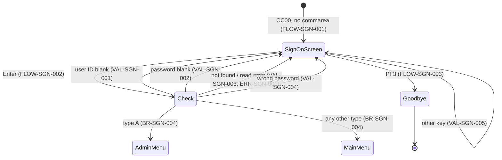
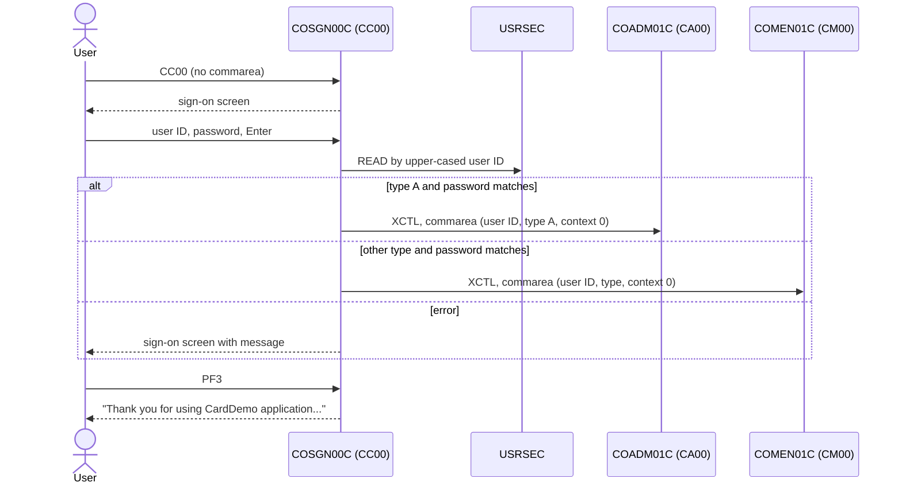

# COSGN00C: Online sign-on

## 1. Summary

COSGN00C is the entry point of the CardDemo online application (transaction `CC00`). It shows the sign-on screen, takes a user ID and a password, converts both to upper case, reads the user's record from the user security file `USRSEC` by user ID and compares the stored password with the typed one in **plain text**. On a match it puts the user ID and the user type into the commarea and transfers control to the **admin menu** `COADM01C` when the stored user type is `A`, or to the **main menu** `COMEN01C` for any other type. PF3 ends the session with a goodbye text. There is no attempt counter, no lockout, no audit record and no CICS-level sign-on: the user's identity exists only in the commarea from here on.

## 2. Rules at a glance

| ID | Rule |
| :-- | :-- |
| BR-SGN-001 | The typed user ID and password are converted to upper case before use. |
| BR-SGN-002 | The user ID is the key of the user security record; the record must exist. |
| BR-SGN-003 | The stored password must equal the upper-cased typed password, all 8 characters, in plain text. |
| BR-SGN-004 | User type `A` goes to the admin menu; every other type, including blank or unknown values, goes to the main menu. |
| BR-SGN-005 | A successful sign-on starts the session state: user ID, user type, "first entry", and the sign-on program as the caller. |
| VAL-SGN-001 | The user ID is required. |
| VAL-SGN-002 | The password is required. |
| VAL-SGN-003 | An unknown user ID is reported as `User not found. Try again ...`. |
| VAL-SGN-004 | A wrong password is reported as `Wrong Password. Try again ...`. |
| VAL-SGN-005 | Only Enter and PF3 are valid keys. |

## 3. Actors and triggers

- **Actor:** anyone at a CICS terminal. No prior identification is needed (the transaction has `RESSEC(NO)` and `CMDSEC(NO)`, `app/csd/CARDDEMO.CSD:385`).
- **Normal trigger:** the user types `CC00` on a blank terminal (`app/csd/CARDDEMO.CSD:378-387`, program `COSGN00C`, `app/csd/CARDDEMO.CSD:249-256`). The program starts with no commarea and shows the sign-on screen (FLOW-SGN-001).
- **Re-entry trigger:** every interaction ends with "return, next transaction `CC00`", so the next key pressed on the sign-on screen starts COSGN00C again, now with a 160-byte commarea (FLOW-SGN-005).
- **Return to sign-on from other programs:** the menus' PF3 (`COMEN01C`, `COADM01C`) transfer here without a commarea, so the user gets a fresh sign-on screen (`app/cbl/COMEN01C.cbl:196-203`, `app/cbl/COADM01C.cbl:163-170`). Many other online programs transfer here, with their commarea, when they are started without one (for example `app/cbl/COUSR00C.cbl:110-112`, `app/cbl/COBIL00C.cbl:107-109`); see FLOW-SGN-008. Not all of them: the account and card programs (`COACTVWC`, `COACTUPC`, `COCRDLIC`, `COCRDSLC`, `COCRDUPC`) and the Db2 module's `COTRTLIC` and `COTRTUPC` run without a sign-on and build their own commarea (DEF-SGN-012).
- **Precondition:** the CICS file `USRSEC` must be open. The batch cycle closes it (`app/jcl/CLOSEFIL.jcl:30`), so nobody can sign on during the batch window (ERR-SGN-001).

## 4. Interfaces

### 4.1 Screen COSGN0A (mapset COSGN00), 24 x 80

Source: `app/bms/COSGN00.bms:26-205`; symbolic map `app/cpy-bms/COSGN00.CPY:17-152`. The mapset has `CTRL=(ALARM,FREEKB)` and `EXTATT=YES` (`app/bms/COSGN00.bms:19-25`). The input fields have `FSET`, so they are always sent back to the program (the unnamed `AppID:` label also has `FSET`, `app/bms/COSGN00.bms:75`; the stray field of DEF-SGN-009 has none).

| Row,Col | Field | Len | Direction | Attributes | Content |
| :-- | :-- | --: | :-- | :-- | :-- |
| 1,1 | (label) | 6 | out | protected, blue | `Tran :` |
| 1,8 | `TRNNAME` | 4 | out | protected, blue | `CC00` |
| 1,21 | `TITLE01` | 40 | out | protected, yellow | `      AWS Mainframe Modernization       ` (`app/cpy/COTTL01Y.cpy:18-19`) |
| 1,64 | (label) | 6 | out | protected, blue | `Date :` |
| 1,71 | `CURDATE` | 8 | out | protected, blue | today `mm/dd/yy` (NUM-SGN-001) |
| 2,1 | (label) | 6 | out | protected, blue | `Prog :` |
| 2,8 | `PGMNAME` | 8 | out | protected, blue | `COSGN00C` |
| 2,21 | `TITLE02` | 40 | out | protected, yellow | `              CardDemo                  ` (`app/cpy/COTTL01Y.cpy:20-22`) |
| 2,64 | (label) | 6 | out | protected, blue | `Time :` |
| 2,71 | `CURTIME` | 9 | out | protected, blue | now `hh:mm:ss` plus one trailing space |
| 3,1 | (label) | 6 | out | protected, blue | `AppID:` |
| 3,8 | `APPLID` | 8 | out | protected, blue | CICS region APPLID (FLOW-SGN-007) |
| 3,64 | (label) | 6 | out | protected, blue | `SysID:` |
| 3,71 | `SYSID` | 8 | out | protected, blue | CICS system ID |
| 5,6 | (label) | 66 | out | protected, neutral | `This is a Credit Card Demo Application for Mainframe Modernization` |
| 7-15,21 | (labels) | 42 each | out | protected, blue | an ASCII-art one-dollar note (`app/bms/COSGN00.bms:100-144`) |
| 17,16 | (label) | 49 | out | protected, turquoise | `Type your User ID and Password, then press ENTER:` |
| 19,29 | (label) | 13 | out | protected, turquoise | `User ID     :` |
| 19,43 | `USERID` | 8 | in/out | **unprotected**, green, initial cursor (`IC`) | User ID |
| 19,52 | (label) | 8 | out | protected, blue | `(8 Char)` |
| 20,29 | (label) | 13 | out | protected, turquoise | `Password    :` |
| 20,43 | `PASSWD` | 8 | in/out | **unprotected, dark** (not displayed), green; initial value `________` | Password |
| 20,52 | (label) | 8 | out | protected, blue | `(8 Char)` |
| 20,61 | (unnamed) | 1 | in | unprotected, dark | never read by the program (DEF-SGN-009) |
| 23,1 | `ERRMSG` | 78 | out | protected, bright, red | Message (section 8.3) |
| 24,1 | (label) | 22 | out | protected, yellow | `ENTER=Sign-on  F3=Exit` |

The program's message work field is 80 characters (`:38`); only the first 78 reach the screen. No message is longer than 50.

### 4.2 Files

| CICS file | Entity | Operation | Key | Lines |
| :-- | :-- | :-- | :-- | :-- |
| `USRSEC` | ENT-USER-SECURITY | READ (no update) into `SEC-USER-DATA`, 80 bytes | `SEC-USR-ID` = upper-cased typed user ID (8) | 211-219 |

The CICS definition (`app/csd/CARDDEMO.CSD:88-99`) has `RECOVERY(NONE)`, `READ(YES) BROWSE(YES) ADD(YES) UPDATE(YES) DELETE(YES)`; the dataset is a KSDS with an 8-byte key at offset 0 and 80-byte records (`app/jcl/DUSRSECJ.jcl:64-73`).

### 4.3 Commarea

ENT-COMMAREA, 160 bytes (`app/cpy/COCOM01Y.cpy:19-44`), with no program extension. The program never copies the commarea it receives into its own (FLOW-SGN-006); it builds the outgoing commarea in working storage.

| Field | Written on successful sign-on | Value |
| :-- | :-- | :-- |
| `CDEMO-FROM-TRANID` | yes | `CC00` |
| `CDEMO-FROM-PROGRAM` | yes | `COSGN00C` |
| `CDEMO-USER-ID` | yes | upper-cased user ID as typed (8) |
| `CDEMO-USER-TYPE` | yes | `SEC-USR-TYPE` from the user's record (1) |
| `CDEMO-PGM-CONTEXT` | yes | 0 (first entry) |
| all other fields | no | not set by the program (DEF-SGN-007) |

### 4.4 Console output

None. The program writes nothing to the CICS log.

## 5. Data used

| Entity field | Read | Written | How |
| :-- | :-- | :-- | :-- |
| ENT-USER-SECURITY.SEC-USR-ID | key | no | upper-cased `USERID` from the screen |
| ENT-USER-SECURITY.SEC-USR-PWD | yes | no | compared with the upper-cased `PASSWD` (BR-SGN-003) |
| ENT-USER-SECURITY.SEC-USR-TYPE | yes | no | copied to `CDEMO-USER-TYPE`; decides the menu (BR-SGN-004) |
| ENT-USER-SECURITY.SEC-USR-FNAME, -LNAME, FILLER | read with the record | no | not used |
| ENT-COMMAREA | no (ignored) | yes | section 4.3 |

Program-local data with behaviour: error flag `WS-ERR-FLG` (`:40-42`), `WS-USER-ID` and `WS-USER-PWD` (8 each, `:45-46`) holding the upper-cased input, `WS-USRSEC-FILE` = `USRSEC  ` (`:39`), transaction `CC00` and program name (`:36-37`).

## 6. Processing flow

Each arrow is one CICS task.

**Entry (MAIN-PARA, lines 73-102)**

1. Clear the error flag, the message and the screen's message field (75-78).
2. No commarea: blank the screen, cursor on the user ID, send the sign-on screen (80-83).
3. Commarea present: act on the key (85-95): Enter (FLOW-SGN-002), PF3 (FLOW-SGN-003), anything else (VAL-SGN-005).
4. Return to CICS with next transaction `CC00` and the 160-byte commarea (98-102). Not reached after a transfer (BR-SGN-004) or after PF3.

**Enter (PROCESS-ENTER-KEY, lines 108-140, then READ-USER-SEC-FILE, lines 209-257)**

1. Receive the screen (110-115).
2. User ID blank: VAL-SGN-001. Else password blank: VAL-SGN-002 (117-130).
3. Upper-case the user ID into `WS-USER-ID` and `CDEMO-USER-ID`, and the password into `WS-USER-PWD` (132-136). This runs even after step 2 reported an error.
4. If no error: read `USRSEC` by `WS-USER-ID` (138-140, SE-SGN-001), then:
   - found and password equal: fill the commarea and transfer (BR-SGN-004, BR-SGN-005);
   - found and password different: VAL-SGN-004;
   - not found: VAL-SGN-003;
   - other response: ERR-SGN-001.

## 7. Business rules

#### BR-SGN-001 · Input is upper-cased
- **When:** Enter is processed.
- **Then:** the user ID (8 characters) and the password (8 characters) are converted with `FUNCTION UPPER-CASE`, which changes only the letters `a`-`z`. The upper-cased user ID is the file key and is stored in the commarea; the upper-cased password is compared with the stored one. The screen fields themselves are not changed, so a re-sent screen shows the user ID as typed.
- **Source:** `:132-136`
- **Fidelity:** must-preserve · **Confidence:** reviewed; the conversion itself runtime-verified (NUM-SGN-002)

#### BR-SGN-002 · The user must exist
- **When:** both fields are filled in.
- **Then:** the user security record with key = upper-cased user ID is read from `USRSEC`. The key is the full 8 characters, so `ADMIN001` and `admin001` find the same user, but `ADMIN01` does not find `ADMIN001`. Not found: VAL-SGN-003.
- **Source:** `:138-140, 211-219, 247-251`
- **Fidelity:** must-preserve · **Confidence:** reviewed

#### BR-SGN-003 · Plain-text password comparison
- **When:** the user's record was read.
- **Then:** `SEC-USR-PWD` (8 characters as stored) is compared with the upper-cased typed password (8 characters, padded with spaces by BMS when shorter, see DEF-SGN-008). Equal: sign-on succeeds. Different: VAL-SGN-004. Because the typed value is upper-cased first, a stored password that contains lower-case letters can never match (DEF-SGN-011). There is no hashing, salting or encryption (DEF-SGN-001).
- **Source:** `:223, 241-246`
- **Fidelity:** must-preserve (outcome), defect-decide (plain-text storage, Q-SGN-001) · **Confidence:** reviewed

#### BR-SGN-004 · Routing by user type
- **When:** the password matched.
- **Then:** if `SEC-USR-TYPE` is `A` (`CDEMO-USRTYP-ADMIN`, `app/cpy/COCOM01Y.cpy:27`), transfer control (XCTL) to the admin menu `COADM01C`; otherwise transfer to the main menu `COMEN01C`. "Otherwise" includes `U`, blank and any other character: there is no check that the type is valid (DEF-SGN-005). The commarea of BR-SGN-005 is passed. The program does not get control back.
- **Source:** `:230-240`
- **Fidelity:** must-preserve · **Confidence:** reviewed

#### BR-SGN-005 · Session state after sign-on
- **When:** the password matched, before the transfer.
- **Then:** `CDEMO-FROM-TRANID` = `CC00`, `CDEMO-FROM-PROGRAM` = `COSGN00C`, `CDEMO-USER-ID` = upper-cased user ID, `CDEMO-USER-TYPE` = stored user type, `CDEMO-PGM-CONTEXT` = 0. These five fields are the whole "session" of CardDemo; every later program trusts them without checking them again (DEF-SGN-006). Some later programs also overwrite them: the account and card functions set the type to `U` and the Db2 transaction-type functions set it to `A` before returning to a menu (DEF-SGN-012).
- **Source:** `:224-228`
- **Fidelity:** must-preserve · **Confidence:** reviewed

## 8. Validations and messages

#### VAL-SGN-001 · User ID required
- **When:** Enter is processed and `USERID` is spaces or low-values (nothing typed).
- **Then:** message `Please enter User ID ...`, cursor on the user ID, screen sent; the file is not read.
- **Source:** `:118-122`
- **Fidelity:** must-preserve · **Confidence:** reviewed

#### VAL-SGN-002 · Password required
- **When:** the user ID is filled in and `PASSWD` is spaces or low-values.
- **Then:** message `Please enter Password ...`, cursor on the password, screen sent; the file is not read. Only one of VAL-SGN-001 and VAL-SGN-002 is reported, user ID first.
- **Source:** `:123-127`
- **Fidelity:** must-preserve · **Confidence:** reviewed

#### VAL-SGN-003 · Unknown user
- **When:** the read of `USRSEC` returns response 13 (NOTFND).
- **Then:** message `User not found. Try again ...`, cursor on the user ID, screen sent.
- **Source:** `:247-251`
- **Fidelity:** must-preserve (message text is a security decision, Q-SGN-004) · **Confidence:** reviewed

#### VAL-SGN-004 · Wrong password
- **When:** the record was found and the password differs.
- **Then:** message `Wrong Password. Try again ...`, cursor on the password, screen sent. The error flag is not set (no visible effect). The typed password stays in the (dark) password field of the re-sent screen (DEF-SGN-004).
- **Source:** `:241-246`
- **Fidelity:** must-preserve · **Confidence:** reviewed

#### VAL-SGN-005 · Valid keys
- **When:** the commarea is present and the key is neither Enter nor PF3 (any PF key, PA key or Clear).
- **Then:** message `Invalid key pressed. Please see below...` (the 50-character common message, `app/cpy/CSMSG01Y.cpy:20-21`), sign-on screen sent. The screen is not received first, and no cursor position is set by the program (DEF-SGN-010).
- **Source:** `:91-94`
- **Fidelity:** must-preserve (text), incidental (cursor) · **Confidence:** reviewed

### 8.1 Decision table for Enter

| User ID | Password | `USRSEC` read | Stored password = typed (upper-cased) | Stored type | Result |
| :-- | :-- | :-- | :-- | :-- | :-- |
| blank | any | not done | - | - | VAL-SGN-001 |
| filled | blank | not done | - | - | VAL-SGN-002 |
| filled | filled | NOTFND (13) | - | - | VAL-SGN-003 |
| filled | filled | other error | - | - | ERR-SGN-001 |
| filled | filled | NORMAL | no | - | VAL-SGN-004 |
| filled | filled | NORMAL | yes | `A` | XCTL `COADM01C` |
| filled | filled | NORMAL | yes | not `A` | XCTL `COMEN01C` |

### 8.2 Flow and keys

#### FLOW-SGN-001 · First display
- **When:** the program starts with no commarea (`EIBCALEN` = 0).
- **Then:** the output map is set to low-values (so the map's initial values are shown, including `________` in the password field), the cursor is put on the user ID, and the screen is sent with erase.
- **Source:** `:80-83`

#### FLOW-SGN-002 · Enter
- **When:** commarea present, Enter pressed.
- **Then:** section 6 "Enter", decision table 8.1.
- **Source:** `:86-87`

#### FLOW-SGN-003 · PF3, exit
- **When:** commarea present, PF3 pressed.
- **Then:** the screen is erased and the plain text `Thank you for using CardDemo application...` followed by spaces (80 characters in all) is sent with the keyboard unlocked; the task ends with a RETURN that names no next transaction, so the terminal is free and the next input starts whatever transaction the user types. No commarea survives.
- **Source:** `:88-90, 162-172`; text `app/cpy/CSMSG01Y.cpy:18-19`
- **Fidelity:** must-preserve · **Confidence:** reviewed

#### FLOW-SGN-004 · Other keys
- **Then:** VAL-SGN-005.
- **Source:** `:91-94`

#### FLOW-SGN-005 · End of every interaction
- **Then:** return to CICS naming `CC00` as the next transaction and passing the 160-byte commarea. Not reached after a transfer or after PF3.
- **Source:** `:98-102`

#### FLOW-SGN-006 · The received commarea is ignored
- **When:** the program starts with a commarea.
- **Then:** the program uses the commarea only as "this is a re-entry" (`EIBCALEN` not 0). It never reads its contents: nothing is carried over from a previous interaction, and the commarea passed on is built from working storage.
- **Source:** `:80-96` (no move from `DFHCOMMAREA`; linkage at `:64-67`)
- **Fidelity:** incidental · **Confidence:** reviewed

#### FLOW-SGN-007 · Header on every screen
- **Then:** titles, `CC00`, `COSGN00C`, the date `mm/dd/yy` and time `hh:mm:ss` from the system clock, the CICS APPLID and SYSID (EXEC CICS ASSIGN) and the current message are filled in before each send. The screen is sent with erase and with the cursor at the field whose length was set to -1.
- **Source:** `:145-157, 177-204`

#### FLOW-SGN-008 · Arriving from another program with a commarea
- **When:** another program transfers to COSGN00C with a commarea, which happens when that program was itself started without one (for example the user typed `CU00` on a blank screen: `app/cbl/COUSR00C.cbl:110-112, 506-517`).
- **Then:** `EIBCALEN` is not 0, so the program acts on the key the user pressed for the other transaction: with Enter it tries to receive the sign-on map although the sign-on screen is not displayed. The RECEIVE response is not checked (ERR-SGN-002); the expected outcome is the sign-on screen with `Please enter User ID ...`; with any other key, `Invalid key pressed. Please see below...` on the sign-on screen.
- **Source:** `:80-96, 108-122`
- **Fidelity:** incidental · **Confidence:** platform-inferred

### 8.3 Message catalog

Messages appear in `ERRMSG` (row 23, 78 characters, red).

| Text (exact) | Cause | Cursor | Item |
| :-- | :-- | :-- | :-- |
| `Please enter User ID ...` | user ID blank | user ID | VAL-SGN-001 |
| `Please enter Password ...` | password blank | password | VAL-SGN-002 |
| `User not found. Try again ...` | USRSEC NOTFND | user ID | VAL-SGN-003 |
| `Wrong Password. Try again ...` | password differs | password | VAL-SGN-004 |
| `Unable to verify the User ...` | USRSEC other response | user ID | ERR-SGN-001 |
| `Invalid key pressed. Please see below...` | key other than Enter or PF3 | not set | VAL-SGN-005 |
| `Thank you for using CardDemo application...` (plain text, whole screen, not in `ERRMSG`) | PF3 | - | FLOW-SGN-003 |

## 9. Side effects

#### SE-SGN-001 · Read the user security record
- **What:** READ `USRSEC` by the 8-character upper-cased user ID into the 80-byte `SEC-USER-DATA`, without UPDATE (no lock). This is the program's only data access; nothing is written, so a failed sign-on leaves no trace in any file.
- **Source:** `:211-219`
- **Fidelity:** must-preserve · **Confidence:** reviewed

## 10. Error handling

#### ERR-SGN-001 · USRSEC response codes

| Response | Effect |
| :-- | :-- |
| 0 (NORMAL) | password check (BR-SGN-003) |
| 13 (NOTFND) | `User not found. Try again ...` (VAL-SGN-003) |
| any other (for example NOTOPEN or DISABLED while the batch cycle has closed the file, `app/jcl/CLOSEFIL.jcl:30`) | `Unable to verify the User ...`, cursor on the user ID |

The program tests the numeric values 0 and 13 directly instead of `DFHRESP` names. Nothing is written to the CICS log.
- **Source:** `:221-257`
- **Fidelity:** must-preserve · **Confidence:** reviewed; the response during the batch window is platform-inferred

#### ERR-SGN-002 · Screen receive not checked
- **What:** the response of RECEIVE MAP is stored but never tested; a MAPFAIL is ignored and the program goes on with whatever is in the input area.
- **Source:** `:110-115`
- **Fidelity:** incidental · **Confidence:** reviewed

#### ERR-SGN-003 · No abend handler
- **What:** no HANDLE ABEND or HANDLE CONDITION. If the XCTL to `COADM01C` or `COMEN01C` fails (program not installed, PGMIDERR), the task abends; the user sees a CICS abend message instead of a menu.
- **Source:** `:231-239` (XCTL without RESP); no `HANDLE` command in `app/cbl/COSGN00C.cbl`
- **Fidelity:** incidental · **Confidence:** platform-inferred

## 11. Interactions

- **Inbound:** transaction `CC00`; PF3 of `COMEN01C` and `COADM01C` (XCTL without commarea); the "no commarea" fallback of most online programs (XCTL with commarea, FLOW-SGN-008).
- **Outbound:** `COADM01C` (ADMN) or `COMEN01C` (MENU) by XCTL with the 160-byte commarea. Their specs describe what they do with it (FLOW-ADMN-002, FLOW-MENU-002).
- **Shared data:** `USRSEC` is maintained online by `COUSR01C` (add), `COUSR02C` (update) and `COUSR03C` (delete), and browsed by `COUSR00C`. Those programs store user IDs and passwords as typed, without upper-casing them, which COSGN00C requires (DEF-SGN-011, DEF-USRA-001, DEF-USRU-004).
- **Shared invariants (INV-006, INV-007, INV-002 in `components.md`):** the session identity is only `CDEMO-USER-ID` and `CDEMO-USER-TYPE` in the commarea, meant to be set only here (today other programs also set them, DEF-SGN-012); a user can sign on only if the stored ID and password are upper case (or contain no letters); `USRSEC` is unavailable during the batch window.

### Module extraction notes (selective conversion of sign-on)

| Boundary | Contract |
| :-- | :-- |
| Entry | Transaction `CC00` from a blank terminal; PF3 from the menus (no commarea). |
| Credential store | `USRSEC` (ENT-USER-SECURITY): key = 8-character user ID, 8-character plain-text password, 1-character type. Shared with the user administration programs; a new authentication service must either keep this store or migrate it together with `COUSR01C`-`COUSR03C`. `USRSEC` has one VSAM string (`STRINGS(1)`, `app/csd/CARDDEMO.CSD:91`), so concurrent sign-ons, list browses and update reads queue for it: a throughput limit, not a functional rule. |
| Output to the legacy programs | XCTL to `COADM01C` or `COMEN01C` with a 160-byte commarea holding at least `CDEMO-FROM-TRANID`, `CDEMO-FROM-PROGRAM`, `CDEMO-USER-ID`, `CDEMO-USER-TYPE`, `CDEMO-PGM-CONTEXT` = 0 (BR-SGN-005). Nothing else downstream identifies the user. |
| Batch window | Must be unavailable (or must not depend on `USRSEC` being open) while the batch cycle runs. |

## 12. Numeric, date and format details

#### NUM-SGN-001 · Header date and time
- From `FUNCTION CURRENT-DATE`: date `mm/dd/yy` (two-digit year) and time `hh:mm:ss`; the time goes into a 9-character field, so a trailing space follows.
- **Source:** `:179-196`; layouts `app/cpy/CSDAT01Y.cpy:30-41`
- **Confidence:** reviewed

#### NUM-SGN-002 · Upper-case conversion
- `FUNCTION UPPER-CASE` converts `a`-`z` to `A`-`Z` and leaves digits, spaces and other characters unchanged: `Pass wd1` becomes `PASS WD1` (GnuCOBOL 3.2 test, evidence file). On z/OS the result for national characters depends on the code page; CardDemo IDs and passwords use only letters and digits.
- **Source:** `:132-136`
- **Confidence:** runtime-verified (GnuCOBOL); z/OS code page platform-inferred

## 13. Known defects and oddities

None of these were changed in this branch (`COSGN00C.cbl` is not touched by any commit after the original import; `CHANGELOG.md` "Fixed" lists only batch and JCL fixes).

#### DEF-SGN-001 · [security] Passwords are stored and compared in plain text
- `SEC-USR-PWD` holds the password itself; the program compares it byte for byte. Anyone who can read the `USRSEC` dataset, its backups or the seed JCL (`app/jcl/DUSRSECJ.jcl:35-44`, where all ten demo users have the password `PASSWORD`) has every password.
- **Source:** `:223`; `app/cpy/CSUSR01Y.cpy:21`
- **Status:** open · **Fidelity:** defect-decide (Q-SGN-001) · **Confidence:** reviewed

#### DEF-SGN-002 · [security] No attempt limit, lockout, delay or audit
- Wrong passwords can be tried without limit; nothing is counted, logged or delayed, and a successful sign-on is not recorded either.
- **Source:** `:221-257`
- **Status:** open · **Fidelity:** defect-decide (Q-SGN-003) · **Confidence:** reviewed

#### DEF-SGN-003 · [security] Messages reveal whether a user ID exists
- `User not found. Try again ...` and `Wrong Password. Try again ...` differ, so the screen tells an attacker which user IDs are valid.
- **Source:** `:242, 249`
- **Status:** open · **Fidelity:** defect-decide (Q-SGN-004) · **Confidence:** reviewed

#### DEF-SGN-004 · [security] The typed password is sent back to the terminal
- After a wrong password (or any error after the screen was received), the output map still holds the received input, so the typed password is sent back in the 3270 data stream into the dark password field. It is not visible, but it is transmitted in clear.
- **Source:** `:110-115, 145-157`
- **Status:** open · **Confidence:** platform-inferred (BMS sends non-null output fields)

#### DEF-SGN-005 · Unknown user types get the main menu
- Any `SEC-USR-TYPE` other than `A` (blank, lower-case `a`, `X`) signs on as a regular user. The user administration programs accept any character as a type (DEF-USRA-002).
- **Source:** `:230-240`
- **Status:** open · **Fidelity:** defect-decide (Q-SGN-005) · **Confidence:** reviewed

#### DEF-SGN-006 · [security] Identity lives only in the commarea; no CICS security
- The program does not issue EXEC CICS SIGNON and the CardDemo transactions are defined with `RESSEC(NO) CMDSEC(NO)`, so the CICS task keeps running under the terminal's default user. Authorisation in the rest of the application rests on `CDEMO-USER-TYPE` in the commarea, and the admin programs do not check even that (DEF-ADMN-001, DEF-USRL-008). Because some programs build a commarea of their own when started without one, both menus can be reached without signing on at all (DEF-SGN-012).
- **Source:** `:224-240`; `app/csd/CARDDEMO.CSD:385`
- **Status:** open · **Fidelity:** defect-decide · **Confidence:** reviewed (CSD), platform-inferred (CICS user)

#### DEF-SGN-007 · Commarea fields not initialised
- Only the five fields of BR-SGN-005 are set. `CDEMO-TO-TRANID`, `CDEMO-TO-PROGRAM`, the customer, account and card fields and `CDEMO-LAST-MAP`/`-MAPSET` are passed with whatever working storage held (no VALUE clauses in `COCOM01Y`). Their content depends on the LE storage initialisation option of the region; binary zeros (low-values) are typical. The menus treat low-values in `CDEMO-TO-PROGRAM` as "blank".
- **Source:** `:48, 224-228`; `app/cpy/COCOM01Y.cpy:19-44`
- **Status:** open · **Confidence:** platform-inferred

#### DEF-SGN-008 · Password field starts with underscores
- The password field's initial value is `________` (eight underscores, `app/bms/COSGN00.bms:175-180`) and it has `FSET`. A user who types a password shorter than 8 characters without erasing the rest of the field sends, for example, `PASS____`, which does not match `PASS    `. The demo password `PASSWORD` fills the field and is not affected. A password field the user never touched comes back as `________`, not blank, so VAL-SGN-002 (`Please enter Password ...`) fires only when the user erased the field; otherwise the file is read and the result is `Wrong Password. Try again ...` or `User not found. Try again ...`, which lets anyone probe which user IDs exist without typing a password (DEF-SGN-003).
- **Source:** `app/bms/COSGN00.bms:175-180`; `:123, 223`
- **Status:** open · **Confidence:** platform-inferred (3270 overtype behaviour)

#### DEF-SGN-009 · Stray input field
- A 1-character dark, unprotected field without a name follows the password label at row 20, column 61. The cursor can tab into it; whatever is typed there is ignored.
- **Source:** `app/bms/COSGN00.bms:190-193`
- **Status:** open (cosmetic) · **Fidelity:** incidental · **Confidence:** reviewed

#### DEF-SGN-010 · Invalid-key screen built from unreceived data
- On an invalid key the screen is sent without being received or cleared, so its fields hold whatever the new task's working storage contains (normally low-values, which shows the initial screen) and no cursor position is set.
- **Source:** `:91-94`
- **Status:** open (cosmetic) · **Confidence:** platform-inferred

#### DEF-SGN-011 · Users with lower-case IDs or passwords cannot sign on
- The user ID and password are upper-cased before the read and the compare (BR-SGN-001), but the user add and update programs store both exactly as typed (DEF-USRA-001, DEF-USRU-004). A user added as `jsmith` cannot be found; a password stored as `Secret12` can never match. Unless the terminals translate input to upper case (CICS `UCTRAN`), an administrator can create users who can never sign on.
- **Source:** `:132-136, 215, 223`; `app/cbl/COUSR01C.cbl:154-158`
- **Status:** open · **Fidelity:** defect-decide (Q-SGN-002) · **Confidence:** reviewed; terminal translation platform-inferred (Q-SGN-006)

#### DEF-SGN-012 · [security] Both menus can be reached without signing on
- Sign-on is not the only place that creates the session commarea. The account and card programs (`COACTVWC`, `COACTUPC`, `COCRDLIC`, `COCRDSLC`, `COCRDUPC`) treat "no commarea" as a normal first run: they initialise the commarea (user ID and type blank; `COCRDLIC` sets type `U` at once), and their PF3 sets type `U` and transfers to `COMEN01C` with context 0. With the Db2 module installed, `COTRTLIC` (which sets type `A` at once) and `COTRTUPC` do the same, setting type `A` on PF3 and transferring to `COADM01C`. So `CCLI` + PF3 on a blank terminal opens the main menu, and `CTLI` + PF3 opens the admin menu (and user add, update and delete) without a password. The transactions have no resource or command security (`RESSEC(NO) CMDSEC(NO)`). The same programs also overwrite `CDEMO-USER-TYPE` on every PF3, so the type is not stable across a session (BR-SGN-005). The authorization screens `CPVS` and `CPVD` (COPAUS0C DEF-AUSM-012, COPAUS1C DEF-AUDT-009) open the same path to the main menu with a blank user type, and the menu's admin-only test applies only to type `U` (`app/cbl/COMEN01C.cbl:136-143`), so a blank type passes it; see INV-006. See DEF-MENU-003, DEF-ADMN-001.
- **Source:** `app/cbl/COCRDLIC.cbl:315-325, 384-404`; `app/cbl/COACTVWC.cbl:282-286, 338-352`; `app/app-transaction-type-db2/cbl/COTRTLIC.cbl:515-525, 591-623`; `app/app-transaction-type-db2/cbl/COTRTUPC.cbl:366-374, 438-449`; `app/csd/CARDDEMO.CSD:357-364`; `app/app-transaction-type-db2/csd/CRDDEMOD.csd:25-32`
- **Status:** open · **Fidelity:** defect-decide (Q-ADMN-001) · **Confidence:** reviewed (code paths); starting a transaction by typing its ID on a blank screen is standard CICS behaviour, platform-inferred

#### DEF-SGN-013 · Attempted user ID left in the commarea
- After a failed sign-on the commarea returned to CICS still carries the upper-cased user ID that was tried (`:134`). The next interaction does not use it, so there is no visible effect; a rewrite should not treat it as an identity.
- **Source:** `:132-136, 98-102`
- **Status:** open · **Fidelity:** incidental · **Confidence:** reviewed

## 14. Open questions

| ID | Question | For |
| :-- | :-- | :-- |
| Q-SGN-001 | The target will not store plain-text passwords. Confirm that existing passwords are migrated by hashing them once (they are readable today), and whether all users must set a new password at first sign-on. | security, business |
| Q-SGN-002 | Keep case-insensitive sign-on (upper-casing ID and password), or make passwords case-sensitive? If case-insensitive stays, the user add and update functions must store upper case. | business, security |
| Q-SGN-003 | Which attempt limit, lockout, session timeout and sign-on audit does the target need? Today there are none. | security |
| Q-SGN-004 | Keep the two distinct failure messages, or use one neutral message for unknown user and wrong password? | security |
| Q-SGN-005 | What should happen for a user whose type is neither `A` nor `U`: refuse sign-on, or treat as a regular user as today? | business |
| Q-SGN-006 | On the mainframe: do the CardDemo terminals translate input to upper case (`UCTRAN`), and how does the region initialise working storage (LE `STORAGE` option)? Both change DEF-SGN-007 and DEF-SGN-011. | mainframe team |

## 15. Equivalence contract

A reimplementation must reproduce, for each scenario: which menu is reached and the commarea fields of BR-SGN-005, the message text, and where the cursor is. It may differ in: the screen technology, the APPLID/SYSID header values and the clock values. The seed users are those of `app/jcl/DUSRSECJ.jcl:35-44` (public demo data).

| # | Start state | Input | Expected |
| --: | :-- | :-- | :-- |
| S1 | blank terminal | `CC00` | sign-on screen, cursor on user ID |
| S2 | sign-on screen | Enter, both blank | `Please enter User ID ...`, cursor on user ID |
| S3 | sign-on screen | Enter, `ADMIN001`, password field erased | `Please enter Password ...`, cursor on password (with the underscores left in place: `Wrong Password. Try again ...`, DEF-SGN-008) |
| S4 | sign-on screen | Enter, `ADMIN001` / `PASSWORD` | admin menu `COADM01C`; commarea user `ADMIN001`, type `A`, context 0, from `CC00`/`COSGN00C` |
| S5 | sign-on screen | Enter, `user0001` / `password` | main menu `COMEN01C`; commarea user `USER0001`, type `U` |
| S6 | sign-on screen | Enter, `NOUSER01` / `PASSWORD` | `User not found. Try again ...`, cursor on user ID |
| S7 | sign-on screen | Enter, `ADMIN001` / `WRONGPWD` | `Wrong Password. Try again ...`, cursor on password |
| S8 | sign-on screen | PF3 | `Thank you for using CardDemo application...`, session ended |
| S9 | sign-on screen | PF5 | `Invalid key pressed. Please see below...` |
| S10 | `USRSEC` closed (batch window) | Enter, `ADMIN001` / `PASSWORD` | `Unable to verify the User ...` |
| S11 | user `TEST0001` stored with password `Secret12` | Enter, `TEST0001` / `Secret12` | `Wrong Password. Try again ...` (DEF-SGN-011) |

These scenarios cannot run locally (no CICS); they become acceptance tests for the target. Review evidence: `evidence/a-signon-admin-review.md`.

## 16. Paragraph coverage

| Paragraph | Lines | Covered by |
| :-- | :-- | :-- |
| (data division) | 33-67 | §4.3, §5, DEF-SGN-007 |
| `MAIN-PARA` | 73-102 | FLOW-SGN-001..006, VAL-SGN-005, DEF-SGN-010 |
| `PROCESS-ENTER-KEY` | 108-140 | VAL-SGN-001, VAL-SGN-002, BR-SGN-001, ERR-SGN-002, FLOW-SGN-008, DEF-SGN-013 |
| `SEND-SIGNON-SCREEN` | 145-157 | FLOW-SGN-007, DEF-SGN-004 |
| `SEND-PLAIN-TEXT` | 162-172 | FLOW-SGN-003 |
| `POPULATE-HEADER-INFO` | 177-204 | FLOW-SGN-007, NUM-SGN-001 |
| `READ-USER-SEC-FILE` | 209-257 | SE-SGN-001, BR-SGN-002..005, VAL-SGN-003, VAL-SGN-004, ERR-SGN-001, ERR-SGN-003, DEF-SGN-001..003 |

6 of 6 paragraphs covered (plus the data division row).
