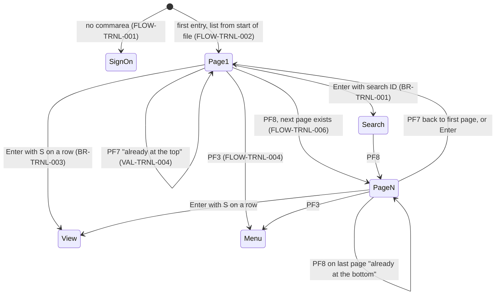
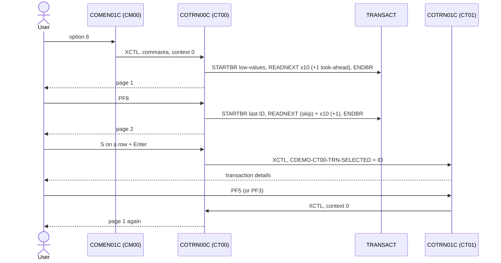

# COTRN00C: Online transaction list

## 1. Summary

A signed-on user picks **Transaction List** from the main menu and sees the transaction master file (`TRANSACT`) ten transactions at a time, in ascending transaction ID order, with ID, date, description and amount. The user can type a transaction ID to start the list at that ID, page forward (PF8) and backward (PF7), or put `S` next to a row to open that transaction in the transaction view (`COTRN01C`). The list is read-only and shows every transaction in the file, whoever it belongs to.

## 2. Rules at a glance

| ID | Rule |
| :-- | :-- |
| BR-TRNL-001 | The list shows transactions in ascending ID order, 10 per page, starting at the first ID equal to or above the search ID (or at the start of the file). |
| BR-TRNL-002 | Each row shows the ID, the original date as `mm/dd/yy`, the first 26 characters of the description and the amount edited `+99999999.99`. |
| BR-TRNL-003 | The first row (top to bottom) with a non-blank selection field decides; `S` or `s` opens that transaction in the view program. |
| BR-TRNL-004 | The page number counts pages from the start of the current list (search or top of file), not from the start of the file. |
| BR-TRNL-005 | PF8 is only possible when a look-ahead read found at least one more transaction after the page. |
| BR-TRNL-006 | Every transaction in the file is listed; there is no filter by user, account or card. |
| VAL-TRNL-001 | The search ID must be numeric (all 16 positions digits). |
| VAL-TRNL-002 | The only valid selection value is `S` (or `s`). |
| VAL-TRNL-003 | Only Enter, PF3, PF7 and PF8 are valid keys. |
| VAL-TRNL-004 | PF7 on the first page and PF8 on the last page give a message and change nothing. |
| VAL-TRNL-005 | Reaching the end or the start of the file while reading a page gives a message. |

## 3. Actors and triggers

- **Actor:** a signed-on CardDemo user, regular or admin. The program reads no user identity (BR-TRNL-006).
- **Normal trigger:** main menu `COMEN01C`, option 6 "Transaction List" (user type `U`, `app/cpy/COMEN02Y.cpy:55-59`). The menu transfers control (XCTL) with the 160-byte commarea and `CDEMO-PGM-CONTEXT` = 0 (`app/cbl/COMEN01C.cbl:177-187`).
- **Return from the view:** transaction view `COTRN01C` transfers back here on PF5 ("Browse Tran.") and on PF3 when it was opened from this list (context 0 in both cases, so the list starts again from the top; FLOW-TRNL-002, DEF-TRNL-003).
- **Re-entry trigger:** CICS starts transaction `CT00` again (`app/csd/CARDDEMO.CSD:419-428`) when the user presses a key on the list screen, because every interaction ends with "return, next transaction CT00" (FLOW-TRNL-008).
- **Direct start:** typing `CT00` on a blank terminal starts the program with no commarea; it sends the user to sign-on (FLOW-TRNL-001).

## 4. Interfaces

### 4.1 Screen COTRN0A (mapset COTRN00), 24 x 80

Source: `app/bms/COTRN00.bms:26-459`; symbolic map `app/cpy-bms/COTRN00.CPY:17-728`. All named fields have `FSET`, so the terminal always sends them back. The input and output views of the map share the same storage, so the program writes list rows into the input-named fields (`TRNID01I` ...) and they are sent from there.

| Row,Col | Field | Len | Direction | Attributes | Content |
| :-- | :-- | --: | :-- | :-- | :-- |
| 1,1 | (label) | 5 | out | protected, blue | `Tran:` |
| 1,7 | `TRNNAME` | 4 | out | protected, blue | `CT00` |
| 1,21 | `TITLE01` | 40 | out | protected, yellow | `      AWS Mainframe Modernization       ` (`app/cpy/COTTL01Y.cpy:18-19`) |
| 1,65 | (label) | 5 | out | protected, blue | `Date:` |
| 1,71 | `CURDATE` | 8 | out | protected, blue | today `mm/dd/yy` |
| 2,1 | (label) | 5 | out | protected, blue | `Prog:` |
| 2,7 | `PGMNAME` | 8 | out | protected, blue | `COTRN00C` |
| 2,21 | `TITLE02` | 40 | out | protected, yellow | `              CardDemo                  ` (`app/cpy/COTTL01Y.cpy:20-22`) |
| 2,65 | (label) | 5 | out | protected, blue | `Time:` |
| 2,71 | `CURTIME` | 8 | out | protected, blue | now `hh:mm:ss` |
| 4,30 | (label) | 17 | out | protected, bright | `List Transactions` |
| 4,65 | (label) | 5 | out | protected, bright, turquoise | `Page:` |
| 4,71 | `PAGENUM` | 8 | out | protected, blue | page number, 8 digits (NUM-TRNL-003) |
| 6,5 | (label) | 15 | out | protected, turquoise | `Search Tran ID:` |
| 6,21 | `TRNIDIN` | 16 | in/out | **unprotected**, green, underlined, cursor | search transaction ID |
| 8,2 / 8,8 / 8,27 / 8,38 / 8,67 | (labels) | 3 / 16 / 8 / 26 / 12 | out | protected | `Sel`, ` Transaction ID `, `  Date  `, `     Description          `, `   Amount   ` |
| 9 | (labels) | | out | protected | dashes under each column |
| 10-19,3 | `SEL0001` .. `SEL0010` | 1 | in/out | **unprotected**, green, underlined | selection, one per row |
| 10-19,8 | `TRNID01` .. `TRNID10` | 16 | out (sent back) | protected, blue | transaction ID |
| 10-19,27 | `TDATE01` .. `TDATE10` | 8 | out | protected, blue | original date `mm/dd/yy` |
| 10-19,38 | `TDESC01` .. `TDESC10` | 26 | out | protected, blue | description, first 26 characters |
| 10-19,67 | `TAMT001` .. `TAMT010` | 12 | out | protected, blue | amount `+99999999.99` |
| 21,12 | (label) | 50 | out | protected, bright | `Type 'S' to View Transaction details from the list` |
| 23,1 | `ERRMSG` | 78 | out | protected, bright, red | message (section 8.3) |
| 24,1 | (label) | 48 | out | protected, yellow | `ENTER=Continue  F3=Back  F7=Backward  F8=Forward` |

The message work field is 80 characters (`:38`); the longest message is 44 characters.

### 4.2 Files

| CICS file | Entity | Operation | Key | Lines |
| :-- | :-- | :-- | :-- | :-- |
| `TRANSACT` | ENT-TRANSACTION | STARTBR, READNEXT, READPREV, ENDBR | `TRAN-ID` (16), full key | 591-600, 624-634, 658-668, 692-696 |

The file is defined `RECOVERY(NONE)`, `READINTEG(UNCOMMITTED)` (`app/csd/CARDDEMO.CSD:76-87`); the browse sees uncommitted records of other tasks.

### 4.3 Commarea

`ENT-COMMAREA` (160 bytes, `COCOM01Y`) plus the 58-byte list extension `CDEMO-CT00-INFO` (`:62-70`), 218 bytes in total. Same layout as the bill payment extension (proposed correction to ENT-COMMAREA in `areas/c-transactions-entities.md`).

| Field | Pos | Len | Read | Written | Use |
| :-- | --: | --: | :-- | :-- | :-- |
| `CDEMO-PGM-CONTEXT` | 34 | 1 | yes | yes | 0 = first entry, 1 = re-entry |
| `CDEMO-FROM-TRANID`, `CDEMO-FROM-PROGRAM` | 1, 5 | 4, 8 | no | yes | set to `CT00`, `COTRN00C` when leaving |
| `CDEMO-TO-PROGRAM` | 17 | 8 | yes | yes | XCTL target |
| `CDEMO-CT00-TRNID-FIRST` | 161 | 16 | yes | yes | ID in row 1 of the current page; PF7 start key |
| `CDEMO-CT00-TRNID-LAST` | 177 | 16 | yes | yes | ID in row 10 of the current page; PF8 start key |
| `CDEMO-CT00-PAGE-NUM` | 193 | 8 | yes | yes | page number, `9(08)` |
| `CDEMO-CT00-NEXT-PAGE-FLG` | 201 | 1 | yes | yes | `Y` = a next page exists |
| `CDEMO-CT00-TRN-SEL-FLG` | 202 | 1 | no | yes | selection character of the chosen row |
| `CDEMO-CT00-TRN-SELECTED` | 203 | 16 | no | yes | transaction ID of the chosen row; read by `COTRN01C` |

All other commarea fields pass through unchanged. From the menu the received commarea is 160 bytes, so the extension starts as spaces (group move pads with spaces).

### 4.4 Console output

Unexpected browse response codes are written to the CICS log as `RESP:<code>REAS:<code>` (`:613, 647, 681`). Incidental.

## 5. Data used

| Entity field | Read | Written | How |
| :-- | :-- | :-- | :-- |
| ENT-TRANSACTION.TRAN-ID | yes | no | browse key; shown in the row; saved as first/last ID of the page |
| ENT-TRANSACTION.TRAN-ORIG-TS | yes | no | positions 1-10 give the row date (NUM-TRNL-002) |
| ENT-TRANSACTION.TRAN-DESC | yes | no | first 26 characters shown |
| ENT-TRANSACTION.TRAN-AMT | yes | no | edited for display (NUM-TRNL-001) |
| ENT-TRANSACTION (other fields) | read with the record | no | not used |

Program-local data with behaviour: error flag `WS-ERR-FLG` (`:40-42`), end-of-file flag `WS-TRANSACT-EOF` (`:43-45`), send-with-erase flag `WS-SEND-ERASE-FLG` (`:46-48`), row index `WS-IDX` (`:53`), amount edit field `WS-TRAN-AMT PIC +99999999.99` (`:56`), date field `WS-TRAN-DATE` (`:57`). `WS-REC-COUNT` and `WS-PAGE-NUM` are declared but not used.

## 6. Processing flow

Each arrow is one CICS task: receive the screen, act, send the screen, end with "next transaction CT00".

**Entry (MAIN-PARA, lines 95-141)**

1. Reset the error, end-of-file and next-page flags, set "send with erase", clear the message; cursor on the search field (97-105).
2. No commarea: transfer to sign-on (107-109).
3. Copy the received commarea into the 218-byte work commarea (111). Because the copy comes after step 1, the next-page flag from the commarea wins.
4. First entry (`CDEMO-PGM-CONTEXT` not 1): mark re-entry, clear the map, run the Enter logic (which lists the first page from the start of the file), and send the screen once more (112-116, DEF-TRNL-001).
5. Re-entry: receive the screen, then act on the key: Enter, PF3, PF7, PF8, other (118-134).
6. Return to CICS with next transaction `CT00` and the 218-byte commarea (138-141).

**Enter (PROCESS-ENTER-KEY, lines 146-229)**

1. Find the first of the 10 selection fields, top to bottom, that is not blank; remember its character and the ID shown in its row (148-182).
2. If both are non-blank: `S`/`s` transfers to the view (FLOW-TRNL-010); any other character sets `Invalid selection. Valid value is S` and continues (183-204, VAL-TRNL-002).
3. Search field blank: start key = low-values (start of file). Numeric: start key = the 16 characters typed. Otherwise: VAL-TRNL-001 (206-219).
4. Set the page number to 0 and read a page forward (224-225, SE-TRNL-001).
5. If no error, blank the search field (227-229).

**Page forward (PROCESS-PAGE-FORWARD, lines 279-328)**

1. Start a browse at the start key (equal or greater).
2. Unless the key pressed was Enter, PF7 or PF3, read and discard one record (285-287): on PF8 this skips the last row of the previous page, which the browse finds again.
3. Clear the 10 rows (289-293), then read up to 10 records into rows 1-10 (295-303).
4. If 10 rows were read without reaching the end: page number + 1, read one more record to decide whether a next page exists (305-313). Otherwise: no next page, and page number + 1 if at least one row was read (314-320).
5. End the browse, put the page number on the screen, blank the search field and send (322-326).

**Page backward (PROCESS-PAGE-BACKWARD, lines 333-376)**

1. Start a browse at the first ID of the current page (equal or greater).
2. Unless the key was Enter or PF8, read backwards once and discard (339-341): this re-reads the first row of the current page.
3. Clear the 10 rows, then read backwards up to 10 records into rows 10, 9, ... 1 (343-357).
4. If 10 rows were read: read backwards once more; if a record was found and the page number is above 1, page number - 1, otherwise page number = 1 (359-369).
5. End the browse, put the page number on the screen and send (371-374).

## 7. Business rules

#### BR-TRNL-001 · Order and start of the list
- **When:** a page is listed after Enter or on first entry.
- **Then:** the transactions are read from `TRANSACT` in ascending `TRAN-ID` order, starting at the first ID equal to or greater than the start key, up to 10 per page. The start key is the search ID when one was typed (VAL-TRNL-001) and low-values (start of the file) otherwise. Any Enter without a selection, and an Enter with an invalid selection, lists again from this start key with page number 1 (DEF-TRNL-005).
- **Source:** `:206-210, 224-225, 279-303, 591-600`
- **Fidelity:** must-preserve · **Confidence:** reviewed; "equal or greater" is the CICS default for STARTBR without `GTEQ`/`EQUAL` (the `GTEQ` line is commented out at `:597`), platform-inferred

#### BR-TRNL-002 · Row content
- **When:** a record is read into row *n* (1-10).
- **Then:** the row shows:

| Column | Value |
| :-- | :-- |
| Transaction ID | `TRAN-ID`, 16 characters |
| Date | `mm/dd/yy` built from characters 6-7, 9-10 and 3-4 of `TRAN-ORIG-TS` (NUM-TRNL-002) |
| Description | the first 26 characters of `TRAN-DESC` (100) |
| Amount | `TRAN-AMT` edited `+99999999.99`, 12 characters (NUM-TRNL-001) |

Row 1's ID becomes `CDEMO-CT00-TRNID-FIRST` and row 10's ID becomes `CDEMO-CT00-TRNID-LAST`. A page with fewer than 10 rows leaves the last ID from the earlier page in place. Rows without a record are blank.
- **Source:** `:381-445, 450-505`
- **Fidelity:** must-preserve · **Confidence:** reviewed; the edit pattern is runtime-verified (NUM-TRNL-001)

#### BR-TRNL-003 · Selecting a transaction
- **When:** Enter is pressed and at least one selection field is not blank.
- **Then:** only the first non-blank selection field from row 1 down counts; the others are ignored. If that row also shows a transaction ID: `S` or `s` saves the selection character and the row's ID in the commarea (`CDEMO-CT00-TRN-SEL-FLG`, `CDEMO-CT00-TRN-SELECTED`) and transfers to the view (FLOW-TRNL-010); any other character is VAL-TRNL-002. If the row is empty (no ID), the selection is ignored without a message and the list is shown again from the start key.
- **Source:** `:148-204`
- **Fidelity:** must-preserve · **Confidence:** reviewed

#### BR-TRNL-004 · Page number
- **When:** a page is listed.
- **Then:** Enter sets the page number to 0 and the forward read adds 1, so the first page of any list (start of file or search result) is page 1. PF8 adds 1 when it shows a page; PF7 subtracts 1, but sets it to 1 when no record exists before the new page. The number is relative to where the list started: after a search, page 1 is the page that starts at the search ID, and PF7 from it says `You are already at the top of the page...` even if lower IDs exist (DEF-TRNL-008).
- **Source:** `:224, 245-252, 305-320, 359-369`
- **Fidelity:** must-preserve (shown to the user) · **Confidence:** reviewed

#### BR-TRNL-005 · Next page indicator
- **When:** a forward page is filled with 10 rows.
- **Then:** one more record is read (look-ahead). Found: next page = yes. End of file: next page = no and the message `You have reached the bottom of the page...` is shown with the full page. A forward page with fewer than 10 rows always sets next page = no. PF7 always sets next page = yes before paging backward.
- **Source:** `:242, 305-320`
- **Fidelity:** must-preserve · **Confidence:** reviewed

#### BR-TRNL-006 · No ownership filter
- **When:** any list.
- **Then:** every transaction in the file is listed, for all cards and accounts, whatever the signed-on user. No column shows the card or account (DEF-TRNL-007).
- **Source:** `:279-328` (no key other than `TRAN-ID`; `CDEMO-USER-ID`, `CDEMO-ACCT-ID` and `CDEMO-CARD-NUM` are never read)
- **Fidelity:** defect-decide · **Confidence:** reviewed

## 8. Validations and messages

#### VAL-TRNL-001 · Search ID must be numeric
- **When:** Enter is processed and the search field is not blank.
- **Then:** if all 16 characters are digits, they are the start key. Otherwise: message `Tran ID must be Numeric ...`, cursor on the search field, screen sent with the rows as they were received; no new page is read (the browse is started with an unset key and not used, DEF-TRNL-009). A shorter number, such as `683580`, is not numeric because BMS pads the field with spaces (DEF-TRNL-006).
- **Source:** `:206-219, 283`
- **Fidelity:** must-preserve · **Confidence:** reviewed; padding platform-inferred

#### VAL-TRNL-002 · Selection value
- **When:** the first non-blank selection field holds anything other than `S` or `s`, and its row shows an ID.
- **Then:** message `Invalid selection. Valid value is S`, cursor on the search field, and the Enter logic goes on: the list is read again from the start key and sent with this message, unless VAL-TRNL-001 replaces it.
- **Source:** `:196-203`
- **Fidelity:** must-preserve · **Confidence:** reviewed

#### VAL-TRNL-003 · Valid keys
- **When:** a key other than Enter, PF3, PF7 or PF8 is pressed (PA keys, Clear, other PF keys).
- **Then:** message `Invalid key pressed. Please see below...` (the 50-character common message, `app/cpy/CSMSG01Y.cpy:20-21`), cursor on the search field, screen re-sent with the received data. For PA keys and Clear the terminal sends no data; the RECEIVE response is not checked (ERR-TRNL-002).
- **Source:** `:129-133`
- **Fidelity:** must-preserve · **Confidence:** reviewed

#### VAL-TRNL-004 · Already at the top or bottom
- **When:** PF7 with page number 1 or less, or PF8 with next page = no.
- **Then:** message `You are already at the top of the page...` (PF7) or `You are already at the bottom of the page...` (PF8); the screen is sent **without erase**, so only the fields in the map are rewritten; the rows stay as received; nothing is read.
- **Source:** `:245-252, 267-274, 533-549`
- **Fidelity:** must-preserve (text) · **Confidence:** reviewed

#### VAL-TRNL-005 · End and start of file while paging

| Situation | Message | What the user sees | Source |
| :-- | :-- | :-- | :-- |
| Forward read reaches the end of the file (within the page or in the look-ahead) | `You have reached the bottom of the page...` | the rows read so far, rest blank; next page = no | 639-645, 305-320 |
| Backward read reaches the start of the file (within the page or in the look-behind) | `You have reached the top of the page...` | rows filled from row 10 upwards, rows above blank; page number set to 1 by the look-behind | 673-679, 359-369 |
| Browse start finds no record at or above the key (search ID above the highest ID) | `You are at the top of the page...` | no rows read; see ERR-TRNL-003 | 605-611 |

Each of these sends the screen at the moment it happens; the page logic then goes on and sends it again at the end of the page (DEF-TRNL-001), with the same message.
- **Source:** `:605-611, 639-645, 673-679`
- **Fidelity:** must-preserve (text) · **Confidence:** reviewed

### 8.1 Flow and keys

#### FLOW-TRNL-001 · No commarea
- **When:** `EIBCALEN` = 0.
- **Then:** transfer to `COSGN00C` through FLOW-TRNL-009.
- **Source:** `:107-109`

#### FLOW-TRNL-002 · First entry
- **When:** commarea present and `CDEMO-PGM-CONTEXT` is not 1 (from the menu, or back from the view).
- **Then:** set the context to 1, clear the map, run the Enter logic on the empty map (no selection, blank search, so the first page from the start of the file), then send the screen again. The selected-ID fields of the commarea are set to spaces (no row selected).
- **Source:** `:112-116`

#### FLOW-TRNL-003 · Enter
- **Then:** section 6, Enter.
- **Source:** `:120-121, 146-229`

#### FLOW-TRNL-004 · PF3, back to the menu
- **Then:** transfer to `COMEN01C`, always (not to `CDEMO-FROM-PROGRAM`).
- **Source:** `:122-124`

#### FLOW-TRNL-005 · PF7, page backward
- **Then:** start key = `CDEMO-CT00-TRNID-FIRST` (low-values if blank); next page = yes; if the page number is above 1, page backward (section 6), otherwise VAL-TRNL-004.
- **Source:** `:125-126, 234-252`

#### FLOW-TRNL-006 · PF8, page forward
- **Then:** start key = `CDEMO-CT00-TRNID-LAST` (high-values if blank); if next page = yes, page forward (section 6, skipping the first record read), otherwise VAL-TRNL-004.
- **Source:** `:127-128, 257-274`

#### FLOW-TRNL-007 · Other keys
- **Then:** VAL-TRNL-003.
- **Source:** `:129-133`

#### FLOW-TRNL-008 · End of every interaction
- **Then:** return to CICS naming `CT00` as the next transaction, passing the 218-byte commarea.
- **Source:** `:138-141`

#### FLOW-TRNL-009 · Leaving the program
- **Then:** if the target program is blank or low-values, use `COSGN00C`; set `CDEMO-FROM-TRANID` = `CT00`, `CDEMO-FROM-PROGRAM` = `COTRN00C`, `CDEMO-PGM-CONTEXT` = 0; XCTL with the 218-byte commarea.
- **Source:** `:510-521`

#### FLOW-TRNL-010 · Open the selected transaction
- **When:** BR-TRNL-003 with `S`/`s`.
- **Then:** set `CDEMO-TO-PROGRAM` = `COTRN01C`, `CDEMO-FROM-TRANID` = `CT00`, `CDEMO-FROM-PROGRAM` = `COTRN00C`, `CDEMO-PGM-CONTEXT` = 0, and XCTL to `COTRN01C` with the 218-byte commarea, which carries the selected ID in `CDEMO-CT00-TRN-SELECTED` (positions 203-218). The view program reads it from the same position under its own name.
- **Source:** `:186-195`

### 8.2 Header and send

#### FLOW-TRNL-011 · Header and screen send
- **Then:** before each send: titles, `CT00`, `COTRN00C`, date `mm/dd/yy` and time `hh:mm:ss` from `FUNCTION CURRENT-DATE`, and the current message. The screen is sent with erase and the cursor at the field whose length was set to -1 (always the search field), except for the two VAL-TRNL-004 messages, which are sent without erase.
- **Source:** `:527-549, 567-586`

### 8.3 Message catalog

All messages appear in `ERRMSG` (row 23), in red; the program never changes the colour.

| Text (exact) | Cause | Item |
| :-- | :-- | :-- |
| `Tran ID must be Numeric ...` | search ID not 16 digits | VAL-TRNL-001 |
| `Invalid selection. Valid value is S` | selection not `S`/`s` | VAL-TRNL-002 |
| `Invalid key pressed. Please see below...` | wrong key | VAL-TRNL-003 |
| `You are already at the top of the page...` | PF7 on page 1 | VAL-TRNL-004 |
| `You are already at the bottom of the page...` | PF8 with no next page | VAL-TRNL-004 |
| `You have reached the bottom of the page...` | end of file while reading forward | VAL-TRNL-005 |
| `You have reached the top of the page...` | start of file while reading backward | VAL-TRNL-005 |
| `You are at the top of the page...` | browse start NOTFND | VAL-TRNL-005, ERR-TRNL-001 |
| `Unable to lookup transaction...` | browse start, read next or read previous, other response | ERR-TRNL-001 |

## 9. Side effects

The program only reads. In execution order per page:

#### SE-TRNL-001 · Forward browse
- **What:** STARTBR `TRANSACT` at the start key (equal or greater), optionally one READNEXT that is discarded, up to 10 READNEXT into the rows, one look-ahead READNEXT, ENDBR. Records are read into `TRAN-RECORD` (350 bytes) with the full 16-byte key. No lock is taken.
- **Source:** `:279-328, 591-653, 692-696`

#### SE-TRNL-002 · Backward browse
- **What:** STARTBR `TRANSACT` at the first ID of the current page, one READPREV that is discarded (on PF7), up to 10 READPREV into rows 10 to 1, one look-behind READPREV, ENDBR.
- **Source:** `:333-376, 591-619, 658-696`

## 10. Error handling

#### ERR-TRNL-001 · Browse response codes

| Operation | NORMAL | NOTFND | ENDFILE | Other |
| :-- | :-- | :-- | :-- | :-- |
| STARTBR | continue | end-of-file flag on, `You are at the top of the page...`, send | - | error flag on, `Unable to lookup transaction...`, send |
| READNEXT | row filled | (Other) | end-of-file flag on, `You have reached the bottom of the page...`, send | error flag on, `Unable to lookup transaction...`, send |
| READPREV | row filled | (Other) | end-of-file flag on, `You have reached the top of the page...`, send | error flag on, `Unable to lookup transaction...`, send |
| ENDBR | no response checked (ERR-TRNL-003) | | | |

"Other" also writes `RESP:..REAS:..` to the CICS log. With the error flag on, the page logic stops reading and, after STARTBR, does not end the browse or send the page again.
- **Source:** `:602-619, 636-653, 670-687`
- **Confidence:** reviewed

#### ERR-TRNL-002 · Screen receive not checked
- **What:** the RECEIVE MAP response is stored but never tested; MAPFAIL (PA keys, Clear) is ignored.
- **Source:** `:554-562`
- **Confidence:** reviewed

#### ERR-TRNL-003 · Browse end after a failed browse start
- **What:** when STARTBR returns NOTFND, the program does not set the error flag, so the page logic continues and issues ENDBR without a browse in progress. ENDBR has no RESP option; CICS raises INVREQ and, with no handler, abends the task (AEIP). The screen with `You are at the top of the page...` was already sent. This happens for a search ID above the highest ID in the file, and for PF8 when the last ID of the page was deleted in the meantime and no higher ID exists.
- **Source:** `:605-611, 322, 692-696`
- **Confidence:** platform-inferred (Q-TRNL-003)

#### ERR-TRNL-004 · No abend handler
- **What:** no HANDLE ABEND or HANDLE CONDITION; any CICS condition not covered by RESP abends the task.
- **Source:** whole program (no `HANDLE` command in `app/cbl/COTRN00C.cbl`)
- **Confidence:** reviewed

## 11. Interactions

- **Inbound:** `COMEN01C` (menu option 6); `COTRN01C` on PF5 and on PF3 when the view was opened from the list (its PF3 goes to `CDEMO-FROM-PROGRAM`).
- **Outbound:** `COTRN01C` (selection), `COMEN01C` (PF3), `COSGN00C` (no commarea), all by XCTL.
- **Shared data:** `TRANSACT` is written by POSTTRAN (`CBTRN02C`), bill payment (`COBIL00C`), transaction add (`COTRN02C`) and the batch cycle; the list shows whatever is in the file at the moment of each page read.
- **Shared commarea contract:** positions 161-218 are interpreted by this program, the view and the add program with the same layout (proposed correction to ENT-COMMAREA). The selected ID travels in positions 203-218.

### Module extraction notes (selective conversion of the transaction list)

| Boundary | Contract |
| :-- | :-- |
| Entry | From the menu with the 160-byte commarea and context 0; from the view with context 0. |
| Data | Read-only, ordered by `TRAN-ID`; page size 10; start at a given ID (equal or greater). |
| Paging state | First and last ID of the page, page number and next-page flag live in the commarea; a stateless API can take "after ID" / "before ID" cursors instead. |
| Exit to view | Must pass the selected ID so that `COTRN01C` (or its replacement) shows it at once (positions 203-218 of the commarea). |
| Batch window | `TRANSACT` is closed in CICS during the batch cycle; the list is unavailable then. |

## 12. Numeric, date and format details

#### NUM-TRNL-001 · Amount display
- `TRAN-AMT` (decimal(11,2), `S9(09)V99`) is edited with `+99999999.99`: sign always shown, **8** integer digits with leading zeros, a full stop, 2 decimals, 12 characters. The amount has 9 integer digits, so the highest digit is dropped for amounts of 100,000,000.00 or more (DEF-TRNL-002). Examples (GnuCOBOL 3.2 with `-std=ibm`): 504.77 shows as `+00000504.77`; -5.50 as `-00000005.50`; 0 as `+00000000.00`; 123,456,789.12 as `+23456789.12`.
- **Source:** `:56, 383, 396`
- **Confidence:** runtime-verified (edit semantics)

#### NUM-TRNL-002 · Row date
- `TRAN-ORIG-TS` is moved into the 26-character timestamp work area `WS-TIMESTAMP` (`app/cpy/CSDAT01Y.cpy:42-55`); the row date is `MM/DD/YY` from timestamp positions 6-7 (month), 9-10 (day) and 3-4 (year). Example: `2022-06-10 19:27:53.000000` shows as `06/10/22`. Only the first 10 characters matter, so all three timestamp layouts in ENT-TRANSACTION give the same date. The pieces are moved as 2-digit numeric fields; non-digit content (a blank timestamp) gives an undefined display.
- **Source:** `:384-388`

#### NUM-TRNL-003 · Page number
- `CDEMO-CT00-PAGE-NUM` (`9(08)`) is moved to the 8-character page field: page 1 shows as `00000001`. Before the first list from the menu the field is blank.
- **Source:** `:65, 324, 373`

#### NUM-TRNL-004 · Browse keys
- The start key is the full 16-character `TRAN-ID`: the search value as typed, low-values (start of file) or high-values (PF8 when no last ID is known). The comparison is a byte comparison on the key.
- **Source:** `:206-210, 236-240, 259-263, 595-596`

## 13. Known defects and oddities

`COTRN00C.cbl` is unchanged by commit b5e0139; none of these is fixed in this branch.

#### DEF-TRNL-001 · Several screens sent in one interaction
- On first entry the page is sent by the page logic and again by MAIN-PARA. Every end-of-file and browse message sends the screen at once and the page logic sends it again at the end. The user sees only the last screen.
- **Source:** `:115-116, 326, 374, 611, 645, 679`
- **Status:** open · **Fidelity:** incidental

#### DEF-TRNL-002 · Large amounts lose their highest digit
- The display edit has 8 integer digits for a 9-digit amount; 123,456,789.12 is shown as `+23456789.12` (NUM-TRNL-001).
- **Source:** `:56, 383`
- **Status:** open · **Fidelity:** defect-decide (Q-TRNL-004) · **Confidence:** runtime-verified

#### DEF-TRNL-003 · First transaction skipped after PF5 from the view
- The "skip one record" step runs for every key except Enter, PF7 and PF3. When the view program transfers back on PF5, the attention key of the task is still PF5, so the first page read from the start of the file drops its first record: the list starts at the second-lowest ID. From the menu (Enter) and on PF3 from the view the first record is shown.
- **Source:** `:285-287, 112-116`
- **Status:** open · **Fidelity:** defect-decide · **Confidence:** reviewed; EIBAID surviving the XCTL is platform-inferred (Q-TRNL-003)

#### DEF-TRNL-004 · Wrong message when the search ID is above the highest ID
- STARTBR NOTFND means "no record at or above the key" but shows `You are at the top of the page...`; the task then probably abends (ERR-TRNL-003).
- **Source:** `:605-611`
- **Status:** open · **Confidence:** platform-inferred

#### DEF-TRNL-005 · Enter always restarts the list
- Enter (with no selection, an empty-row selection, or an invalid selection) lists again from the search key or the start of the file with page 1. A user on page 5 who presses Enter is back on page 1.
- **Source:** `:206-225`
- **Status:** open · **Fidelity:** defect-decide

#### DEF-TRNL-006 · Search needs all 16 digits
- The search ID is tested with a numeric class test on all 16 characters; the user must type the full ID with leading zeros (`0000000000683580`). Because the search field is blanked after each list (spaces, not nulls), shorter input always has trailing spaces and fails with `Tran ID must be Numeric ...`.
- **Source:** `:209, 228, 325`
- **Status:** open · **Fidelity:** defect-decide · **Confidence:** reviewed; BMS padding platform-inferred

#### DEF-TRNL-007 · [security] Every user sees every transaction
- No filter by the signed-on user, customer, account or card (BR-TRNL-006). Descriptions and amounts of all customers are visible; selecting a row opens the full record, including the card number, in the view program.
- **Source:** `:279-328`
- **Status:** open · **Fidelity:** defect-decide (Q-TRNL-001)

#### DEF-TRNL-008 · Page numbers are relative to the search
- After a search the first page is page 1, and PF7 from it reports `You are already at the top of the page...` although lower IDs exist. A backward page that runs into the start of the file before 10 rows (possible after a search that started mid-file, or after inserts) shows blank top rows and keeps its page number.
- **Source:** `:224, 245-252, 343-369`
- **Status:** open · **Fidelity:** defect-decide

#### DEF-TRNL-009 · Non-numeric search leaves a browse open
- After `Tran ID must be Numeric ...` the page logic still issues STARTBR with the key left in `TRAN-ID` (not set in this task) and then stops because the error flag is on; the browse is never ended (CICS ends it at task end). If that STARTBR returns NOTFND, its message `You are at the top of the page...` replaces the numeric-check message on a second screen.
- **Source:** `:211-217, 225, 281-283`
- **Status:** open · **Fidelity:** incidental · **Confidence:** platform-inferred (content of the unset key)

#### DEF-TRNL-010 · PF3 passes the 218-byte commarea to the menu
- The menu keeps only the first 160 bytes; the list state is lost when the user comes back from the menu.
- **Source:** `:123-124, 518-521`
- **Status:** open · **Fidelity:** incidental

## 14. Open questions

| ID | Question | For |
| :-- | :-- | :-- |
| Q-TRNL-001 | Should the list show only the transactions of the signed-on user's accounts or cards (DEF-TRNL-007), and should admins see all? | business, security |
| Q-TRNL-002 | Keep "Enter restarts at page 1" and the 16-digit search (DEF-TRNL-005, DEF-TRNL-006), or allow a partial ID search and keep the current page? | business |
| Q-TRNL-003 | On the mainframe: does ENDBR after STARTBR NOTFND abend with AEIP (ERR-TRNL-003), and is EIBAID still PF5 after the XCTL from the view (DEF-TRNL-003)? | mainframe team |
| Q-TRNL-004 | Widen the amount column to show 9 integer digits (DEF-TRNL-002)? | business |

## 15. Equivalence contract

A reimplementation must reproduce, for each scenario: which IDs are on the page and in which rows, the row texts, the page number, the next-page decision, the message text and the cursor position; and the selected ID passed to the view. It may differ in: CICS log lines, the duplicate sends (DEF-TRNL-001), screen technology and the clock values.

Start state for S2-S13: `TRANSACT` holds IDs `I1 < I2 < ... < I25` (25 records).

| # | Start state | Input | Expected |
| --: | :-- | :-- | :-- |
| S1 | no commarea | start CT00 | transfer to sign-on |
| S2 | from menu (Enter) | - | page `00000001`, rows I1-I10, next page yes, search field blank, no message |
| S3 | page 1 | PF8 | page `00000002`, rows I11-I20 |
| S4 | page 2 | PF8 | page `00000003`, rows I21-I25, rows 6-10 blank, `You have reached the bottom of the page...`, next page no |
| S5 | page 3 | PF8 | `You are already at the bottom of the page...`, rows unchanged |
| S6 | page 3 | PF7 | page `00000002`, rows I11-I20 |
| S7 | page 2 | PF7 | page `00000001`, rows I1-I10, `You have reached the top of the page...` |
| S8 | page 1 | PF7 | `You are already at the top of the page...` |
| S9 | any | Enter, search = I13 (16 digits) | page `00000001`, rows I13-I22 |
| S10 | any | Enter, search `123` | `Tran ID must be Numeric ...`, rows unchanged |
| S11 | page 1 | `S` on row 3 + Enter | transfer to `COTRN01C` with `CDEMO-CT00-TRN-SELECTED` = I3 |
| S12 | page 1 | `X` on row 3 + Enter | page `00000001` from the start key, `Invalid selection. Valid value is S` |
| S13 | page 1 | PF5 | `Invalid key pressed. Please see below...` |
| S14 | back from the view by PF5 | - | page `00000001`, rows I2-I11 (DEF-TRNL-003) |
| S15 | any | PF3 | transfer to `COMEN01C` |
| S16 | a record with amount 504.77, original timestamp `2022-06-10 19:27:53.000000`, description `Purchase at Abshire-Lowe` | listed | row shows `06/10/22`, `Purchase at Abshire-Lowe  `, `+00000504.77` |

These scenarios cannot run locally (no CICS); they become acceptance tests for the target. Evidence: `evidence/c-transactions-review.md`.

## 16. Paragraph coverage

| Paragraph | Lines | Covered by |
| :-- | :-- | :-- |
| (data division) | 29-89 | §4.3, §5, NUM-TRNL-001, NUM-TRNL-003 |
| `MAIN-PARA` | 95-141 | FLOW-TRNL-001..008, VAL-TRNL-003, DEF-TRNL-001, §6 Entry |
| `PROCESS-ENTER-KEY` | 146-229 | BR-TRNL-001, BR-TRNL-003, BR-TRNL-004, VAL-TRNL-001, VAL-TRNL-002, FLOW-TRNL-010, DEF-TRNL-005, DEF-TRNL-006, DEF-TRNL-009 |
| `PROCESS-PF7-KEY` | 234-252 | FLOW-TRNL-005, VAL-TRNL-004, BR-TRNL-005 |
| `PROCESS-PF8-KEY` | 257-274 | FLOW-TRNL-006, VAL-TRNL-004 |
| `PROCESS-PAGE-FORWARD` | 279-328 | SE-TRNL-001, BR-TRNL-001, BR-TRNL-004, BR-TRNL-005, DEF-TRNL-003, §6 Page forward |
| `PROCESS-PAGE-BACKWARD` | 333-376 | SE-TRNL-002, BR-TRNL-004, VAL-TRNL-005, DEF-TRNL-008, §6 Page backward |
| `POPULATE-TRAN-DATA` | 381-445 | BR-TRNL-002, NUM-TRNL-001, NUM-TRNL-002, DEF-TRNL-002 |
| `INITIALIZE-TRAN-DATA` | 450-505 | BR-TRNL-002 |
| `RETURN-TO-PREV-SCREEN` | 510-521 | FLOW-TRNL-009, DEF-TRNL-010 |
| `SEND-TRNLST-SCREEN` | 527-549 | FLOW-TRNL-011, VAL-TRNL-004 |
| `RECEIVE-TRNLST-SCREEN` | 554-562 | ERR-TRNL-002 |
| `POPULATE-HEADER-INFO` | 567-586 | FLOW-TRNL-011 |
| `STARTBR-TRANSACT-FILE` | 591-619 | SE-TRNL-001, SE-TRNL-002, ERR-TRNL-001, VAL-TRNL-005, DEF-TRNL-004 |
| `READNEXT-TRANSACT-FILE` | 624-653 | SE-TRNL-001, ERR-TRNL-001, VAL-TRNL-005 |
| `READPREV-TRANSACT-FILE` | 658-687 | SE-TRNL-002, ERR-TRNL-001, VAL-TRNL-005 |
| `ENDBR-TRANSACT-FILE` | 692-696 | SE-TRNL-001, SE-TRNL-002, ERR-TRNL-003 |

16 of 16 paragraphs covered (plus the data division row).
