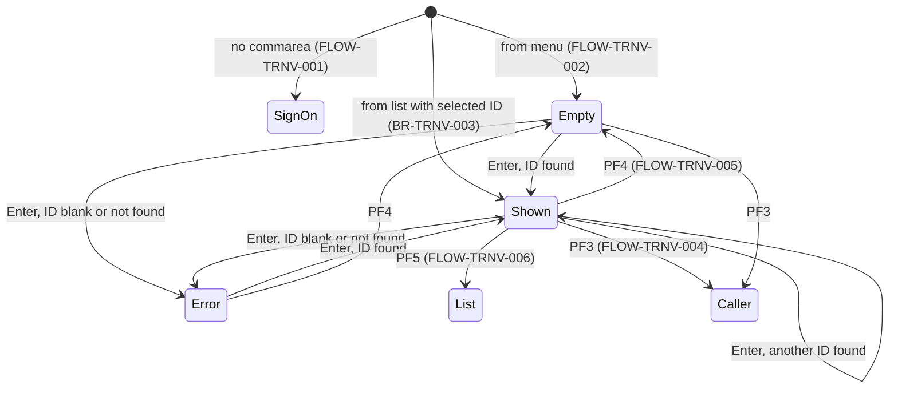
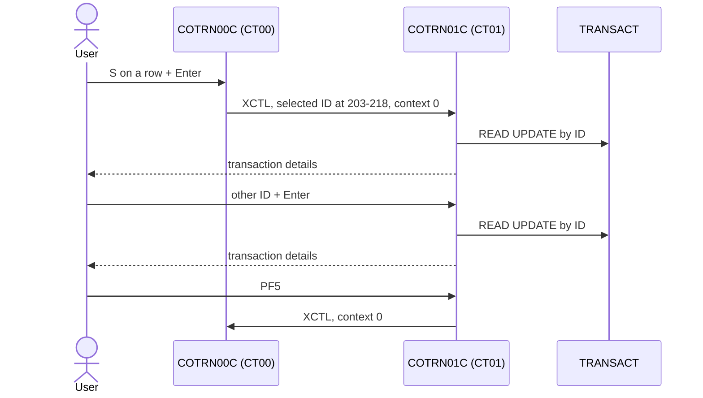

# COTRN01C: Online transaction view

## 1. Summary

The transaction view shows every field of one transaction from the transaction master file (`TRANSACT`). The user types a 16-character transaction ID and presses Enter, or arrives from the transaction list (`COTRN00C`) with a row selected, in which case the transaction is shown at once. The screen is display-only: nothing can be changed. PF5 goes to the list, PF4 clears the screen, PF3 goes back to the program that opened the view. Although nothing is updated, the record is read with an update lock.

## 2. Rules at a glance

| ID | Rule |
| :-- | :-- |
| BR-TRNV-001 | The transaction is looked up by the 16 characters of the ID field exactly as typed. |
| BR-TRNV-002 | The screen shows the transaction's fields, several of them shortened (description 60, merchant name 30, city 25, dates without time). |
| BR-TRNV-003 | Arriving from the list with a selected transaction shows it without pressing Enter. |
| VAL-TRNV-001 | The transaction ID is required. |
| VAL-TRNV-002 | The transaction must exist. |
| VAL-TRNV-003 | Only Enter, PF3, PF4 and PF5 are valid keys. |

## 3. Actors and triggers

- **Actor:** a signed-on CardDemo user, regular or admin; the program reads no user identity (DEF-TRNV-004).
- **From the menu:** `COMEN01C` option 7 "Transaction View" (user type `U`, `app/cpy/COMEN02Y.cpy:61-65`), XCTL with the 160-byte commarea and context 0 (`app/cbl/COMEN01C.cbl:177-187`). The screen starts empty.
- **From the list:** `COTRN00C` transfers here after the user put `S` on a row (`app/cbl/COTRN00C.cbl:186-195`), with the selected ID at positions 203-218 of the commarea and context 0.
- **Re-entry trigger:** CICS starts transaction `CT01` again (`app/csd/CARDDEMO.CSD:429-438`) when the user presses a key on the view screen (FLOW-TRNV-008).
- **Direct start:** typing `CT01` on a blank terminal starts the program with no commarea; it goes to sign-on (FLOW-TRNV-001).

## 4. Interfaces

### 4.1 Screen COTRN1A (mapset COTRN01), 24 x 80

Source: `app/bms/COTRN01.bms:26-268`; symbolic map `app/cpy-bms/COTRN01.CPY:17-272`. The search field `TRNIDIN`, the message field and the header fields (`app/bms/COTRN01.bms:34, 38, 47, 57, 61, 70`) are `FSET`; the detail fields are protected display fields without `FSET` that the terminal does not send back.

| Row,Col | Field | Len | Direction | Attributes | Content |
| :-- | :-- | --: | :-- | :-- | :-- |
| 1,1-2,71 | header | | out | protected | `Tran:` `CT01`, titles (`app/cpy/COTTL01Y.cpy:18-22`), `Date:` mm/dd/yy, `Prog:` `COTRN01C`, `Time:` hh:mm:ss (`app/bms/COTRN01.bms:29-74`) |
| 4,30 | (label) | 16 | out | protected, bright, neutral | `View Transaction` |
| 6,6 | (label) | 14 | out | protected, turquoise | `Enter Tran ID:` |
| 6,21 | `TRNIDIN` | 16 | in/out | **unprotected**, green, underlined, initial cursor | transaction ID to look up |
| 8,6 | (label) | 70 | out | protected, neutral | a line of dashes |
| 10,6 / 10,22 | `Transaction ID:` / `TRNID` | 15 / 16 | out | protected; label turquoise, value blue | `TRAN-ID` |
| 10,45 / 10,58 | `Card Number:` / `CARDNUM` | 12 / 16 | out | protected; label turquoise, value blue | `TRAN-CARD-NUM`, in full |
| 12,6 / 12,15 | `Type CD:` / `TTYPCD` | 8 / 2 | out | protected; label turquoise, value blue | `TRAN-TYPE-CD` |
| 12,23 / 12,36 | `Category CD:` / `TCATCD` | 12 / 4 | out | protected; label turquoise, value blue | `TRAN-CAT-CD` |
| 12,46 / 12,54 | `Source:` / `TRNSRC` | 7 / 10 | out | protected; label turquoise, value blue | `TRAN-SOURCE` |
| 14,6 / 14,19 | `Description:` / `TDESC` | 12 / 60 | out | protected; label turquoise, value blue | first 60 of the 100 characters of `TRAN-DESC` |
| 16,6 / 16,14 | `Amount:` / `TRNAMT` | 7 / 12 | out | protected; label turquoise, value blue | `TRAN-AMT` edited `+99999999.99` (NUM-TRNV-001) |
| 16,31 / 16,42 | `Orig Date:` / `TORIGDT` | 10 / 10 | out | protected; label turquoise, value blue | first 10 characters of `TRAN-ORIG-TS` |
| 16,57 / 16,68 | `Proc Date:` / `TPROCDT` | 10 / 10 | out | protected; label turquoise, value blue | first 10 characters of `TRAN-PROC-TS` |
| 18,6 / 18,19 | `Merchant ID:` / `MID` | 12 / 9 | out | protected; label turquoise, value blue | `TRAN-MERCHANT-ID` |
| 18,33 / 18,48 | `Merchant Name:` / `MNAME` | 14 / 30 | out | protected; label turquoise, value blue | first 30 of 50 characters |
| 20,6 / 20,21 | `Merchant City:` / `MCITY` | 14 / 25 | out | protected; label turquoise, value blue | first 25 of 50 characters |
| 20,53 / 20,67 | `Merchant Zip:` / `MZIP` | 13 / 10 | out | protected; label turquoise, value blue | `TRAN-MERCHANT-ZIP` |
| 23,1 | `ERRMSG` | 78 | out | protected, bright, red | message (section 8.3) |
| 24,1 | (label) | 47 | out | protected, yellow | `ENTER=Fetch  F3=Back  F4=Clear  F5=Browse Tran.` |

Field definitions: `app/bms/COTRN01.bms:75-268`.

### 4.2 Files

| CICS file | Entity | Operation | Key | Lines |
| :-- | :-- | :-- | :-- | :-- |
| `TRANSACT` | ENT-TRANSACTION | READ with UPDATE | `TRAN-ID` (16) | 267-278 |

`TRANSACT` is defined `RECOVERY(NONE)`, `UPDATE(YES)` (`app/csd/CARDDEMO.CSD:76-87`).

### 4.3 Commarea

`ENT-COMMAREA` (160 bytes) plus the extension `CDEMO-CT01-INFO` (`:53-61`), the same 58-byte layout as the list's extension under other names; 218 bytes in total.

| Field | Pos | Len | Read | Written | Use |
| :-- | --: | --: | :-- | :-- | :-- |
| `CDEMO-PGM-CONTEXT` | 34 | 1 | yes | yes | 0 = first entry, 1 = re-entry |
| `CDEMO-FROM-PROGRAM` | 5 | 8 | yes | yes | PF3 target; set to `COTRN01C` when leaving |
| `CDEMO-FROM-TRANID` | 1 | 4 | no | yes | set to `CT01` when leaving |
| `CDEMO-TO-PROGRAM` | 17 | 8 | yes | yes | XCTL target |
| `CDEMO-CT01-TRN-SELECTED` | 203 | 16 | yes | no | ID selected in the list (written there as `CDEMO-CT00-TRN-SELECTED`) |

The other extension fields (`-TRNID-FIRST`, `-TRNID-LAST`, `-PAGE-NUM`, `-NEXT-PAGE-FLG`, `-TRN-SEL-FLG`) are carried unchanged, so the list's paging state passes through the view. All other commarea fields pass through unchanged.

### 4.4 Console output

An unexpected READ response is written to the CICS log as `RESP:<code>REAS:<code>` (`:290`). Incidental.

## 5. Data used

| Entity field | Read | Written | How |
| :-- | :-- | :-- | :-- |
| ENT-TRANSACTION.TRAN-ID | key | no | from `TRNIDIN`; shown |
| ENT-TRANSACTION.TRAN-CARD-NUM | yes | no | shown in full |
| ENT-TRANSACTION.TRAN-TYPE-CD, TRAN-CAT-CD, TRAN-SOURCE | yes | no | shown |
| ENT-TRANSACTION.TRAN-DESC | yes | no | first 60 characters |
| ENT-TRANSACTION.TRAN-AMT | yes | no | edited (NUM-TRNV-001) |
| ENT-TRANSACTION.TRAN-ORIG-TS, TRAN-PROC-TS | yes | no | first 10 characters |
| ENT-TRANSACTION.TRAN-MERCHANT-ID, -NAME, -CITY, -ZIP | yes | no | shown; name 30, city 25 characters |

Program-local data with behaviour: error flag `WS-ERR-FLG` (`:40-42`), amount edit field `WS-TRAN-AMT PIC +99999999.99` (`:49`). `WS-USR-MODIFIED` and `WS-TRAN-DATE` are declared but have no effect.

## 6. Processing flow

**Entry (MAIN-PARA, lines 86-139)**

1. Clear the error flag and the message (88-92).
2. No commarea: transfer to sign-on (94-96).
3. Copy the received commarea into the 218-byte work commarea (98).
4. First entry: mark re-entry, clear the map, cursor on the ID field; if a selected ID is in the commarea, put it into the ID field and run the Enter logic; send the screen (99-109).
5. Re-entry: receive the screen and act on the key (111-132).
6. Return to CICS with next transaction `CT01` and the commarea (136-139).

**Enter (PROCESS-ENTER-KEY, lines 144-192)**

1. ID blank: VAL-TRNV-001, stop (146-152).
2. Blank all detail fields, read the transaction by the ID as typed (158-174, SE-TRNV-001).
3. Found: fill the detail fields (BR-TRNV-002) and send (176-192).

## 7. Business rules

#### BR-TRNV-001 · Lookup key
- **When:** Enter is processed with a non-blank ID field.
- **Then:** the 16 characters of `TRNIDIN` are used unchanged as `TRAN-ID`: no numeric check, no padding with leading zeros, no trimming. Only an exact 16-character match is found (DEF-TRNV-003).
- **Source:** `:172-173, 267-278`
- **Fidelity:** must-preserve · **Confidence:** reviewed

#### BR-TRNV-002 · What is shown
- **When:** the transaction was read.
- **Then:** the detail fields are filled as in section 4.1. Text fields longer than their screen field are cut on the right: `TRAN-DESC` to 60 characters, `TRAN-MERCHANT-NAME` to 30, `TRAN-MERCHANT-CITY` to 25, and the two timestamps to their first 10 characters (the date, NUM-TRNV-002). The card number is shown in full. The ID field keeps the ID typed.
- **Source:** `:176-190`; field lengths `app/bms/COTRN01.bms:168-256`
- **Fidelity:** must-preserve · **Confidence:** reviewed

#### BR-TRNV-003 · Pre-selected transaction from the list
- **When:** first entry and `CDEMO-CT01-TRN-SELECTED` is neither spaces nor low-values (set by the list, `COTRN00C`).
- **Then:** the selected ID is put into the ID field and the Enter logic runs, so the screen opens with the transaction shown (or with VAL-TRNV-002 if it was deleted in between). From the menu the extension is blank (the menu passes 160 bytes), so the screen starts empty.
- **Source:** `:99-109`
- **Fidelity:** must-preserve · **Confidence:** reviewed

## 8. Validations and messages

#### VAL-TRNV-001 · Transaction ID required
- **When:** Enter is processed and the ID field is spaces or low-values.
- **Then:** message `Tran ID can NOT be empty...`, cursor on the ID field, send; nothing is read. The detail fields are not filled in this task; the terminal does not send them back, so the screen shows them empty.
- **Source:** `:146-152`
- **Fidelity:** must-preserve · **Confidence:** reviewed; "detail fields empty" platform-inferred (BMS input mapping)

#### VAL-TRNV-002 · Transaction must exist
- **When:** the READ returns NOTFND.
- **Then:** message `Transaction ID NOT found...`, cursor on the ID field, the detail fields blank, send. Any other response: `Unable to lookup Transaction...`, same handling (ERR-TRNV-001).
- **Source:** `:280-296`
- **Fidelity:** must-preserve · **Confidence:** reviewed

#### VAL-TRNV-003 · Valid keys
- **When:** a key other than Enter, PF3, PF4 or PF5 is pressed.
- **Then:** message `Invalid key pressed. Please see below...` (`app/cpy/CSMSG01Y.cpy:20-21`), screen sent. The program does not set the cursor in this case; BMS places it at the map's initial-cursor field `TRNIDIN`. The detail fields are not re-filled and show empty.
- **Source:** `:128-131`
- **Fidelity:** must-preserve (text) · **Confidence:** reviewed; cursor and empty detail platform-inferred

### 8.1 Flow and keys

#### FLOW-TRNV-001 · No commarea
- **When:** `EIBCALEN` = 0.
- **Then:** transfer to `COSGN00C` (FLOW-TRNV-009).
- **Source:** `:94-96`

#### FLOW-TRNV-002 · First entry
- **When:** `CDEMO-PGM-CONTEXT` is not 1.
- **Then:** set it to 1, clear the map, cursor on the ID field, apply BR-TRNV-003, send the screen. With a selected ID the screen is sent twice (once by the Enter logic, once here, DEF-TRNV-005).
- **Source:** `:99-109`

#### FLOW-TRNV-003 · Enter
- **Then:** section 6, Enter.
- **Source:** `:113-114`

#### FLOW-TRNV-004 · PF3, back
- **Then:** transfer to `CDEMO-FROM-PROGRAM`, or to `COMEN01C` when it is blank. From the menu that is `COMEN01C`; from the list it is `COTRN00C`, which then starts again at its first page (`app/cbl/COTRN00C.cbl:112-116`).
- **Source:** `:115-122`

#### FLOW-TRNV-005 · PF4, clear
- **Then:** blank the ID field, all detail fields and the message, cursor on the ID field, send.
- **Source:** `:123-124, 301-326`

#### FLOW-TRNV-006 · PF5, browse transactions
- **Then:** transfer to the list `COTRN00C`, which starts at its first page; because the attention key is PF5, the list skips the first transaction of the file (`COTRN00C` DEF-TRNL-003).
- **Source:** `:125-127`

#### FLOW-TRNV-007 · Other keys
- **Then:** VAL-TRNV-003.
- **Source:** `:128-131`

#### FLOW-TRNV-008 · End of every interaction
- **Then:** return to CICS naming `CT01` as the next transaction, passing the 218-byte commarea.
- **Source:** `:136-139`

#### FLOW-TRNV-009 · Leaving the program
- **Then:** if the target program is blank or low-values, use `COSGN00C`; set `CDEMO-FROM-TRANID` = `CT01`, `CDEMO-FROM-PROGRAM` = `COTRN01C`, `CDEMO-PGM-CONTEXT` = 0; XCTL with the 218-byte commarea.
- **Source:** `:197-208`

### 8.2 Header and send

#### FLOW-TRNV-010 · Header and screen send
- **Then:** before each send: titles, `CT01`, `COTRN01C`, date `mm/dd/yy` and time `hh:mm:ss` from `FUNCTION CURRENT-DATE`, and the current message. The screen is always sent with erase and with the cursor at the field marked by length -1.
- **Source:** `:213-225, 243-262`

### 8.3 Message catalog

All messages appear in `ERRMSG` (row 23), red.

| Text (exact) | Cause | Cursor | Item |
| :-- | :-- | :-- | :-- |
| `Tran ID can NOT be empty...` | ID blank | ID field | VAL-TRNV-001 |
| `Transaction ID NOT found...` | READ NOTFND | ID field | VAL-TRNV-002 |
| `Unable to lookup Transaction...` | READ, other response | ID field | ERR-TRNV-001 |
| `Invalid key pressed. Please see below...` | wrong key | not set | VAL-TRNV-003 |

## 9. Side effects

#### SE-TRNV-001 · Read the transaction with an update lock
- **What:** READ `TRANSACT` by the 16-byte `TRAN-ID` with UPDATE into `TRAN-RECORD` (350 bytes). No REWRITE or UNLOCK follows; CICS releases the record lock when the task ends, right after the screen is sent. While the lock is held, another task that reads the same record for update (view, or a writer) waits (DEF-TRNV-001). On this non-RLS LSR file the exclusive control may extend to the whole control interval, so writes of other records in it, such as the next-higher ID added by COTRN02C or COBIL00C while the newest transaction is viewed, may wait as well.
- **Source:** `:267-278`
- **Confidence:** reviewed; lock duration platform-inferred

## 10. Error handling

#### ERR-TRNV-001 · READ response codes

| Response | Effect |
| :-- | :-- |
| NORMAL | fields shown (BR-TRNV-002) |
| NOTFND | `Transaction ID NOT found...`, error flag, send |
| other | `RESP:..REAS:..` to the CICS log, `Unable to lookup Transaction...`, error flag, send |

- **Source:** `:280-296`
- **Confidence:** reviewed

#### ERR-TRNV-002 · Screen receive not checked
- **What:** the RECEIVE MAP response is stored but never tested; MAPFAIL (PA keys, Clear) is ignored.
- **Source:** `:230-238`
- **Confidence:** reviewed

#### ERR-TRNV-003 · No abend handler
- **What:** no HANDLE ABEND or HANDLE CONDITION; any CICS condition not covered by RESP abends the task.
- **Source:** whole program (no `HANDLE` command in `app/cbl/COTRN01C.cbl`)
- **Confidence:** reviewed

## 11. Interactions

- **Inbound:** `COMEN01C` (option 7), `COTRN00C` (selection).
- **Outbound:** `COTRN00C` (PF5, and PF3 when opened from the list), `COMEN01C` (PF3 from the menu), `COSGN00C` (no commarea), all by XCTL.
- **Shared data:** `TRANSACT`, also read by the list and written by POSTTRAN, bill payment and transaction add. The update lock of SE-TRNV-001 can delay those online writers for the length of one view task; batch writers run while the file is closed in CICS.
- **Shared commarea contract:** positions 161-218 as in the list (proposed correction to ENT-COMMAREA).

### Module extraction notes (selective conversion of the view)

| Boundary | Contract |
| :-- | :-- |
| Entry | From the menu (empty) or from the list with a selected ID at positions 203-218 (show at once). |
| Data | Read-only lookup of ENT-TRANSACTION by full 16-character ID. The target needs no lock (DEF-TRNV-001), unless the business wants the current behaviour. |
| Exit | PF5 to the list, PF3 to the caller, passing the commarea back unchanged except the routing fields. |

## 12. Numeric, date and format details

#### NUM-TRNV-001 · Amount display
- `TRAN-AMT` (decimal(11,2), `S9(09)V99`) is edited with `+99999999.99` (12 characters, sign always shown, 8 integer digits): amounts of 100,000,000.00 or more lose their highest digit (DEF-TRNV-002). Same edit as the list (`COTRN00C` NUM-TRNL-001): 504.77 shows `+00000504.77`, -5.50 shows `-00000005.50`.
- **Source:** `:49, 177, 183`
- **Confidence:** runtime-verified (edit semantics on GnuCOBOL 3.2)

#### NUM-TRNV-002 · Dates
- `TRAN-ORIG-TS` and `TRAN-PROC-TS` (26 characters) are moved to 10-character fields: the date part `YYYY-MM-DD` of each layout in ENT-TRANSACTION is shown and the time is dropped. Transactions added online (`COTRN02C`) store only a 10-character date, which shows the same way.
- **Source:** `:185-186`

#### NUM-TRNV-003 · Codes and IDs
- `TRAN-CAT-CD` (`9(04)`) and `TRAN-MERCHANT-ID` (`9(09)`) are shown as their digit characters with leading zeros (`0001`, `800000000`).
- **Source:** `:181, 187`

## 13. Known defects and oddities

`COTRN01C.cbl` is unchanged by commit b5e0139; none of these is fixed in this branch.

#### DEF-TRNV-001 · Update lock for a display
- The record is read with UPDATE although the program never changes it. The lock lasts until the end of the task; a concurrent task reading the same record for update waits. The CSD defines no deadlock timeout for the CardDemo transactions (`DTIMOUT(NO)`, `app/csd/CARDDEMO.CSD:433`). Because the file is a non-RLS LSR file (`RLSACCESS(NO)`, `LSRPOOLNUM(1)`, `app/csd/CARDDEMO.CSD:77-78`), VSAM exclusive control may cover the whole control interval, so adds of neighbouring IDs (COTRN02C, COBIL00C) could also wait (platform-inferred, Q-TRNV-003).
- **Source:** `:275`
- **Status:** open · **Fidelity:** defect-decide · **Confidence:** platform-inferred

#### DEF-TRNV-002 · Large amounts lose their highest digit
- See NUM-TRNV-001.
- **Source:** `:49, 177`
- **Status:** open · **Fidelity:** defect-decide

#### DEF-TRNV-003 · ID not checked or padded
- A shorter ID (`683580`) is padded with spaces, not zeros, and is not found: `Transaction ID NOT found...`. Non-numeric input is accepted as a key and also ends in "not found". Because `TRNIDIN` is `FSET` and keeps the last ID, typing a shorter ID over it without erasing the rest of the field sends the new prefix followed by the end of the old ID.
- **Source:** `:172`
- **Status:** open · **Fidelity:** defect-decide

#### DEF-TRNV-004 · [security] Any transaction, full card number
- Any user who reaches the screen can view any transaction by ID, and the full 16-digit card number is shown unmasked.
- **Source:** `:179`; field `app/bms/COTRN01.bms:118-122`
- **Status:** open · **Fidelity:** defect-decide (Q-TRNV-001)

#### DEF-TRNV-005 · Screen sent twice on first entry from the list
- The Enter logic sends the screen and the first-entry branch sends it again; the user sees the second one, which has the same content.
- **Source:** `:107-109, 191`
- **Status:** open · **Fidelity:** incidental

#### DEF-TRNV-006 · Parts of the record are not visible
- The description is cut to 60 of 100 characters, the merchant name to 30 of 50, the city to 25 of 50, and the time of both timestamps is not shown. A user cannot see the full record on this screen.
- **Source:** `:184-189`
- **Status:** open · **Fidelity:** defect-decide (Q-TRNV-002)

## 14. Open questions

| ID | Question | For |
| :-- | :-- | :-- |
| Q-TRNV-001 | Restrict viewing to the user's own transactions and mask the card number (DEF-TRNV-004)? | business, security |
| Q-TRNV-002 | Should the target show the full description, merchant name and city, and the time of the timestamps (DEF-TRNV-006)? | business |
| Q-TRNV-003 | On the mainframe: how long is the READ UPDATE lock held for this non-recoverable file, and do concurrent bill payments or transaction adds ever wait on it (DEF-TRNV-001)? | mainframe team |

## 15. Equivalence contract

A reimplementation must reproduce, for each scenario, the fields shown (with their truncation), the message text and the cursor field. It may differ in: the duplicate send (DEF-TRNV-005), the record lock (if the business accepts it, Q-TRNV-003), CICS log lines and the clock values.

| # | Start state | Input | Expected |
| --: | :-- | :-- | :-- |
| S1 | no commarea | start CT01 | transfer to sign-on |
| S2 | from menu | - | empty screen, cursor on the ID field |
| S3 | from the list, selected ID `0000000000683580` (exists) | - | details of that transaction shown, ID field `0000000000683580` |
| S4 | any | Enter, ID blank | `Tran ID can NOT be empty...` |
| S5 | any | Enter, ID `9999999999999999` (missing) | `Transaction ID NOT found...`, details blank |
| S6 | any | Enter, ID `683580` | `Transaction ID NOT found...` (DEF-TRNV-003) |
| S7 | transaction with description of 100 characters, amount 504.77, timestamps `2022-06-10 19:27:53.000000` | Enter with its ID | description first 60 characters, amount `+00000504.77`, both dates `2022-06-10` |
| S8 | shown | PF4 | all fields and message blank, cursor on the ID field |
| S9 | from the list | PF3 | transfer to `COTRN00C` |
| S10 | from the menu | PF3 | transfer to `COMEN01C` |
| S11 | any | PF5 | transfer to `COTRN00C` |
| S12 | any | PF7 | `Invalid key pressed. Please see below...` |

These scenarios cannot run locally (no CICS); they become acceptance tests for the target. Evidence: `evidence/c-transactions-review.md`.

## 16. Paragraph coverage

| Paragraph | Lines | Covered by |
| :-- | :-- | :-- |
| (data division) | 29-80 | §4.3, §5, NUM-TRNV-001 |
| `MAIN-PARA` | 86-139 | FLOW-TRNV-001..008, BR-TRNV-003, VAL-TRNV-003, DEF-TRNV-005, §6 Entry |
| `PROCESS-ENTER-KEY` | 144-192 | BR-TRNV-001, BR-TRNV-002, VAL-TRNV-001, NUM-TRNV-001..003, DEF-TRNV-002..004, DEF-TRNV-006, §6 Enter |
| `RETURN-TO-PREV-SCREEN` | 197-208 | FLOW-TRNV-009 |
| `SEND-TRNVIEW-SCREEN` | 213-225 | FLOW-TRNV-010, §8.3 |
| `RECEIVE-TRNVIEW-SCREEN` | 230-238 | ERR-TRNV-002 |
| `POPULATE-HEADER-INFO` | 243-262 | FLOW-TRNV-010 |
| `READ-TRANSACT-FILE` | 267-296 | SE-TRNV-001, VAL-TRNV-002, ERR-TRNV-001, DEF-TRNV-001 |
| `CLEAR-CURRENT-SCREEN` | 301-304 | FLOW-TRNV-005 |
| `INITIALIZE-ALL-FIELDS` | 309-326 | FLOW-TRNV-005 |

9 of 9 paragraphs covered (plus the data division row).
