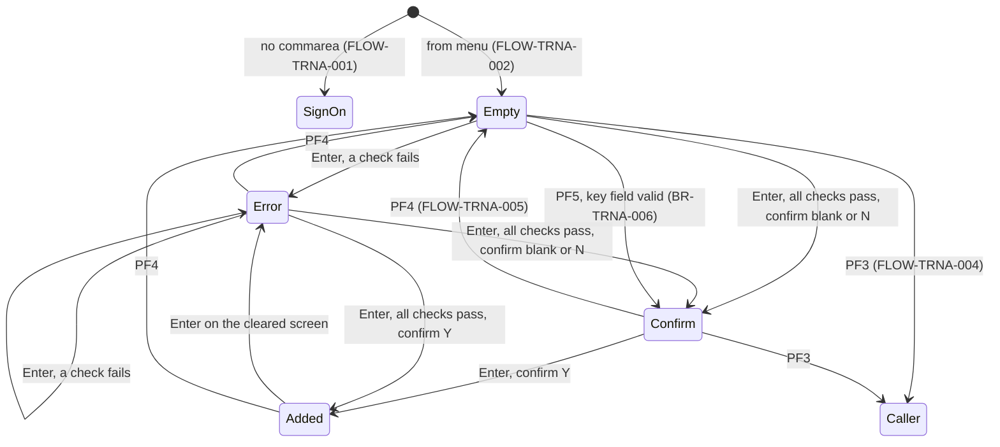
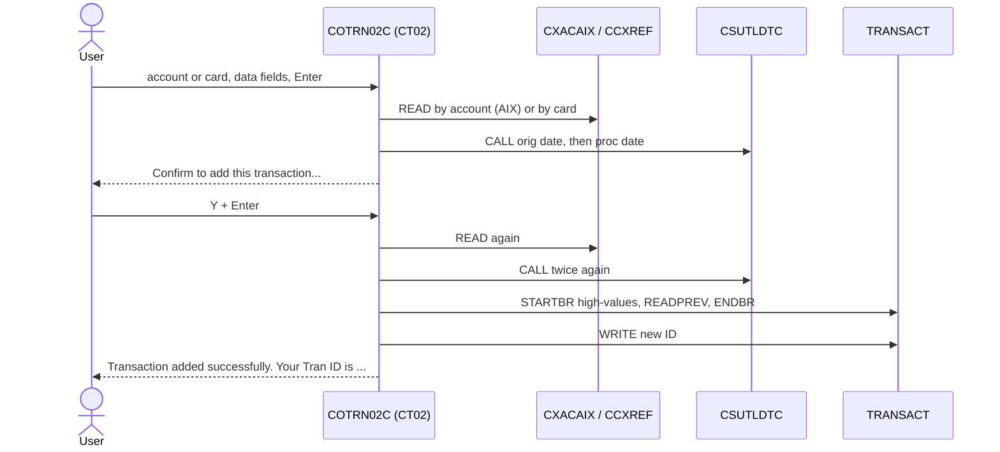

# COTRN02C: Online transaction add

## 1. Summary

The transaction add screen lets a user type a new transaction and write it to the transaction master file (`TRANSACT`). The user identifies the card either by account ID or by card number; the program looks the other one up in the card cross-reference. All twelve data fields are required and checked for format; the two dates are checked as calendar dates by `CSUTLDTC`. The user then confirms with `Y`, and the program writes the record with the next free transaction ID (highest existing ID + 1) and shows that ID. PF5 fills the data fields from the transaction with the highest ID in the file. The program writes only the transaction record: no account balance, category balance, credit limit or card status is read or changed.

## 2. Rules at a glance

| ID | Rule |
| :-- | :-- |
| BR-TRNA-001 | The account ID, when given, wins: the card number is taken from the cross-reference; otherwise the card number gives the account ID. |
| BR-TRNA-002 | A transaction is written only after every check passes and the confirm field is `Y` or `y`. |
| BR-TRNA-003 | The new transaction ID is the highest ID in `TRANSACT` plus 1. |
| BR-TRNA-004 | The record is built from the screen fields; dates are stored as 10 characters followed by spaces. |
| BR-TRNA-005 | After a successful add the screen is cleared and the new ID is shown in green. |
| BR-TRNA-006 | PF5 copies the data fields of the transaction with the highest ID, then runs the Enter logic. |
| BR-TRNA-007 | Nothing but the transaction record is written: no balance, limit, status or reference-table check or update. |
| VAL-TRNA-001 | Account ID or card number is required. |
| VAL-TRNA-002 | The account ID must be 11 digits. |
| VAL-TRNA-003 | The card number must be 16 digits. |
| VAL-TRNA-004 | The account must be in the cross-reference. |
| VAL-TRNA-005 | The card must be in the cross-reference. |
| VAL-TRNA-006 | All eleven data fields are required, checked in screen order. |
| VAL-TRNA-007 | Type code and category code must be all digits. |
| VAL-TRNA-008 | The amount must have the form `-99999999.99` or `+99999999.99`. |
| VAL-TRNA-009 | Both dates must have the form `YYYY-MM-DD`. |
| VAL-TRNA-010 | Both dates must be calendar dates, except that dates before 1582-10-15 are accepted. |
| VAL-TRNA-011 | The merchant ID must be 9 digits. |
| VAL-TRNA-012 | The confirm field must be `Y`, `y`, `N`, `n` or blank. |
| VAL-TRNA-013 | Only Enter, PF3, PF4 and PF5 are valid keys. |

## 3. Actors and triggers

- **Actor:** a signed-on CardDemo user, regular or admin. The menu entry is open to regular users (user type `U`); the label `Transaction Add (Admin Only)` is commented out (`app/cpy/COMEN02Y.cpy:67-72`). The program reads no user identity (DEF-TRNA-012).
- **From the menu:** `COMEN01C` option 8 "Transaction Add", XCTL with the 160-byte commarea and context 0 (`app/cbl/COMEN01C.cbl:177-187`). The screen starts empty.
- **Re-entry trigger:** CICS starts transaction `CT02` again (`app/csd/CARDDEMO.CSD:439-448`) when the user presses a key on the add screen (FLOW-TRNA-008).
- **Direct start:** typing `CT02` on a blank terminal starts the program with no commarea; it goes to sign-on (FLOW-TRNA-001).
- No other program transfers to `COTRN02C` (the only reference in `app/` besides the CSD is the menu table, `app/cpy/COMEN02Y.cpy:71`).

## 4. Interfaces

### 4.1 Screen COTRN2A (mapset COTRN02), 24 x 80

Source: `app/bms/COTRN02.bms:19-304`; symbolic map `app/cpy-bms/COTRN02.CPY:17-272` (output map `COTRN2AO` redefines input map `COTRN2AI` at `:145`, so values received are sent back unless the program changes them). Every input field is unprotected, green, underlined and `FSET`, so it is sent back on every key, changed or not. No field has the `NUM` attribute or a `JUSTIFY` option.

| Row,Col | Field | Len | Direction | Attributes | Content |
| :-- | :-- | --: | :-- | :-- | :-- |
| 1,1-2,71 | header | | out | protected | `Tran:` `CT02`, titles (`app/cpy/COTTL01Y.cpy:18-22`), `Date:` mm/dd/yy, `Prog:` `COTRN02C`, `Time:` hh:mm:ss (`app/bms/COTRN02.bms:29-74`) |
| 4,30 | (label) | 15 | out | protected, bright | `Add Transaction` |
| 6,6 / 6,21 | `Enter Acct #:` / `ACTIDIN` | 13 / 11 | in/out | initial cursor | account ID |
| 6,37 | (label) | 4 | out | protected | `(or)` |
| 6,46 / 6,55 | `Card #:` / `CARDNIN` | 7 / 16 | in/out | | card number |
| 8,6 | (label) | 70 | out | protected | a line of dashes |
| 10,6 / 10,15 | `Type CD:` / `TTYPCD` | 8 / 2 | in/out | | `TRAN-TYPE-CD` |
| 10,23 / 10,36 | `Category CD:` / `TCATCD` | 12 / 4 | in/out | | `TRAN-CAT-CD` |
| 10,46 / 10,54 | `Source:` / `TRNSRC` | 7 / 10 | in/out | | `TRAN-SOURCE` |
| 12,6 / 12,19 | `Description:` / `TDESC` | 12 / 60 | in/out | | first 60 of the 100 characters of `TRAN-DESC` |
| 14,6 / 14,14 | `Amount:` / `TRNAMT` | 7 / 12 | in/out | | `TRAN-AMT` as `-99999999.99` (NUM-TRNA-001) |
| 14,31 / 14,42 | `Orig Date:` / `TORIGDT` | 10 / 10 | in/out | | `TRAN-ORIG-TS` date part |
| 14,57 / 14,68 | `Proc Date:` / `TPROCDT` | 10 / 10 | in/out | | `TRAN-PROC-TS` date part |
| 15,13 / 15,41 / 15,67 | (hints) | 14 / 12 / 12 | out | protected, blue | `(-99999999.99)`, `(YYYY-MM-DD)`, `(YYYY-MM-DD)` |
| 16,6 / 16,19 | `Merchant ID:` / `MID` | 12 / 9 | in/out | | `TRAN-MERCHANT-ID` |
| 16,33 / 16,48 | `Merchant Name:` / `MNAME` | 14 / 30 | in/out | | first 30 of 50 characters |
| 18,6 / 18,21 | `Merchant City:` / `MCITY` | 14 / 25 | in/out | | first 25 of 50 characters |
| 18,53 / 18,67 | `Merchant Zip:` / `MZIP` | 13 / 10 | in/out | | `TRAN-MERCHANT-ZIP` |
| 21,6 | (label) | 55 | out | protected, turquoise | `You are about to add this transaction. Please confirm :` |
| 21,63 | `CONFIRM` | 1 | in/out | | `Y`/`N` |
| 21,66 | (label) | 5 | out | protected | `(Y/N)` |
| 23,1 | `ERRMSG` | 78 | out | protected, bright, red (green on success) | message (section 8.3) |
| 24,1 | (label) | 53 | out | protected, yellow | `ENTER=Continue  F3=Back  F4=Clear  F5=Copy Last Tran.` |

Field definitions: `app/bms/COTRN02.bms:75-302`.

### 4.2 Files

| CICS file | Entity | Operation | Key | Lines |
| :-- | :-- | :-- | :-- | :-- |
| `CXACAIX` | ENT-CARD-XREF | READ through the alternate-index path | `XREF-ACCT-ID` (11) | 576-604 |
| `CCXREF` | ENT-CARD-XREF | READ | `XREF-CARD-NUM` (16) | 609-637 |
| `TRANSACT` | ENT-TRANSACTION | STARTBR, READPREV, ENDBR | `TRAN-ID` (16) = high-values | 642-706 |
| `TRANSACT` | ENT-TRANSACTION | WRITE | `TRAN-ID` (16) | 711-749 |

The alternate index over the cross-reference is defined `KEYS(11,25) NONUNIQUEKEY` (`app/jcl/XREFFILE.jcl:72-75`): one account can have several cards. All three files are `RECOVERY(NONE)` (`app/csd/CARDDEMO.CSD:37-49, 63-87`). The program names `ACCTDAT` (`:40`) and copies the account layout `CVACT01Y` (`:89`) but never uses either.

### 4.3 Commarea

`ENT-COMMAREA` (160 bytes) plus the extension `CDEMO-CT02-INFO` (`:72-80`), the same 58-byte layout as the list's extension (positions 161-218) under other names; 218 bytes in total.

| Field | Pos | Len | Read | Written | Use |
| :-- | --: | --: | :-- | :-- | :-- |
| `CDEMO-PGM-CONTEXT` | 34 | 1 | yes | yes | 0 = first entry, 1 = re-entry |
| `CDEMO-FROM-PROGRAM` | 5 | 8 | yes | yes | PF3 target; set to `COTRN02C` when leaving |
| `CDEMO-FROM-TRANID` | 1 | 4 | no | yes | set to `CT02` when leaving |
| `CDEMO-TO-PROGRAM` | 17 | 8 | yes | yes | XCTL target |
| `CDEMO-CT02-TRN-SELECTED` | 203 | 16 | yes | no | tested on first entry; always blank in practice (DEF-TRNA-010) |

The other extension fields are carried and never used. All other commarea fields pass through unchanged. From the menu the received commarea is 160 bytes, so the extension starts as spaces (group move pads with spaces, `:119`).

### 4.4 Called program

`CSUTLDTC` is called twice per complete check, with the 10-character date, the picture `YYYY-MM-DD` and an 80-byte result area (`:62-69, 389-427`). The program reads the severity (positions 1-4) and the message number (positions 16-19) of ENT-DATE-CHECK-RESULT (CSUTLDTC BR-DTCK-003).

### 4.5 Console output

An unexpected file response is written to the CICS log as `RESP:<code>REAS:<code>` (`:598, 631, 662, 691, 743`). Incidental.

## 5. Data used

| Entity field | Read | Written | How |
| :-- | :-- | :-- | :-- |
| ENT-CARD-XREF.XREF-ACCT-ID | key / yes | no | key of the alternate-index read; copied to the account field after a card lookup |
| ENT-CARD-XREF.XREF-CARD-NUM | key / yes | no | key of the card read; copied to the card field after an account lookup |
| ENT-TRANSACTION.TRAN-ID | yes | yes | highest existing ID read; new ID written (BR-TRNA-003) |
| ENT-TRANSACTION.TRAN-TYPE-CD, TRAN-CAT-CD, TRAN-SOURCE | PF5 | yes | from the screen |
| ENT-TRANSACTION.TRAN-DESC | PF5 | yes | 60 characters from the screen, padded with spaces to 100 |
| ENT-TRANSACTION.TRAN-AMT | PF5 | yes | parsed from the screen (NUM-TRNA-001) |
| ENT-TRANSACTION.TRAN-MERCHANT-ID, -NAME, -CITY, -ZIP | PF5 | yes | from the screen; name 30 and city 25 characters, padded to 50 |
| ENT-TRANSACTION.TRAN-CARD-NUM | no | yes | the card field after BR-TRNA-001 |
| ENT-TRANSACTION.TRAN-ORIG-TS, TRAN-PROC-TS | PF5 | yes | the 10-character date from the screen, padded with spaces to 26 (NUM-TRNA-002) |

"PF5" means the field is read from the highest-ID record only by the copy function (BR-TRNA-006). Program-local data with behaviour: error flag `WS-ERR-FLG` (`:44-46`), numeric work fields `WS-ACCT-ID-N 9(11)`, `WS-CARD-NUM-N 9(16)`, `WS-TRAN-ID-N 9(16)`, `WS-TRAN-AMT-N S9(9)V99`, edit field `WS-TRAN-AMT-E +99999999.99`, date picture `WS-DATE-FORMAT` = `YYYY-MM-DD` (`:55-60`). `WS-USR-MODIFIED`, `WS-TRAN-AMT` and `WS-TRAN-DATE` are declared but have no effect.

## 6. Processing flow

**Entry (MAIN-PARA, lines 107-159)**

1. Clear the error flag and the message (109-113).
2. No commarea: transfer to sign-on (115-117).
3. Copy the received commarea into the 218-byte work commarea (119).
4. First entry: mark re-entry, clear the map, cursor on the account field, test the unused pre-selection (DEF-TRNA-010), send the screen (120-130).
5. Re-entry: receive the screen and act on the key (132-152).
6. Return to CICS with next transaction `CT02` (156-159). This statement is reached only by paths that do not send a screen, which in practice is none: every screen send ends the task itself (FLOW-TRNA-010).

**Enter (PROCESS-ENTER-KEY, lines 164-188)**

1. Key fields: VAL-TRNA-001 to VAL-TRNA-005 and BR-TRNA-001 (193-230).
2. Data fields: VAL-TRNA-006 to VAL-TRNA-011 in this order: required fields, type and category digits, amount form, original date form, processing date form, amount re-edit (NUM-TRNA-001), original date calendar check, processing date calendar check, merchant ID digits (235-437).
3. Confirm: `Y`/`y` adds the transaction (BR-TRNA-002 to BR-TRNA-005); otherwise VAL-TRNA-012 (169-188).

The first failing check sends its message and ends the task (FLOW-TRNA-011), so the user sees one message at a time, in the order above.

## 7. Business rules

#### BR-TRNA-001 · Account or card identifies the card
- **When:** Enter (or PF5) is processed.
- **Then:**
  1. If the account field is not blank: it must be all digits (VAL-TRNA-002). Its value is moved back into the field as 11 digits with leading zeros, the cross-reference is read through the account alternate index (VAL-TRNA-004), and the card number of the record returned replaces whatever is in the card field.
  2. Else, if the card field is not blank: it must be all digits (VAL-TRNA-003). Its value is moved back as 16 digits, the cross-reference is read by card number (VAL-TRNA-005), and the account ID of that record replaces the account field.
  3. Else: VAL-TRNA-001.
- The card number written to the transaction is the card field after this step. When both fields are typed, the card typed is ignored and no check is made that it belongs to the account (DEF-TRNA-005).
- **Source:** `:193-230`
- **Fidelity:** must-preserve · **Confidence:** reviewed

#### BR-TRNA-002 · Confirm before writing
- **When:** every check of VAL-TRNA-001 to VAL-TRNA-011 has passed.
- **Then:** if the confirm field is `Y` or `y`, the transaction is added (BR-TRNA-003). If it is `N`, `n`, blank or low-values, the message `Confirm to add this transaction...` is shown with the cursor on the confirm field, and nothing is written. `N` does not cancel or clear anything; it gives the same prompt as blank (DEF-TRNA-014). Any other value: VAL-TRNA-012. The confirm field is checked after the data, so a `Y` typed together with the data adds the transaction at once on the first Enter.
- **Source:** `:164-188`
- **Fidelity:** must-preserve · **Confidence:** reviewed

#### BR-TRNA-003 · Next transaction ID
- **When:** the add is confirmed.
- **Then:** start a browse of `TRANSACT` at key high-values, read the previous record (the one with the highest key) and end the browse. Its 16-character ID is taken as a number, 1 is added, and the result as 16 digits with leading zeros is the new `TRAN-ID`. If the read-previous reports end of file, the highest ID is taken as zero, so the first ID is `0000000000000001`.
- Nothing reserves the ID between this read and the write; a concurrent add or bill payment can take the same ID (DEF-TRNA-003). At `9999999999999999` the addition overflows (NUM-TRNA-004).
- **Source:** `:444-449, 642-706`
- **Fidelity:** must-preserve (ID format); defect-decide (generation method) · **Confidence:** reviewed; positioning at high-values and the empty-file case platform-inferred (Q-TRNA-004)

#### BR-TRNA-004 · Record built from the screen
- **When:** the new ID is known.
- **Then:** the 350-byte record is initialised (text fields to spaces, numeric fields to zeros, FILLER to spaces) and filled:

| Record field | Value |
| :-- | :-- |
| `TRAN-ID` | new ID (BR-TRNA-003) |
| `TRAN-TYPE-CD` | type field (2) |
| `TRAN-CAT-CD` | category field (4 digits) |
| `TRAN-SOURCE` | source field (10) |
| `TRAN-DESC` | description field (60), padded with spaces to 100 |
| `TRAN-AMT` | amount field parsed as a number (NUM-TRNA-001) |
| `TRAN-MERCHANT-ID` | merchant ID field (9 digits) |
| `TRAN-MERCHANT-NAME` | merchant name field (30), padded to 50 |
| `TRAN-MERCHANT-CITY` | merchant city field (25), padded to 50 |
| `TRAN-MERCHANT-ZIP` | merchant ZIP field (10) |
| `TRAN-CARD-NUM` | card field (16) after BR-TRNA-001 |
| `TRAN-ORIG-TS` | original date field (10), padded with spaces to 26 |
| `TRAN-PROC-TS` | processing date field (10), padded with spaces to 26 |

  Then the record is written (SE-TRNA-002).
- **Source:** `:450-466`; layout `app/cpy/CVTRA05Y.cpy:4-18`
- **Fidelity:** must-preserve · **Confidence:** reviewed

#### BR-TRNA-005 · Success
- **When:** the write returns NORMAL.
- **Then:** all input fields and the confirm field are cleared, the cursor goes to the account field and the message is shown in green: `Transaction added successfully.  Your Tran ID is <ID>.`, with two spaces after the first full stop and the 16-digit ID, for example `Transaction added successfully.  Your Tran ID is 0000000000000301.` when the highest ID was `0000000000000300`.
- **Source:** `:724-734, 762-779`
- **Fidelity:** must-preserve (content); incidental (double space) · **Confidence:** reviewed

#### BR-TRNA-006 · PF5, copy the last transaction
- **When:** PF5 is pressed.
- **Then:**
  1. Run the key-field checks and lookups of BR-TRNA-001; a failure ends here with its message.
  2. Read the transaction with the highest ID in the whole file, as in BR-TRNA-003. It need not belong to the account or card on the screen (DEF-TRNA-009).
  3. Copy its type, category, source, amount (edited `+99999999.99`), description (first 60), original and processing date (first 10 characters), merchant ID, name (first 30), city (first 25) and ZIP into the data fields. The card number and ID are not copied.
  4. Run the whole Enter logic (section 6). With the confirm field blank this ends in `Confirm to add this transaction...`; if the user had typed `Y` in it before pressing PF5, the copy is added at once.
- If the read fails, its message is sent and the task ends before step 3 (ERR-TRNA-001).
- **Source:** `:146-147, 471-495`
- **Fidelity:** must-preserve · **Confidence:** reviewed

#### BR-TRNA-007 · Only the transaction record is written
- **When:** a transaction is added.
- **Then:** the program does not read the account (`ACCTDAT` is named but unused), and does not check or change the account balance, credit limit, cycle totals, account or card status, card expiry, or the category balance (ENT-TCAT-BAL); it does not check that the type and category exist in ENT-TRAN-TYPE and ENT-TRAN-CATEGORY. The transaction is visible at once in the list and view screens and in the next transaction report that covers its processing date. It is not posted to any balance (DEF-TRNA-001, DEF-TRNA-002).
- **Source:** whole program; `:40, 89` (unused account file and layout), `:442-466`
- **Fidelity:** must-preserve (as-is scope); defect-decide (Q-TRNA-001) · **Confidence:** reviewed

## 8. Validations and messages

Every message is shown in `ERRMSG` (row 23) in red, with the cursor on the field named, except BR-TRNA-005 (green). The screen keeps the values as typed, except those the program has already changed (zero-padded account or card, the looked-up partner field, the re-edited amount).

#### VAL-TRNA-001 · Account or card required
- **When:** both the account field and the card field are spaces or low-values.
- **Then:** `Account or Card Number must be entered...`, cursor on the account field.
- **Source:** `:224-229`
- **Fidelity:** must-preserve · **Confidence:** reviewed

#### VAL-TRNA-002 · Account ID all digits
- **When:** the account field is not blank and not all digits.
- **Then:** `Account ID must be Numeric...`, cursor on the account field. The field has 11 positions and BMS pads a shorter entry with spaces, so only a full 11-digit ID passes (`00000000050`, not `50`, DEF-TRNA-006).
- **Source:** `:196-203`
- **Fidelity:** must-preserve · **Confidence:** reviewed; padding platform-inferred

#### VAL-TRNA-003 · Card number all digits
- **When:** the account field is blank and the card field is not all digits.
- **Then:** `Card Number must be Numeric...`, cursor on the card field. Only a full 16-digit number passes (DEF-TRNA-006).
- **Source:** `:210-217`
- **Fidelity:** must-preserve · **Confidence:** reviewed; padding platform-inferred

#### VAL-TRNA-004 · Account in the cross-reference
- **When:** the alternate-index read by account ID does not return NORMAL.
- **Then:** NOTFND: `Account ID NOT found...`; any other response: `Unable to lookup Acct in XREF AIX file...`; cursor on the account field in both cases. An account with more than one card gets DUPKEY from CICS, which falls under "any other response" (DEF-TRNA-004).
- **Source:** `:576-604`
- **Fidelity:** must-preserve · **Confidence:** reviewed; DUPKEY platform-inferred

#### VAL-TRNA-005 · Card in the cross-reference
- **When:** the read by card number does not return NORMAL.
- **Then:** NOTFND: `Card Number NOT found...`; any other response: `Unable to lookup Card # in XREF file...`; cursor on the card field.
- **Source:** `:609-637`
- **Fidelity:** must-preserve · **Confidence:** reviewed

#### VAL-TRNA-006 · Data fields required
- **When:** a data field is spaces or low-values. Checked in this order, first failure wins:

| Field | Message (exact) |
| :-- | :-- |
| Type CD | `Type CD can NOT be empty...` |
| Category CD | `Category CD can NOT be empty...` |
| Source | `Source can NOT be empty...` |
| Description | `Description can NOT be empty...` |
| Amount | `Amount can NOT be empty...` |
| Orig Date | `Orig Date can NOT be empty...` |
| Proc Date | `Proc Date can NOT be empty...` |
| Merchant ID | `Merchant ID can NOT be empty...` |
| Merchant Name | `Merchant Name can NOT be empty...` |
| Merchant City | `Merchant City can NOT be empty...` |
| Merchant Zip | `Merchant Zip can NOT be empty...` |

- **Then:** that message, cursor on that field. Partly blank fields are not "empty" here; they fail the format checks that follow.
- **Source:** `:251-320`
- **Fidelity:** must-preserve · **Confidence:** reviewed

#### VAL-TRNA-007 · Type and category codes all digits
- **When:** the type field (2) is not all digits; else the category field (4) is not all digits.
- **Then:** `Type CD must be Numeric...` or `Category CD must be Numeric...`, cursor on that field. A one-digit type such as `1` (padded to `1 `) fails; `01` passes. The values are not looked up in ENT-TRAN-TYPE or ENT-TRAN-CATEGORY (DEF-TRNA-002).
- **Source:** `:322-337`
- **Fidelity:** must-preserve · **Confidence:** reviewed; padding platform-inferred

#### VAL-TRNA-008 · Amount form
- **When:** any of: position 1 is neither `-` nor `+`; positions 2-9 are not all digits; position 10 is not `.`; positions 11-12 are not both digits.
- **Then:** `Amount should be in format -99999999.99`, cursor on the amount field. The amount must be exactly 12 characters: `-00000012.50` and `+00000012.50` pass, `12.50` and `-12.50` fail. Zero (`+00000000.00`, also `-00000000.00`) passes; there is no minimum, maximum or sign rule beyond the form.
- **Source:** `:339-351`
- **Fidelity:** must-preserve · **Confidence:** reviewed

#### VAL-TRNA-009 · Date form
- **When:** for the original date, then the processing date: positions 1-4 not all digits, position 5 not `-`, positions 6-7 not all digits, position 8 not `-`, or positions 9-10 not all digits.
- **Then:** `Orig Date should be in format YYYY-MM-DD` or `Proc Date should be in format YYYY-MM-DD`, cursor on that field. `2022-7-6` fails; `2022-13-45` passes this check and fails VAL-TRNA-010. The processing date form is checked before the original date's calendar check.
- **Source:** `:353-381`
- **Fidelity:** must-preserve · **Confidence:** reviewed

#### VAL-TRNA-010 · Dates are calendar dates
- **When:** `CSUTLDTC` returns a severity other than `0000` for the date with picture `YYYY-MM-DD`, and the message number is not `2513`. Original date first, then processing date.
- **Then:** `Orig Date - Not a valid date...` or `Proc Date - Not a valid date...`, cursor on that field. Message number 2513 (date before 1582-10-15, including year `0000`) is let through, so `0001-01-01` is accepted and stored (DEF-TRNA-007; CSUTLDTC DEF-DTCK-004). No other date rule applies: either date may be in the future, and the processing date may be earlier than the original date (DEF-TRNA-008).
- **Source:** `:389-427`; date rules CSUTLDTC BR-DTCK-006
- **Fidelity:** must-preserve · **Confidence:** reviewed; validity rules as in CSUTLDTC (runtime-verified against the stand-in)

#### VAL-TRNA-011 · Merchant ID all digits
- **When:** the merchant ID field (9) is not all digits.
- **Then:** `Merchant ID must be Numeric...`, cursor on the merchant ID field. Checked last, after the date checks. Only a full 9-digit value passes (DEF-TRNA-006).
- **Source:** `:430-436`
- **Fidelity:** must-preserve · **Confidence:** reviewed; padding platform-inferred

#### VAL-TRNA-012 · Confirm value
- **When:** all checks pass and the confirm field is none of `Y`, `y`, `N`, `n`, space, low-values.
- **Then:** `Invalid value. Valid values are (Y/N)...`, cursor on the confirm field.
- **Source:** `:182-187`
- **Fidelity:** must-preserve · **Confidence:** reviewed

#### VAL-TRNA-013 · Valid keys
- **When:** a key other than Enter, PF3, PF4 or PF5 is pressed.
- **Then:** `Invalid key pressed. Please see below...` (`app/cpy/CSMSG01Y.cpy:20-21`), screen sent with the values as received. The program sets no cursor; BMS places it at the map's initial-cursor field, the account field.
- **Source:** `:148-151`
- **Fidelity:** must-preserve (text) · **Confidence:** reviewed; cursor platform-inferred

### 8.1 Flow and keys

#### FLOW-TRNA-001 · No commarea
- **When:** `EIBCALEN` = 0.
- **Then:** transfer to `COSGN00C` (FLOW-TRNA-009).
- **Source:** `:115-117`

#### FLOW-TRNA-002 · First entry
- **When:** `CDEMO-PGM-CONTEXT` is not 1.
- **Then:** set it to 1, clear the map, cursor on the account field; if `CDEMO-CT02-TRN-SELECTED` is not blank, move it into the card field and run the Enter logic (never happens, DEF-TRNA-010); send the empty screen.
- **Source:** `:120-130`

#### FLOW-TRNA-003 · Enter
- **Then:** section 6, Enter.
- **Source:** `:134-135`

#### FLOW-TRNA-004 · PF3, back
- **Then:** transfer to `CDEMO-FROM-PROGRAM`, or to `COMEN01C` when it is blank. From the menu that is `COMEN01C`. Nothing typed is kept.
- **Source:** `:136-143`

#### FLOW-TRNA-005 · PF4, clear
- **Then:** blank every input field, the confirm field and the message, cursor on the account field, send.
- **Source:** `:144-145, 754-779`

#### FLOW-TRNA-006 · PF5, copy last transaction
- **Then:** BR-TRNA-006.
- **Source:** `:146-147`

#### FLOW-TRNA-007 · Other keys
- **Then:** VAL-TRNA-013.
- **Source:** `:148-151`

#### FLOW-TRNA-008 · End of every interaction
- **Then:** every screen send is followed by a return to CICS naming `CT02` as the next transaction, passing the 218-byte commarea.
- **Source:** `:530-534`; also `:156-159`

#### FLOW-TRNA-009 · Leaving the program
- **Then:** if the target program is blank or low-values, use `COSGN00C`; set `CDEMO-FROM-TRANID` = `CT02`, `CDEMO-FROM-PROGRAM` = `COTRN02C`, `CDEMO-PGM-CONTEXT` = 0; XCTL with the 218-byte commarea.
- **Source:** `:500-511`

#### FLOW-TRNA-010 · Header and screen send
- **Then:** before each send: titles, `CT02`, `COTRN02C`, date `mm/dd/yy` and time `hh:mm:ss` from `FUNCTION CURRENT-DATE`, and the current message. The screen is sent with erase and with the cursor at the field whose length is set to -1; then the task returns to CICS at once (`EXEC CICS RETURN` inside the send paragraph).
- **Source:** `:516-534, 552-571`

#### FLOW-TRNA-011 · First failure ends the task
- **When:** any check or file operation fails.
- **Then:** its message is sent and, because the send paragraph returns to CICS, no later statement of the task runs: later checks, the confirm test and the write are skipped. The blanking of the data fields when the error flag is on (`:237-249`) is therefore never reached with the flag on (DEF-TRNA-011).
- **Source:** `:237-249, 530-534`
- **Confidence:** reviewed

### 8.2 Message catalog

| Text (exact) | Colour | Cause | Cursor | Item |
| :-- | :-- | :-- | :-- | :-- |
| `Account or Card Number must be entered...` | red | both key fields blank | account | VAL-TRNA-001 |
| `Account ID must be Numeric...` | red | account not 11 digits | account | VAL-TRNA-002 |
| `Card Number must be Numeric...` | red | card not 16 digits | card | VAL-TRNA-003 |
| `Account ID NOT found...` | red | AIX read NOTFND | account | VAL-TRNA-004 |
| `Unable to lookup Acct in XREF AIX file...` | red | AIX read, other response | account | VAL-TRNA-004 |
| `Card Number NOT found...` | red | card read NOTFND | card | VAL-TRNA-005 |
| `Unable to lookup Card # in XREF file...` | red | card read, other response | card | VAL-TRNA-005 |
| `<Field> can NOT be empty...` (11 texts) | red | data field blank | that field | VAL-TRNA-006 |
| `Type CD must be Numeric...` | red | type not digits | type | VAL-TRNA-007 |
| `Category CD must be Numeric...` | red | category not digits | category | VAL-TRNA-007 |
| `Amount should be in format -99999999.99` | red | amount form | amount | VAL-TRNA-008 |
| `Orig Date should be in format YYYY-MM-DD` | red | date form | orig date | VAL-TRNA-009 |
| `Proc Date should be in format YYYY-MM-DD` | red | date form | proc date | VAL-TRNA-009 |
| `Orig Date - Not a valid date...` | red | calendar check | orig date | VAL-TRNA-010 |
| `Proc Date - Not a valid date...` | red | calendar check | proc date | VAL-TRNA-010 |
| `Merchant ID must be Numeric...` | red | merchant ID not digits | merchant ID | VAL-TRNA-011 |
| `Confirm to add this transaction...` | red | confirm blank, `N` or `n` | confirm | BR-TRNA-002 |
| `Invalid value. Valid values are (Y/N)...` | red | other confirm value | confirm | VAL-TRNA-012 |
| `Transaction ID NOT found...` | red | browse start NOTFND | account | ERR-TRNA-001 |
| `Unable to lookup Transaction...` | red | browse start or read-previous, other response | account | ERR-TRNA-001 |
| `Tran ID already exist...` | red | write DUPKEY or DUPREC | account | ERR-TRNA-001 |
| `Unable to Add Transaction...` | red | write, other response | account | ERR-TRNA-001 |
| `Transaction added successfully.  Your Tran ID is <ID>.` | green | write NORMAL | account | BR-TRNA-005 |
| `Invalid key pressed. Please see below...` | red | wrong key | not set | VAL-TRNA-013 |

## 9. Side effects

#### SE-TRNA-001 · Find the highest transaction ID
- **What:** STARTBR on `TRANSACT` with key high-values, one READPREV into `TRAN-RECORD`, ENDBR. No lock is taken. Done for every confirmed add and for every PF5.
- **Source:** `:444-447, 475-478, 642-706`
- **Confidence:** reviewed; positioning at the end of file platform-inferred

#### SE-TRNA-002 · Write the transaction
- **What:** WRITE of the 350-byte `TRAN-RECORD` to `TRANSACT` with key `TRAN-ID`. The file is `RECOVERY(NONE)`: the record is not backed out if the task later abends.
- **Source:** `:711-721`; `app/csd/CARDDEMO.CSD:76-87`
- **Confidence:** reviewed

#### SE-TRNA-003 · Cross-reference lookups
- **What:** READ of `CXACAIX` by account ID or of `CCXREF` by card number into `CARD-XREF-RECORD` (50 bytes), without update.
- **Source:** `:576-637`
- **Confidence:** reviewed

## 10. Error handling

#### ERR-TRNA-001 · File response codes

| Operation | NORMAL | NOTFND | ENDFILE | DUPKEY / DUPREC | Other |
| :-- | :-- | :-- | :-- | :-- | :-- |
| AIX READ by account | continue | `Account ID NOT found...` | - | (DUPKEY falls under Other) | `Unable to lookup Acct in XREF AIX file...` |
| READ by card | continue | `Card Number NOT found...` | - | - | `Unable to lookup Card # in XREF file...` |
| STARTBR | continue | `Transaction ID NOT found...` | - | - | `Unable to lookup Transaction...` |
| READPREV | continue | - | highest ID taken as 0 | - | `Unable to lookup Transaction...` |
| ENDBR | not checked | | | | |
| WRITE | BR-TRNA-005 | - | - | `Tran ID already exist...` | `Unable to Add Transaction...` |

Each error sets the error flag, writes `RESP:..REAS:..` to the CICS log for "Other", sends the screen and ends the task (FLOW-TRNA-011). On a browse error the browse is left open; CICS ends it with the task. ENDBR has no RESP option, so a failure there would raise a CICS condition and abend the task (ERR-TRNA-003).
- **Source:** `:588-604, 621-637, 652-668, 685-697, 704-706, 723-749`
- **Confidence:** reviewed; browse cleanup at task end platform-inferred

#### ERR-TRNA-002 · Screen receive not checked
- **What:** the RECEIVE MAP response is stored but never tested; MAPFAIL (PA keys, Clear) is ignored.
- **Source:** `:539-547`
- **Confidence:** reviewed

#### ERR-TRNA-003 · No abend handler
- **What:** no HANDLE ABEND or HANDLE CONDITION; a CICS condition not covered by a RESP option (for example on ENDBR or XCTL) abends the task. A failure of the CSUTLDTC call itself also abends (CSUTLDTC ERR-DTCK-001).
- **Source:** whole program (no `HANDLE` command in `app/cbl/COTRN02C.cbl`)
- **Confidence:** reviewed

## 11. Interactions

- **Inbound:** `COMEN01C` (option 8).
- **Outbound:** `COMEN01C` (PF3), `COSGN00C` (no commarea), by XCTL; `CSUTLDTC` by CALL.
- **Shared data:** `TRANSACT` is also browsed by the list (`COTRN00C`), read by the view (`COTRN01C`), written by bill payment (`COBIL00C`, same "highest + 1" ID method, COBIL00C DEF-BILL-003) and rebuilt by the batch posting POSTTRAN (`CBTRN02C`), which needs it empty and takes IDs from the daily file. The cross-reference is shared with bill payment and the account and card screens.
- **Downstream effect:** a transaction added here is reported by TRANREPT when its processing date (positions 305-314 of the record) falls in the requested range, because the report selects on that field (`app/proc/TRANREPT.prc:38-42`). It never reaches the account balance or ENT-TCAT-BAL (BR-TRNA-007).
- **Shared commarea contract:** positions 161-218 as in the list (proposed correction to ENT-COMMAREA in `areas/c-transactions-entities.md`).

### Module extraction notes (selective conversion of the add)

| Boundary | Contract |
| :-- | :-- |
| Entry | From the menu only; no data passed in. |
| Input | Account ID (11 digits) or card number (16 digits); type (2 digits), category (4 digits), source (10), description (60), amount (`±99999999.99`), two dates (`YYYY-MM-DD`), merchant ID (9 digits), name (30), city (25), ZIP (10). |
| Data | Read ENT-CARD-XREF by account or card; create one ENT-TRANSACTION with the next ID. The ID source must be shared with bill payment and must not collide with batch IDs (Q-TRNA-003). |
| Exit | PF3 to the caller, commarea routing fields only. |

## 12. Numeric, date and format details

#### NUM-TRNA-001 · Amount parse and re-edit
- After VAL-TRNA-008, the amount text is converted with `FUNCTION NUMVAL-C` into `S9(9)V99`, edited back with `+99999999.99` and put into the amount field (`-00000012.50` stays, `+00000012.50` stays). On add, the field is converted again with `NUMVAL-C` into `TRAN-AMT` (decimal(11,2)). The screen form allows 8 integer digits, so the stored amount is between -99,999,999.99 and +99,999,999.99; the record could hold 9. Two decimals are always given, so there is no rounding. A negative amount is stored as negative (a credit); nothing gives the sign a business meaning here. PF5 shows the copied amount with the same edit; a stored amount of 100,000,000.00 or more would lose its highest digit there.
- **Source:** `:58-59, 383-386, 456-458, 481, 485`
- **Confidence:** reviewed

#### NUM-TRNA-002 · Dates stored without time
- `TRAN-ORIG-TS` and `TRAN-PROC-TS` (26 characters) get the 10-character date followed by 16 spaces, for example `2022-07-06` + 16 spaces. Batch-written transactions hold a full timestamp in these fields (ENT-TRANSACTION). Programs that read only the first 10 characters (list, view, report selection on positions 305-314) see the same date form for both. The processing date is whatever the user typed, not the current date.
- **Source:** `:464-465`
- **Confidence:** reviewed

#### NUM-TRNA-003 · Key fields normalised
- After its digit check, the account field is converted with `FUNCTION NUMVAL` into `9(11)` and moved back, the card field into `9(16)` and moved back. Since only full-length digit strings pass the checks, this leaves the values unchanged. A target must parse these as exact integers: 16-digit card numbers exceed the 53-bit precision of an IEEE double.
- `TRAN-CAT-CD` `9(04)` and `TRAN-MERCHANT-ID` `9(09)` get the digit characters as typed. `TRAN-TYPE-CD` is text(2).
- **Source:** `:204-207, 218-221, 452-453, 460`
- **Confidence:** reviewed; numeric precision note platform-inferred

#### NUM-TRNA-004 · ID increment
- The highest `TRAN-ID` (16 characters, digits in practice) is moved to `9(16)` and 1 is added without `ON SIZE ERROR`. From `9999999999999999` the result is truncated to `0000000000000000`; the write then fails with `Tran ID already exist...` if that ID exists, or writes ID zero. A non-digit highest ID would give an unpredictable number.
- **Source:** `:448-449, 57`
- **Confidence:** reviewed; truncation is standard COBOL behaviour

#### NUM-TRNA-005 · Field lengths shorter than the record
- Description 60 of 100, merchant name 30 of 50, merchant city 25 of 50. The add stores at most these lengths; PF5 copies at most these lengths from a longer batch record.
- **Source:** `app/bms/COTRN02.bms:161-166, 241-259`; `app/cpy/CVTRA05Y.cpy:9, 12-13`

## 13. Known defects and oddities

`COTRN02C.cbl` is unchanged by commit b5e0139; none of these is fixed in this branch.

#### DEF-TRNA-001 · Added transactions are never posted
- The transaction is written directly to `TRANSACT` and does not change the account balance, cycle credit or debit, or the category balance; nothing checks the credit limit, the account or card status, or the card expiry. The batch posting POSTTRAN, which does these updates and checks (`CBTRN02C`), reads the daily file, not `TRANSACT`. A purchase added here therefore never affects what the customer owes. The batch also needs `TRANSACT` empty before it runs, so an online add made before the batch window conflicts with the cycle (POSTTRAN preconditions, `CBTRN02C.md` section 3).
- **Source:** `:442-466`
- **Status:** open · **Fidelity:** defect-decide (Q-TRNA-001)

#### DEF-TRNA-002 · Type and category not checked against the reference tables
- Any two digits are accepted as type and any four as category; the pair need not exist in ENT-TRAN-CATEGORY. The batch posting does not check them either (`CBTRN02C` DEF-POST-009).
- **Source:** `:322-337`
- **Status:** open · **Fidelity:** defect-decide (Q-TRNA-005)

#### DEF-TRNA-003 · Transaction ID by "highest + 1" is not safe under concurrency
- Two simultaneous adds, or an add and a bill payment (COBIL00C DEF-BILL-003), can compute the same ID; the second write gets `Tran ID already exist...` and the user must press Enter again. IDs are not coordinated with the batch IDs from the daily file.
- **Source:** `:444-449`
- **Status:** open · **Fidelity:** defect-decide (Q-TRNA-003)

#### DEF-TRNA-004 · Accounts with several cards cannot be used by account ID
- A READ through the non-unique alternate index returns DUPKEY when other records share the account ID. The program treats it as an error (`Unable to lookup Acct in XREF AIX file...`) and ends the task; the user must enter the card number instead. Unlike bill payment (COBIL00C DEF-BILL-002), the program does not carry on, because its send ends the task. The sample data has one card per account, so this does not show locally.
- **Source:** `:588-604`; `app/jcl/XREFFILE.jcl:72-75`
- **Status:** open · **Fidelity:** defect-decide · **Confidence:** platform-inferred (Q-TRNA-004)

#### DEF-TRNA-005 · Typed card number ignored when an account is given
- With both fields typed, the card number is replaced by the first card of the account without a message; a mismatch is not reported.
- **Source:** `:196-209`
- **Status:** open · **Fidelity:** defect-decide

#### DEF-TRNA-006 · Numbers must be typed with leading zeros
- Account (11), card (16), type (2), category (4) and merchant ID (9) must be typed at full length; a shorter entry is padded with spaces and fails the digit check, although the account and card values are then converted with `NUMVAL`, which would have accepted them.
- **Source:** `:197, 211, 323, 329, 430`
- **Status:** open · **Fidelity:** defect-decide · **Confidence:** platform-inferred (BMS input padding)

#### DEF-TRNA-007 · Dates before 1582-10-15 accepted
- Message number 2513 is skipped, so `0000-01-01` or `1500-12-31` is stored (CSUTLDTC DEF-DTCK-004).
- **Source:** `:400, 420`
- **Status:** open · **Fidelity:** defect-decide

#### DEF-TRNA-008 · No business rule on the dates
- The processing date is typed by the user (batch sets it to the posting time); it may precede the original date or lie in the future, and either date may be years away from today. The processing date decides in which report the transaction appears.
- **Source:** `:353-427, 465`
- **Status:** open · **Fidelity:** defect-decide (Q-TRNA-005)

#### DEF-TRNA-009 · [security] PF5 shows another customer's transaction
- PF5 copies the transaction with the highest ID in the whole file, whatever its account. Its merchant, amount and description are shown to the user and can be added to a different card with one more key.
- **Source:** `:475-492`
- **Status:** open · **Fidelity:** defect-decide

#### DEF-TRNA-010 · Dead pre-selection code
- On first entry a non-blank `CDEMO-CT02-TRN-SELECTED` would be moved into the card field (a transaction ID into a card number field) and the Enter logic run. Only the menu transfers here, with a 160-byte commarea, so the field is always spaces and the code never runs.
- **Source:** `:124-129`
- **Status:** open · **Fidelity:** incidental

#### DEF-TRNA-011 · Unreachable and unused code
- The data-field blanking when the error flag is on (`:237-249`) cannot run with the flag on (FLOW-TRNA-011). `ACCTDAT`, `CVACT01Y`, `WS-USR-MODIFIED`, `WS-TRAN-AMT`, `WS-TRAN-DATE` and the paging fields of the commarea extension are unused.
- **Source:** `:40, 49-54, 89, 237-249`
- **Status:** open · **Fidelity:** incidental

#### DEF-TRNA-012 · [security] Any signed-on user can add transactions
- The menu option is open to regular users, the admin-only label is commented out, and the program checks no user type or ownership: any user can add a transaction to any card.
- **Source:** `app/cpy/COMEN02Y.cpy:67-72`; no user check in `app/cbl/COTRN02C.cbl`
- **Status:** open · **Fidelity:** defect-decide (Q-TRNA-002)

#### DEF-TRNA-013 · ID overflow
- See NUM-TRNA-004.
- **Source:** `:448-449`
- **Status:** open · **Fidelity:** incidental

#### DEF-TRNA-014 · `N` does not cancel
- Answering `N` gives the same `Confirm to add this transaction...` prompt as a blank field; the data stays on the screen. Only PF4 or PF3 abandons the add.
- **Source:** `:173-181`
- **Status:** open · **Fidelity:** defect-decide

## 14. Open questions

| ID | Question | For |
| :-- | :-- | :-- |
| Q-TRNA-001 | Should an online add post to the account and category balances (with the checks of POSTTRAN), feed the daily file for the batch, or stay a record-only insert (DEF-TRNA-001)? | business |
| Q-TRNA-002 | Should transaction add be admin-only, as the commented-out menu label suggests, or limited to the user's own cards (DEF-TRNA-012)? | business, security |
| Q-TRNA-003 | Target ID generation: a database sequence shared by add, bill payment and the batch, or keep "highest + 1" (DEF-TRNA-003)? | architecture |
| Q-TRNA-004 | On the mainframe: does READ on `CXACAIX` return DUPKEY for an account with several cards, and what do STARTBR at high-values and READPREV return on an empty `TRANSACT` (BR-TRNA-003, DEF-TRNA-004)? | mainframe team |
| Q-TRNA-005 | Should type and category be checked against the reference tables, and should the dates be limited (processing date = today, original date not after it) (DEF-TRNA-002, DEF-TRNA-008)? | business |

## 15. Equivalence contract

A reimplementation must reproduce, for each scenario, the message text and colour, the cursor field, the field values shown, and the record written (all 350 bytes). It may differ in: CICS log lines, the clock values in the header, and the generated ID when Q-TRNA-003 changes the method.

| # | Start state | Input | Expected |
| --: | :-- | :-- | :-- |
| S1 | no commarea | start CT02 | transfer to sign-on |
| S2 | from menu | - | empty screen, cursor on the account field |
| S3 | any | Enter, account and card blank | `Account or Card Number must be entered...` |
| S4 | any | Enter, account `50` | `Account ID must be Numeric...` |
| S5 | any | Enter, account `99999999999` (missing) | `Account ID NOT found...` |
| S6 | any | Enter, account `00000000050`, card blank, data blank | card field shows `0500024453765740`; `Type CD can NOT be empty...` |
| S7 | any | Enter, account blank, card `0683586198171516`, data blank | account field shows `00000000027`; `Type CD can NOT be empty...` |
| S8 | key valid | type `1` | `Type CD must be Numeric...` |
| S9 | key valid, type `01`, category `0001`, other fields filled | amount `12.50` | `Amount should be in format -99999999.99` |
| S10 | as S9 | amount `+00000012.50`, orig `2022-02-30` | `Orig Date - Not a valid date...` |
| S11 | as S9 | amount `-00000012.50`, orig `2022-07-06`, proc `2022/07/06` | `Proc Date should be in format YYYY-MM-DD` |
| S12 | as S9 | orig `1500-01-01`, proc `2022-07-06`, merchant ID `123` | `Merchant ID must be Numeric...` (the 1500 date passed) |
| S13 | all valid, confirm blank | Enter | `Confirm to add this transaction...`, cursor on confirm, amount shown `-00000012.50` |
| S14 | all valid | confirm `X` | `Invalid value. Valid values are (Y/N)...` |
| S15 | all valid, highest ID `0000000000000300` | confirm `Y` | record ID `0000000000000301` written with fields of BR-TRNA-004; screen cleared; green `Transaction added successfully.  Your Tran ID is 0000000000000301.` |
| S16 | account `00000000050`, highest-ID record of another card | PF5 | data fields filled from that record; `Confirm to add this transaction...` |
| S17 | any | PF5, account and card blank | `Account or Card Number must be entered...` |
| S18 | any | PF4 | all fields and message blank, cursor on the account field |
| S19 | from menu | PF3 | transfer to `COMEN01C` |
| S20 | any | PF7 | `Invalid key pressed. Please see below...` |
| S21 | two users confirm adds at the same time | Y + Enter in both | one succeeds; the other gets `Tran ID already exist...` (DEF-TRNA-003) |

Account and card values in S6-S7 are from the sample cross-reference (`app/data/ASCII/cardxref.txt:1-2`). These scenarios cannot run locally (no CICS); they become acceptance tests for the target. Evidence: `evidence/c-transactions-review.md`.

## 16. Paragraph coverage

| Paragraph | Lines | Covered by |
| :-- | :-- | :-- |
| (data division) | 29-101 | §4.3, §5, NUM-TRNA-001, NUM-TRNA-004 |
| `MAIN-PARA` | 107-159 | FLOW-TRNA-001..008, VAL-TRNA-013, DEF-TRNA-010, §6 Entry |
| `PROCESS-ENTER-KEY` | 164-188 | BR-TRNA-002, VAL-TRNA-012, DEF-TRNA-014, §6 Enter |
| `VALIDATE-INPUT-KEY-FIELDS` | 193-230 | BR-TRNA-001, VAL-TRNA-001..003, NUM-TRNA-003, DEF-TRNA-005, DEF-TRNA-006 |
| `VALIDATE-INPUT-DATA-FIELDS` | 235-437 | VAL-TRNA-006..011, NUM-TRNA-001, FLOW-TRNA-011, DEF-TRNA-002, DEF-TRNA-007, DEF-TRNA-008, DEF-TRNA-011 |
| `ADD-TRANSACTION` | 442-466 | BR-TRNA-003, BR-TRNA-004, BR-TRNA-007, NUM-TRNA-002, NUM-TRNA-004, DEF-TRNA-001, DEF-TRNA-003 |
| `COPY-LAST-TRAN-DATA` | 471-495 | BR-TRNA-006, DEF-TRNA-009 |
| `RETURN-TO-PREV-SCREEN` | 500-511 | FLOW-TRNA-009 |
| `SEND-TRNADD-SCREEN` | 516-534 | FLOW-TRNA-008, FLOW-TRNA-010, §8.2 |
| `RECEIVE-TRNADD-SCREEN` | 539-547 | ERR-TRNA-002 |
| `POPULATE-HEADER-INFO` | 552-571 | FLOW-TRNA-010 |
| `READ-CXACAIX-FILE` | 576-604 | VAL-TRNA-004, SE-TRNA-003, DEF-TRNA-004 |
| `READ-CCXREF-FILE` | 609-637 | VAL-TRNA-005, SE-TRNA-003 |
| `STARTBR-TRANSACT-FILE` | 642-668 | SE-TRNA-001, ERR-TRNA-001 |
| `READPREV-TRANSACT-FILE` | 673-697 | SE-TRNA-001, BR-TRNA-003, ERR-TRNA-001 |
| `ENDBR-TRANSACT-FILE` | 702-706 | SE-TRNA-001, ERR-TRNA-001 |
| `WRITE-TRANSACT-FILE` | 711-749 | SE-TRNA-002, BR-TRNA-005, ERR-TRNA-001 |
| `CLEAR-CURRENT-SCREEN` | 754-757 | FLOW-TRNA-005 |
| `INITIALIZE-ALL-FIELDS` | 762-779 | FLOW-TRNA-005, BR-TRNA-005 |

18 of 18 paragraphs covered (plus the data division row).
