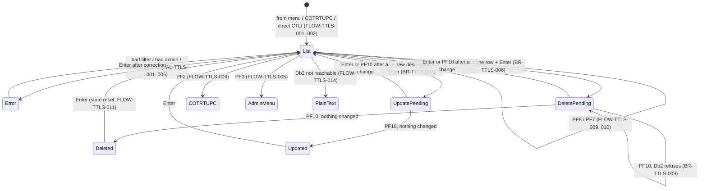
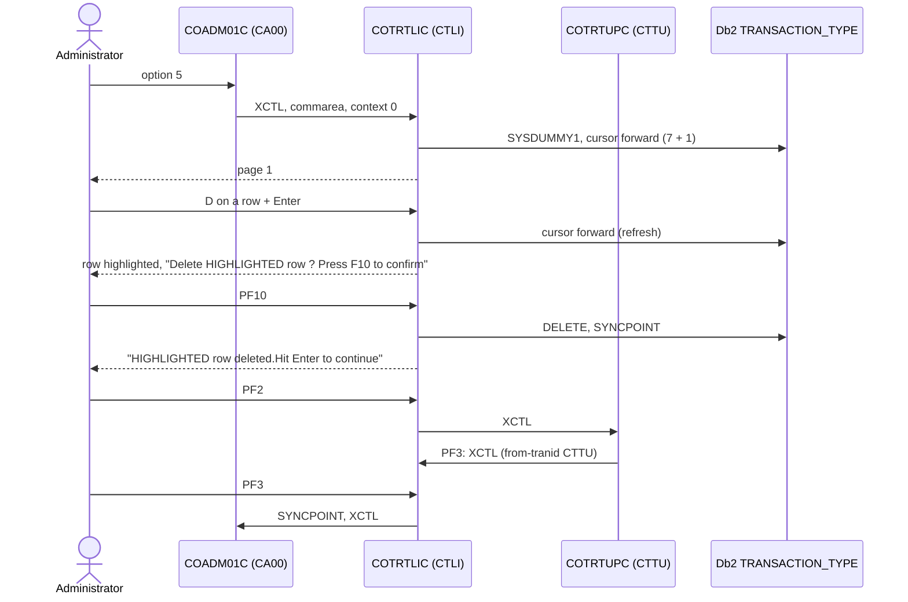

# COTRTLIC: Transaction type list, update and delete (Db2)

## 1. Summary

An administrator picks option 5 **Transaction Type List/Update (Db2)** on the admin menu and gets a paged list of the transaction types stored in the Db2 table `CARDDEMO.TRANSACTION_TYPE` (ENT-DB2-TRAN-TYPE), 7 rows per page, ordered by type code. The list can be narrowed with a type code filter (exact 2-digit match) and a description filter (case-sensitive "contains"). On one row the user can type `D` (delete) or `U` (update, with a new description typed over the old one) and press Enter; the program highlights the row and asks for confirmation, and PF10 then deletes the row or updates its description and commits. PF7/PF8 page backward and forward, PF2 transfers to the add/maintenance program `COTRTUPC`, PF3 returns to the admin menu. Deleting a type that still has categories in `CARDDEMO.TRANSACTION_TYPE_CATEGORY` (ENT-DB2-TRAN-TYPE-CAT) is refused by Db2, which with the seed data is every type (BR-TTLS-009). The program does no authorisation check of its own (DEF-TTLS-009).

## 2. Rules at a glance

| ID | Rule |
| :-- | :-- |
| BR-TTLS-001 | The list shows transaction types in ascending type code order, at most 7 per page. |
| BR-TTLS-002 | The type code filter selects the one type whose code equals the 2 digits typed; blank or `00` means no type filter. |
| BR-TTLS-003 | The description filter selects types whose description contains the typed text (case-sensitive; `%` and `_` act as wildcards). |
| BR-TTLS-004 | When both filters are given, a type must satisfy both. |
| BR-TTLS-005 | Only one row action (`D` or `U`) may be requested per interaction. |
| BR-TTLS-006 | Delete is two-step: `D` + Enter highlights the row and asks for PF10; PF10 deletes and commits. |
| BR-TTLS-007 | Update is two-step: `U` + new description + Enter highlights the row and asks for PF10; PF10 updates the description and commits. |
| BR-TTLS-008 | The stored description is the typed text without leading and trailing spaces, padded with spaces to 50 characters. |
| BR-TTLS-009 | A type that still has categories cannot be deleted (Db2 foreign key with ON DELETE RESTRICT). |
| BR-TTLS-010 | Paging forward starts at the first type after the current page; paging backward shows the 7 types before the current page; a page counter is kept. |
| VAL-TTLS-001 | A type code filter, if given, must be 2 digits. |
| VAL-TTLS-002 | The filters must select at least one type. |
| VAL-TTLS-003 | A row action code must be `D` or `U`. |
| VAL-TTLS-004 | At most one row may carry an action code. |
| VAL-TTLS-005 | An update needs a non-blank description. |
| VAL-TTLS-006 | A new description may contain only letters, digits and spaces. |
| VAL-TTLS-007 | An update whose description equals the stored one (ignoring case and surrounding spaces) gets a warning, not an error. |
| VAL-TTLS-008 | Message precedence: when several checks fail, the message of the last check to run is shown (decision table). |

## 3. Actors and triggers

- **Actor:** an administrator signed on to CardDemo. The program itself never checks the user type or the user ID (DEF-TTLS-009).
- **Normal trigger:** admin menu `COADM01C`, option 5 `Transaction Type List/Update (Db2) ` (`app/cpy/COADM02Y.cpy:46-49`). The menu transfers control (XCTL) with the 160-byte commarea, `CDEMO-FROM-PROGRAM` = `COADM01C` and `CDEMO-PGM-CONTEXT` = 0 (`app/cbl/COADM01C.cbl:140-148`).
- **Return from COTRTUPC:** PF3 in `COTRTUPC` transfers back to `COTRTLIC` with `CDEMO-FROM-TRANID` = `CTTU` and `CDEMO-PGM-CONTEXT` = 0 (`app/app-transaction-type-db2/cbl/COTRTUPC.cbl:429-460`); the list starts afresh (FLOW-TTLS-002).
- **Re-entry trigger:** every interaction ends with "return, next transaction `CTLI`" (FLOW-TTLS-013); CICS starts `CTLI` again when the user presses a key. `CTLI` is defined in group CARDDEMO with program `COTRTLIC` (`app/app-transaction-type-db2/csd/CRDDEMOD.csd:11-17, 25-34`) and uses the Db2 entry `CARDDEMO` (plan `CARDDEMO`, `AUTHTYPE(USERID)`, `THREADLIMIT(1)`) through `DB2TRAN(CTLITRAN)` (`app/app-transaction-type-db2/csd/CRDDEMOD.csd:45-55`).
- **Direct start:** typing `CTLI` on a blank terminal starts the program with no commarea. Unlike the base programs, it does not send the user to sign-on: it builds a fresh commarea, marks the user as an administrator and shows the list (FLOW-TTLS-001, DEF-TTLS-009).
- **Precondition:** the Db2 connection works; otherwise every interaction ends with a plain-text error (FLOW-TTLS-014).

## 4. Interfaces

### 4.1 Screen CTRTLIA (mapset COTRTLI), 24 x 80

Source: `app/app-transaction-type-db2/bms/COTRTLI.bms:20-338`; symbolic map `app/app-transaction-type-db2/cpy-bms/COTRTLI.cpy:17-500` (input 17-258, output 259-500). The program addresses the 7 list rows through its own redefinition of the symbolic map (`:434-478`): 238 bytes of header fields, then 7 groups of selection (1), type (2) and description (50).

| Row,Col | Field | Len | Direction | Attributes (map default; program changes in FLOW-TTLS-016/017) | Content |
| :-- | :-- | --: | :-- | :-- | :-- |
| 1,1 | (label) | 5 | out | protected, blue | `Tran:` |
| 1,7 | `TRNNAME` | 4 | out | protected, blue | `CTLI` |
| 1,21 | `TITLE01` | 40 | out | protected, yellow | `CCDA-TITLE01` (`app/cpy/COTTL01Y.cpy:18-19`) |
| 1,65 | (label) | 5 | out | protected, blue | `Date:` |
| 1,71 | `CURDATE` | 8 | out | protected, blue | today `mm/dd/yy` (NUM-TTLS-006) |
| 2,1 | (label) | 5 | out | protected, blue | `Prog:` |
| 2,7 | `PGMNAME` | 8 | out | protected, blue | `COTRTLIC` |
| 2,21 | `TITLE02` | 40 | out | protected, yellow | `CCDA-TITLE02` (`app/cpy/COTTL01Y.cpy:20-22`) |
| 2,65 | (label) | 5 | out | protected, blue | `Time:` |
| 2,71 | `CURTIME` | 8 | out | protected, blue | now `hh:mm:ss` |
| 4,28 | (label) | 25 | out | neutral | `Maintain Transaction Type` |
| 4,70 | (label) | 5 | out | default | `Page ` |
| 4,76 | `PAGENO` | 3 | out | default | page counter, 1 digit left-aligned (NUM-TTLS-001) |
| 6,30 | (label) | 12 | out | protected, turquoise | `Type Filter:` |
| 6,44 | `TRTYPE` | 2 | in/out | **unprotected**, green, underlined, FSET, initial cursor | type code filter |
| 8,4 | (label) | 19 | out | protected, turquoise | `Description Filter:` |
| 8,25 | `TRDESC` | 50 | in/out | **unprotected**, green, underlined, FSET | description filter |
| 10,4 / 10,16 / 10,42 | (labels) | 10 / 4 / 11 | out | neutral | `Select    `, `Type`, `Description` |
| 11,4 / 11,15 / 11,25 | (labels) | 6 / 5 / 50 | out | neutral | dashes |
| 12..18,6 | `TRTSEL1`..`TRTSEL7` | 1 | in/out | protected, FSET, underlined in the map; unprotected by the program on rows that show a type | row action `D` / `U` |
| 12..18,17 | `TRTTYP1`..`TRTTYP7` | 2 | out (returned, FSET) | protected | type code |
| 12..18,25 | `TRTYPD1`..`TRTYPD7` | 50 | in/out | unprotected in the map; protected by the program except on the row being updated | description |
| 19,6 / 19,17 / 19,25 | `TRTSELA`, `TRTTYPA`, `TRTDSCA` | 1 / 2 / 50 | - | protected | an eighth row that the program never fills (blank) |
| 21,19 | `INFOMSG` | 45 | out | protected, neutral | information message, centred (FLOW-TTLS-018) |
| 23,1 | `ERRMSG` | 78 | out | protected, bright, red | error message (section 8.3) |
| 24,1..44 | (labels) | | out | protected, turquoise | `F2=Add`, `F3=Exit`, `F7=Page Up`, `F8=Page Dn`, `F10=Save` |

The message work field behind `ERRMSG` is 75 characters (`WS-RETURN-MSG`, `:249`); the last 3 positions of `ERRMSG` are always blank.

### 4.2 Db2

| Object | Entity | Operation | Key / predicate | Lines |
| :-- | :-- | :-- | :-- | :-- |
| `SYSIBM.SYSDUMMY1` | - | `SELECT 1 ... FETCH FIRST 1 ROW ONLY` (connectivity check) | - | `app/app-transaction-type-db2/cpy/CSDB2RPY.cpy:23-28` |
| `CARDDEMO.TRANSACTION_TYPE` | ENT-DB2-TRAN-TYPE | `SELECT COUNT(1)` with the filters | BR-TTLS-002..004 | 1803-1815 |
| same | | cursor `C-TR-TYPE-FORWARD`: `TR_TYPE >= start key`, filters, `ORDER BY TR_TYPE` | | 338-352, 1942-1995 |
| same | | cursor `C-TR-TYPE-BACKWARD`: `TR_TYPE < start key`, filters, `ORDER BY TR_TYPE DESC` | | 354-368, 1997-2048 |
| same | | `UPDATE ... SET TR_DESCRIPTION = :desc WHERE TR_TYPE = :code` | primary key `TR_TYPE` | 1846-1850 |
| same | | `DELETE ... WHERE TR_TYPE = :code` | primary key `TR_TYPE` | 1900-1903 |
| `CARDDEMO.TRANSACTION_TYPE_CATEGORY` | ENT-DB2-TRAN-TYPE-CAT | not accessed by the program; its foreign key restricts the delete | `TRC_TYPE_CODE` references `TR_TYPE` | `app/app-transaction-type-db2/ddl/TRNTYCAT.ddl:1-7`, `app/app-transaction-type-db2/ctl/DB2CREAT.ctl:96-99` |

Table definitions: `TR_TYPE CHAR(2) NOT NULL` primary key, `TR_DESCRIPTION VARCHAR(50) NOT NULL` (`app/app-transaction-type-db2/ddl/TRNTYPE.ddl:1-4`); host variables `DCL-TR-TYPE PIC X(2)`, `DCL-TR-DESCRIPTION` = 2-byte binary length + `PIC X(50)` text (`app/app-transaction-type-db2/dcl/DCLTRTYP.dcl:35-46`). The tablespaces use `LOCKSIZE TABLE` (`app/app-transaction-type-db2/ctl/DB2CREAT.ctl:24-31, 61-68`). Formatted Db2 error texts come from a `CALL 'DSNTIAC'` (`app/app-transaction-type-db2/cpy/CSDB2RPY.cpy:53-85`).

### 4.3 Commarea

`ENT-COMMAREA` (160 bytes, `COCOM01Y`) followed by the 427-byte program extension `WS-THIS-PROGCOMMAREA` (`:377-418`); the program returns a 2000-byte area (`WS-COMMAREA`, `:420`, `:904-913`) whose bytes 588-2000 are spaces. XCTL to other programs passes only the 160-byte `CARDDEMO-COMMAREA` (`:620-623`, `:648-651`).

| Extension field | Picture | Use |
| :-- | :-- | :-- |
| `WS-CA-TYPE-CD` | X(2) | type filter of the previous screen, to detect a change |
| `WS-CA-TYPE-DESC` | X(50) | description filter of the previous screen (as typed, not the `%...%` pattern) |
| `WS-CA-ROW-TR-CODE-OUT(1..7)`, `WS-CA-ROW-TR-DESC-OUT(1..7)` | 7 x (X(2) + X(50)) | rows shown; low-values = empty row |
| `WS-CA-ROW-SELECTED` | S9(4) binary | row number of the last action request (0 = none) |
| `WS-CA-LAST-TR-CODE`, `WS-CA-FIRST-TR-CODE` | X(2) each | paging keys |
| `WS-CA-SCREEN-NUM` | 9(1) | page counter, 1 = first page (NUM-TTLS-001) |
| `WS-CA-LAST-PAGE-DISPLAYED` | 9(1) | 0 = last page already shown, 9 = not shown |
| `WS-CA-NEXT-PAGE-IND` | X(1) | `Y` = another page exists; low-values or space (after initialisation) = none |
| `WS-CA-DELETE-FLAG`, `WS-CA-UPDATE-FLAG` | X(1) each | `Y` = a delete / update confirmation is pending; low-values or space (after initialisation) = none or succeeded |

| Commarea field | Read | Written | Use |
| :-- | :-- | :-- | :-- |
| `CDEMO-FROM-TRANID` | yes | yes | PF3 target transaction; `CTTU` + PF3 means "back from COTRTUPC" (FLOW-TTLS-002); set to `CTLI` on every return |
| `CDEMO-FROM-PROGRAM` | yes | yes | decides fresh entry versus re-entry and the PF3 target; set to `COTRTLIC` on every return |
| `CDEMO-TO-TRANID`, `CDEMO-TO-PROGRAM` | no | yes | XCTL target (PF3, PF2) |
| `CDEMO-USER-TYPE` | no | yes | set to `A` on direct start and PF3, to `U` on PF2 (DEF-TTLS-012) |
| `CDEMO-PGM-CONTEXT` | yes | yes | 0 = enter; never set to 1 by this program |
| `CDEMO-LAST-MAP`, `CDEMO-LAST-MAPSET` | no | yes | `CTRTLIA`, `COTRTLI` |
| all others (user ID, customer, account, card) | no | passed through; cleared after a successful delete (DEF-TTLS-008) | |

### 4.4 Plain-text output

A failed Db2 connectivity check sends the 800-character `WS-LONG-MSG` as plain text with erase and ends the conversation (FLOW-TTLS-014). `SEND-PLAIN-TEXT` (`:2066-2076`) is never performed.

## 5. Data used

| Entity field | Read | Written | How |
| :-- | :-- | :-- | :-- |
| ENT-DB2-TRAN-TYPE.TR_TYPE | yes | key only | listed; filter; key of update and delete (taken from the screen row, DEF-TTLS-009) |
| ENT-DB2-TRAN-TYPE.TR_DESCRIPTION | yes | yes | listed (first 50 characters of the VARCHAR into `X(50)`); filter; updated (BR-TTLS-008) |
| ENT-DB2-TRAN-TYPE (row) | | deleted | PF10 after `D` |
| ENT-DB2-TRAN-TYPE-CAT | no | no | only its foreign key affects the delete |
| ENT-COMMAREA | yes | yes | section 4.3 |

Program-local data with behaviour:

- Key and screen work fields: `CCARD-AID` (`app/cpy/CVCRD01Y.cpy:3-19`), the received filters `WS-IN-TYPE-CD`, `WS-IN-TYPE-DESC` (`:309-313`), the received rows `WS-SCREEN-DATA-IN` (`:165-172`) and the action codes `WS-EDIT-SELECT(1..7)` (`:178-188`).
- SQL host variables: `WS-START-KEY` X(2), `WS-TYPE-CD-FILTER` X(2), `WS-TYPE-DESC-FILTER` X(52), and the flags `WS-EDIT-TYPE-FLAG` / `WS-EDIT-DESC-FLAG` (`'1'` = filter valid, `'0'` = invalid, space = blank; `:103-110`, `:274-278`).
- Action counters `WS-ACTIONS-REQUESTED`, `WS-DELETES-REQUESTED`, `WS-UPDATES-REQUESTED`, `WS-VALID-ACTIONS-SELECTED` and `I-SELECTED` (`:197-220`).
- Change flags `WS-TYPEFILTER-CHANGED`, `WS-DESCFILTER-CHANGED`, `WS-ROW-SELECTION-CHANGED` (low-values = no, `Y` = yes; `:111-129`).
- `WS-MISC-STORAGE` (all of the above plus the Db2 work area `CSDB2RWY`) is initialised at the start of every task (`:500-502`): alphanumeric fields become spaces, numeric fields zero. Only the commarea carries state between interactions.
- Declared but without effect: `WS-ROW-RECORDS-CHANGED`, `WS-TYPE-CD-DELETE-FILTER` (an unused `IN (...)` list), `LIT-TRANTYPE-TABLE`, `LIT-ADMINMAPSET`, `LIT-ADDTTRANID` except for the PF3 check, `CCARD-NEXT-PROG/-MAPSET/-MAP`, `CCARD-ERROR-MSG`, `CC-ACCT-ID`, `CC-CARD-NUM`, `CC-CUST-ID`, and the copybooks `CSMSG01Y`, `CSUSR01Y`, `CVACT02Y` (`:480-490`).

## 6. Processing flow

Each arrow is one CICS task: (receive the screen and edit it), act, send the screen, return with next transaction `CTLI`.

**Main line (0000-MAIN, lines 498-897)**

1. Initialise the work areas; clear the error message (500-511).
2. No commarea: build one (FLOW-TTLS-001). Otherwise copy the 160-byte commarea and the 427-byte extension from the received area (515-532).
3. Map the AID key, PF13-PF24 folded onto PF1-PF12 (538-539, FLOW-TTLS-004).
4. Fresh entry (from another program, or PF3 back from `COTRTUPC`): forget the extension, treat the key as Enter (544-554, FLOW-TTLS-002).
5. Re-entry (`CDEMO-FROM-PROGRAM` = `COTRTLIC`): receive the screen and run all edits (561-566, FLOW-TTLS-003). The edits include a Db2 `COUNT` when a filter is given.
6. Keys other than Enter, PF2, PF3, PF7, PF8 and (with a pending request) PF10 become Enter (574-587).
7. PF3: commit and transfer to the admin menu (591-625). PF2 on re-entry: transfer to `COTRTUPC` (630-652).
8. Any key but PF8 resets "last page shown" (657-661). PF10 after a change becomes Enter (666-678, FLOW-TTLS-007).
9. Db2 connectivity check; on failure plain-text error and end (684-691).
10. Decide and act (698-879, FLOW-TTLS-008), send the screen (FLOW-TTLS-015..018), return (FLOW-TTLS-013).

**Edits (1200-EDIT-INPUTS, lines 960-976)**, in this order: row actions and update description (1210, 1211, 1240), description filter (1230), type filter (1220), filter cross-check with `COUNT` (1290). The order fixes which message wins (VAL-TTLS-008).

## 7. Business rules

#### BR-TTLS-001 · List order and page size
- **When:** a page is read forward.
- **Then:** the cursor `C-TR-TYPE-FORWARD` returns the types with `TR_TYPE` >= the start key that satisfy the filters, ascending by `TR_TYPE`; the first 7 fill rows 1-7 (code and description). The first row's code becomes `WS-CA-FIRST-TR-CODE`. When a 7th row is read, one more row is fetched to know whether another page exists (FLOW-TTLS-009). With fewer than 7 rows, the remaining rows are empty (low-values) and shown blank and protected. The start key is `WS-CA-FIRST-TR-CODE` (re-show the current page) except on PF8. After a filter change or a fresh entry it is spaces, which selects from the lowest code.
- **Source:** `:338-352, 1603-1723`
- **Fidelity:** must-preserve
- **Confidence:** reviewed; cursor semantics platform-inferred

#### BR-TTLS-002 · Type code filter
- **When:** the type filter field holds 2 digits other than `00`.
- **Then:** only the type with `TR_TYPE` equal to those 2 characters is listed (`WS-EDIT-TYPE-FLAG` = `'1'`). Blank, empty (low-values) and `00` mean "no type filter" (`00` therefore cannot be searched for).
- **Source:** `:1096-1123, 343-346, 1807-1809`
- **Fidelity:** must-preserve
- **Confidence:** reviewed

#### BR-TTLS-003 · Description filter
- **When:** the description filter field is neither spaces nor empty.
- **Then:** the pattern `'%' + text without leading and trailing spaces + '%'` (at most 52 characters, `WS-TYPE-DESC-FILTER`) is used as `TR_DESCRIPTION LIKE TRIM(pattern)`. The match is a case-sensitive substring match on the stored bytes (the seed descriptions are upper case, `app/app-transaction-type-db2/ctl/DB2LTTYP.ctl:17-23`); interior spaces count; a `%` or `_` typed by the user acts as an SQL wildcard (DEF-TTLS-016).
- **Source:** `:1142-1164, 347-350, 1811-1814`
- **Fidelity:** must-preserve (case sensitivity: defect-decide, Q-TTLS-006)
- **Confidence:** platform-inferred (Db2 LIKE and collation)

#### BR-TTLS-004 · Filters combined
- **When:** both filters are given.
- **Then:** a type must satisfy both (AND). Each filter applies only when its flag is `'1'`; the same predicate is used by the count, the forward cursor and the backward cursor. Filters exist only on the screen: they apply in the interaction in which the screen is received, so a fresh entry always lists without filters.
- **Source:** `:343-350, 359-366, 1807-1814`
- **Fidelity:** must-preserve
- **Confidence:** reviewed

#### BR-TTLS-005 · One action per interaction
- **When:** the screen is received.
- **Then:** the action fields of rows 1-7 are counted: blanks (space or low-values), `D` and `U`. Requested actions = 7 - blanks (so invalid codes count as actions); valid actions = `D` + `U`. The selected row `I-SELECTED` is the lowest row number holding `D` or `U`. More than one requested action is VAL-TTLS-004; any other code is VAL-TTLS-003. The selected row number is stored in the commarea; a different number than last time counts as a "selection change" (FLOW-TTLS-007).
- **Source:** `:982-1053`
- **Fidelity:** must-preserve
- **Confidence:** reviewed

#### BR-TTLS-006 · Two-step delete
- **When:** step 1: Enter with `D` on exactly one row and no input error. Step 2: PF10 in the next interaction with the same row still marked, neither filter changed and no other selection.
- **Then:** step 1 re-reads the current page, highlights the row's code and description (neutral/white), puts the cursor on its action field, keeps `D` in it, sets the pending-delete flag and shows `Delete HIGHLIGHTED row ? Press F10 to confirm` (only if neither filter changed in this interaction; otherwise no information message). Step 2 deletes the row whose code is in the screen row (SE-TTLS-006) and, on success, commits and shows `HIGHLIGHTED row deleted.Hit Enter to continue` with the old page still displayed (FLOW-TTLS-011).
- **Otherwise:** a refused delete leaves the request pending and shows the Db2 message (ERR-TTLS-002).
- **Source:** `:794-834, 1348-1354, 1391-1399, 1507-1508, 1514-1522`
- **Fidelity:** must-preserve
- **Confidence:** reviewed

#### BR-TTLS-007 · Two-step update
- **When:** step 1: Enter with `U` on exactly one row and a description on that row that passes VAL-TTLS-005/006. Step 2: PF10 with the same row still marked, no filter change and no other selection.
- **Then:** step 1 re-reads the current page, highlights the row's code, leaves the description field unprotected with the cursor in it, shows the user's new description in it (or the stored one when VAL-TTLS-007 found no change), sets the pending-update flag and shows `Update HIGHLIGHTED row. Press F10 to save` (only if neither filter changed). Step 2 updates the description (SE-TTLS-005) with the description received in this interaction, commits, re-reads the page and shows `HIGHLIGHTED row was updated`; the row stays highlighted with its action field blank and the cursor on it.
- **Otherwise:** a failed update leaves the request pending and shows the Db2 message (ERR-TTLS-002). VAL-TTLS-007 does not prevent step 2 (DEF-TTLS-004).
- **Source:** `:838-868, 1356-1370, 1404-1422, 1509-1510, 1523-1531`
- **Fidelity:** must-preserve
- **Confidence:** reviewed

#### BR-TTLS-008 · Stored description value
- **When:** an update is executed.
- **Then:** the new `TR_DESCRIPTION` is the received row description with leading spaces removed (on receive) and trailing spaces removed, moved into the 50-character text, which pads it with spaces; the VARCHAR length is set to 50, the declared length of the field, not the length of the text. Every updated description is therefore stored as exactly 50 characters with trailing spaces (DEF-TTLS-001).
- **Source:** `:949-950, 1839-1844`
- **Fidelity:** defect-decide (Q-TTLS-001)
- **Confidence:** reviewed; VARCHAR storage platform-inferred

#### BR-TTLS-009 · Delete restricted by categories
- **When:** the type to delete has rows in `CARDDEMO.TRANSACTION_TYPE_CATEGORY` (`TRC_TYPE_CODE` = `TR_TYPE`).
- **Then:** Db2 refuses the delete because of the foreign key `ON DELETE RESTRICT` (SQLCODE -532); the program shows `Please delete associated child records first: SQLCODE: -532 ...` (ERR-TTLS-001). The seed data gives categories to all 7 seeded types `01`-`07` (`app/app-transaction-type-db2/ctl/DB2LTCAT.ctl:20-37`), so none of them can be deleted here. This program offers no way to delete categories.
- **Source:** `:1914-1925`; `app/app-transaction-type-db2/ctl/DB2CREAT.ctl:96-99`; `app/app-transaction-type-db2/ddl/TRNTYCAT.ddl:6-7`
- **Fidelity:** must-preserve (Q-TTLS-002)
- **Confidence:** platform-inferred (SQLCODE value)

#### BR-TTLS-010 · Paging and page counter
- **When:** PF8 or PF7.
- **Then:** PF8, when another page exists, adds 1 to the page counter and reads forward from `WS-CA-LAST-TR-CODE`, which is the code of the look-ahead row (the 8th), so the next page starts right after the current one. PF7, when the counter is not 1, subtracts 1 and reads backward: the cursor `C-TR-TYPE-BACKWARD` returns the types with `TR_TYPE` < `WS-CA-FIRST-TR-CODE` in descending order and fills rows 7 down to 1; the first code becomes the code in row 1, the previous first code becomes the last code, and "next page exists" is set. "First page" means only "counter = 1", not "no rows before" (DEF-TTLS-005, DEF-TTLS-006). Both keys clear any action codes typed on the old page.
- **Source:** `:766-790, 1727-1792`
- **Fidelity:** must-preserve
- **Confidence:** reviewed; cursor semantics platform-inferred

## 8. Validations and messages

#### VAL-TTLS-001 · Type code filter must be 2 digits
- **When:** the type filter is not blank, not low-values, not `00`, and not numeric (for example `1`, `1 `, ` 1`, `A1`).
- **Then:** input error; message `TYPE CODE FILTER,IF SUPPLIED MUST BE A 2 DIGIT NUMBER`; the type filter field is shown red with the cursor in it; all row action fields are protected; the list is not re-read (the rows of the previous screen stay displayed). Because the new filter text differs from the saved one, the paging keys are reset (`:1134`) and nothing sets the page number back, so the page number shows `0` and the next valid Enter lists from the lowest code.
- **Source:** `:1111-1118, 1127-1137, 713-717, 1340-1341, 1477-1480`
- **Fidelity:** must-preserve
- **Confidence:** reviewed

#### VAL-TTLS-002 · Filters must select something
- **When:** at least one filter is valid and `SELECT COUNT(1)` with the filters returns 0.
- **Then:** input error; message `No Records found for these filter conditions`; each valid filter is marked invalid and shown red with the cursor; row action fields protected; the list is not re-read. When a filter changed in this interaction, the paging keys were reset (`:1134, 1172`), so the page number shows `0`.
- **Source:** `:1134, 1172, 1239-1268, 1801-1833`
- **Fidelity:** must-preserve
- **Confidence:** reviewed

#### VAL-TTLS-003 · Action code must be D or U
- **When:** a row action field holds anything other than `D`, `U`, space or low-values (lower-case `d`/`u` included, unless the terminal translates input to upper case).
- **Then:** input error; message `Action code selected is invalid`; that row's action field is red with the cursor.
- **Source:** `:1034-1038, 1343-1346`
- **Fidelity:** must-preserve
- **Confidence:** reviewed; upper-case translation platform-inferred (Q-TTLS-005)

#### VAL-TTLS-004 · Only one action
- **When:** more than one row has a non-blank action field.
- **Then:** input error; message `Please select only 1 action` (replaces VAL-TTLS-003's message); every row with `D` or `U` gets a red action field with the cursor; no row is highlighted.
- **Source:** `:1024-1027, 1049-1052`
- **Fidelity:** must-preserve
- **Confidence:** reviewed

#### VAL-TTLS-005 · Description required for update
- **When:** a row has `U` and its description changed (VAL-TTLS-007) and is blank: spaces, or `*` (an asterisk alone is read as "blank", `:945-947`).
- **Then:** input error; message `Transaction Desc must be supplied.` (only if no message is set yet); the description field shows `*`, is unprotected, red, with the cursor (when only one action is requested).
- **Source:** `:1078-1089, 1181-1205, 1366-1368, 1414-1415`
- **Fidelity:** must-preserve
- **Confidence:** reviewed

#### VAL-TTLS-006 · Description characters
- **When:** a changed, non-blank update description contains a character other than `A`-`Z`, `a`-`z`, `0`-`9` and space (hyphen, full stop, comma, slash and so on).
- **Then:** input error; message `Transaction Desc can have numbers or alphabets only.` (only if no message is set yet); description field red and unprotected with the cursor, showing the user's text.
- **Source:** `:1207-1233, 1416-1418`
- **Fidelity:** must-preserve (Q-TTLS-004)
- **Confidence:** reviewed; depends on NUM-TTLS-007

#### VAL-TTLS-007 · No change detected
- **When:** a row has `U` and its received description, upper-cased and without surrounding spaces, equals the stored description upper-cased and trimmed, with the same trimmed length.
- **Then:** message `No change detected with respect to database values.` (red, in `ERRMSG`), but this is **not** an input error: the update request proceeds as in BR-TTLS-007 step 1, the description field shows the stored value again (a case-only change is undone on screen), and PF10 saves it (DEF-TTLS-004).
- **Source:** `:1060-1076, 1420-1421`
- **Fidelity:** must-preserve
- **Confidence:** reviewed

#### VAL-TTLS-008 · Message precedence (decision table)

`ERRMSG` shows the last message written to the 75-character message field. Edits run in this order; "always" means the step overwrites any earlier message, "if empty" means it writes only when no message is set yet.

| Order | Step | Message | Writes | Source |
| --: | :-- | :-- | :-- | :-- |
| 1 | row loop, row 7 down to 1: invalid code | `Action code selected is invalid` | always | 1038 |
| 1 | row loop: `U` row, no change | `No change detected with respect to database values.` | always | 1072 |
| 1 | row loop: `U` row, blank / bad characters | VAL-TTLS-005 / 006 texts | if empty | 1195-1201, 1222-1228 |
| 2 | more than one action | `Please select only 1 action` | always | 1051 |
| 3 | type filter not numeric | `TYPE CODE FILTER,IF SUPPLIED MUST BE A 2 DIGIT NUMBER` | always | 1115-1117 |
| 4 | count query fails | `Error reading TRANSACTION_TYPE table SQLCODE:...` | if empty | 1825-1830 |
| 4 | count = 0 (also after a failed count) | `No Records found for these filter conditions` | always | 1263-1265 |
| 5 | Db2 errors while acting (cursor, update, delete) | ERR-TTLS-002 | if empty | 1685-1716, 1783-1789, 1863-1887, 1917-1933, 1956-2046 |
| 5 | forward read finds no further page on PF8 | `No more pages for these search conditions` | if empty | 1677-1680, 1698-1701 |
| 5 | forward read finds no row on page 1 | `No records found for this search condition.` | always | 1702-1705 |
| 6 | PF7 on page 1 | `No previous pages to display` | always | 1532-1535 |
| 6 | PF8, no next page, last page already shown | `No more pages to display` | always | 1536-1540 |

- **Source:** `:960-976, 1504-1557`
- **Fidelity:** must-preserve
- **Confidence:** reviewed

### 8.1 Flow and keys

#### FLOW-TTLS-001 · Start without commarea
- **When:** `EIBCALEN` = 0 (transaction `CTLI` typed on a clear screen).
- **Then:** the commarea and extension are initialised; `CDEMO-FROM-TRANID` = `CTLI`, `CDEMO-FROM-PROGRAM` = `COTRTLIC`, user type `A` (administrator), context 0, first page. Because the from-program is now this program, the fresh-entry reset (FLOW-TTLS-002) does not run, but the screen is not received either; the key pressed is used as is (Enter normally gives the list without filters; PF3 goes to the admin menu; PF2 to `COTRTUPC`).
- **Source:** `:515-525, 544-547, 561-566`
- **Fidelity:** must-preserve (security: DEF-TTLS-009)
- **Confidence:** reviewed

#### FLOW-TTLS-002 · Fresh entry
- **When:** context 0 (enter) and `CDEMO-FROM-PROGRAM` is not `COTRTLIC` (from the admin menu or `COTRTUPC`), or PF3 with `CDEMO-FROM-TRANID` = `CTTU` (PF3 in `COTRTUPC` brought the user back).
- **Then:** the extension is cleared (filters, rows, paging, pending flags), the key is treated as Enter, first page; the screen is not received. The list is read from the lowest code with no filters and sent (the "other" branch of FLOW-TTLS-008). On first entry from the admin menu the filter fields are left empty.
- **Source:** `:544-554, 870-878, 1440-1443`
- **Fidelity:** must-preserve
- **Confidence:** reviewed

#### FLOW-TTLS-003 · Re-entry: receive and edit
- **When:** a commarea is present and `CDEMO-FROM-PROGRAM` = `COTRTLIC` (every interaction after the first, since every return sets it, FLOW-TTLS-013).
- **Then:** receive the screen (FLOW-TTLS-019) and run the edits in the order of section 6, before the key is examined. The edits run even for PF2 and PF3, including the `COUNT` query.
- **Source:** `:561-566, 919-925, 960-976`
- **Fidelity:** must-preserve (order: incidental)
- **Confidence:** reviewed

#### FLOW-TTLS-004 · Valid keys
- **When:** after the AID is mapped (PF13-PF24 count as PF1-PF12; Clear, PA1, PA2 are recognised; PA3 is not mapped and leaves the key blank).
- **Then:** valid keys are Enter, PF2, PF3, PF7, PF8, and PF10 when a delete or update confirmation is pending in the commarea. Every other key (PF1, PF4-PF6, PF9, PF11, PF12, Clear, PA1-PA3, PF10 without pending request) is processed exactly like Enter, with no message.
- **Source:** `:538-539, 574-587`; `app/cpy/CSSTRPFY.cpy:21-78`
- **Fidelity:** must-preserve
- **Confidence:** reviewed

#### FLOW-TTLS-005 · PF3, exit
- **When:** PF3 (and not the "back from COTRTUPC" case of FLOW-TTLS-002).
- **Then:** target transaction = `CDEMO-FROM-TRANID` unless it is blank, low-values or `CTLI`, then `CA00`; target program = `CDEMO-FROM-PROGRAM` unless blank, low-values or `COTRTLIC`, then `COADM01C`. Since every screen of this program returns with `COTRTLIC`/`CTLI` in these fields, PF3 always goes to `COADM01C` in practice. Before leaving: from-tranid `CTLI`, from-program `COTRTLIC`, user type `A`, context 0, last map `CTRTLIA`/`COTRTLI`; `SYNCPOINT` (SE-TTLS-007); XCTL with the 160-byte commarea.
- **Source:** `:591-625`
- **Fidelity:** must-preserve
- **Confidence:** reviewed

#### FLOW-TTLS-006 · PF2, add a type
- **When:** PF2 and `CDEMO-FROM-PROGRAM` = `COTRTLIC` (always true on re-entry and on a direct start).
- **Then:** from-tranid `CTLI`, from-program `COTRTLIC`, user type `U`, context 0, last map `CTRTLIA`/`COTRTLI`, to-program `COTRTUPC`; XCTL to `COTRTUPC` with the 160-byte commarea. No `SYNCPOINT`. `COTRTUPC` shows its empty search screen when called from `COTRTLIC` with context 0, keeps the commarea, and its PF3 returns here (`app/app-transaction-type-db2/cbl/COTRTUPC.cbl:429-478`).
- **Source:** `:630-652`
- **Fidelity:** must-preserve (user type: DEF-TTLS-012)
- **Confidence:** reviewed

#### FLOW-TTLS-007 · PF10 confirmation guard
- **When:** PF10 with a pending delete or update request.
- **Then:** PF10 is honoured only if, in this interaction, the type filter and the description filter are unchanged and the selected row number is the same as last time; otherwise it is processed as Enter (a new request). The guard compares the row number only, not the action code (DEF-TTLS-003).
- **Source:** `:666-678, 1042-1047, 1125-1137, 1165-1175`
- **Fidelity:** must-preserve
- **Confidence:** reviewed

#### FLOW-TTLS-008 · What to do (decision table)
- **Then:** the first matching row applies (after FLOW-TTLS-004/005/006/007 and the connectivity check).

| # | Condition | Action | Source |
| --: | :-- | :-- | :-- |
| 1 | input error (any VAL-TTLS-001..006) | if both filters are not invalid, re-read the page forward from `WS-CA-FIRST-TR-CODE`; send with the error | 699-720 |
| 2 | PF7 on page 1 | re-read the page forward; send with `No previous pages to display` | 721-734 |
| 3 | context "re-enter" and from-program not `COTRTLIC` (also listed with PF3, which never gets here) | reset everything, re-read from the start, send (unreachable: nothing sets context 1, DEF-TTLS-011) | 738-762 |
| 4 | PF8 and another page exists | BR-TTLS-010 forward; clear action codes; send | 766-776 |
| 5 | PF7, not page 1 | BR-TTLS-010 backward; clear action codes; send | 780-790 |
| 6 | Enter and a `D` was received | re-read the page; send (BR-TTLS-006 step 1) | 794-806 |
| 7 | PF10 and a `D` was received | delete (FLOW-TTLS-011) | 810-834 |
| 8 | Enter and a `U` was received | re-read the page; send (BR-TTLS-007 step 1) | 838-850 |
| 9 | PF10 and a `U` was received | update (FLOW-TTLS-012) | 854-868 |
| 10 | anything else (Enter without action, PF8 on the last page, PF10 with pending flag but no code) | re-read the page from `WS-CA-FIRST-TR-CODE`; send | 870-878 |

- **Source:** `:698-896`
- **Fidelity:** must-preserve
- **Confidence:** reviewed

#### FLOW-TTLS-009 · PF8 and the last page
- **When:** PF8.
- **Then:** "last page shown" is kept only for PF8 (any other key resets it to "not shown"). With a next page: BR-TTLS-010. Without one: the current page is re-read (row 10 of FLOW-TTLS-008); the forward read sets `No more pages for these search conditions` because the look-ahead finds nothing. The first such PF8 shows that text with the information message `Type U to update, D to delete any record` and records "last page shown"; the next PF8 shows `No more pages to display` and no information message. Arriving on the last page with PF8 also shows `No more pages for these search conditions` at once.
- **Source:** `:657-661, 1657-1680, 1694-1701, 1536-1549`
- **Fidelity:** must-preserve
- **Confidence:** reviewed

#### FLOW-TTLS-010 · PF7 on the first page
- **When:** PF7 and the page counter is 1.
- **Then:** the current page is re-read forward and `No previous pages to display` is shown. The source has the same `WHEN` condition twice in a row; both share one action.
- **Source:** `:721-734, 1532-1535`
- **Fidelity:** must-preserve
- **Confidence:** reviewed

#### FLOW-TTLS-011 · Delete outcome
- **When:** row 7 of FLOW-TTLS-008.
- **Then:** SE-TTLS-006. If the delete succeeded, the screen is sent from the rows held in the commarea (the deleted row is still listed, highlighted, with its action field blank) with `HIGHLIGHTED row deleted.Hit Enter to continue`; then the whole commarea, the extension and the work area are cleared, context 0, page 1, "last page not shown" (DEF-TTLS-008). The next Enter lists from the lowest code with the filters on the screen. If the delete failed, the screen is sent with the Db2 message and the request stays pending; information message `Type U to update, D to delete any record`.
- **Source:** `:810-834, 1394-1398, 1507-1508`
- **Fidelity:** must-preserve
- **Confidence:** reviewed

#### FLOW-TTLS-012 · Update outcome
- **When:** row 9 of FLOW-TTLS-008.
- **Then:** SE-TTLS-005; then, whatever the result, the page is re-read forward from `WS-CA-FIRST-TR-CODE` and sent. Success: BR-TTLS-007 step 2. Failure: Db2 message, request still pending, information message `Type U to update, D to delete any record`. This branch has no `GO TO`; it falls out of the decision and reaches the common return through the final lines, with the same result.
- **Source:** `:854-868, 882-896, 1360-1362, 1407-1411`
- **Fidelity:** must-preserve
- **Confidence:** reviewed

#### FLOW-TTLS-013 · End of every interaction
- **Then:** `CDEMO-FROM-TRANID` = `CTLI`, `CDEMO-FROM-PROGRAM` = `COTRTLIC`, last map/mapset `CTRTLIA`/`COTRTLI`; the 160-byte commarea and the 427-byte extension are copied into a 2000-byte area; `RETURN TRANSID(CTLI)` with that area.
- **Source:** `:899-915`
- **Fidelity:** must-preserve (length: incidental)
- **Confidence:** reviewed

#### FLOW-TTLS-014 · Db2 connectivity check
- **When:** every interaction, after the edits and the PF2/PF3 handling.
- **Then:** `SELECT 1 FROM SYSIBM.SYSDUMMY1`. On any SQLCODE other than 0 the message `Db2 access failure. SQLCODE:<code> <DSNTIAC text>` (ERR-TTLS-001, built in the 800-character long message) is sent as plain text with erase, and the task returns **without** a next transaction: the conversation ends and the commarea is lost.
- **Source:** `:684-691, 2085-2095`; `app/app-transaction-type-db2/cpy/CSDB2RPY.cpy:21-48`
- **Fidelity:** must-preserve (plain-text form: incidental)
- **Confidence:** platform-inferred

#### FLOW-TTLS-015 · Header and send
- **Then:** before each send the output map is cleared to low-values; titles, `CTLI`, `COTRTLIC`, date `mm/dd/yy`, time `hh:mm:ss` and the page counter are filled in; the information message starts blank (its colour byte is loaded with the "dark" attribute value). The map is sent with `ERASE`, `CURSOR` (symbolic cursor positioning by the field lengths set to -1) and `FREEKB`.
- **Source:** `:1274-1288, 1293-1323, 1587-1596`
- **Fidelity:** must-preserve (attribute details: incidental)
- **Confidence:** reviewed; cursor choice among several marked fields platform-inferred

#### FLOW-TTLS-016 · Row attributes and content
- **Then:** for each of the 7 rows:

| Row state | Action field | Code | Description |
| :-- | :-- | :-- | :-- |
| empty (no type) or a filter is invalid | protected | as held | protected |
| row has an error flag (VAL-TTLS-003/004) | unprotected, red, cursor | | protected |
| `D`, single valid action, no bad action | unprotected, cursor; shows `D`, or blank after a successful delete | neutral (highlighted) | neutral, protected |
| `U`, single valid action, update not yet done | unprotected, shows `U` | neutral | **unprotected**, cursor, red if invalid; shows the user's text (`*` if blank) or the stored text if unchanged |
| `U`, update done | unprotected, cursor, blank | neutral | neutral, protected, shows the user's text |
| other rows with a type | unprotected, shows the received action code | normal | protected, stored text |

Descriptions are protected with the "protected + FSET" attribute so they are returned on the next interaction. The rows displayed are the rows held in the commarea, which are re-read on most paths but not after a delete or an input error with an invalid filter.
- **Source:** `:1329-1374, 1383-1431`
- **Fidelity:** must-preserve (colours: incidental)
- **Confidence:** reviewed

#### FLOW-TTLS-017 · Filter fields and cursor
- **Then:** on a direct start or a first entry from the admin menu the filter fields are left as in the map. Otherwise: when any row action was requested, both filters are shown as typed but protected (autoskip) and blue; when a filter is valid or invalid it is shown as typed and unprotected; a blank type filter is shown empty. An invalid filter is red with the cursor. Without input error, the cursor goes to the type filter unless an action was requested with Enter or PF10 (then FLOW-TTLS-016 placed it).
- **Source:** `:1438-1498`
- **Fidelity:** must-preserve (DEF-TTLS-015)
- **Confidence:** reviewed

#### FLOW-TTLS-018 · Information message
- **Then:** the first matching row sets `INFOMSG` (45 characters, centred, neutral colour):

| Condition | `INFOMSG` |
| :-- | :-- |
| delete succeeded | `HIGHLIGHTED row deleted.Hit Enter to continue` |
| update succeeded | `HIGHLIGHTED row was updated` |
| a filter is invalid | none |
| Enter, one `D`, single action, no filter changed | `Delete HIGHLIGHTED row ? Press F10 to confirm` (none if a filter changed) |
| Enter, one `U`, single action, no filter changed | `Update HIGHLIGHTED row. Press F10 to save` (none if a filter changed) |
| PF7 on page 1 | none (error `No previous pages to display`) |
| PF8, no next page, last page already shown | none (error `No more pages to display`) |
| PF8, no next page | `Type U to update, D to delete any record`; mark "last page shown" |
| anything else | `Type U to update, D to delete any record` |

The information message is suppressed when the error field holds `No records found for this search condition.`. The success texts set during the update or delete are cleared by the screen initialisation and set again here. The "otherwise no message" branch of the source is unreachable (the message is always blank at this point).
- **Source:** `:1504-1581`
- **Fidelity:** must-preserve
- **Confidence:** reviewed

#### FLOW-TTLS-019 · Receiving the screen
- **Then:** the type filter (2) and description filter (50) are copied as received. For each row: the action code (1) and code (2) as received; the description becomes low-values if it is spaces or `*`, otherwise the received text without leading and trailing spaces, left-aligned and space-padded to 50. The RECEIVE response is not checked (ERR-TTLS-003).
- **Source:** `:930-954`
- **Fidelity:** must-preserve
- **Confidence:** reviewed

### 8.2 Message catalog

`ERRMSG` (row 23, red, at most 75 characters used) unless noted.

| Text (exact) | Cause | Item |
| :-- | :-- | :-- |
| `TYPE CODE FILTER,IF SUPPLIED MUST BE A 2 DIGIT NUMBER` | type filter not numeric | VAL-TTLS-001 |
| `No Records found for these filter conditions` | count = 0 | VAL-TTLS-002 |
| `Action code selected is invalid` | action other than D/U | VAL-TTLS-003 |
| `Please select only 1 action` | several actions | VAL-TTLS-004 |
| `Transaction Desc must be supplied.` | blank update description | VAL-TTLS-005 |
| `Transaction Desc can have numbers or alphabets only.` | bad character | VAL-TTLS-006 |
| `No change detected with respect to database values.` | unchanged description (warning) | VAL-TTLS-007 |
| `No previous pages to display` | PF7 on page 1 | FLOW-TTLS-010 |
| `No more pages for these search conditions` | PF8 reached the end | FLOW-TTLS-009 |
| `No more pages to display` | PF8 again on the last page | FLOW-TTLS-009 |
| `No records found for this search condition.` | page 1 has no rows | BR-TTLS-001 |
| `<action> SQLCODE:<code> <DSNTIAC text>` with `<action>` one of: `Record not found. Deleted by others ?`, `Deadlock. Someone else updating ?`, `Update failed with`, `Please delete associated child records first:`, `Delete failed with message:`, `Error reading TRANSACTION_TYPE table`, `C-TR-TYPE-FORWARD Open`, `C-TR-TYPE-FORWARD fetch`, `C-TR-TYPE-FORWARD close`, `C-TR-TYPE-BACKWARD Open`, `C-TR-TYPE-BACKWARD close`, `Error on fetch Cursor C-TR-TYPE-BACKWARD` | Db2 errors | ERR-TTLS-001, ERR-TTLS-002 |
| `Db2 access failure. SQLCODE:<code> <DSNTIAC text>` (plain text, up to 800 characters) | connectivity check failed | FLOW-TTLS-014 |
| `PF03 pressed. Exiting` | set on PF2 but never displayed (XCTL follows) | FLOW-TTLS-006 |

`INFOMSG` (row 21, neutral, centred in 45 characters):

| Text (exact) | Item |
| :-- | :-- |
| `Type U to update, D to delete any record` | FLOW-TTLS-018 |
| `Delete HIGHLIGHTED row ? Press F10 to confirm` | BR-TTLS-006 |
| `Update HIGHLIGHTED row. Press F10 to save` | BR-TTLS-007 |
| `HIGHLIGHTED row deleted.Hit Enter to continue` | BR-TTLS-006 |
| `HIGHLIGHTED row was updated` | BR-TTLS-007 |

## 9. Side effects

Order within one interaction: (count query, if a filter is given) -> connectivity check -> (delete or update with commit) -> cursor browse. Each successful update or delete is committed immediately; there is no explicit rollback anywhere.

#### SE-TTLS-001 · Connectivity query
- **What:** `SELECT 1 INTO :WS-DUMMY-DB2-INT FROM SYSIBM.SYSDUMMY1 FETCH FIRST 1 ROW ONLY` on every interaction that reaches it.
- **Source:** `app/app-transaction-type-db2/cpy/CSDB2RPY.cpy:21-45`
- **Confidence:** platform-inferred

#### SE-TTLS-002 · Count with the filters
- **What:** `SELECT COUNT(1) FROM CARDDEMO.TRANSACTION_TYPE` with the predicate of BR-TTLS-004, only when at least one filter is valid, during the edits.
- **Source:** `:1248-1249, 1801-1833`
- **Confidence:** reviewed

#### SE-TTLS-003 · Forward browse
- **What:** OPEN `C-TR-TYPE-FORWARD` with host variables start key, filter flags and filters; FETCH up to 8 rows (7 + look-ahead) into `DCL-TR-TYPE` / `DCL-TR-DESCRIPTION`; CLOSE. The host record is cleared before each fetch of the loop but not before the look-ahead fetch. On an OPEN failure, the rows are already cleared, nothing is fetched and the cursor is not closed.
- **Source:** `:1603-1723, 1942-1995`
- **Confidence:** platform-inferred

#### SE-TTLS-004 · Backward browse
- **What:** OPEN `C-TR-TYPE-BACKWARD`, FETCH until 7 rows are filled (rows 7 down to 1) or a fetch returns anything other than 0, CLOSE in the exit paragraph. The OPEN result is not used to skip the fetches.
- **Source:** `:1727-1799, 1997-2048`
- **Confidence:** platform-inferred

#### SE-TTLS-005 · Update the description
- **What:** `UPDATE CARDDEMO.TRANSACTION_TYPE SET TR_DESCRIPTION = :DCL-TR-DESCRIPTION WHERE TR_TYPE = :DCL-TR-TYPE` with the code of the screen row `I-SELECTED` and the value of BR-TTLS-008; on SQLCODE 0, `EXEC CICS SYNCPOINT` (commit) and the update flag is cleared.
- **Source:** `:1837-1860`
- **Confidence:** platform-inferred

#### SE-TTLS-006 · Delete the type
- **What:** `DELETE FROM CARDDEMO.TRANSACTION_TYPE WHERE TR_TYPE = :DCL-TR-TYPE` with the code of the screen row `I-SELECTED`; on SQLCODE 0, `SYNCPOINT` and the delete flag is cleared. Category rows are never deleted (BR-TTLS-009).
- **Source:** `:1896-1913`
- **Confidence:** platform-inferred

#### SE-TTLS-007 · Commit on exit
- **What:** PF3 issues `SYNCPOINT` before the XCTL. Nothing is pending at that point (updates and deletes commit immediately), so it has no data effect.
- **Source:** `:616-618`
- **Confidence:** reviewed

## 10. Error handling

#### ERR-TTLS-001 · Db2 message format
- **What:** for a Db2 error the program stores an action text and calls `DSNTIAC` (with the EIB, the commarea, the SQLCA, a 10 x 72 output area and line length 72). The output area's length prefix is 0 at call time: its `VALUE +720` (`app/app-transaction-type-db2/cpy/CSDB2RWY.cpy:34`) is wiped by the `INITIALIZE WS-MISC-STORAGE` at `:500-502`, and only the line length is reset before the call. DSNTIAC is therefore expected to return a non-zero code, so the text after the SQLCODE is normally `DSNTIAC CDnn` rather than formatted Db2 text (platform-inferred, Q-TTLS-005). The message is `TRIM(action) + ' SQLCODE:' + SQLCODE edited ----9 + ' ' + the 720-character DSNTIAC output`, built into the 800-character long message and then cut to the 75-character message field, so `ERRMSG` shows only the start of the first DSNTIAC line (for example after `Please delete associated child records first: SQLCODE: -532 ` only 15 characters of DSNTIAC text fit). If `DSNTIAC` returns a non-zero return code, the DSNTIAC text is replaced by `DSNTIAC CD` followed by the 2-digit code (the source moves `DSNTIAC CD: ` into a 10-character field, so the colon and space are lost). `SQLERRM` is not used (commented out).
- **Source:** `:304, 500-502`; `app/app-transaction-type-db2/cpy/CSDB2RPY.cpy:53-85`; `app/app-transaction-type-db2/cpy/CSDB2RWY.cpy:21-46`
- **Fidelity:** incidental (the target produces its own error texts), but the leading action texts are user-facing
- **Confidence:** platform-inferred (DSNTIAC output layout)

#### ERR-TTLS-002 · SQLCODE handling per statement

| Statement | 0 | +100 | -911 | -532 | other |
| :-- | :-- | :-- | :-- | :-- | :-- |
| priming query | continue | (other) | (other) | (other) | plain-text `Db2 access failure.` and end (FLOW-TTLS-014) |
| count | continue | - | (other) | (other) | input error, `Error reading TRANSACTION_TYPE table ...` then overwritten by `No Records found for these filter conditions` (DEF-TTLS-007) |
| open forward | continue | - | (other) | - | `C-TR-TYPE-FORWARD Open ...`; empty list |
| fetch forward, rows 1-7 | row | end of list; no next page | (other) | - | `C-TR-TYPE-FORWARD close ...` (wrong label, DEF-TTLS-010); list ends there |
| fetch forward, look-ahead | next page exists | no next page | (other) | - | `C-TR-TYPE-FORWARD fetch ...`; next-page flag stays "exists" |
| close forward | continue | - | (other) | - | `C-TR-TYPE-FORWARD close ...` |
| open backward | continue | - | (other) | - | `C-TR-TYPE-BACKWARD Open ...`; the fetches still run |
| fetch backward | row | **treated as error**: `Error on fetch Cursor C-TR-TYPE-BACKWARD SQLCODE:  100 ...`, rows above stay empty (DEF-TTLS-006) | (other) | - | same text |
| close backward | continue | - | (other) | - | `C-TR-TYPE-BACKWARD close ...` |
| update | commit, success | `Record not found. Deleted by others ? ...`, request pending | `Deadlock. Someone else updating ? ...`, input error, request pending | (< 0) | < 0: `Update failed with ...`, request pending; positive warnings other than +100: no SYNCPOINT, no message, request still pending, but the UPDATE has run, is committed when the task ends with RETURN TRANSID, and the re-read page shows it |
| delete | commit, success | (other) | (other) | `Please delete associated child records first: ...`, request pending | `Delete failed with message: ...`, request stays as before (pending) |

All texts except the priming one are written only when no message is set yet. Every error text is displayed in `ERRMSG`; processing then continues with the remaining steps of FLOW-TTLS-008 and the screen is sent.
- **Source:** `:1612-1614, 1634-1718, 1761-1790, 1819-1832, 1854-1889, 1907-1935, 1949-2047`; `app/app-transaction-type-db2/cpy/CSDB2RPY.cpy:33-44`
- **Fidelity:** must-preserve (outcomes), incidental (texts after the action text)
- **Confidence:** platform-inferred

#### ERR-TTLS-003 · CICS responses not checked
- **What:** RECEIVE MAP and SEND MAP store the response code but never test it; a MAPFAIL (for example Clear or a PA key, which send no data) is ignored and the edits run on whatever the input area holds. XCTL and RETURN have no RESP option; a failure (for example `COTRTUPC` not installed) abends the task.
- **Source:** `:931-935, 1588-1595, 620-623, 648-651, 910-914`
- **Fidelity:** incidental
- **Confidence:** platform-inferred

#### ERR-TTLS-004 · No abend handler
- **What:** no HANDLE ABEND or HANDLE CONDITION; Db2 errors are handled through SQLCODE only, CICS conditions without RESP abend the task. CICS backs out uncommitted Db2 work on an abend (`ACTION(BACKOUT)` on `CTLI`, `app/app-transaction-type-db2/csd/CRDDEMOD.csd:31`).
- **Source:** whole program (no `HANDLE` command in `app/app-transaction-type-db2/cbl/COTRTLIC.cbl`)
- **Fidelity:** incidental
- **Confidence:** reviewed

## 11. Interactions

- **Inbound:** `COADM01C` (option 5); `COTRTUPC` (its PF3 returns to `CDEMO-FROM-PROGRAM`, which is `COTRTLIC` when the user came from here); direct `CTLI`.
- **Outbound:** `COADM01C` (PF3; in theory `CDEMO-FROM-PROGRAM`), `COTRTUPC` (PF2), by XCTL; `DSNTIAC` by CALL.
- **Shared data:** `CARDDEMO.TRANSACTION_TYPE` is also read, inserted, updated and deleted by `COTRTUPC`, maintained in batch by `COBTUPDT` (job `MNTTRDB2`) and unloaded by the job `TRANEXTR` (`app/app-transaction-type-db2/jcl/TRANEXTR.jcl:65-83`). The base application's VSAM/sequential transaction type reference data (ENT-TRAN-TYPE) is separate; this program does not update it.
- **Shared invariant:** a type that has categories cannot be deleted (Db2 foreign key, BR-TTLS-009); the order of type codes is the order of the `CHAR(2)` collation.

### Module extraction notes (selective conversion of the transaction type list)

| Boundary | Contract |
| :-- | :-- |
| Entry | Started from the admin menu (option 5) with the 160-byte commarea, or from `COTRTUPC` on its PF3. Must accept both and start with an unfiltered page 1. |
| Exit | PF3 returns to `COADM01C` with context 0, from-program `COTRTLIC`, from-tranid `CTLI`, user type `A`; PF2 hands over to `COTRTUPC` with from-program `COTRTLIC` (so that its PF3 comes back here). |
| Data | Only `CARDDEMO.TRANSACTION_TYPE` (read, update description, delete); category rows are only an obstacle to delete. If the table moves out of Db2, the foreign key behaviour (refuse delete while categories exist) and the `CHAR(2)` ordering must move with it. |
| Concurrency | Every change is committed at once; no lock is held between the list and the PF10 confirmation, so a row can change or disappear in between (DEF-TTLS-014). |
| Coexistence | `COTRTUPC`, `COBTUPDT` and `TRANEXTR` share the table; descriptions written here carry trailing spaces (DEF-TTLS-001) that other readers see. |
| Security | No authorisation in the program; the target must add a role check (DEF-TTLS-009). |

## 12. Numeric, date and format details

#### NUM-TTLS-001 · Page counter
- `WS-CA-SCREEN-NUM` is `PIC 9(1)` (one unsigned digit). PF8 adds 1 without a size check: from 9 the result is 0, which the next forward read turns into 1, so the tenth page is numbered 1 and treated as the first page (DEF-TTLS-005). Subtracting 1 from 0 stores 1 (sign lost). The digit is moved to the 3-character `PAGENO` field left-aligned (`1  `).
- **Source:** `:403-404, 770, 784, 1318, 1646-1647`
- **Confidence:** reviewed

#### NUM-TTLS-002 · SQLCODE in messages
- Edited with `----9`: 5 characters, right-aligned, minus sign floating before the first digit: 100 -> `  100`, -532 -> ` -532`, -911 -> ` -911`, 0 -> `    0`. After `SQLCODE:` there is therefore no extra space beyond the edit's own leading blanks.
- **Source:** `app/app-transaction-type-db2/cpy/CSDB2RWY.cpy:22`; `app/app-transaction-type-db2/cpy/CSDB2RPY.cpy:74-83`
- **Confidence:** reviewed

#### NUM-TTLS-003 · Message lengths
- Error message field 75 characters (`WS-RETURN-MSG`), screen field 78; long message 800; DSNTIAC area 10 lines x 72; information message 45. Longer texts are truncated on the right.
- **Source:** `:235-249`; `app/app-transaction-type-db2/cpy/CSDB2RWY.cpy:33-39`
- **Confidence:** reviewed

#### NUM-TTLS-004 · Centring of the information message
- Start position = (45 - trimmed length) / 2 + 1, stored in a 3-digit unsigned integer (fraction truncated). Resulting leading spaces: `Type U to update, D to delete any record` (40) 2; `Delete HIGHLIGHTED row ? Press F10 to confirm` (45) 0; `Update HIGHLIGHTED row. Press F10 to save` (41) 2; `HIGHLIGHTED row deleted.Hit Enter to continue` (45) 0; `HIGHLIGHTED row was updated` (27) 9.
- **Source:** `:1562-1571`
- **Confidence:** reviewed

#### NUM-TTLS-005 · Description lengths
- Screen and host text 50 characters; `TR_DESCRIPTION` is `VARCHAR(50)`. Fetch takes the text into `X(50)` (the length part is ignored for display). Update sets the length to 50 (BR-TTLS-008). The description filter pattern is at most 52 characters (`%` + 50 + `%`), `TRIM`med by Db2 before `LIKE`.
- **Source:** `:1638-1643, 1841-1844, 1156-1162`; `app/app-transaction-type-db2/dcl/DCLTRTYP.dcl:40-46`
- **Confidence:** reviewed

#### NUM-TTLS-006 · Header date and time
- From `FUNCTION CURRENT-DATE`: date `mm/dd/yy` (two-digit year), time `hh:mm:ss`.
- **Source:** `:1296-1315`; `app/cpy/CSDAT01Y.cpy:17-41`
- **Confidence:** reviewed

#### NUM-TTLS-007 · Length of a trimmed all-space value
- The blank checks and the character check of VAL-TTLS-005/006 rely on `FUNCTION LENGTH(FUNCTION TRIM(x))` being 0 when `x` is all spaces (after the allowed characters were converted to spaces). If the compiler returned 1, every description would fail VAL-TTLS-006. A reimplementation must treat "only letters, digits and spaces" as valid.
- **Source:** `:1190-1191, 1210-1218`
- **Confidence:** platform-inferred (Q-TTLS-005)

## 13. Known defects and oddities

None of these is changed in this branch.

#### DEF-TTLS-001 · Updated descriptions are stored with trailing spaces
- The VARCHAR length is set to 50 for every update (BR-TTLS-008), so `PAYMENT` becomes `PAYMENT` + 43 spaces in Db2. Seeded rows have no trailing spaces (`app/app-transaction-type-db2/ctl/DB2LTTYP.ctl:17-23`), so the table holds two forms. The list and the no-change check trim, so they hide it; exports, other programs and exact comparisons do not.
- **Source:** `:1843-1844`
- **Status:** open · **Fidelity:** defect-decide (Q-TTLS-001) · **Confidence:** reviewed

#### DEF-TTLS-002 · Seeded types can never be deleted here
- Every seeded type has categories (BR-TTLS-009), and the program has no way to delete categories; the message tells the user to delete "child records" without saying where.
- **Source:** `:1914-1925`; `app/app-transaction-type-db2/ctl/DB2LTCAT.ctl:20-37`
- **Status:** open · **Fidelity:** defect-decide (Q-TTLS-002) · **Confidence:** reviewed

#### DEF-TTLS-003 · Confirmation can be skipped by switching D and U
- The PF10 guard compares only the row number (FLOW-TTLS-007), and the pending flags are not cleared when a request is abandoned (only a successful action, a fresh entry or a successful delete reset them). After `D` + Enter on a row (delete prompt), changing that row's `D` to `U`, typing a new description and pressing PF10 updates the row without the update prompt; after `U` + Enter (update prompt), changing `U` to `D` and pressing PF10 deletes the row without the delete prompt. The pending flag also survives paging: after `D` (or `U`) + Enter on row N, PF7 or PF8 clears the action codes (`:773, 787`) but not the flag, so on the new page `D` on the same row number N + PF10 deletes a type that was never prompted for. After `D`/`U` + Enter together with a filter change, the page is re-read from the lowest code (`:797-802`), so row N may hold a different type, which is highlighted and flagged without a prompt; the next PF10 acts on it.
- **Source:** `:580-581, 666-678, 773, 787, 797-802, 810-868, 1042-1047, 1134, 1172, 1397, 1410`
- **Status:** open · **Fidelity:** defect-decide (Q-TTLS-007) · **Confidence:** reviewed

#### DEF-TTLS-004 · "No change detected" does not stop the save
- VAL-TTLS-007 only warns; the request proceeds and PF10 rewrites the stored value (now with 50 characters, DEF-TTLS-001) and reports `HIGHLIGHTED row was updated`. A case-only change (`payment` for `PAYMENT`) is shown as "no change" and replaced on screen by the stored text, so it cannot be saved through Enter + PF10; it is saved only if the user retypes it and presses PF10 directly. In the PF10 interaction the description edit runs again, so the success screen shows `No change detected with respect to database values.` in the error line together with `HIGHLIGHTED row was updated` in the information line (`:1072`).
- **Source:** `:1060-1076, 1420-1421, 854-862`
- **Status:** open · **Fidelity:** defect-decide · **Confidence:** reviewed

#### DEF-TTLS-005 · Page counter wraps after page 9
- NUM-TTLS-001: the tenth page is shown as page 1 and PF7 there answers `No previous pages to display`; the user cannot page back past it. With 2-digit numeric codes (`00`-`99`) there can be up to 100 types (15 pages).
- **Source:** `:403, 770, 1646-1647, 721-734`
- **Status:** open · **Fidelity:** defect-decide · **Confidence:** reviewed

#### DEF-TTLS-006 · Backward paging treats "no more rows" as an error
- The backward fetch handles only SQLCODE 0; +100 (fewer than 7 rows before the current page) gives `Error on fetch Cursor C-TR-TYPE-BACKWARD SQLCODE:  100 ...` and a page whose top rows are empty (all rows, in the filter-change case below), and leaves the page counter decremented. This happens when rows were deleted or added in between, and always when PF7 is pressed in the same interaction as a filter change: the change clears the paging keys (start key spaces, nothing is lower) and sets the counter to 0, which PF7 turns into 1.
- **Source:** `:1761-1790, 780-790, 1134, 1172`
- **Status:** open · **Fidelity:** defect-decide · **Confidence:** reviewed; SQLCODE platform-inferred

#### DEF-TTLS-007 · Count failure reported as "no records"
- When the filter count query fails, its Db2 message is replaced by `No Records found for these filter conditions`, because the count stays 0 and that message is written unconditionally.
- **Source:** `:1251-1266, 1819-1832`
- **Status:** open · **Fidelity:** defect-decide · **Confidence:** reviewed

#### DEF-TTLS-008 · State after a successful delete
- The screen after a delete still lists the deleted row (not re-read). Then the whole commarea is cleared, including `CDEMO-USER-ID` and `CDEMO-USER-TYPE` of the signed-on user, which are lost for the rest of the session (PF3 sets the type back to `A` but not the user ID).
- **Source:** `:823-833`
- **Status:** open · **Fidelity:** defect-decide · **Confidence:** reviewed

#### DEF-TTLS-009 · [security] No authorisation check
- The program never checks the user type or that the user signed on. Typing `CTLI` on any terminal starts it without a commarea and it marks the user as administrator itself (FLOW-TTLS-001). Db2 authorisation does not help: the CICS Db2 entry uses `AUTHTYPE(USERID)` (`app/app-transaction-type-db2/csd/CRDDEMOD.csd:47`), and the table grants `DELETE, INSERT, SELECT, UPDATE` and `DBADM` to `PUBLIC` (`app/app-transaction-type-db2/ctl/DB2CREAT.ctl:52-59`). The key of update and delete is the type code returned by the screen row, not the code the program displayed (`WS-CA-ROW-TR-CODE-OUT`), so a modified terminal emulator could delete or update any code.
- **Source:** `:515-525, 1839-1840, 1898`
- **Status:** open · **Fidelity:** defect-decide (Q-TTLS-003) · **Confidence:** reviewed

#### DEF-TTLS-010 · Wrong or missing Db2 error labels
- A failed fetch of rows 1-7 is labelled `C-TR-TYPE-FORWARD close`; a failed backward OPEN does not stop the fetches (which then fail on a closed cursor; the first message is kept).
- **Source:** `:1712-1713, 1746-1749`
- **Status:** open · **Fidelity:** incidental · **Confidence:** reviewed

#### DEF-TTLS-011 · Dead and redundant code
- (a) The "filter changed: clear the action codes" test at the start of the row edit always fails, because the change flags are set later by the filter edits (they are blank at that point); action codes are kept when a filter changes. (b) Duplicate `WHEN` for PF7 on page 1. (c) The `PF3` / "re-enter from another program" branch of FLOW-TTLS-008 is unreachable. (d) The "no information message" branch of FLOW-TTLS-018 is unreachable. (e) The unused fields and copybooks of section 5. (f) The 2000-byte return area holds 587 bytes of data.
- **Source:** `:991-994, 721-727, 738-762, 1553-1554, 1125-1137`
- **Status:** open · **Fidelity:** incidental · **Confidence:** reviewed

#### DEF-TTLS-012 · PF2 marks the user as a regular user
- PF2 sets `CDEMO-USER-TYPE` to `U` before transferring to `COTRTUPC` (the source comment says "CALL MENU PROGRAM"). `COTRTUPC` never reads the user type and its PF3 sets it to `A` before returning here, so the value has no visible effect.
- **Source:** `:634, 644-646`, `app/app-transaction-type-db2/cbl/COTRTUPC.cbl:448`
- **Status:** open · **Fidelity:** incidental · **Confidence:** reviewed

#### DEF-TTLS-013 · Commarea extension read past the received length
- On every entry with a commarea, 427 bytes after the first 160 are copied from the received area even when the caller passed only 160 bytes (the admin menu and `COTRTUPC` do). On those entries the extension is cleared right after (FLOW-TTLS-002), so the garbage has no effect; it is still a read beyond the commarea.
- **Source:** `:527-531, 544-548`
- **Status:** open · **Fidelity:** incidental · **Confidence:** platform-inferred

#### DEF-TTLS-014 · Lost update between request and confirmation
- No lock is held between Enter and PF10. If another user deletes the row in between, PF10 gets +100 (`Record not found. Deleted by others ? ...`), the page is re-read and the highlighted row position now shows the next type, while the user's description stays in it and the request stays pending; a second PF10 updates that other type. A concurrent change of the description is overwritten without warning.
- **Source:** `:854-868, 1861-1869, 1404-1418`
- **Status:** open · **Fidelity:** defect-decide · **Confidence:** reviewed

#### DEF-TTLS-015 · Paging with a pending action code
- PF7/PF8 clear the action codes, but the filters on the new page are shown protected and blue (because an action was requested in this interaction), with the cursor placed on the protected type filter. The next Enter unlocks them.
- **Source:** `:773, 787, 1446-1449, 1462-1465, 1489-1496`
- **Status:** open · **Fidelity:** incidental · **Confidence:** reviewed

#### DEF-TTLS-016 · Inconsistent case handling and wildcards in the description filter
- The description filter is case-sensitive while the no-change check ignores case; `%` and `_` typed in the filter act as wildcards and are not validated (the description filter has no character check, unlike the update description).
- **Source:** `:1155-1163, 1064-1067`
- **Status:** open · **Fidelity:** defect-decide (Q-TTLS-006) · **Confidence:** platform-inferred

#### DEF-TTLS-017 · [security] Direct start leads to the admin menu as administrator without sign-on
- With no commarea (`CTLI` typed on any terminal) the program initialises ENT-COMMAREA, so the user ID is blank, and sets the user type to `A` itself (`:515-525`). PF3 then always sets the user type to `A` again and transfers (XCTL) to `COADM01C` with that commarea and context 0 (`:591-623`; the from-program is `COTRTLIC`, so the target falls back to the admin menu). `COADM01C` sends the user to sign-on only when it gets no commarea (`app/cbl/COADM01C.cbl:86-95`), so it shows the admin menu, whose options include user list, add, update and delete (`app/cpy/COADM02Y.cpy:28-46`). Someone who never signed on can therefore reach user administration and create an administrator. PF3 also overwrites `CDEMO-USER-TYPE` on every exit, whatever the caller had set. Linked to area A (sign-on and menus): DEF-ADMN-001 and PINV-a-signon-admin-01; area F invariant PINV-f-06.
- **Source:** `:515-525, 591-623`, `app/cbl/COADM01C.cbl:86-95`
- **Status:** open · **Fidelity:** defect-decide (Q-TTLS-003) · **Confidence:** reviewed

## 14. Open questions

| ID | Question | For |
| :-- | :-- | :-- |
| Q-TTLS-001 | Store descriptions without trailing spaces (fix DEF-TTLS-001), and clean the rows already written with 50 characters? | business, data |
| Q-TTLS-002 | Should deleting a type with categories stay forbidden, cascade, or should the target offer category maintenance? | business |
| Q-TTLS-003 | Restrict this function to administrators (user type `A`, signed on) and remove the `PUBLIC` grants (DEF-TTLS-009)? | business, security |
| Q-TTLS-004 | Is "letters, digits and spaces only" the intended rule for descriptions (no hyphen, slash or full stop)? | business |
| Q-TTLS-005 | On the mainframe: does `FUNCTION LENGTH(FUNCTION TRIM(all spaces))` return 0; does the `CTLI` terminal profile translate input to upper case (so `d`/`u` work); is -532 the SQLCODE for the RESTRICT delete; what is the exact first line DSNTIAC returns? | mainframe team |
| Q-TTLS-006 | Should the description filter be case-insensitive and treat `%` and `_` literally? | business |
| Q-TTLS-007 | Fix the confirmation bypass of DEF-TTLS-003 (confirm action and row, not only row)? Expected yes. | business |

## 15. Equivalence contract

A reimplementation must reproduce, for each scenario: the rows listed (codes, descriptions, order), the Db2 changes, the error and information texts, which rows are highlighted or editable, the page number and where the cursor is. It may differ in: the DSNTIAC part of Db2 messages, colours and attribute bytes, screen technology, and the clock values.

Sample data: types `01` PURCHASE, `02` PAYMENT, `03` CREDIT, `04` AUTHORIZATION, `05` REFUND, `06` REVERAL, `07` ADJUSTMENT, each with categories (`app/app-transaction-type-db2/ctl/DB2LTTYP.ctl:17-23`, `app/app-transaction-type-db2/ctl/DB2LTCAT.ctl:20-37`).

| # | Start state | Input | Expected |
| --: | :-- | :-- | :-- |
| S1 | admin menu | option 5 | page `1`, rows `01`-`07`, `INFOMSG` `Type U to update, D to delete any record`, `ERRMSG` blank |
| S2 | S1 | PF8 | same 7 rows (no next page), `No more pages for these search conditions`, information `Type U to update, D to delete any record` |
| S3 | S2 | PF8 | same rows, `No more pages to display`, no information message |
| S4 | S1 | PF7 | same rows, `No previous pages to display` |
| S5 | S1 | type filter `05`, Enter | one row `05` REFUND |
| S6 | S1 | type filter `5`, Enter | `TYPE CODE FILTER,IF SUPPLIED MUST BE A 2 DIGIT NUMBER`, filter red, action fields protected, old rows still shown, page `0` |
| S7 | S1 | description filter `PAY`, Enter | one row `02` PAYMENT |
| S8 | S1 | description filter `pay`, Enter | `No Records found for these filter conditions` |
| S9 | S1 | `D` on rows 1 and 2, Enter | `Please select only 1 action`, both action fields red |
| S10 | S1 | `X` on row 3, Enter | `Action code selected is invalid` |
| S11 | S1 | `D` on row 2, Enter | row 2 highlighted, `Delete HIGHLIGHTED row ? Press F10 to confirm`, filters protected |
| S12 | S11 | PF10 | Db2 refuses: `Please delete associated child records first: SQLCODE: -532 ...`; table unchanged |
| S13 | an extra type `08` without categories (added through `COTRTUPC`); PF8 shows it as page 2, row 1 | `D` on row 1, Enter, PF10 | row deleted, `HIGHLIGHTED row deleted.Hit Enter to continue`, deleted row still shown; next Enter lists without it from page 1 |
| S14 | S1 | `U` on row 5, description `REFUND CREDIT`, Enter | `Update HIGHLIGHTED row. Press F10 to save`, description editable with the new text |
| S15 | S14 | PF10 | `TR_DESCRIPTION` of `05` = `REFUND CREDIT` + 37 spaces (length 50); `HIGHLIGHTED row was updated` |
| S16 | S1 | `U` on row 5, description `refund`, Enter | `No change detected with respect to database values.`, update prompt, description shows `REFUND` |
| S17 | S1 | `U` on row 5, description `REFUND-X`, Enter | `Transaction Desc can have numbers or alphabets only.`, description red |
| S18 | S1 | `U` on row 5, description `*`, Enter | `Transaction Desc must be supplied.`, description shows `*` |
| S19 | S11 | change `D` to `U`, type a new description, PF10 | row updated without the update prompt (DEF-TTLS-003, as-is) |
| S20 | any | PF2 | transfer to `COTRTUPC` |
| S21 | any | PF3 | transfer to `COADM01C` |
| S22 | any | PF5 | same as Enter, no message |
| S23 | Db2 unavailable | any key | plain text starting `Db2 access failure. SQLCODE:`; conversation ends |

These scenarios cannot run locally (no CICS, no Db2); they become acceptance tests for the target. No evidence file exists yet.

## 16. Paragraph coverage

| Paragraph | Lines | Covered by |
| :-- | :-- | :-- |
| (data division) | 35-496 | §4.3, §5, BR-TTLS-001, BR-TTLS-003, NUM-TTLS-001, NUM-TTLS-003, DEF-TTLS-011 |
| `0000-MAIN` | 498-897 | FLOW-TTLS-001..012, BR-TTLS-006, BR-TTLS-007, BR-TTLS-010, SE-TTLS-007, DEF-TTLS-003, DEF-TTLS-008, DEF-TTLS-012, DEF-TTLS-013, §6 |
| `COMMON-RETURN` | 899-915 | FLOW-TTLS-013 |
| `0000-MAIN-EXIT` | 916-918 | FLOW-TTLS-013 (exit only) |
| `1000-RECEIVE-MAP` | 919-925 | FLOW-TTLS-003 |
| `1000-RECEIVE-MAP-EXIT` | 926-928 | FLOW-TTLS-003 (exit only) |
| `1100-RECEIVE-SCREEN` | 930-954 | FLOW-TTLS-019, ERR-TTLS-003 |
| `1100-RECEIVE-SCREEN-EXIT` | 956-958 | FLOW-TTLS-019 (exit only) |
| `1200-EDIT-INPUTS` | 960-976 | FLOW-TTLS-003, VAL-TTLS-008 |
| `1200-EDIT-INPUTS-EXIT` | 978-980 | FLOW-TTLS-003 (exit only) |
| `1210-EDIT-ARRAY` | 982-1053 | BR-TTLS-005, VAL-TTLS-003, VAL-TTLS-004, FLOW-TTLS-007, DEF-TTLS-011 |
| `1210-EDIT-ARRAY-EXIT` | 1055-1057 | BR-TTLS-005 (exit only) |
| `1211-EDIT-ARRAY-DESC` | 1060-1090 | VAL-TTLS-005, VAL-TTLS-007, DEF-TTLS-004 |
| `1211-EDIT-ARRAY-DESC-EXIT` | 1092-1094 | VAL-TTLS-007 (exit only) |
| `1220-EDIT-TYPECD` | 1096-1123 | BR-TTLS-002, VAL-TTLS-001 |
| `1220-EDIT-TYPECD-EXIT` | 1125-1140 | FLOW-TTLS-007 (type filter change detection, clears paging), DEF-TTLS-006 |
| `1230-EDIT-DESC` | 1142-1164 | BR-TTLS-003, DEF-TTLS-016 |
| `1230-EDIT-DESC-EXIT` | 1165-1178 | FLOW-TTLS-007 (description filter change detection, clears paging), DEF-TTLS-006 |
| `1240-EDIT-ALPHANUM-REQD` | 1181-1234 | VAL-TTLS-005, VAL-TTLS-006, NUM-TTLS-007 |
| `1240-EDIT-ALPHANUM-REQD-EXIT` | 1235-1237 | VAL-TTLS-006 (exit only) |
| `1290-CROSS-EDITS` | 1239-1268 | VAL-TTLS-002, SE-TTLS-002, DEF-TTLS-007 |
| `1290-CROSS-EDITS-EXIT` | 1269-1288 | VAL-TTLS-002 (exit); the checker folds 2000-SEND-MAP into this range: FLOW-TTLS-015 |
| (2000-SEND-MAP, label at 1274 with its period on line 1275) | 1274-1288 | FLOW-TTLS-015 |
| `2000-SEND-MAP-EXIT` | 1290-1292 | FLOW-TTLS-015 (exit only) |
| `2100-SCREEN-INIT` | 1293-1323 | FLOW-TTLS-015, NUM-TTLS-001, NUM-TTLS-006 |
| `2100-SCREEN-INIT-EXIT` | 1325-1327 | FLOW-TTLS-015 (exit only) |
| `2200-SETUP-ARRAY-ATTRIBS` | 1329-1374 | FLOW-TTLS-016, BR-TTLS-006, BR-TTLS-007 |
| `2200-SETUP-ARRAY-ATTRIBS-EXIT` | 1377-1379 | FLOW-TTLS-016 (exit only) |
| `2300-SCREEN-ARRAY-INIT` | 1383-1431 | FLOW-TTLS-016, BR-TTLS-006, BR-TTLS-007, VAL-TTLS-007 |
| `2300-SCREEN-ARRAY-INIT-EXIT` | 1433-1435 | FLOW-TTLS-016 (exit only) |
| `2400-SETUP-SCREEN-ATTRS` | 1438-1498 | FLOW-TTLS-017, DEF-TTLS-015 |
| `2400-SETUP-SCREEN-ATTRS-EXIT` | 1499-1501 | FLOW-TTLS-017 (exit only) |
| `2500-SETUP-MESSAGE` | 1504-1581 | FLOW-TTLS-018, FLOW-TTLS-009, FLOW-TTLS-010, NUM-TTLS-004, §8.3 |
| `2500-SETUP-MESSAGE-EXIT` | 1582-1584 | FLOW-TTLS-018 (exit only) |
| `2600-SEND-SCREEN` | 1587-1596 | FLOW-TTLS-015, ERR-TTLS-003 |
| `2600-SEND-SCREEN-EXIT` | 1597-1599 | FLOW-TTLS-015 (exit only) |
| `8000-READ-FORWARD` | 1603-1723 | BR-TTLS-001, SE-TTLS-003, FLOW-TTLS-009, ERR-TTLS-002, DEF-TTLS-010 |
| `8000-READ-FORWARD-EXIT` | 1724-1726 | SE-TTLS-003 (exit only) |
| `8100-READ-BACKWARDS` | 1727-1792 | BR-TTLS-010, SE-TTLS-004, ERR-TTLS-002, DEF-TTLS-006 |
| `8100-READ-BACKWARDS-EXIT` | 1794-1799 | SE-TTLS-004 (closes the backward cursor) |
| `9100-CHECK-FILTERS` | 1801-1833 | SE-TTLS-002, BR-TTLS-004, ERR-TTLS-002 |
| `9100-CHECK-FILTERS-EXIT` | 1834-1836 | SE-TTLS-002 (exit only) |
| `9200-UPDATE-RECORD` | 1837-1890 | SE-TTLS-005, BR-TTLS-008, ERR-TTLS-002, DEF-TTLS-001, DEF-TTLS-014 |
| `9200-UPDATE-RECORD-EXIT` | 1892-1894 | SE-TTLS-005 (exit only) |
| `9300-DELETE-RECORD` | 1896-1936 | SE-TTLS-006, BR-TTLS-009, ERR-TTLS-002 |
| `9300-DELETE-RECORD-EXIT` | 1938-1940 | SE-TTLS-006 (exit only) |
| `9400-OPEN-FORWARD-CURSOR` | 1942-1964 | SE-TTLS-003, ERR-TTLS-002 |
| `9400-OPEN-FORWARD-CURSOR-EXIT` | 1965-1967 | SE-TTLS-003 (exit only) |
| `9450-CLOSE-FORWARD-CURSOR` | 1970-1992 | SE-TTLS-003, ERR-TTLS-002 |
| `9450-CLOSE-FORWARD-CURSOR-EXIT` | 1993-1995 | SE-TTLS-003 (exit only) |
| `9500-OPEN-BACKWARD-CURSOR` | 1997-2020 | SE-TTLS-004, ERR-TTLS-002, DEF-TTLS-010 |
| `9500-OPEN-BACKWARD-CURSOR-EXIT` | 2021-2023 | SE-TTLS-004 (exit only) |
| `9550-CLOSE-BACK-CURSOR` | 2026-2048 | SE-TTLS-004, ERR-TTLS-002 |
| `9550-CLOSE-BACK-CURSOR-EXIT` | 2049-2061 | SE-TTLS-004 (exit); range includes the INCLUDE and COPY lines below |
| (CSDB2RPY 9998-PRIMING-QUERY and 9999-FORMAT-DB2-MESSAGE, included at 2055) | 2055-2055 | SE-TTLS-001, FLOW-TTLS-014, ERR-TTLS-001, NUM-TTLS-002; `app/app-transaction-type-db2/cpy/CSDB2RPY.cpy:21-89` |
| (CSSTRPFY YYYY-STORE-PFKEY, copied at 2060) | 2060-2061 | FLOW-TTLS-004; `app/cpy/CSSTRPFY.cpy:17-82` |
| `SEND-PLAIN-TEXT` | 2066-2076 | §4.4 (never performed), ERR-TTLS-004 |
| `SEND-PLAIN-TEXT-EXIT` | 2077-2079 | §4.4 (exit only) |
| `SEND-LONG-TEXT` | 2085-2095 | FLOW-TTLS-014 |
| `SEND-LONG-TEXT-EXIT` | 2096-2098 | FLOW-TTLS-014 (exit only) |

All paragraphs of the primary source have a row; the two copybook rows cover the paragraphs brought in by `EXEC SQL INCLUDE CSDB2RPY` and `COPY 'CSSTRPFY'`.
