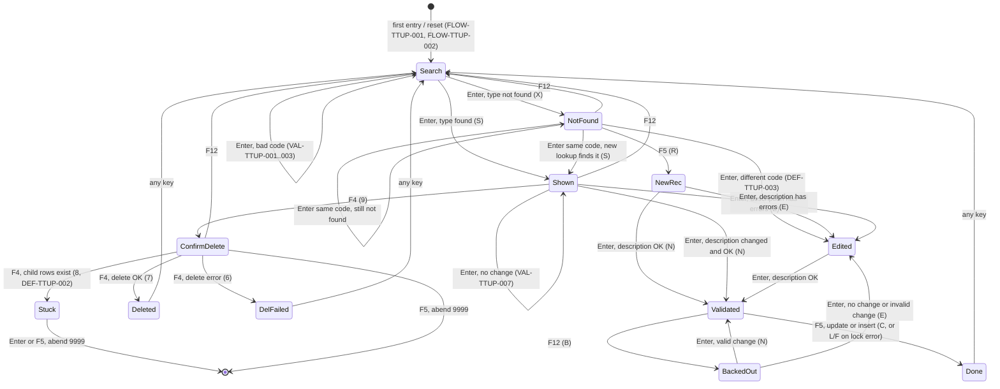
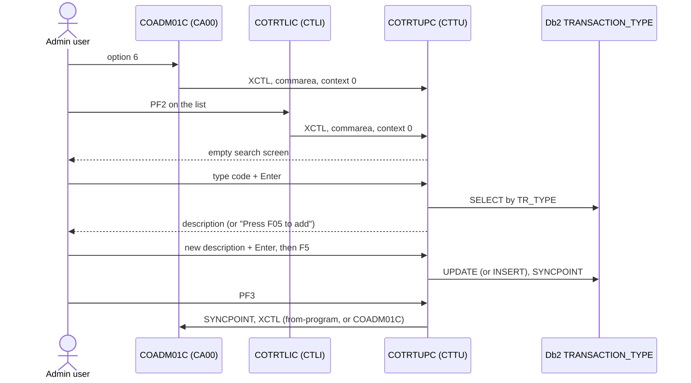

# COTRTUPC: Transaction type add, update and delete

## 1. Summary

An administrator picks **Transaction Type Maintenance (Db2)** from the admin menu (option 6), or presses PF2 on the transaction type list. The screen asks for a two-digit transaction type code. If the type exists in the Db2 table `CARDDEMO.TRANSACTION_TYPE`, its description is shown and can be changed (Enter to validate, F5 to save) or the type can be deleted (F4, then F4 again to confirm). If the type does not exist, the user can add it (F5, type a description, Enter, F5). Saving always tries an UPDATE first and falls back to an INSERT when no row was updated. Every successful change is committed at once with a CICS SYNCPOINT. The program has several state-handling defects: a failed save is reported as committed (DEF-TTUP-001), and a delete refused because the type still has categories leaves the screen in a state where the next Enter abends the task (DEF-TTUP-002).

## 2. Rules at a glance

| ID | Rule |
| :-- | :-- |
| BR-TTUP-001 | The type code is turned into a two-digit number with leading zero (`1` becomes `01`) before it is used. |
| BR-TTUP-002 | Saving updates the description of the type; if no row has that code, a new row is inserted. |
| BR-TTUP-003 | The description is stored with leading and trailing spaces removed, then padded with spaces to 50 characters. |
| BR-TTUP-004 | Delete removes the type row; Db2 refuses it while categories of that type exist. |
| BR-TTUP-005 | A change is detected only if the description differs after trimming and ignoring upper/lower case. |
| BR-TTUP-006 | Every change needs two steps: validate (Enter) then save (F5); delete needs F4 twice. |
| VAL-TTUP-001 | The type code is required. |
| VAL-TTUP-002 | The type code must be numeric. |
| VAL-TTUP-003 | The type code must not be zero. |
| VAL-TTUP-004 | A type that is not in the table can only be added, not updated or deleted. |
| VAL-TTUP-005 | The description is required. |
| VAL-TTUP-006 | The description may contain only letters, digits and spaces. |
| VAL-TTUP-007 | Saving needs a change to the description. |
| VAL-TTUP-008 | Which keys are accepted depends on the screen state. |

## 3. Actors and triggers

- **Actor:** a signed-on CardDemo user who reaches the screen. The program does not check the user type or user ID (DEF-TTUP-010).
- **Admin menu:** `COADM01C` option 6 "Transaction Type Maintenance (Db2)" (`app/cpy/COADM02Y.cpy:50-53`). The menu transfers control (XCTL) with `CDEMO-FROM-PROGRAM` = `COADM01C` and `CDEMO-PGM-CONTEXT` = 0 (`app/cbl/COADM01C.cbl:143-147`).
- **List screen:** `COTRTLIC` transfers here on PF2 with `CDEMO-FROM-PROGRAM` = `COTRTLIC`, context 0 and user type set to `U` (`app/app-transaction-type-db2/cbl/COTRTLIC.cbl:630-651`).
- **Re-entry:** CICS starts transaction `CTTU` again when the user presses a key, because every interaction ends with "return, next transaction CTTU" (FLOW-TTUP-010). `CTTU` runs `COTRTUPC` with Db2 plan `CARDDEMO` through DB2TRAN `CTTUTRAN` (`app/app-transaction-type-db2/csd/CRDDEMOD.csd:18-24, 35-44, 56-60`).
- **Direct start:** typing `CTTU` on a blank terminal starts the program with no commarea; it shows the empty search screen (FLOW-TTUP-001). Unlike the base programs, it does not send the user to sign-on.
- **Precondition:** the Db2 objects of job CREADB21 exist and plan `CARDDEMO` is bound with this program's package (platform; see the CREADB21 job spec).

## 4. Interfaces

### 4.1 Screen CTRTUPA (mapset COTRTUP), 24 x 80

Source: `app/app-transaction-type-db2/bms/COTRTUP.bms:20-137`; symbolic map `app/app-transaction-type-db2/cpy-bms/COTRTUP.cpy`.

| Row,Col | Field | Len | Direction | Attributes in the BMS | Content |
| :-- | :-- | --: | :-- | :-- | :-- |
| 1,1 | (label) | 5 | out | protected, blue | `Tran:` |
| 1,7 | `TRNNAME` | 4 | out | protected, blue | `CTTU` |
| 1,21 | `TITLE01` | 40 | out | protected, yellow | `COTTL01Y` title 1 |
| 1,65 | (label) | 5 | out | protected, blue | `Date:` |
| 1,71 | `CURDATE` | 8 | out | protected, blue | `mm/dd/yy` (NUM-TTUP-005) |
| 2,1 | (label) | 5 | out | protected, blue | `Prog:` |
| 2,7 | `PGMNAME` | 8 | out | protected, blue | `COTRTUPC` |
| 2,21 | `TITLE02` | 40 | out | protected, yellow | `COTTL01Y` title 2 |
| 2,65 | (label) | 5 | out | protected, blue | `Time:` |
| 2,71 | `CURTIME` | 8 | out | protected, blue | `hh:mm:ss` |
| 7,28 | (label) | 25 | out | neutral | `Maintain Transaction Type` |
| 12,4 | (label) | 19 | out | protected, turquoise | `Transaction Type  :` |
| 12,26 | `TRTYPCD` | 2 | in/out | unprotected, underlined, initial cursor | Type code |
| 14,4 | (label) | 19 | out | turquoise | `Description       :` |
| 14,26 | `TRTYDSC` | 50 | in/out | unprotected, underlined | Description |
| 22,23 | `INFOMSG` | 45 | out | protected, neutral | Information message (section 8.4) |
| 23,1 | `ERRMSG` | 78 | out | protected, bright, red | Error message (section 8.4) |
| 24,1 | `FKEYS` | 21 | out | protected, yellow | `ENTER=Process F3=Exit` |
| 24,23 | `FKEY04` | 9 | out | protected, dark | `F4=Delete` |
| 24,33 | `FKEY05` | 8 | out | protected, dark | `F5=Save` |
| 24,43 | `FKEY06` | 6 | out | protected, dark | `F6=Add` (never made visible, DEF-TTUP-012) |
| 24,69 | `FKEY12` | 10 | out | protected, dark | `F12=Cancel` |

The program overrides the attributes of `TRTYPCD`, `TRTYDSC`, `INFOMSG` and the key labels on every send (FLOW-TTUP-011). Only `TRTYPCD` and `TRTYDSC` carry input.

### 4.2 Db2 tables

| Table | Entity | Statement | Key | Lines |
| :-- | :-- | :-- | :-- | :-- |
| `CARDDEMO.TRANSACTION_TYPE` | ENT-DB2-TRAN-TYPE | SELECT `TR_TYPE`, `TR_DESCRIPTION` | `TR_TYPE` = type code | 1475-1482 |
| `CARDDEMO.TRANSACTION_TYPE` | ENT-DB2-TRAN-TYPE | UPDATE SET `TR_DESCRIPTION` | `TR_TYPE` | 1544-1548 |
| `CARDDEMO.TRANSACTION_TYPE` | ENT-DB2-TRAN-TYPE | INSERT (`TR_TYPE`, `TR_DESCRIPTION`) | - | 1597-1602 |
| `CARDDEMO.TRANSACTION_TYPE` | ENT-DB2-TRAN-TYPE | DELETE | `TR_TYPE` | 1627-1630 |
| `CARDDEMO.TRANSACTION_TYPE_CATEGORY` | ENT-DB2-TRAN-TYPE-CAT | none (the DCLGEN is included at `:288` but never used); the foreign key `ON DELETE RESTRICT` makes Db2 refuse a delete of a type with categories | - | `app/app-transaction-type-db2/ctl/DB2CREAT.ctl:96-99` |

Static SQL; the DCLGEN host structure for the type table is `DCLTRANSACTION-TYPE` with `DCL-TR-TYPE` X(2) and the VARCHAR `DCL-TR-DESCRIPTION` (length `S9(4) COMP` + text X(50)) (`app/app-transaction-type-db2/dcl/DCLTRTYP.dcl:35-46`).

### 4.3 Commarea

The program receives and returns a 2000-byte area `WS-COMMAREA` (`:336`, `:567-571`): ENT-COMMAREA (160 bytes) followed by the program's own 105-byte extension `WS-THIS-PROGCOMMAREA` (`:294-335`) at positions 161-265; the rest is unused.

| Pos | Len | Field | Meaning |
| --: | --: | :-- | :-- |
| 161 | 1 | `TTUP-CHANGE-ACTION` | Screen state (FLOW-TTUP-004) |
| 162 | 2 | `TTUP-OLD-TTYP-TYPE` | Type code as read from Db2 |
| 164 | 50 | `TTUP-OLD-TTYP-TYPE-DESC` | Description as read from Db2 |
| 214 | 2 | `TTUP-NEW-TTYP-TYPE` | Type code as entered (normalised, BR-TTUP-001) |
| 216 | 50 | `TTUP-NEW-TTYP-TYPE-DESC` | Description as entered (trimmed) |

ENT-COMMAREA fields used:

| Field | Read | Written | Use |
| :-- | :-- | :-- | :-- |
| `CDEMO-FROM-PROGRAM` | yes | yes | first-entry test (FLOW-TTUP-001); PF3 target; set to `COTRTUPC` on PF3 |
| `CDEMO-FROM-TRANID` | yes | yes | PF3 target transaction; set to `CTTU` on PF3 |
| `CDEMO-TO-PROGRAM`, `CDEMO-TO-TRANID` | yes | yes | XCTL target on PF3 |
| `CDEMO-PGM-CONTEXT` | yes | yes | 0 enter, 1 re-enter |
| `CDEMO-USER-TYPE` | no | yes | set to `A` on PF3 (DEF-TTUP-010) |
| `CDEMO-ACCT-ID` | no | yes | cleared to zero on first entry (`:471-473`) |
| `CDEMO-LAST-MAP`, `CDEMO-LAST-MAPSET` | no | yes | `CTRTUPA`, `COTRTUP ` on PF3 |

ENT-COMMAREA is initialised only on a direct start (`EIBCALEN` = 0); on entry from the menu or the list it is kept (DEF-TTUP-009).

### 4.4 Abend screen

On an abend the program sends the 134-byte `ABEND-DATA` structure (`app/cpy/CSMSG02Y.cpy:21-29`: code X(4), culprit X(8), reason X(50), message X(72)) as plain text with erase, then abends with code `9999` (ERR-TTUP-005).

## 5. Data used

| Entity field | Read | Written | How |
| :-- | :-- | :-- | :-- |
| ENT-DB2-TRAN-TYPE.TR_TYPE | key, and returned by SELECT | inserted | from the screen, normalised (BR-TTUP-001) |
| ENT-DB2-TRAN-TYPE.TR_DESCRIPTION | yes | updated / inserted | shown in `TRTYDSC`; written trimmed and padded to 50 (BR-TTUP-003) |

Program-local data with behaviour:

- Edit flags `WS-EDIT-TTYP-FLAG` (`:94-97`) and `WS-EDIT-DESC-FLAGS` (`:100-103`): low-values valid, `0` not OK, `B` blank. They are part of `WS-MISC-STORAGE`, which is initialised to spaces at the start of every task (`:352-354`), so on paths that do not run the edits they are neither valid, not-OK nor blank.
- `WS-INFO-MSG` X(40) (`:142-165`) and `WS-RETURN-MSG` X(75) (`:167-196`): the information and error message texts are 88-level values of these fields; several decisions test the 88 levels (DEF-TTUP-001).
- `WS-EDIT-NUMERIC-2` 9(02) (`:119`): type code normalisation.
- `WS-DISP-SQLCODE` `----9` (`:68`): SQLCODE in messages.
- `TTYP-UPDATE-RECORD`, `WS-EDIT-DATE-X`, `WS-EDIT-CURRENCY-9-2(-F)`, `CSUTLDWY` date fields, `LIT-ALL-ALPHA-FROM`, `LIT-ALL-NUM-FROM` and the `CODING-TO-BE-DONE`, `WS-NAME-MUST-BE-ALPHA`, `WS-INVALID-KEY` messages are declared but have no effect.

## 6. Processing flow

Each arrow is one CICS task: receive the screen, act, send the screen, end with "next transaction CTTU". PF3 leaves the program from every state (FLOW-TTUP-003).

**Entry (0000-MAIN, lines 345-557)**

1. Set an abend handler (`:348-350`); initialise the work areas and the outgoing commarea (`:352-354`); clear the error message (`:362`).
2. First entry or restore of the commarea (FLOW-TTUP-001, `:366-381`).
3. Map the key pressed (PF13-PF24 count as PF1-PF12) (`:386-387`) and check whether it is valid in the current state (VAL-TTUP-008, `:398-401`).
4. Reset to the search screen after a finished action or a cancel (FLOW-TTUP-002, `:405-419`).
5. Act on the key and state (`:423-556`), decision table in FLOW-TTUP-004.
6. Return to CICS with next transaction `CTTU` and the 2000-byte commarea (FLOW-TTUP-010).

**Enter (1000-PROCESS-INPUTS, 2000-DECIDE-ACTION)**

1. Receive the screen (`:641-648`) and copy it to the "new" fields (`:652-685`): `*` or spaces become low-values; other input is trimmed.
2. Edit the type code (section 8.2) unless the screen is in add or validated state (VAL-TTUP-001..003, BR-TTUP-001).
3. If no type has been shown yet: look it up (SE-TTUP-001) and show it (state S) or offer to add it (state X).
4. Otherwise compare the description with the one read (BR-TTUP-005); if it changed, edit it (VAL-TTUP-005, VAL-TTUP-006) and, if valid, ask for F5 (state N).
5. Build and send the screen (FLOW-TTUP-011).

## 7. Business rules

#### BR-TTUP-001 · Type code normalised to two digits
- **When:** the type code passes VAL-TTUP-001..003.
- **Then:** the code is converted with `NUMVAL`, stored in a two-digit unsigned number and moved back as two characters. `1` or ` 1` becomes `01`; `5 ` becomes `05`. The normalised value is used for the lookup, the update, the insert and is shown on the screen. Signs and decimal points are accepted and dropped (NUM-TTUP-001, DEF-TTUP-008).
- **Source:** `:834-842`
- **Fidelity:** must-preserve · **Confidence:** runtime-verified (GnuCOBOL 3.2 `-std=ibm`, evidence file); platform-inferred for Enterprise COBOL

#### BR-TTUP-002 · Save is update, or insert when the type does not exist
- **When:** the screen is in state N ("Changes validated.Press F5 to save") and the user presses F5.
- **Then:** `UPDATE CARDDEMO.TRANSACTION_TYPE SET TR_DESCRIPTION = <new description> WHERE TR_TYPE = <new code>`. If Db2 answers SQLCODE +100 (no row), the program inserts a row with the same code and description. A successful update or insert is committed (SYNCPOINT) and the screen shows `Changes committed to database`.
- **Otherwise:** see ERR-TTUP-002 and ERR-TTUP-003.
- **Source:** `:514-520, 1531-1592, 1596-1620`
- **Fidelity:** must-preserve · **Confidence:** reviewed

#### BR-TTUP-003 · Stored description layout
- **When:** an update or insert is issued.
- **Then:** the description is trimmed of leading and trailing spaces, moved left-aligned into the 50-character VARCHAR text and its length is set to 50, so Db2 stores 50 characters including the trailing spaces (NUM-TTUP-002, DEF-TTUP-006). On input the screen value is also trimmed on both sides (`:682-683`).
- **Source:** `:1538-1542, 1599-1601`
- **Fidelity:** must-preserve (the stored value is read by COTRTLIC and extracted by TRANEXTR) · **Confidence:** reviewed

#### BR-TTUP-004 · Delete of a transaction type
- **When:** the user presses F4 on a shown type (state S), then F4 again (state 9).
- **Then:** `DELETE FROM CARDDEMO.TRANSACTION_TYPE WHERE TR_TYPE = <code read from Db2>`; on success the deletion is committed and the screen shows `Delete successful.`. The table `TRANSACTION_TYPE_CATEGORY` has a foreign key to the type with `ON DELETE RESTRICT` (`app/app-transaction-type-db2/ctl/DB2CREAT.ctl:96-99`), so Db2 refuses the delete (SQLCODE -532) while the type has categories. Every type in the seed data has categories (`app/app-transaction-type-db2/ctl/DB2LTCAT.ctl:20-37`), so none of the seeded types can be deleted.
- **Source:** `:482-489, 1624-1663`
- **Fidelity:** must-preserve · **Confidence:** platform-inferred (SQLCODE -532 for a RESTRICT violation)

#### BR-TTUP-005 · What counts as a change
- **When:** Enter (or PF5 in states 8 and 9) in any state other than "not fetched", or X with the same code, once the type code has passed its edits (states S, E, B, N, R, X with a changed code, 8, 9).
- **Then:** "no change" when the upper-cased type codes are equal and the upper-cased trimmed descriptions are equal and of equal trimmed length. Changing only the case of letters, or only leading or trailing spaces, is "no change" (VAL-TTUP-007, DEF-TTUP-007).
- **Source:** `:783-812`
- **Fidelity:** must-preserve · **Confidence:** reviewed

#### BR-TTUP-006 · Two-step confirmation
- **When:** a change or delete is requested.
- **Then:** a change is first validated with Enter (state N, all fields protected, `F5=Save` and `F12=Cancel` shown), and written only when F5 is pressed in that state. A delete is first requested with F4 (state 9) and executed only when F4 is pressed again. Enter is not accepted while a delete waits for confirmation.
- **Source:** `:482-498, 514-520, 582-608`
- **Fidelity:** must-preserve · **Confidence:** reviewed

## 8. Validations and messages

### 8.1 Keys, states and navigation

#### FLOW-TTUP-001 · First entry
- **When:** `EIBCALEN` = 0 (direct start of `CTTU`): ENT-COMMAREA and the program extension are initialised, the context is set to "enter" and the state to "not fetched". The source also tests `CDEMO-FROM-PROGRAM` = `COADM01C`/`COTRTLIC` with context not "re-enter" here, but it tests the working-storage copy before it is loaded from the received commarea, so in practice only `EIBCALEN` = 0 takes this branch (DEF-TTUP-009).
- **Otherwise:** ENT-COMMAREA is restored from the first 160 bytes of the received commarea and the extension from the next 105 bytes (on entry from COADM01C or COTRTLIC these bytes lie past the 160-byte commarea).
- **Then:** the main dispatch recognises first entry (context "enter" and from-program `COADM01C` or `COTRTLIC`, or context "enter" and state "not fetched"). It clears only the extension, the work fields and `CDEMO-ACCT-ID`, sends the empty search screen (`Enter transaction type to be maintained`, type code editable, cursor on it), and sets the context to "re-enter". User ID, user type, from-program and from-transaction are kept.
- **Source:** `:366-381, 465-478`
- **Fidelity:** must-preserve · **Confidence:** reviewed

#### FLOW-TTUP-002 · Reset to the search screen
- **When:** before the key is acted on, any of: PF12 in state S, R or X; state C (save done); state L or F (save failed); state B with the whole "old details" group blank or low-values; state 7 (deleted); state 6 (delete failed).
- **Then:** context "enter", state "not fetched"; unless the key is PF3 the main dispatch sends the empty search screen as in FLOW-TTUP-001, clearing every message (including `Invalid key pressed`). So after a save or delete, any key except PF3 shows an empty search screen; the input typed on the result screen is discarded.
- **Source:** `:405-419, 469-478`
- **Fidelity:** must-preserve · **Confidence:** reviewed

#### FLOW-TTUP-003 · PF3, exit
- **Then:** target transaction = `CDEMO-FROM-TRANID`, or `CA00` when blank; target program = `CDEMO-FROM-PROGRAM`, or `COADM01C` when blank: the caller (`COADM01C`/`CA00` from the menu, `COTRTLIC`/`CTLI` from the list; `COADM01C`/`CA00` only after a direct start, DEF-TTUP-009); set from-transaction `CTTU`, from-program `COTRTUPC`, user type `A` (DEF-TTUP-010), context "enter", last mapset `COTRTUP `, last map `CTRTUPA`; SYNCPOINT (SE-TTUP-005); XCTL to the target with the 160-byte ENT-COMMAREA. PF3 is valid in every state.
- **Source:** `:429-460`
- **Fidelity:** must-preserve · **Confidence:** reviewed

#### FLOW-TTUP-004 · Screen states and key dispatch
- **Then:** the screen state is `TTUP-CHANGE-ACTION` (commarea position 161):

| Value | Name in the source | Meaning |
| :-- | :-- | :-- |
| low-values or space | `TTUP-DETAILS-NOT-FETCHED` | search screen, no type shown |
| `K` | `TTUP-INVALID-SEARCH-KEYS` | set when the type code fails its edit but overwritten at once by "not fetched" (`:729-730`), so never stored |
| `X` | `TTUP-DETAILS-NOT-FOUND` | type code not in the table, add offered |
| `S` | `TTUP-SHOW-DETAILS` | type shown, description editable |
| `R` | `TTUP-CREATE-NEW-RECORD` | adding a new type, description editable |
| `V` | `TTUP-REVIEW-NEW-RECORD` | declared, never set |
| `E` | `TTUP-CHANGES-NOT-OK` | description changed but has errors (or after B) |
| `N` | `TTUP-CHANGES-OK-NOT-CONFIRMED` | description valid, waiting for F5 |
| `C` | `TTUP-CHANGES-OKAYED-AND-DONE` | save done (or failed, DEF-TTUP-001) |
| `L`, `F` | `TTUP-CHANGES-OKAYED-LOCK-ERROR`, `-BUT-FAILED` | save failed (only L is reachable) |
| `B` | `TTUP-CHANGES-BACKED-OUT` | update cancelled with F12 |
| `9` | `TTUP-CONFIRM-DELETE` | delete requested, waiting for F4 |
| `8` | `TTUP-START-DELETE` | delete issued (stays after -532, DEF-TTUP-002) |
| `7`, `6` | `TTUP-DELETE-DONE`, `TTUP-DELETE-FAILED` | delete result |

After FLOW-TTUP-002 the key is dispatched in this order (first match wins):

| # | Condition | Action |
| --: | :-- | :-- |
| 1 | PF3 | FLOW-TTUP-003 |
| 2 | context "enter" and state "not fetched" (and first entry) | empty search screen, FLOW-TTUP-001 |
| 3 | PF4 in state 9 | delete (FLOW-TTUP-007) |
| 4 | PF4 in state S | ask for delete confirmation (FLOW-TTUP-007) |
| 5 | PF5 in state X | state R (FLOW-TTUP-008) |
| 6 | PF5 in state N | save (FLOW-TTUP-008) |
| 7 | PF12 in state N, 9 or S | cancel (FLOW-TTUP-006) |
| 8 | key not valid in the state (VAL-TTUP-008) | redisplay with `Invalid key pressed` (FLOW-TTUP-009) |
| 9 | anything else (Enter; PF5 in states 9 and 8, which both abend, ERR-TTUP-006; PF5 in 7 or 6 was reset to "not fetched" first) | process the input (FLOW-TTUP-005) |

PF13-PF24 are treated as PF1-PF12 (`app/cpy/CSSTRPFY.cpy:54-77`).
- **Source:** `:296-327, 386-387, 423-556`
- **Fidelity:** must-preserve · **Confidence:** reviewed

#### FLOW-TTUP-005 · Enter: process the input
- **Then:** receive the map; copy the screen into the "new" fields (`*` or spaces become low-values, otherwise trimmed); in state X with Enter and the same code as before, the copy is skipped and the state set back to "not fetched" so that the code is looked up again. Then edit (section 8.2). The edits already set the state: any detected change sets E, then N when the description is valid (`:753, 775`); a type code error sets "not fetched". Then decide: state "not fetched" with a valid code: look up (SE-TTUP-001), state S if found, X if not; state S (no change): unchanged; state E or N: unchanged; state B (reached only with no change, since a change already replaced B by E or N): E; any other state (in practice 9 after PF5, and 8): abend (ERR-TTUP-006). So from S an invalid change gives E, and from B a valid change gives N. Finally send the screen (FLOW-TTUP-011).
- **Source:** `:548-555, 625-636, 652-777, 978-1082, 1041-1042`
- **Fidelity:** must-preserve · **Confidence:** reviewed

#### FLOW-TTUP-006 · PF12, cancel
- **When:** PF12 in state N or 9 (PF12 in S, R or X is a reset, FLOW-TTUP-002).
- **Then:** state 9: message `Delete was cancelled`, state "not fetched", empty search screen with the message. State N: message `Update was cancelled`, state B, the values read from Db2 are shown again with the description editable, information message `Update transaction type details shown.` (or the search prompt when no type was read, as in the add path). The re-read branch of 2000-DECIDE-ACTION (`:989-997`) does not run here, because the type code edit flag was cleared at task start.
- **Source:** `:524-533, 988-1010`
- **Fidelity:** must-preserve · **Confidence:** reviewed

#### FLOW-TTUP-007 · PF4, delete
- **Then:** in state S: state 9, all fields protected, information message `Delete this record ? Press F4 to confirm`. In state 9: state 8, delete (SE-TTUP-004, ERR-TTUP-004), send the result screen.
- **Source:** `:482-498`
- **Fidelity:** must-preserve · **Confidence:** reviewed

#### FLOW-TTUP-008 · PF5, add and save
- **Then:** in state X: state R, the entered code is shown protected, the description editable, information message `Enter new transaction type details.`. In state N: save (BR-TTUP-002), send the result screen.
- **Source:** `:503-520`
- **Fidelity:** must-preserve · **Confidence:** reviewed

#### FLOW-TTUP-009 · Invalid key
- **When:** the key is not valid in the state (VAL-TTUP-008) and no reset applies.
- **Then:** message `Invalid key pressed`; the input is not received; the screen is rebuilt from the commarea (so typed changes are lost) and sent; the state does not change.
- **Source:** `:603-607, 539-542`
- **Fidelity:** must-preserve · **Confidence:** reviewed

#### FLOW-TTUP-010 · End of every interaction
- **Then:** copy ENT-COMMAREA and the extension into the 2000-byte `WS-COMMAREA` and return to CICS naming `CTTU` as the next transaction with that commarea (length 2000).
- **Source:** `:559-572`
- **Fidelity:** must-preserve · **Confidence:** reviewed

### 8.2 Field edits

#### VAL-TTUP-001 · Type code required
- **When:** the type code (after `*`/spaces become low-values) is low-values, spaces or empty after trimming, and the screen is not in state R or N.
- **Then:** message `Tran Type code must be supplied.`, state reset to "not fetched", type code field red with `*` on re-entry, cursor on the type code. The intended message `No input received` (`:720-723`) is never shown, because the edit has already set a message (DEF-TTUP-012).
- **Source:** `:712-726, 820-833, 907-930, 1331-1340`
- **Fidelity:** must-preserve · **Confidence:** reviewed

#### VAL-TTUP-002 · Type code numeric
- **When:** `FUNCTION TEST-NUMVAL` of the 2-character code is not 0 (for example `A1`, `1A`).
- **Then:** message `Tran Type code must be numeric.`; the state ends "not fetched" (K is set and overwritten at once, `:729-730`), so the screen is built by 3201 and the entered code is cleared: the code field is shown empty in red with the cursor on it, information message `Enter transaction type to be maintained`.
- **Source:** `:728-732, 934-949, 1146-1147, 1176-1179, 1331-1334`
- **Fidelity:** must-preserve · **Confidence:** reviewed

#### VAL-TTUP-003 · Type code not zero
- **When:** `NUMVAL` of the code is 0 (`00`, `0`, `-0`).
- **Then:** message `Tran Type code must not be zero.`; state "not fetched" as in VAL-TTUP-002, so the code field is shown empty in red. `.5` has a value of 0.5, passes this edit and is stored as `00` (DEF-TTUP-008).
- **Source:** `:728-732, 954-969`
- **Fidelity:** must-preserve · **Confidence:** reviewed

#### VAL-TTUP-004 · Type must exist to be shown
- **When:** a valid code is looked up (state "not fetched") and Db2 returns SQLCODE +100.
- **Then:** message `No record found for this key in database`, state X ("details not found"), information message `Press F05 to add. F12 to cancel`, type code editable and red, `F5=Save` and `F12=Cancel` shown. F5 moves to state R ("create new record", FLOW-TTUP-008). Pressing Enter with the same code looks it up again. A database error on the lookup also ends in state X (DEF-TTUP-011).
- **Source:** `:984-997, 1469-1494, 1219-1220`
- **Fidelity:** must-preserve · **Confidence:** reviewed

#### VAL-TTUP-005 · Description required
- **When:** a change was detected (BR-TTUP-005) and the description is low-values, spaces or empty after trimming.
- **Then:** message `Transaction Desc must be supplied.`, state E, description field red with `*` (copybook `CSSETATY`), cursor on the description.
- **Source:** `:753-764, 849-873, 1357-1361`; `app/cpy/CSSETATY.cpy:18-27`
- **Fidelity:** must-preserve · **Confidence:** reviewed

#### VAL-TTUP-006 · Description characters
- **When:** a change was detected and the description, with every letter (`A-Z`, `a-z`) and digit replaced by a space, is not empty after trimming (any other character, such as `-`, `.`, `/` or `&`).
- **Then:** message `Transaction Desc can have numbers or alphabets only.`, state E, description red, cursor on the description.
- **Otherwise:** the description is valid; when no other error occurred the state becomes N and the information message is `Changes validated.Press F5 to save`.
- **Source:** `:875-901, 772-776`
- **Fidelity:** must-preserve · **Confidence:** reviewed; the "empty after trimming" test relies on `FUNCTION TRIM` of an all-space value having length 0 (true on GnuCOBOL 3.2; Q-TTUP-002)

#### VAL-TTUP-007 · No change
- **When:** Enter is pressed in state S, B or E and BR-TTUP-005 finds no change.
- **Then:** message `No change detected with respect to values fetched.`, the state stays (S), or becomes E when it was B (DEF-TTUP-014). Nothing is written.
- **Source:** `:743-751, 799-803, 1023-1030, 1041-1042`
- **Fidelity:** must-preserve · **Confidence:** reviewed

#### VAL-TTUP-008 · Valid keys per state

| Key | Accepted when (state of `TTUP-CHANGE-ACTION`) |
| :-- | :-- |
| PF3 | always |
| Enter | any state except 9 (delete confirmation) |
| PF4 | S (shown), 9 (confirm delete) |
| PF5 | N (validated), X (not found), 9/8/7/6 (delete in progress, DEF-TTUP-002) |
| PF12 | N, S, X, 9, R |
| anything else (including PF1, PF2, PF6-PF11, Clear, PA keys) | never |

A key outside this table sets `Invalid key pressed` and redisplays the screen without processing input (`:539-542`), unless FLOW-TTUP-002 resets the screen first.
- **Source:** `:577-618, 539-542`
- **Fidelity:** must-preserve · **Confidence:** reviewed

### 8.3 Screen build

#### FLOW-TTUP-011 · Screen build
- **Then:** on every send the program clears the output map, fills the titles, `CTTU`, `COTRTUPC`, date and time (NUM-TTUP-005), then (a) the field values per state: blank in state "not fetched", the values read from Db2 in states S, 9, 6, 7, B (and any other state not listed), the values entered in states E, N, L, F, X, R, C; on first entry nothing (`:1140-1205`); (b) the information message (`:1210-1265`, section 8.4) centred (NUM-TTUP-004) and the error message; (c) field attributes: all fields protected, then the type code editable in states "not fetched", X (and B with no type read) and in L and F (the WHEN OTHER branch), the description editable in states S, E, R, B; all protected in N, C, 9/8/7/6 (`:1269-1298`); colours: type code red when its edit failed, the lookup failed (`:1491, 1497`) or the delete failed, red with `*` when blank on re-entry (`:1331-1340`); the description red (and `*` when blank) when its edit failed, only if the type code edits passed (`:1342-1361`); information message bright when present (`:1386-1392`, DEF-TTUP-012); (d) key labels (FLOW-TTUP-012). The screen is sent with cursor positioning, erase and keyboard unlock; the response is not checked (ERR-TTUP-007).
- **Source:** `:1089-1104, 1110-1134, 1140-1205, 1210-1265, 1269-1384, 1428-1441`
- **Fidelity:** must-preserve · **Confidence:** reviewed

#### FLOW-TTUP-012 · Key labels and cursor
- **Then:** `ENTER=Process F3=Exit` is shown bright except in state 9, where it is hidden (dark). `F4=Delete` is shown in states S and 9; `F5=Save` in N and X; `F12=Cancel` in N, S, X, 9 and R; `F6=Add` never. Cursor: on the type code in states "not fetched", X, K, C, after a type code error, and B with no type read; on the description in states R, S, E/N/L/F, B, after "no change" or a description error; otherwise on the type code.
- **Source:** `:1300-1325, 1397-1423`
- **Fidelity:** must-preserve · **Confidence:** reviewed

### 8.4 Message catalog

Information messages (`INFOMSG`, 45 columns, centred in the first 40; NUM-TTUP-004):

| Text (exact) | State | Item |
| :-- | :-- | :-- |
| `Enter transaction type to be maintained` | first entry, "not fetched", K, B with no type read, any state without another message (including 8) | FLOW-TTUP-001 |
| `Press F05 to add. F12 to cancel` | X | VAL-TTUP-004 |
| `Update transaction type details shown.` | B (type read), E | VAL-TTUP-007 |
| `Delete this record ? Press F4 to confirm` | 9 | BR-TTUP-004 |
| `Changes unsuccessful` | 6, L, F | ERR-TTUP-002, ERR-TTUP-004 |
| `Delete successful.` | 7 | BR-TTUP-004 |
| `Enter new transaction type details.` | R | FLOW-TTUP-008 |
| `Changes validated.Press F5 to save` | N | VAL-TTUP-006 |
| `Changes committed to database` | C (also after a failed save, DEF-TTUP-001) | BR-TTUP-002 |

Note on state S: the EVALUATE lists "state S" and "state B with no type read" as one branch (`:1221-1225`), so a shown type gets `Enter transaction type to be maintained`; `Update transaction type details shown.` appears only in states B (type read) and E. `Selected transaction type shown above` (`:145-146`) is never used.

Error messages (`ERRMSG`, row 23; the work field is 75 characters, so at most 75 of the 78 columns are filled):

| Text (exact) | Cause | Item |
| :-- | :-- | :-- |
| `Invalid key pressed` | key not valid in the state | VAL-TTUP-008 |
| `Tran Type code must be supplied.` | type code blank | VAL-TTUP-001 |
| `Tran Type code must be numeric.` | type code not numeric | VAL-TTUP-002 |
| `Tran Type code must not be zero.` | type code zero | VAL-TTUP-003 |
| `No record found for this key in database` | lookup +100 | VAL-TTUP-004 |
| `Error accessing: TRANSACTION_TYPE table. SQLCODE:` + SQLCODE + `:` + `SQLERRM` | lookup SQLCODE < 0 | ERR-TTUP-001 |
| `Transaction Desc must be supplied.` | description blank | VAL-TTUP-005 |
| `Transaction Desc can have numbers or alphabets only.` | description characters | VAL-TTUP-006 |
| `No change detected with respect to values fetched.` | no change | VAL-TTUP-007 |
| `Update was cancelled` | F12 in state N | FLOW-TTUP-006 |
| `Delete was cancelled` | F12 in state 9 | FLOW-TTUP-006 |
| `Could not lock record for update` | update SQLCODE -911 | ERR-TTUP-002 |
| `Error updating: TRANSACTION_TYPE Table. SQLCODE:` + SQLCODE + `:` + `SQLERRM` | update SQLCODE < 0 | ERR-TTUP-002 |
| `Error inserting record into: TRANSACTION_TYPE Table. SQLCODE:` + SQLCODE + `:` + `SQLERRM` | insert not 0 | ERR-TTUP-003 |
| `Please delete associated child records first:SQLCODE :` + SQLCODE + `:` + `SQLERRM` + `SQLERRM` | delete -532 | ERR-TTUP-004 |
| `Delete failed with message:SQLCODE :` + SQLCODE + `:` + `SQLERRM` | delete other error | ERR-TTUP-004 |

SQLCODE is edited `----9` (NUM-TTUP-003). `SQLERRM` is the SQLCA group (2-byte binary length + 70-byte text), so its binary length bytes appear in the message before the text (DEF-TTUP-005). Long messages are cut at 75 characters.

## 9. Side effects

In execution order. Each successful change is committed at once; the CICS task end also commits whatever is pending (platform).

#### SE-TTUP-001 · Look up the type
- **What:** `SELECT TR_TYPE, TR_DESCRIPTION INTO :DCL-TR-TYPE, :DCL-TR-DESCRIPTION FROM CARDDEMO.TRANSACTION_TYPE WHERE TR_TYPE = :DCL-TR-TYPE` with the normalised entered code. On SQLCODE 0 the "old" fields are set from the result: code, and the description text cut to its VARCHAR length (then space-padded to 50). The "old" fields are cleared before the lookup, so after +100 they are blank.
- **Source:** `:1447-1463, 1469-1511, 1517-1527`
- **Confidence:** reviewed

#### SE-TTUP-002 · Update the description
- **What:** UPDATE as in BR-TTUP-002, host variables from the "new" fields. SQLCODE 0: `EXEC CICS SYNCPOINT` (commits the Db2 change). No lock is taken between the lookup (SE-TTUP-001) and this update; another user's change in between is overwritten (no optimistic check, `DATA-WAS-CHANGED-BEFORE-UPDATE` is never set).
- **Source:** `:1531-1557, 1585-1586`
- **Confidence:** reviewed

#### SE-TTUP-003 · Insert a new type
- **What:** when the update found no row: `INSERT INTO CARDDEMO.TRANSACTION_TYPE (TR_TYPE, TR_DESCRIPTION) VALUES (:DCL-TR-TYPE, :DCL-TR-DESCRIPTION)` with the same host variables; SQLCODE 0: SYNCPOINT.
- **Source:** `:1558-1560, 1596-1606`
- **Confidence:** reviewed

#### SE-TTUP-004 · Delete the type
- **What:** `DELETE FROM CARDDEMO.TRANSACTION_TYPE WHERE TR_TYPE = :DCL-TR-TYPE` with the code read from Db2 (`TTUP-OLD-TTYP-TYPE`); SQLCODE 0: state 7, SYNCPOINT. Rows of the category table are never deleted by this program.
- **Source:** `:1624-1637`
- **Confidence:** reviewed

#### SE-TTUP-005 · Commit on exit
- **What:** PF3 issues `EXEC CICS SYNCPOINT` before the transfer, committing any pending unit of work (normally none).
- **Source:** `:453-455`
- **Confidence:** reviewed

## 10. Error handling

#### ERR-TTUP-001 · Lookup SQLCODE

| SQLCODE | Effect |
| :-- | :-- |
| 0 | found: state S |
| +100 | `No record found for this key in database`, state X |
| < 0 | `Error accessing: TRANSACTION_TYPE table. SQLCODE:...`, state X (DEF-TTUP-011) |
| > 0, not 100 (warning) | no message, "found" not set, state X (DEF-TTUP-016); the returned values are still stored as the "old" fields (`:1456-1462`) |
- **Source:** `:1484-1509, 993-997, 1456-1462`
- **Confidence:** platform-inferred

#### ERR-TTUP-002 · Update SQLCODE

| SQLCODE | Effect | State, information message |
| :-- | :-- | :-- |
| 0 | SYNCPOINT | C, `Changes committed to database` |
| +100 | insert (SE-TTUP-003, ERR-TTUP-003) | depends on insert |
| -911 (deadlock or timeout; Db2 has rolled back) | `Could not lock record for update` | L, `Changes unsuccessful` |
| other < 0 | `Error updating: TRANSACTION_TYPE Table. SQLCODE:...` | C, `Changes committed to database` (DEF-TTUP-001) |
| > 0, not 100 | nothing, no SYNCPOINT | C, `Changes committed to database` (DEF-TTUP-016) |

After any save the next key resets to the search screen (FLOW-TTUP-002).
- **Source:** `:1553-1589`
- **Confidence:** reviewed (logic); platform-inferred (SQLCODE meanings)

#### ERR-TTUP-003 · Insert SQLCODE
- **What:** SQLCODE 0: SYNCPOINT, state C. Any other value (for example -803 when another user inserted the same code since the update): message `Error inserting record into: TRANSACTION_TYPE Table. SQLCODE:` followed by the SQLCODE of the **update** (`  100`), not of the insert (DEF-TTUP-004); state C with `Changes committed to database` (DEF-TTUP-001).
- **Source:** `:1604-1619, 1580-1589`
- **Confidence:** reviewed

#### ERR-TTUP-004 · Delete SQLCODE

| SQLCODE | Effect | State, information message |
| :-- | :-- | :-- |
| 0 | SYNCPOINT | 7, `Delete successful.` |
| -532 (child rows exist) | `Please delete associated child records first:SQLCODE : -532:...` | stays 8 (start delete), `Enter transaction type to be maintained`, all fields protected; the next Enter or F5 abends (DEF-TTUP-002) |
| other | `Delete failed with message:SQLCODE :...` | 6, `Changes unsuccessful`, type code red |
- **Source:** `:1632-1662`
- **Confidence:** reviewed (logic); platform-inferred (SQLCODE -532)

#### ERR-TTUP-005 · Abend handler
- **What:** `HANDLE ABEND LABEL(ABEND-ROUTINE)` is set at the start of every task. On any abend the routine sets the culprit `COTRTUPC` and code `9999`, sends `ABEND-DATA` as plain text with erase (no response check), cancels the handler and abends with code `9999`. The default text `UNEXPECTED ABEND OCCURRED.` is only used when the message is low-values, which it never is (DEF-TTUP-013).
- **Source:** `:348-350, 1675-1698`
- **Confidence:** platform-inferred

#### ERR-TTUP-006 · Unexpected state
- **What:** when 2000-DECIDE-ACTION finds no matching state (in practice state 8 after DEF-TTUP-002, PF5 pressed in state 9 on the delete confirmation screen, which is a valid key there although `F5=Save` is not shown, or a corrupted commarea), it sets code `0001`, message `UNEXPECTED DATA SCENARIO` and performs the abend routine, which overwrites the code with `9999`. The terminal shows the abend data and the task ends abnormally (ABCODE 9999); nothing is written.
- **Source:** `:588-593, 1073-1080, 1675-1698`
- **Confidence:** reviewed

#### ERR-TTUP-007 · Unchecked responses
- **What:** the responses of RECEIVE MAP (`:642-647`, a MAPFAIL is ignored) and SEND MAP (`:1433-1440`) are stored in `WS-RESP-CD` but never tested.
- **Source:** `:641-648, 1428-1441`
- **Confidence:** reviewed

## 11. Interactions

- **Inbound:** `COADM01C` (option 6) and `COTRTLIC` (PF2), both by XCTL with context 0; transaction `CTTU` for re-entry.
- **Outbound:** PF3 transfers (XCTL) to `CDEMO-FROM-PROGRAM`, or to `COADM01C` when it is blank: back to `COADM01C` (`CA00`) when entered from the menu, back to `COTRTLIC` (`CTLI`) when entered from the list, and to `COADM01C` after a direct start.
- **Shared data:** `CARDDEMO.TRANSACTION_TYPE` is also read, updated and deleted by `COTRTLIC`, maintained in batch by `COBTUPDT` (job MNTTRDB2) and extracted to the VSAM reference file by job TRANEXTR, which feeds the transaction report (TRANREPT). A description saved here reaches the reports only after the next TRANEXTR run and reload of the VSAM file.
- **No lock across interactions:** two users editing the same type both succeed; the last save wins (SE-TTUP-002).

### Module extraction notes (transaction type maintenance as a service)

| Boundary | Contract |
| :-- | :-- |
| Entry | From the admin menu and the type list, with ENT-COMMAREA; the program uses the from-program, from-transaction and context, and passes the rest through unchanged (DEF-TTUP-009). |
| Data | Owns `CARDDEMO.TRANSACTION_TYPE`: read one row by code, update the description, insert, delete. Descriptions are stored padded to 50 (BR-TTUP-003). |
| Referential integrity | Delete must keep refusing types that have categories (`ON DELETE RESTRICT`), or the business decides on a cascade (Q-TTUP-005). |
| Downstream | Changes reach batch reporting only through TRANEXTR (Db2 to sequential extract) and the VSAM reload; a replacement must keep that extract format or replace the VSAM consumers. |
| Exit | PF3 returns to the caller (admin menu or type list) with `CDEMO-USER-TYPE` = `A`. |

## 12. Numeric, date and format details

#### NUM-TTUP-001 · Type code normalisation examples
- The code goes through `TEST-NUMVAL`, `NUMVAL` and a `9(02)` field (integer part, sign dropped, no rounding). Observed with GnuCOBOL 3.2 `-std=ibm` (evidence file): `1 ` → `01`, ` 5` → `05`, `-1` → `01`, `+3` → `03`, `1.` → `01`, `.5` → `00` (passes the zero check because 0.5 is not 0), `00` → rejected as zero, `A1` → rejected as not numeric.
- **Source:** `:934-969, 834-842`

#### NUM-TTUP-002 · Description VARCHAR length
- `DCL-TR-DESCRIPTION-LEN` is set to `FUNCTION LENGTH` of the 50-character field, which is always 50, not the trimmed length. Stored values therefore always have length 50 with trailing spaces. On read the text is cut to the stored length (`:1524-1525`).
- **Source:** `:1539-1542`

#### NUM-TTUP-003 · SQLCODE in messages
- Edited with `----9`: five characters, right-aligned, minus sign floating, no plus sign: -911 is ` -911`, -532 ` -532`, 100 `  100`.
- **Source:** `:68, 1484, 1553, 1632`

#### NUM-TTUP-004 · Centring the information message
- `WS-INFO-MSG` is 40 characters. Start position = (40 - trimmed length) / 2 + 1, truncated to an integer; the text is placed at that position in a 40-character field, which is moved to the 45-column `INFOMSG`. Messages are thus centred in columns 23-62 of row 22, not in the full 45-column field. Example: `Changes validated.Press F5 to save` (34 characters) starts at position 4.
- **Source:** `:1251-1262`

#### NUM-TTUP-005 · Header date and time
- From `FUNCTION CURRENT-DATE`: date `mm/dd/yy` (two-digit year), time `hh:mm:ss`.
- **Source:** `:1113-1132`

## 13. Known defects and oddities

None of these are changed in this branch.

#### DEF-TTUP-001 · A failed save is reported as committed
- After an update error other than -911, or any insert error, the program sets the 88-level `TABLE-UPDATE-FAILED` (which moves `Update of record failed` into `WS-RETURN-MSG`) and then overwrites `WS-RETURN-MSG` with the `Error ...` text. The following test `WHEN TABLE-UPDATE-FAILED` compares the message field with `Update of record failed` and is false, so the state becomes C ("changes okayed and done"). The user sees the information message `Changes committed to database` above the error message; nothing was written.
- **Source:** `:1567-1589, 1607-1618`
- **Status:** open · **Fidelity:** defect-decide (Q-TTUP-003) · **Confidence:** reviewed

#### DEF-TTUP-002 · Delete refused by Db2 leaves the screen stuck, the next Enter abends
- On SQLCODE -532 the delete branch sets the message but not the state, so the state stays 8 ("start delete"). The screen shows the read values, all protected, with `Enter transaction type to be maintained`. Enter is valid (VAL-TTUP-008) and goes to input processing; the type and description are unchanged (protected), so the edits find no change and 2000-DECIDE-ACTION has no branch for state 8: the task abends with `UNEXPECTED DATA SCENARIO` / code 9999 (ERR-TTUP-006). F5 is also valid in state 8 and takes the same path. Only PF3 leaves cleanly. Since every seeded type has categories (BR-TTUP-004), this happens for any delete of a seeded type.
- **Source:** `:1638-1649, 588-593, 548-555, 1073-1080`
- **Status:** open · **Fidelity:** defect-decide · **Confidence:** reviewed (logic); platform-inferred (SQLCODE -532)

#### DEF-TTUP-003 · Changing the code after "not found" skips the lookup
- In state X the type code stays editable. If the user types a different code and presses Enter, the program does not look it up: the code passes the edits, the comparison with the blank "old" values finds a change, and because the description is protected and empty in state X, the screen moves to state E (`Transaction Desc must be supplied.`); after a description is entered it moves to N, as if editing an existing type. F5 then updates that code's description if it exists (overwriting a description the user never saw) or inserts it if it does not.
- **Source:** `:654-661, 698-737, 743-776`
- **Status:** open · **Fidelity:** defect-decide (Q-TTUP-001) · **Confidence:** reviewed

#### DEF-TTUP-004 · Insert error shows the update's SQLCODE
- The insert branch does not copy the insert's SQLCODE to `WS-DISP-SQLCODE`; the message shows the update's `  100`.
- **Source:** `:1553, 1596-1618`
- **Status:** open · **Confidence:** reviewed

#### DEF-TTUP-005 · SQLERRM length bytes in messages
- `SQLERRM OF SQLCA` is a group: a 2-byte binary length followed by the 70-byte text. Moved into a message with STRING, the two binary bytes appear before the text (shown as unprintable characters or garbage). The -532 message appends `SQLERRM` twice. All these messages are cut at 75 characters, so little of the Db2 text is visible.
- **Source:** `:1499-1507, 1569-1577, 1609-1617, 1640-1649, 1653-1661`
- **Status:** open · **Fidelity:** incidental · **Confidence:** platform-inferred

#### DEF-TTUP-006 · Descriptions are stored padded to 50
- See NUM-TTUP-002. The VARCHAR column always holds 50 characters; `COTRTLIC`'s `LIKE` filter and any target system comparing values must account for the trailing spaces.
- **Source:** `:1539-1542`
- **Status:** open · **Confidence:** reviewed

#### DEF-TTUP-007 · Case-only changes cannot be saved
- Because the comparison ignores case (BR-TTUP-005), a correction such as `PURCHASE` to `Purchase` is rejected with `No change detected with respect to values fetched.`. The seed data loaded by CREADB21 is all upper case (`app/app-transaction-type-db2/ctl/DB2LTTYP.ctl:17-23`), while the VSAM sample data is mixed case.
- **Source:** `:786-797`
- **Status:** open · **Fidelity:** defect-decide (Q-TTUP-004) · **Confidence:** reviewed

#### DEF-TTUP-008 · Signs and decimals accepted in the type code
- `-1` is accepted as `01`, `.5` as `00` (a code the zero check should have refused). See NUM-TTUP-001.
- **Source:** `:934-969, 834-842`
- **Status:** open · **Confidence:** runtime-verified (GnuCOBOL); platform-inferred (Enterprise COBOL)

#### DEF-TTUP-009 · First-entry test reads the commarea before restoring it
- The test at `:366-370` checks `CDEMO-FROM-PROGRAM` and the context in the working-storage copy of ENT-COMMAREA before it is loaded from the received commarea (`:376`), so it acts only when `EIBCALEN` = 0. On entry from the menu or the list the program therefore restores the commarea and also copies bytes 161-265 from beyond the end of the 160-byte commarea; the result is discarded by the first-entry dispatch (`:471`), but the read goes past the area the caller passed. ENT-COMMAREA (user ID, user type, from-program) passes through unchanged, and PF3 returns to the caller.
- **Source:** `:366-381, 465-473`
- **Status:** open · **Fidelity:** incidental · **Confidence:** reviewed; the working-storage content tested is platform-inferred (no VALUE clause)

#### DEF-TTUP-010 · [security] No authorisation; PF3 grants admin user type
- The program never checks `CDEMO-USER-TYPE` or the user ID; anyone who can start `CTTU` (including directly from a blank terminal, FLOW-TTUP-001) can add, change and delete transaction types. PF3 sets `CDEMO-USER-TYPE` to `A` before transferring to the caller, so the admin menu or the type list receives user type `A` (replacing the `U` that COTRTLIC set on PF2). The CSD has `RESSEC(NO) CMDSEC(NO)` for `CTTU` (`app/app-transaction-type-db2/csd/CRDDEMOD.csd:42`).
- **Source:** `:448`
- **Status:** open · **Fidelity:** defect-decide (Q-TTUP-006) · **Confidence:** reviewed

#### DEF-TTUP-011 · Database error on lookup offers to add
- A negative SQLCODE on the SELECT ends in state X: the screen offers `Press F05 to add. F12 to cancel` together with the error text.
- **Source:** `:1495-1508, 993-997`
- **Status:** open · **Confidence:** reviewed

#### DEF-TTUP-012 · Dead code and unused texts
- `No input received` is never shown (VAL-TTUP-001); `DATA-WAS-CHANGED-BEFORE-UPDATE` (`:183-184`) is never set, so the branch at `:1585-1586` never runs; the state C branch of 2000-DECIDE-ACTION (`:1065-1072`) is unreachable because FLOW-TTUP-002 resets state C first; the "no information message" branch of `:1387-1388` is unreachable because a message is always set; `F6=Add` is never shown; `3201-SHOW-INITIAL-VALUES` clears the type code twice and never the description (harmless, the map is cleared before); comment `Read the Card file` at `:1471` is copied from another program.
- **Source:** `:720-723, 1065-1072, 1176-1179, 1387-1391, 1585-1586`
- **Status:** open · **Fidelity:** incidental · **Confidence:** reviewed

#### DEF-TTUP-013 · Abend data
- `ABEND-MSG` has `VALUE SPACES`, never low-values, so a real abend shows a blank message instead of `UNEXPECTED ABEND OCCURRED.`; the code `0001` set for the unexpected-state abend is overwritten with `9999`.
- **Source:** `:1074-1079, 1677-1682`; `app/cpy/CSMSG02Y.cpy:28-29`
- **Status:** open · **Fidelity:** incidental · **Confidence:** reviewed

#### DEF-TTUP-014 · After cancelling an update, delete and cancel are no longer offered
- F12 in state N gives state B (`Update was cancelled`) with the read values. The next Enter with no change gives state E with `No change detected with respect to values fetched.` (an invalid change also gives E; a valid change gives N). In state E only Enter and PF3 are valid: the user can no longer delete (F4) or cancel (F12) until a valid change reaches N, or must leave with PF3. The same holds for any edit error in state E.
- **Source:** `:1003-1005, 1041-1042, 577-608, 753, 775`
- **Status:** open · **Confidence:** reviewed

#### DEF-TTUP-015 · Information message centred in 40 of 45 columns
- See NUM-TTUP-004.
- **Source:** `:142, 1251-1262`
- **Status:** open (cosmetic) · **Fidelity:** incidental

#### DEF-TTUP-016 · Db2 warnings are not handled
- A positive SQLCODE other than 100 on the lookup gives state X without a message; on the update it gives state C without SYNCPOINT (the change is committed at task end).
- **Source:** `:1486-1509, 1555-1589`
- **Status:** open · **Confidence:** platform-inferred

#### DEF-TTUP-017 · [security] Direct start leads to the admin menu as administrator without sign-on
- With no commarea (`CTTU` typed on any terminal) the program initialises ENT-COMMAREA, so the user ID and the from-program are blank (`:366-374`). PF3 then sets the user type to `A` and, because the from-program and from-transaction are blank, transfers (XCTL) to `COADM01C`/`CA00` with context 0 (`:429-460`). `COADM01C` sends the user to sign-on only when it gets no commarea (`app/cbl/COADM01C.cbl:86-95`), so it shows the admin menu, whose options include user list, add, update and delete (`app/cpy/COADM02Y.cpy:28-46`). The transaction `CTTU` is defined with `RESSEC(NO) CMDSEC(NO)` (`app/app-transaction-type-db2/csd/CRDDEMOD.csd:35-42`), so CICS does not check either. Someone who never signed on can therefore reach user administration and create an administrator. Unlike COTRTLIC, the program does not set the user type on a direct start; only PF3 sets it, and it overwrites `CDEMO-USER-TYPE` with `A` on every exit (DEF-TTUP-010). Linked to area A (sign-on and menus): DEF-ADMN-001 and PINV-a-signon-admin-01; area F invariant PINV-f-06.
- **Source:** `:366-374, 429-460`, `app/cbl/COADM01C.cbl:86-95`, `app/app-transaction-type-db2/csd/CRDDEMOD.csd:35-42`
- **Status:** open · **Fidelity:** defect-decide (Q-TTUP-006) · **Confidence:** reviewed

## 14. Open questions

| ID | Question | For |
| :-- | :-- | :-- |
| Q-TTUP-001 | Is "save = update, else insert" intended, and should changing the code after "not found" look the new code up first (DEF-TTUP-003)? | business |
| Q-TTUP-002 | On Enterprise COBOL, does `FUNCTION TRIM` of an all-space value have length 0 (the description character check and the message centring depend on it), and does `NUMVAL('.5')` give 0.5 so that `.5` is stored as `00`? | mainframe team |
| Q-TTUP-003 | Fix DEF-TTUP-001 and DEF-TTUP-002 in the target (report failures as failures; stay on the shown type after a refused delete)? Expected yes. | business |
| Q-TTUP-004 | Should a change of upper/lower case in a description be accepted as a change (DEF-TTUP-007)? | business |
| Q-TTUP-005 | Deleting a type with categories: keep "refuse" (`ON DELETE RESTRICT`), or delete the categories too? Which message should the user see? | business |
| Q-TTUP-006 | Which users may maintain transaction types? The program checks nothing and PF3 sets the admin flag (DEF-TTUP-010). | security |
| Q-TTUP-007 | Should descriptions be stored with their real length instead of padded to 50 (DEF-TTUP-006)? TRANEXTR pads to 50 anyway. | architecture |

## 15. Equivalence contract

A reimplementation must reproduce the Db2 changes, the information and error message texts, which fields are editable and highlighted, the cursor position and the key labels. It may differ in screen technology, clock values, the binary SQLERRM bytes (DEF-TTUP-005) and the abend presentation.

| # | Start state | Input | Expected |
| --: | :-- | :-- | :-- |
| S1 | from admin menu | - | blank screen, `Enter transaction type to be maintained`, type code editable, cursor on it |
| S2 | search | Enter, code blank | `Tran Type code must be supplied.`, `*` in red in the code field |
| S3 | search | Enter, `A1` | `Tran Type code must be numeric.`, code field empty and red |
| S4 | search | Enter, `00` | `Tran Type code must not be zero.` |
| S5 | search, type 01 exists | Enter, `1` | code `01`, description from Db2, `Enter transaction type to be maintained`, description editable, `F4=Delete` and `F12=Cancel` shown |
| S6 | S5 | Enter, description unchanged or case-only change | `No change detected with respect to values fetched.` |
| S7 | S5 | Enter, description `Purchase-1` | `Transaction Desc can have numbers or alphabets only.`, description red |
| S8 | S5 | Enter, description `Purchases` | `Changes validated.Press F5 to save`, all fields protected, `F5=Save` shown |
| S9 | S8 | F5 | row 01 description `Purchases` padded to 50, committed; `Changes committed to database` |
| S10 | S8 | F12 | `Update was cancelled`, original description shown |
| S11 | search, type 99 absent | Enter, `99` | `No record found for this key in database`, `Press F05 to add. F12 to cancel` |
| S12 | S11 | F5, then description + Enter, then F5 | `Enter new transaction type details.`, then `Changes validated.Press F5 to save`, then row 99 inserted, `Changes committed to database` |
| S13 | S5 | F4 | `Delete this record ? Press F4 to confirm`, Enter label hidden |
| S14 | S13, type has categories (all seeded types) | F4 | `Please delete associated child records first:SQLCODE : -532:...`; then Enter abends with code 9999 (DEF-TTUP-002) |
| S15 | S13, type without categories | F4 | row deleted, committed, `Delete successful.` |
| S16 | any | PF3 | SYNCPOINT, XCTL to the caller: `COTRTLIC` when entered from the list, `COADM01C` from the menu or after a direct start |
| S17 | S5 | PF7 | `Invalid key pressed`, screen redisplayed |
| S18 | S13 | F5 | abend `UNEXPECTED DATA SCENARIO`, code 9999; nothing deleted (ERR-TTUP-006) |

These scenarios cannot run locally (no CICS, no Db2); they become acceptance tests for the target. The type code normalisation (NUM-TTUP-001) was checked with GnuCOBOL; see `docs/modernization/spec/evidence/f-trantype-vsam-mq-review.md`.

## 16. Paragraph coverage

| Paragraph | Lines | Covered by |
| :-- | :-- | :-- |
| (data division) | 32-342 | §4.3, §5, §8.3, NUM-TTUP-003, NUM-TTUP-004, DEF-TTUP-012 |
| `0000-MAIN` | 345-557 | FLOW-TTUP-001..010, VAL-TTUP-008, BR-TTUP-004, BR-TTUP-006, SE-TTUP-005, ERR-TTUP-005 |
| `COMMON-RETURN` | 559-572 | FLOW-TTUP-010 |
| `0000-MAIN-EXIT` | 573-575 | FLOW-TTUP-010 (exit only) |
| `0001-CHECK-PFKEYS` | 577-618 | VAL-TTUP-008, FLOW-TTUP-009 |
| `0001-CHECK-PFKEYS-EXIT` | 621-623 | VAL-TTUP-008 (exit only) |
| `1000-PROCESS-INPUTS` | 625-636 | FLOW-TTUP-005 |
| `1000-PROCESS-INPUTS-EXIT` | 638-640 | FLOW-TTUP-005 (exit only) |
| `1100-RECEIVE-MAP` | 641-648 | FLOW-TTUP-005, ERR-TTUP-007 |
| `1100-RECEIVE-MAP-EXIT` | 649-650 | FLOW-TTUP-005 (exit only) |
| `1150-STORE-MAP-IN-NEW` | 652-685 | FLOW-TTUP-005, BR-TTUP-003, DEF-TTUP-003 |
| `1150-STORE-MAP-IN-NEW-EXIT` | 686-688 | FLOW-TTUP-005 (exit only) |
| `1200-EDIT-MAP-INPUTS` | 689-777 | VAL-TTUP-001..007, DEF-TTUP-003 |
| `1200-EDIT-MAP-INPUTS-EXIT` | 779-781 | VAL-TTUP-001 (exit only) |
| `1205-COMPARE-OLD-NEW` | 783-812 | BR-TTUP-005, VAL-TTUP-007, DEF-TTUP-007 |
| `1205-COMPARE-OLD-NEW-EXIT` | 814-816 | BR-TTUP-005 (exit only) |
| `1210-EDIT-TRANTYPE` | 820-843 | BR-TTUP-001, NUM-TTUP-001 |
| `1210-EDIT-TRANTYPE-EXIT` | 845-847 | BR-TTUP-001 (exit only) |
| `1230-EDIT-ALPHANUM-REQD` | 849-902 | VAL-TTUP-005, VAL-TTUP-006 |
| `1230-EDIT-ALPHANUM-REQD-EXIT` | 903-905 | VAL-TTUP-005 (exit only) |
| `1245-EDIT-NUM-REQD` | 907-973 | VAL-TTUP-001..003, NUM-TTUP-001, DEF-TTUP-008 |
| `1245-EDIT-NUM-REQD-EXIT` | 974-976 | VAL-TTUP-001 (exit only) |
| `2000-DECIDE-ACTION` | 978-1082 | FLOW-TTUP-004..006, VAL-TTUP-004, VAL-TTUP-007, ERR-TTUP-006, DEF-TTUP-012, DEF-TTUP-014 |
| `2000-DECIDE-ACTION-EXIT` | 1083-1085 | FLOW-TTUP-004 (exit only) |
| `3000-SEND-MAP` | 1089-1104 | FLOW-TTUP-011 |
| `3000-SEND-MAP-EXIT` | 1106-1108 | FLOW-TTUP-011 (exit only) |
| `3100-SCREEN-INIT` | 1110-1134 | FLOW-TTUP-011, NUM-TTUP-005 |
| `3100-SCREEN-INIT-EXIT` | 1136-1138 | FLOW-TTUP-011 (exit only) |
| `3200-SETUP-SCREEN-VARS` | 1140-1171 | FLOW-TTUP-011 |
| `3200-SETUP-SCREEN-VARS-EXIT` | 1172-1174 | FLOW-TTUP-011 (exit only) |
| `3201-SHOW-INITIAL-VALUES` | 1176-1179 | FLOW-TTUP-011, DEF-TTUP-012 |
| `3201-SHOW-INITIAL-VALUES-EXIT` | 1181-1183 | FLOW-TTUP-011 (exit only) |
| `3202-SHOW-ORIGINAL-VALUES` | 1185-1192 | FLOW-TTUP-011 |
| `3202-SHOW-ORIGINAL-VALUES-EXIT` | 1194-1196 | FLOW-TTUP-011 (exit only) |
| `3203-SHOW-UPDATED-VALUES` | 1197-1201 | FLOW-TTUP-011 |
| `3203-SHOW-UPDATED-VALUES-EXIT` | 1203-1205 | FLOW-TTUP-011 (exit only) |
| `3250-SETUP-INFOMSG` | 1210-1265 | FLOW-TTUP-011, §8.3, NUM-TTUP-004, DEF-TTUP-015 |
| `3250-SETUP-INFOMSG-EXIT` | 1266-1268 | FLOW-TTUP-011 (exit only) |
| `3300-SETUP-SCREEN-ATTRS` | 1269-1363 | FLOW-TTUP-011, FLOW-TTUP-012, VAL-TTUP-001, VAL-TTUP-005 |
| `3300-SETUP-SCREEN-ATTRS-EXIT` | 1364-1366 | FLOW-TTUP-011 (exit only) |
| `3310-PROTECT-ALL-ATTRS` | 1368-1372 | FLOW-TTUP-011 |
| `3310-PROTECT-ALL-ATTRS-EXIT` | 1373-1375 | FLOW-TTUP-011 (exit only) |
| `3320-UNPROTECT-FEW-ATTRS` | 1377-1381 | FLOW-TTUP-011 |
| `3320-UNPROTECT-FEW-ATTRS-EXIT` | 1382-1384 | FLOW-TTUP-011 (exit only) |
| `3390-SETUP-INFOMSG-ATTRS` | 1386-1392 | FLOW-TTUP-011, DEF-TTUP-012 |
| `3390-SETUP-INFOMSG-ATTRS-EXIT` | 1393-1395 | FLOW-TTUP-011 (exit only) |
| `3391-SETUP-PFKEY-ATTRS` | 1397-1423 | FLOW-TTUP-012 |
| `3391-SETUP-PFKEY-ATTRS-EXIT` | 1424-1426 | FLOW-TTUP-012 (exit only) |
| `3400-SEND-SCREEN` | 1428-1441 | FLOW-TTUP-011, ERR-TTUP-007 |
| `3400-SEND-SCREEN-EXIT` | 1442-1444 | FLOW-TTUP-011 (exit only) |
| `9000-READ-TRANTYPE` | 1447-1463 | SE-TTUP-001 |
| `9000-READ-TRANTYPE-EXIT` | 1466-1468 | SE-TTUP-001 (exit only) |
| `9100-GET-TRANSACTION-TYPE` | 1469-1511 | SE-TTUP-001, VAL-TTUP-004, ERR-TTUP-001, DEF-TTUP-011, DEF-TTUP-016 |
| `9100-GET-TRANSACTION-TYPE-EXIT` | 1512-1514 | SE-TTUP-001 (exit only) |
| `9500-STORE-FETCHED-DATA` | 1517-1527 | SE-TTUP-001, NUM-TTUP-002 |
| `9500-STORE-FETCHED-DATA-EXIT` | 1528-1530 | SE-TTUP-001 (exit only) |
| `9600-WRITE-PROCESSING` | 1531-1592 | BR-TTUP-002, BR-TTUP-003, SE-TTUP-002, ERR-TTUP-002, DEF-TTUP-001, DEF-TTUP-006 |
| `9600-WRITE-PROCESSING-EXIT` | 1593-1595 | SE-TTUP-002 (exit only) |
| `9700-INSERT-RECORD` | 1596-1620 | SE-TTUP-003, ERR-TTUP-003, DEF-TTUP-004 |
| `9700-INSERT-RECORD-EXIT` | 1621-1623 | SE-TTUP-003 (exit only) |
| `9800-DELETE-PROCESSING` | 1624-1663 | BR-TTUP-004, SE-TTUP-004, ERR-TTUP-004, DEF-TTUP-002, DEF-TTUP-005 |
| `9800-DELETE-PROCESSING-EXIT` | 1664-1672 | SE-TTUP-004 (exit; the range includes the `COPY 'CSSTRPFY'` statement at 1671-1672) |
| (CSSTRPFY `YYYY-STORE-PFKEY`, copied at 1671) | 1671-1672 | FLOW-TTUP-004 (PF13-PF24 count as PF1-PF12, `app/cpy/CSSTRPFY.cpy:17-82`) |
| `ABEND-ROUTINE` | 1675-1698 | ERR-TTUP-005, DEF-TTUP-013 |
| `ABEND-ROUTINE-EXIT` | 1699-1701 | ERR-TTUP-005 (exit only) |

63 of 63 paragraphs covered (plus the data division and copybook rows); no paragraph is unmapped.
