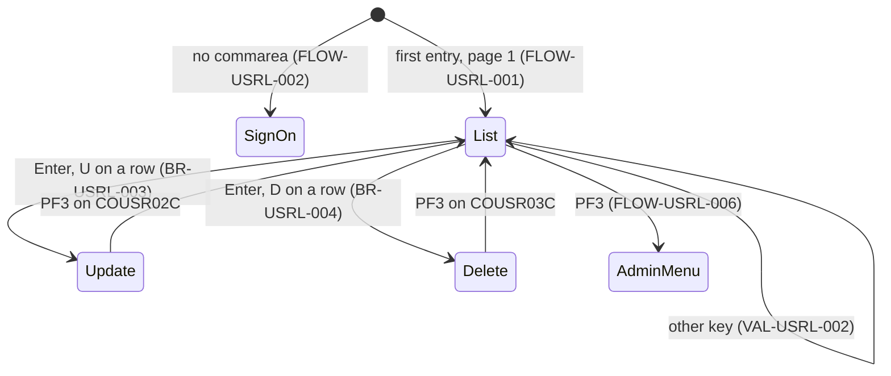
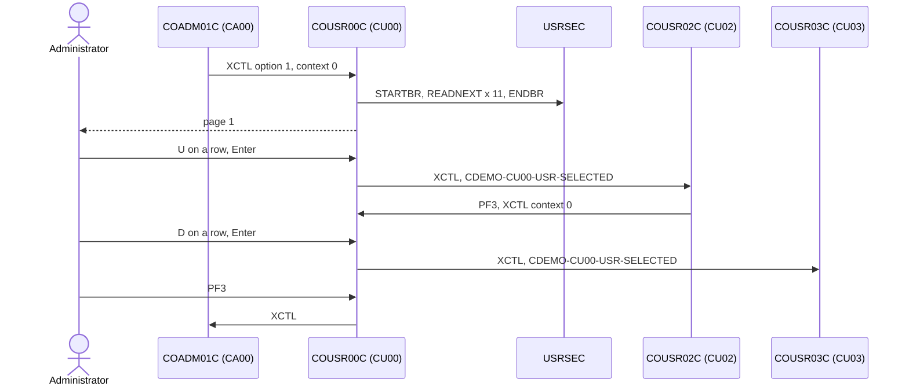

# COUSR00C: User list

## 1. Summary

COUSR00C is option 1 of the admin menu (transaction `CU00`). It browses the user security file `USRSEC` in user ID order and shows ten users per page with their first name, last name and type. The administrator can start the list at a typed user ID, page forward (PF8) and back (PF7), and mark one user with `U` to open the user update function `COUSR02C` or `D` to open the user delete function `COUSR03C` for that user. PF3 returns to the admin menu. The program only reads; it never shows passwords. It does not check that the user is an administrator. Several paging paths misbehave at the ends of the file, two of them by abending the task.

## 2. Rules at a glance

| ID | Rule |
| :-- | :-- |
| BR-USRL-001 | The list shows up to 10 users per page in ascending user ID order: user ID, first name, last name, type. |
| BR-USRL-002 | A typed search user ID starts the list at the first user ID equal to or greater than it, compared as typed. |
| BR-USRL-003 | `U` or `u` next to a user opens the user update function for that user. |
| BR-USRL-004 | `D` or `d` next to a user opens the user delete function for that user. |
| BR-USRL-005 | Only the first marked row counts. |
| BR-USRL-006 | The page number counts pages from where the list was started, beginning at 1. |
| VAL-USRL-001 | A selection code other than `U`/`u`/`D`/`d` is reported as `Invalid selection. Valid values are U and D`. |
| VAL-USRL-002 | Only Enter, PF3, PF7 and PF8 are valid keys. |
| VAL-USRL-003 | PF7 on page 1 is reported as `You are already at the top of the page...`. |
| VAL-USRL-004 | PF8 when there is no next page is reported as `You are already at the bottom of the page...`. |

## 3. Actors and triggers

- **Actor:** an administrator, by convention; nothing checks it (DEF-USRL-008).
- **Normal trigger:** admin menu option 1 (`app/cpy/COADM02Y.cpy:26-29`): XCTL from `COADM01C` with the 160-byte commarea and `CDEMO-PGM-CONTEXT` = 0 (BR-ADMN-002). The program shows the first page at once (FLOW-USRL-001).
- **Return trigger:** `COUSR02C` and `COUSR03C` transfer back here on PF3 when they were opened from the list (their PF3 target is `CDEMO-FROM-PROGRAM`), with context 0; the list starts again at page 1.
- **Re-entry trigger:** each interaction ends with "return, next transaction `CU00`" (`app/csd/CARDDEMO.CSD:449-458`, program `app/csd/CARDDEMO.CSD:278-284`).
- **Direct start:** `CU00` on a blank terminal starts the program without a commarea; it transfers to sign-on (FLOW-USRL-002).
- **Precondition:** `USRSEC` open with browse allowed (`app/csd/CARDDEMO.CSD:88-99`, `BROWSE(YES)`).

## 4. Interfaces

### 4.1 Screen COUSR0A (mapset COUSR00), 24 x 80

Source: `app/bms/COUSR00.bms:26-458`; symbolic map `app/cpy-bms/COUSR00.CPY`. Mapset `CTRL=(ALARM,FREEKB)`, `EXTATT=YES`. Every named field has `FSET`, so all of them, including the protected list columns, come back to the program on every key.

| Row,Col | Field | Len | Direction | Attributes | Content |
| :-- | :-- | --: | :-- | :-- | :-- |
| 1,1-2,79 | header | | out | as the menus | `Tran:` `CU00`, titles, `Date:` `mm/dd/yy`, `Prog:` `COUSR00C`, `Time:` `hh:mm:ss` |
| 4,35 | (label) | 10 | out | protected, bright, neutral | `List Users` |
| 4,65 | (label) | 5 | out | protected, bright, turquoise | `Page:` |
| 4,71 | `PAGENUM` | 8 | out | protected, blue | page number, 8 digits with leading zeros (NUM-USRL-001) |
| 6,5 | (label) | 15 | out | protected, turquoise | `Search User ID:` |
| 6,21 | `USRIDIN` | 8 | in/out | **unprotected**, green, underlined; the program always puts the cursor here | search user ID |
| 8,5-8,72 | (labels) | | out | protected, neutral | column headings `Sel`, `User ID `, `     First Name     `, `     Last Name      `, `Type`; row 9 dashes |
| 10-19,6 | `SEL0001`-`SEL0010` | 1 each | in/out | **unprotected**, green, underlined | selection code for the row |
| 10-19,12 | `USRID01`-`USRID10` | 8 each | out | protected, blue | `SEC-USR-ID` |
| 10-19,24 | `FNAME01`-`FNAME10` | 20 each | out | protected, blue | `SEC-USR-FNAME` |
| 10-19,48 | `LNAME01`-`LNAME10` | 20 each | out | protected, blue | `SEC-USR-LNAME` |
| 10-19,73 | `UTYPE01`-`UTYPE10` | 1 each | out | protected, blue | `SEC-USR-TYPE` |
| 21,12 | (label) | 56 | out | protected, bright, neutral | `Type 'U' to Update or 'D' to Delete a User from the list` |
| 23,1 | `ERRMSG` | 78 | out | protected, bright, red | message (§8.3); the program never changes the colour |
| 24,1 | (label) | 48 | out | protected, yellow | `ENTER=Continue  F3=Back  F7=Backward  F8=Forward` |

### 4.2 Files

| CICS file | Entity | Operation | Key | Lines |
| :-- | :-- | :-- | :-- | :-- |
| `USRSEC` | ENT-USER-SECURITY | STARTBR (default positioning, no `GTEQ` or `EQUAL` coded), READNEXT or READPREV into the 80-byte `SEC-USER-DATA`, ENDBR | `SEC-USR-ID` (8) | 586-691 |

### 4.3 Commarea

ENT-COMMAREA (160 bytes) followed by the 34-byte list extension ENT-COMMAREA-USER-ADMIN-EXT (`CDEMO-CU00-INFO`, `:67-75`); the program returns and passes 194 bytes. When it arrives from the admin menu with 160 bytes, the extension is filled with spaces by the copy (`:114`).

| Field | Read | Written | Use |
| :-- | :-- | :-- | :-- |
| `CDEMO-PGM-CONTEXT` | yes | yes | 0 = first entry, 1 = re-entry; 0 before every transfer |
| `CDEMO-FROM-TRANID`, `CDEMO-FROM-PROGRAM` | no | yes | `CU00` / `COUSR00C` before every transfer; the update and delete functions use it as their PF3 target |
| `CDEMO-TO-PROGRAM` | yes | yes | transfer target |
| `CDEMO-CU00-USRID-FIRST` | yes | yes | user ID in row 1 of the page shown; start key for PF7 |
| `CDEMO-CU00-USRID-LAST` | yes | yes | user ID in row 10 of the page shown (unchanged when the page has fewer than 10 rows); start key for PF8 |
| `CDEMO-CU00-PAGE-NUM` | yes | yes | page number, `9(08)` |
| `CDEMO-CU00-NEXT-PAGE-FLG` | yes | yes | `Y` = a next page exists |
| `CDEMO-CU00-USR-SEL-FLG` | yes (within the task, `:187-189`) | yes | selection code of the marked row |
| `CDEMO-CU00-USR-SELECTED` | no | yes | user ID of the marked row; read by `COUSR02C` and `COUSR03C` |

### 4.4 Console output

When a browse command fails with an unexpected response, the program writes `RESP:` and `REAS:` followed by the decimal values of the two binary response fields to the region's job log (LE standard output, not the CICS system log) (`:608, 642, 676`). No user data is written.

## 5. Data used

| Entity field | Read | Written | How |
| :-- | :-- | :-- | :-- |
| ENT-USER-SECURITY.SEC-USR-ID | key, shown | no | browse key; row user ID |
| ENT-USER-SECURITY.SEC-USR-FNAME, SEC-USR-LNAME | yes | no | shown (20 characters each) |
| ENT-USER-SECURITY.SEC-USR-TYPE | yes | no | shown (1 character) |
| ENT-USER-SECURITY.SEC-USR-PWD, SEC-USR-FILLER | read with the record | no | not used, not shown |
| ENT-COMMAREA, ENT-COMMAREA-USER-ADMIN-EXT | yes | yes | §4.3 |

Program-local data with behaviour: flags `WS-ERR-FLG`, `WS-USER-SEC-EOF` and `WS-SEND-ERASE-FLG` (`:40-48`), row index `WS-IDX` (`:53`). `WS-USER-DATA`, `WS-REC-COUNT` and `WS-PAGE-NUM` (`:52-64`) are never used (DEF-USRL-009).

## 6. Processing flow

**Entry (MAIN-PARA, lines 98-144)**

1. Clear the flags and the message; cursor on the search field (100-108).
2. No commarea: transfer to sign-on (110-112).
3. Copy the received commarea into the 194-byte work commarea (114).
4. First entry: mark re-entry, blank the screen, run the Enter logic (which builds and sends page 1), send the screen once more (115-119).
5. Re-entry: receive the screen, then by key: Enter, PF3, PF7, PF8 or other (121-137).
6. Return to CICS with next transaction `CU00` and the 194-byte commarea (141-144).

**Enter (PROCESS-ENTER-KEY, lines 149-232)**

1. Find the first row, 1 to 10, whose selection field is not blank; remember its code and user ID (151-185).
2. If a code and a user ID were found: `U`/`u` transfer to update, `D`/`d` transfer to delete, other code: VAL-USRL-001 (187-216). Processing continues after VAL-USRL-001.
3. Start key = search user ID, or low-values when it is blank (218-222).
4. Page number = 0; build the page forward (227-228, FLOW-USRL-005 steps 2-6). The search field is cleared inside the page build before its send (328); the second clear (230-232) runs after the screen was sent and only affects the extra send of the first entry.

**Page forward (PROCESS-PAGE-FORWARD, lines 282-331)**

1. Start the browse at the start key (284, SE-USRL-001). On NOTFND or an error, see ERR-USRL-001.
2. Unless the key pressed was Enter, PF7 or PF3, read one record and discard it (the last row of the current page) (288-290).
3. If the file is not exhausted: clear the 10 rows (292-296).
4. Read up to 10 records into rows 1-10 (298-306). Row 1's user ID becomes `CDEMO-CU00-USRID-FIRST`, row 10's becomes `CDEMO-CU00-USRID-LAST`.
5. If 10 rows were filled and the file is not exhausted: page number + 1, then read one more record: found means a next page exists (`Y`), end of file means it does not (`N`, with the bottom message). Otherwise: no next page; page number + 1 only if at least one row was filled (308-323).
6. End the browse, show the page number, clear the search field, send the screen (325-329).

**Page backward (PROCESS-PAGE-BACKWARD, lines 336-379)**

1. Start the browse at `CDEMO-CU00-USRID-FIRST` (338).
2. Read backward once and discard the record (the first row of the current page) (342-344).
3. If the file is not exhausted: clear the 10 rows (346-350).
4. Read backward up to 10 records into rows 10 down to 1 (352-360).
5. If 10 rows were filled and the file is not exhausted, read backward once more: found and page number above 1: page number - 1; otherwise page number = 1 (362-372). If the beginning of the file was reached while filling the rows, the page number is unchanged (DEF-USRL-011).
6. End the browse, show the page number, send the screen (374-377).

## 7. Business rules

#### BR-USRL-001 · List content and order
- **When:** a page is built.
- **Then:** the users are read from `USRSEC` in ascending key order (the byte order of the 8-character user ID, NUM-USRL-002). Each row shows user ID (8), first name (20), last name (20) and type (1) exactly as stored. Rows not filled are blank. Passwords are not shown. With the seed data (`app/jcl/DUSRSECJ.jcl:35-44`) the first page is `ADMIN001`-`ADMIN005` (type `A`) followed by `USER0001`-`USER0005` (type `U`).
- **Source:** `:293-306, 384-441, 446-501`
- **Fidelity:** must-preserve · **Confidence:** reviewed

#### BR-USRL-002 · Search start
- **When:** Enter is pressed (or the program is entered from a menu or a returning function) and no row selection is acted on.
- **Then:** the list restarts at page 1. If the search user ID is filled in, the browse starts at the first user ID equal to or greater than the typed value, compared byte by byte as typed (no upper-casing, no trimming); otherwise at the first user. It is a "start at" search, not a filter: the following users are listed too. A value greater than every user ID ends in an abend (DEF-USRL-001).
- **Source:** `:218-228, 586-595`
- **Fidelity:** must-preserve · **Confidence:** reviewed; "equal or greater" positioning platform-inferred (CICS STARTBR default, Q-USRL-003)

#### BR-USRL-003 · Select a user for update
- **When:** Enter, the first marked row has code `U` or `u` and its user ID is not blank.
- **Then:** `CDEMO-CU00-USR-SEL-FLG` = the code, `CDEMO-CU00-USR-SELECTED` = the row's user ID, `CDEMO-FROM-TRANID` = `CU00`, `CDEMO-FROM-PROGRAM` = `COUSR00C`, `CDEMO-PGM-CONTEXT` = 0, XCTL to `COUSR02C` with the 194-byte commarea. The update function opens with that user loaded (FLOW-USRU-001).
- **Source:** `:187-199`
- **Fidelity:** must-preserve · **Confidence:** reviewed

#### BR-USRL-004 · Select a user for delete
- **When:** as BR-USRL-003 with code `D` or `d`.
- **Then:** the same commarea settings and XCTL to `COUSR03C` (FLOW-USRD-001).
- **Source:** `:187-188, 200-209`
- **Fidelity:** must-preserve · **Confidence:** reviewed

#### BR-USRL-005 · First marked row wins
- **When:** several rows have a selection code.
- **Then:** only the first one from the top is considered; the others are ignored without a message. A code on an empty row (user ID blank) is ignored, and the rows below it are not looked at.
- **Source:** `:151-185, 187-188`
- **Fidelity:** must-preserve · **Confidence:** reviewed

#### BR-USRL-006 · Page number
- **When:** a page is shown.
- **Then:** Enter and every entry set the page number to 0 and the forward build makes it 1 (it stays 0 only when STARTBR fails, in which case no page is shown). PF8 adds 1 when it shows at least one row. PF7 subtracts 1 when a record exists before the new first row, sets 1 when the new page is the first of the file, and leaves the number unchanged when the beginning of the file is reached while filling the rows (DEF-USRL-011). The number counts pages from where the list was started, so after a search the first page shown is page 1 whatever its position in the file.
- **Source:** `:227, 308-323, 362-372`
- **Fidelity:** must-preserve · **Confidence:** reviewed

## 8. Validations and messages

#### VAL-USRL-001 · Selection code
- **When:** Enter, the first marked row has a user ID and a code other than `U`, `u`, `D`, `d`.
- **Then:** message `Invalid selection. Valid values are U and D` (no trailing dot), cursor on the search field. No error flag is set: the page is still rebuilt from the search ID as for a plain Enter, and the message is replaced when that rebuild reaches the end of the file (DEF-USRL-004). The code stays in its field.
- **Source:** `:210-214`
- **Fidelity:** must-preserve · **Confidence:** reviewed

#### VAL-USRL-002 · Valid keys
- **When:** re-entry with a key other than Enter, PF3, PF7, PF8.
- **Then:** message `Invalid key pressed. Please see below...`, cursor on the search field, the screen as received sent back with erase.
- **Source:** `:132-136`
- **Fidelity:** must-preserve · **Confidence:** reviewed

#### VAL-USRL-003 · Already on the first page
- **When:** PF7 and the page number is not above 1.
- **Then:** message `You are already at the top of the page...`, screen sent **without erase**, so the list on the terminal stays as it is. The next-page flag is set to `Y` anyway (DEF-USRL-002).
- **Source:** `:239-255`
- **Fidelity:** must-preserve (message), defect-decide (flag) · **Confidence:** reviewed

#### VAL-USRL-004 · No next page
- **When:** PF8 and the next-page flag is not `Y`.
- **Then:** message `You are already at the bottom of the page...`, screen sent without erase; the list stays.
- **Source:** `:262-277`
- **Fidelity:** must-preserve · **Confidence:** reviewed

### 8.1 Flow and keys

#### FLOW-USRL-001 · First entry
- **When:** commarea present and `CDEMO-PGM-CONTEXT` is not 1 (from the admin menu, or back from update or delete).
- **Then:** set context to 1, blank the screen and run the Enter logic with an empty screen: no selection, no search ID, so page 1 from the first user is built and sent (BR-USRL-002). The screen is then sent a second time, unchanged. The key that started the task (Enter from the menu, PF3 from update or delete) does not skip a record (Page forward step 2).
- **Source:** `:115-119, 288`

#### FLOW-USRL-002 · No commarea
- **When:** `EIBCALEN` = 0.
- **Then:** `CDEMO-TO-PROGRAM` = `COSGN00C`, `CDEMO-FROM-TRANID` = `CU00`, `CDEMO-FROM-PROGRAM` = `COUSR00C`, context 0, XCTL to sign-on **with** the 194-byte commarea (made of uninitialised working storage). Sign-on then acts on the key pressed (FLOW-SGN-008).
- **Source:** `:110-112, 506-517`

#### FLOW-USRL-003 · Enter
- **Then:** section 6 "Enter": act on a selection, or rebuild the list from the search ID at page 1.
- **Source:** `:123-124, 149-232`

#### FLOW-USRL-004 · PF7, previous page
- **When:** PF7.
- **Then:** start key = `CDEMO-CU00-USRID-FIRST` (low-values if blank); next-page flag = `Y`. Page number above 1: section 6 "Page backward". Otherwise VAL-USRL-003. Going back from page 2 to page 1 shows `You have reached the top of the page...` only when the list was started at the first user; after a search, page 1 can start in the middle of the file, the look-behind read finds a record, the page number goes to 1 and no message is shown.
- **Source:** `:128-129, 237-255, 336-379`

#### FLOW-USRL-005 · PF8, next page
- **When:** PF8.
- **Then:** start key = `CDEMO-CU00-USRID-LAST` (high-values if blank). Next-page flag `Y`: section 6 "Page forward", which first skips the record at the start key. Otherwise VAL-USRL-004. A page that reaches the end of the file carries `You have reached the bottom of the page...`.
- **Source:** `:130-131, 260-277, 282-331`

#### FLOW-USRL-006 · PF3, back to the admin menu
- **Then:** `CDEMO-TO-PROGRAM` = `COADM01C`, from-fields `CU00`/`COUSR00C`, context 0, XCTL with the 194-byte commarea (the admin menu keeps the first 160 bytes).
- **Source:** `:125-127, 506-517`

#### FLOW-USRL-007 · End of every interaction
- **Then:** return to CICS naming `CU00` as the next transaction, with the 194-byte commarea, which carries the paging state to the next task.
- **Source:** `:141-144`

#### FLOW-USRL-008 · Screen send
- **Then:** header (titles, `CU00`, `COUSR00C`, date, time) and message filled in; the cursor is placed on the search field (`-1` length plus `CURSOR`). The screen is erased first except for the two "already at" messages. One task often sends the screen two or three times (the end-of-file and error branches send immediately, then the page is sent again); the user sees the last one (DEF-USRL-010).
- **Source:** `:522-544, 562-581`

### 8.2 Decision table for a page build

| Path | STARTBR | Records found | Result |
| :-- | :-- | :-- | :-- |
| Enter / entry | NOTFND (search ID above all IDs, or empty file) | - | `You are at the top of the page...` then abend (DEF-USRL-001) |
| any | other error | - | `Unable to lookup User...`, list unchanged |
| Enter / entry | NORMAL | 1-10 users to the end of the file | rows filled, rest blank, page 1, no next page, `You have reached the bottom of the page...` |
| Enter / entry | NORMAL | more than 10 | rows 1-10, page 1, next page `Y`, no message (or VAL-USRL-001's) |
| PF8, flag `Y` | NORMAL | more than 10 after the last row | next 10, page + 1, flag `Y` |
| PF8, flag `Y` | NORMAL | 1-10 after the last row | rows filled, page + 1, flag `N`, bottom message |
| PF8, flag `Y` | NORMAL | none after the last row | blank list, page unchanged, flag `N`, bottom message (DEF-USRL-002) |
| PF8, flag `Y`, last ID blank | start key high-values; most likely NORMAL, positioned at the end of the file | none | skip read gets ENDFILE: bottom message, rows as received, page unchanged, flag `N`; no abend expected (DEF-USRL-001, platform-inferred) |
| PF7, page > 1 | NORMAL | 10 before the first row, more before | previous 10, page - 1 |
| PF7, page > 1 | NORMAL | 10 before the first row, none before | previous 10, page 1, `You have reached the top of the page...` |
| PF7, page > 1 | NORMAL | fewer than 10 before | rows at the bottom, top rows blank, page unchanged, top message (DEF-USRL-011) |
| PF7, page > 1 | NOTFND (every user from the first-row key on was deleted) | - | READPREV on a browse that never started (`Unable to lookup User...`), then the ENDBR abend (DEF-USRL-001) |

### 8.3 Message catalog

All messages appear in `ERRMSG` (row 23, red), informational ones included.

| Text (exact) | Cause | Item |
| :-- | :-- | :-- |
| `Invalid selection. Valid values are U and D` | selection code not U/D | VAL-USRL-001 |
| `Invalid key pressed. Please see below...` | wrong key | VAL-USRL-002 |
| `You are already at the top of the page...` | PF7 on page 1 | VAL-USRL-003 |
| `You are already at the bottom of the page...` | PF8 with no next page | VAL-USRL-004 |
| `You have reached the bottom of the page...` | end of file reached while building a page | ERR-USRL-002 |
| `You have reached the top of the page...` | beginning of file reached while paging back | ERR-USRL-002 |
| `You are at the top of the page...` | STARTBR NOTFND | ERR-USRL-001 |
| `Unable to lookup User...` | any other browse response | ERR-USRL-001, ERR-USRL-002 |

## 9. Side effects

#### SE-USRL-001 · Forward browse
- **What:** STARTBR `USRSEC` at the start key, then READNEXT: up to 1 skip read (PF8), up to 10 row reads and 1 look-ahead read, then ENDBR, all in one task. No lock is taken; nothing is written. Users added or deleted between tasks shift the pages.
- **Source:** `:284-325, 586-648, 687-691`
- **Fidelity:** must-preserve (result), incidental (number of reads) · **Confidence:** reviewed

#### SE-USRL-002 · Backward browse
- **What:** STARTBR at `CDEMO-CU00-USRID-FIRST`, then READPREV: 1 skip read, up to 10 row reads and 1 look-behind read, then ENDBR. The first READPREV after STARTBR returns the record at the start key itself, which is why it is skipped. If that user was deleted between tasks, the STARTBR positions on a different key and the first READPREV most likely returns NOTFND, which shows `Unable to lookup User...` (ERR-USRL-002).
- **Source:** `:338-374, 653-682, 687-691`
- **Fidelity:** must-preserve (result) · **Confidence:** reviewed; READPREV positioning platform-inferred

## 10. Error handling

#### ERR-USRL-001 · STARTBR responses

| Response | Effect |
| :-- | :-- |
| NORMAL | browse continues |
| NOTFND (no user ID at or after the start key) | `You are at the top of the page...`, cursor on the search field, screen sent; the end-of-file flag is set but the error flag is not, so the page build goes on: with PF8 it issues a READNEXT, and on the PF7 path a READPREV, on a browse that never started (response other, `Unable to lookup User...`), and in every case it ends with an ENDBR that has no RESP option, which raises INVREQ and abends the task (DEF-USRL-001) |
| other (for example NOTOPEN in the batch window) | log line, `Unable to lookup User...`, screen sent, error flag set; no ENDBR; normal return |

- **Source:** `:597-614, 284-331, 687-691`
- **Fidelity:** must-preserve (NORMAL, other), defect-decide (NOTFND) · **Confidence:** reviewed; INVREQ abend platform-inferred

#### ERR-USRL-002 · READNEXT and READPREV responses

| Response | Effect |
| :-- | :-- |
| NORMAL | row filled or record skipped |
| ENDFILE on READNEXT | `You have reached the bottom of the page...`, end-of-file flag, screen sent at once (partial page), then the page build finishes |
| ENDFILE on READPREV | `You have reached the top of the page...`, as above |
| other | log line, `Unable to lookup User...`, error flag; the build stops reading, ends the browse and sends the screen |

- **Source:** `:631-648, 665-682`
- **Fidelity:** must-preserve · **Confidence:** reviewed

#### ERR-USRL-003 · Unchecked commands
- **What:** the RECEIVE MAP response is not tested; ENDBR, the XCTLs and the SENDs have no RESP and no HANDLE CONDITION exists, so any failure there abends the task. With Clear or a PA key the RECEIVE gets MAPFAIL, the key falls to VAL-USRL-002, and the screen is sent from a map area that nothing filled in this task: the list and page number come back blank, while the paging keys in the commarea are kept, so PF7 and PF8 still work.
- **Source:** `:549-557, 687-691, 196-209, 514-517`
- **Fidelity:** incidental · **Confidence:** platform-inferred

## 11. Interactions

- **Inbound:** `COADM01C` option 1; PF3 of `COUSR02C` and `COUSR03C` when opened from the list.
- **Outbound:** `COUSR02C`, `COUSR03C` (the selected user ID in the commarea extension), `COADM01C`, `COSGN00C`.
- **Shared data:** `USRSEC` (ENT-USER-SECURITY), also used by `COSGN00C` (read), `COUSR01C` (add), `COUSR02C` (update) and `COUSR03C` (delete). The extension `CDEMO-CU00-INFO` has the same layout as `CDEMO-CU02-INFO` and `CDEMO-CU03-INFO` in the update and delete programs; the selected user ID is the hand-over field (ENT-COMMAREA-USER-ADMIN-EXT).

### Module extraction notes (user administration as one module)

| Boundary | Contract |
| :-- | :-- |
| Entry | XCTL from `COADM01C` with the 160-byte commarea; no authorisation is checked (Q-ADMN-001). |
| Data | `USRSEC` read-only here; ordering is the EBCDIC byte order of the user ID (NUM-USRL-002), which a store on an ASCII or Unicode platform does not reproduce by default. |
| Hand-over | `CDEMO-CU00-USR-SELECTED` (8) in commarea bytes 187-194 (counted from 1) to `COUSR02C`/`COUSR03C`; `CDEMO-FROM-PROGRAM` = `COUSR00C` makes them return here. |

## 12. Numeric, date and format details

#### NUM-USRL-001 · Page number display
- `CDEMO-CU00-PAGE-NUM` is `9(08)`, unsigned; it is moved to the 8-character `PAGENUM`, so page 1 shows as `00000001` (GnuCOBOL test of the same move). No overflow handling; 99,999,999 pages are out of reach with 8-character keys.
- **Source:** `:70, 327, 376`
- **Confidence:** runtime-verified

#### NUM-USRL-002 · Key order and case
- The browse order and the search start compare the 8 key bytes in EBCDIC: lower-case letters sort before upper-case letters, which sort before digits. A search for `user0001` (lower case) therefore starts at the very first user, not at `USER0001`. A target that stores user IDs in ASCII or Unicode order sorts digits first and lower case last, and would list and search differently.
- **Source:** `:218-222, 586-595`
- **Confidence:** platform-inferred

#### NUM-USRL-003 · Header date and time
- Date `mm/dd/yy`, time `hh:mm:ss`, from `FUNCTION CURRENT-DATE`.
- **Source:** `:562-581`

## 13. Known defects and oddities

None of these were changed in this branch (`COUSR00C.cbl` is not touched after the original import; `CHANGELOG.md` "Fixed" lists only batch and JCL fixes).

#### DEF-USRL-001 · Abend when the browse start finds nothing
- When STARTBR returns NOTFND, the program shows `You are at the top of the page...` but carries on and issues ENDBR on a browse that never started; ENDBR has no RESP option, so CICS raises INVREQ and abends the task (AEIP), and the pseudo-conversation is lost (the next key starts no CardDemo transaction). It happens for a search user ID greater than every user ID (for example `ZZZZZZZZ`; in EBCDIC digits sort above letters, so `99999999` is the safer example), for an empty file, and for PF7 when every user from the first-row key on was deleted. PF8 with a blank last user ID starts at high-values; CICS most likely treats a full-length X'FF' key as "position at the end of the file" (NORMAL, then ENDFILE on the first read), so that case probably ends with the bottom message and no abend (Q-USRL-003).
- **Source:** `:600-606, 286-290, 325, 687-691`
- **Status:** open · **Fidelity:** defect-decide · **Confidence:** platform-inferred

#### DEF-USRL-002 · PF7 on page 1 sets the next-page flag
- PF7 sets the next-page flag to `Y` before checking the page number. After PF7 on a list that fits on one page, PF8 no longer says "already at the bottom": with exactly 10 users it shows an empty list with `You have reached the bottom of the page...`; with fewer than 10 users, entered from the admin menu, the last user ID is blank and the browse starts at high-values, which most likely ends with the bottom message and the list unchanged (DEF-USRL-001).
- **Source:** `:245, 248-255, 262-266, 288-296`
- **Status:** open · **Fidelity:** defect-decide · **Confidence:** reviewed (logic), platform-inferred (high-values start)

#### DEF-USRL-003 · Informational messages look like errors
- All messages, including "reached the bottom" on a complete one-page list, are shown in bright red. With the 10 seed users the very first screen already reads `You have reached the bottom of the page...`. `You are at the top of the page...` is shown when a search finds nothing, which is not what it means.
- **Source:** `:603, 637`; `app/bms/COUSR00.bms:449-452`
- **Status:** open (cosmetic) · **Fidelity:** incidental · **Confidence:** reviewed

#### DEF-USRL-004 · Invalid-selection message can be lost; the code is not cleared
- After VAL-USRL-001 the list is rebuilt; when the rebuilt page reaches the end of the file (always with 10 users or fewer), `You have reached the bottom of the page...` replaces the message, so the administrator gets no feedback on the wrong code. The rows' selection fields are never cleared, so the wrong code is sent again with the next Enter.
- **Source:** `:210-214, 227-228, 637-638, 446-501`
- **Status:** open · **Fidelity:** defect-decide · **Confidence:** reviewed

#### DEF-USRL-005 · Extra marks are ignored silently
- Only the first marked row is acted on (BR-USRL-005); a second mark is neither processed nor reported.
- **Source:** `:151-185`
- **Status:** open · **Fidelity:** incidental · **Confidence:** reviewed

#### DEF-USRL-006 · Enter always restarts the list
- Enter without a selection, a returning function and every new entry rebuild the list from the search ID (or the first user) at page 1, so the position on later pages is lost after an update or delete.
- **Source:** `:115-119, 218-228`
- **Status:** open · **Fidelity:** incidental · **Confidence:** reviewed

#### DEF-USRL-007 · Search is case-sensitive and order-dependent
- The typed search ID is not upper-cased, while sign-on upper-cases user IDs (BR-SGN-001). See NUM-USRL-002.
- **Source:** `:218-222`
- **Status:** open · **Fidelity:** defect-decide (Q-USRL-001) · **Confidence:** reviewed

#### DEF-USRL-008 · [security] No check that the user is an administrator
- The program never reads `CDEMO-USER-TYPE`. Anyone who reaches it with a commarea can list every user ID and name, including all administrator IDs, which helps password guessing on the sign-on screen (DEF-SGN-002, DEF-SGN-003). See DEF-ADMN-001.
- **Source:** `:110-139`
- **Status:** open · **Fidelity:** defect-decide (Q-ADMN-001) · **Confidence:** reviewed

#### DEF-USRL-009 · Dead data and an ineffective initialisation
- `WS-USER-DATA` (a 10-row table), `WS-REC-COUNT` and `WS-PAGE-NUM` are never used. Setting the next-page flag to `N` at the start of the task has no effect when a commarea arrives, because the copy of the received commarea overwrites it.
- **Source:** `:52-64, 102, 114`
- **Status:** open · **Fidelity:** incidental · **Confidence:** reviewed

#### DEF-USRL-010 · Several screen sends per task
- The end-of-file and error branches send the screen immediately (with a partial page; on first entry without a page number, on re-entry with the previous page number, because `PAGENUM` is `FSET` and comes back from the terminal), and the page is sent again at the end; the first entry sends it once more. Only the last send is visible after the task ends, but every send travels to the terminal.
- **Source:** `:119, 329, 377, 606, 640, 674`
- **Status:** open · **Fidelity:** incidental · **Confidence:** reviewed

#### DEF-USRL-011 · Paging back can show a partial page
- If fewer than 10 users precede the first row of the current page, PF7 fills rows from the bottom up, leaves the top rows blank and keeps the page number; the "top" message is shown. A page above 1 is normally reached by PF8 from a full page, so this needs deletions between tasks, or the stale last-row key of DEF-USRL-014.
- **Source:** `:352-372`
- **Status:** open · **Fidelity:** defect-decide · **Confidence:** reviewed

#### DEF-USRL-012 · Selection marks survive paging and act on another user
- `INITIALIZE-USER-DATA` clears the user ID, name and type columns but never the selection fields `SEL0001`-`SEL0010`, and the input and output map areas share storage. A mark typed on row 3 followed by PF7, PF8 or an invalid key is sent back on the new page; the next Enter then opens update or delete for whichever user is now in row 3. For `D` the delete function opens a different user than the one the administrator marked.
- **Source:** `:151-209, 446-501`; `app/cpy-bms/COUSR00.CPY` (`COUSR0AO REDEFINES COUSR0AI`)
- **Status:** open · **Fidelity:** defect-decide · **Confidence:** reviewed

#### DEF-USRL-013 · [security] The selected user ID comes from the terminal
- `CDEMO-CU00-USR-SELECTED` is taken from the protected, `FSET` row field returned by the terminal (`:154-181`), not from server-side state. A modified 3270 data stream can hand any user ID, including one not on the list, to update or delete.
- **Source:** `:151-185`; `app/bms/COUSR00.bms` (`USRID01`-`USRID10`, `FSET`)
- **Status:** open · **Fidelity:** defect-decide (Q-ADMN-001) · **Confidence:** reviewed; data-stream tampering platform-inferred

#### DEF-USRL-014 · Stale first and last keys after a short page
- `CDEMO-CU00-USRID-FIRST` is set only from row 1 and `CDEMO-CU00-USRID-LAST` only from row 10 (`:387-389, 433-435`). After a page with fewer than 10 rows, the last key still holds row 10 of an earlier full page. Combined with DEF-USRL-002 this pages from the old key: with 25 users, show page 1, search the 18th user (8 rows), press PF7 (top message, flag `Y`), then PF8: users 11-20 appear as page 2.
- **Source:** `:245, 262-266, 384-441`
- **Status:** open · **Fidelity:** defect-decide · **Confidence:** reviewed

#### DEF-USRL-015 · The search field is read only by Enter and cleared after each page
- A search ID typed before PF7 or PF8 is ignored (only Enter reads it, `:218-222`). PF8 then blanks the field (`:328`); PF7 leaves it on screen, where it looks active but is not. Because every forward page clears it, a later Enter (including one with an invalid selection) restarts at the first user unless the ID is typed again, which reinforces DEF-USRL-006.
- **Source:** `:218-222, 328`
- **Status:** open · **Fidelity:** incidental · **Confidence:** reviewed

## 14. Open questions

| ID | Question | For |
| :-- | :-- | :-- |
| Q-USRL-001 | Should the user search be case-insensitive and should it be a filter (prefix or contains) instead of a "start at" position? | business |
| Q-USRL-002 | Must the target keep the EBCDIC user ID order (lower case, then upper case, then digits) for listing and paging, or is the target platform's natural order acceptable? | business |
| Q-USRL-003 | On the mainframe: confirm that STARTBR without `GTEQ` or `EQUAL` positions at the first key equal to or greater than the start key, that ENDBR after a NOTFND STARTBR abends with AEIP, and how STARTBR behaves with an all-X'FF' (high-values) key (DEF-USRL-001, DEF-USRL-002). | mainframe team |

## 15. Equivalence contract

A reimplementation must reproduce the rows shown (order, columns, values), the page number, which function opens for which code and with which user ID, and the messages. It may differ in screen technology, in the number of screen sends, and in clock values. It must not reproduce the abends of DEF-USRL-001 unless the business decides so; the scenarios state the as-is outcome. Seed data: `app/jcl/DUSRSECJ.jcl:35-44`.

| # | Start state | Input | Expected |
| --: | :-- | :-- | :-- |
| S1 | admin menu, seed users | option 1 | page `00000001`: `ADMIN001 MARGARET GOLD A` ... `USER0005 LEE TING U`; `You have reached the bottom of the page...` |
| S2 | S1 | PF8 | `You are already at the bottom of the page...`, list unchanged |
| S3 | S1 | PF7 | `You are already at the top of the page...`, list unchanged |
| S4 | S3 | PF8 | empty list, page `00000001`, `You have reached the bottom of the page...` (DEF-USRL-002) |
| S5 | S1 | search `USER0003`, Enter | rows `USER0003`-`USER0005`, page `00000001`, bottom message |
| S6 | S1 | `u` next to `USER0002`, Enter | XCTL `COUSR02C`, `CDEMO-CU00-USR-SELECTED` = `USER0002`, from `CU00`/`COUSR00C` |
| S7 | S1 | `D` next to `ADMIN003`, Enter | XCTL `COUSR03C` with `ADMIN003` |
| S8 | S1 | `X` next to `USER0001`, Enter | list rebuilt; message `You have reached the bottom of the page...` (the selection message is replaced, DEF-USRL-004) |
| S9 | 15 users | entry, PF8, PF7 | page 1 (10 rows, no message), page 2 (5 rows, bottom message), page 1 (`You have reached the top of the page...`) |
| S10 | S1 | search `ZZZZZZZZ`, Enter | `You are at the top of the page...`, then task abend (DEF-USRL-001) |
| S11 | S1 | PF3 | admin menu |
| S12 | S1 | PF5 | `Invalid key pressed. Please see below...` |

These scenarios cannot run locally (no CICS); they become acceptance tests for the target. Review evidence: `evidence/a-signon-admin-review.md`.

## 16. Paragraph coverage

| Paragraph | Lines | Covered by |
| :-- | :-- | :-- |
| (data division) | 33-92 | §4.3, §5, DEF-USRL-009 |
| `MAIN-PARA` | 98-144 | FLOW-USRL-001, FLOW-USRL-002, FLOW-USRL-006, FLOW-USRL-007, VAL-USRL-002 |
| `PROCESS-ENTER-KEY` | 149-232 | FLOW-USRL-003, BR-USRL-002..005, VAL-USRL-001, DEF-USRL-004, DEF-USRL-006, DEF-USRL-012, DEF-USRL-013, DEF-USRL-015 |
| `PROCESS-PF7-KEY` | 237-255 | FLOW-USRL-004, VAL-USRL-003, DEF-USRL-002 |
| `PROCESS-PF8-KEY` | 260-277 | FLOW-USRL-005, VAL-USRL-004 |
| `PROCESS-PAGE-FORWARD` | 282-331 | SE-USRL-001, BR-USRL-001, BR-USRL-006, DEF-USRL-001, DEF-USRL-015 |
| `PROCESS-PAGE-BACKWARD` | 336-379 | SE-USRL-002, BR-USRL-006, DEF-USRL-011 |
| `POPULATE-USER-DATA` | 384-441 | BR-USRL-001, DEF-USRL-014 |
| `INITIALIZE-USER-DATA` | 446-501 | BR-USRL-001, DEF-USRL-004, DEF-USRL-012 |
| `RETURN-TO-PREV-SCREEN` | 506-517 | FLOW-USRL-002, FLOW-USRL-006 |
| `SEND-USRLST-SCREEN` | 522-544 | FLOW-USRL-008, DEF-USRL-010 |
| `RECEIVE-USRLST-SCREEN` | 549-557 | ERR-USRL-003 |
| `POPULATE-HEADER-INFO` | 562-581 | FLOW-USRL-008, NUM-USRL-003 |
| `STARTBR-USER-SEC-FILE` | 586-614 | ERR-USRL-001, BR-USRL-002, NUM-USRL-002 |
| `READNEXT-USER-SEC-FILE` | 619-648 | ERR-USRL-002, SE-USRL-001 |
| `READPREV-USER-SEC-FILE` | 653-682 | ERR-USRL-002, SE-USRL-002 |
| `ENDBR-USER-SEC-FILE` | 687-691 | SE-USRL-001, DEF-USRL-001, ERR-USRL-003 |

16 of 16 paragraphs covered (plus the data division row).
