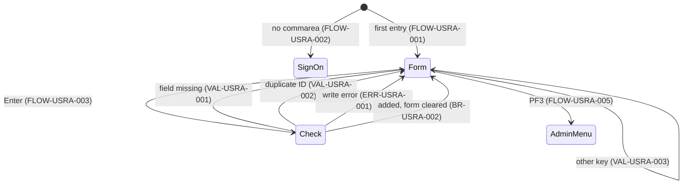

# COUSR01C: User add

## 1. Summary

COUSR01C is option 2 of the admin menu (transaction `CU01`). It shows an empty form with first name, last name, user ID, password and user type; when the administrator presses Enter with all five filled in, it writes a new record to the user security file `USRSEC` exactly as typed and confirms `User <id> has been added ...` in green. A user ID that already exists is refused. PF4 clears the form and PF3 returns to the admin menu. Nothing else is validated: the user type can be any character, the ID and password are not converted to upper case (so the new user may be unable to sign on), and the password is stored in plain text. The program does not check that the operator is an administrator.

## 2. Rules at a glance

| ID | Rule |
| :-- | :-- |
| BR-USRA-001 | A new user record is written with the five typed values, unchanged, as one 80-byte record keyed by the user ID. |
| BR-USRA-002 | After a successful add the form is cleared and `User <id> has been added ...` is shown in green. |
| VAL-USRA-001 | First name, last name, user ID, password and user type are all required, checked in that order; the first missing one is reported. |
| VAL-USRA-002 | The user ID must not exist yet: `User ID already exist...`. |
| VAL-USRA-003 | Only Enter, PF3 and PF4 are valid keys; PF12, although shown on the screen, is not. |

## 3. Actors and triggers

- **Actor:** an administrator, by convention; nothing checks it (DEF-USRA-005).
- **Normal trigger:** admin menu option 2 (`app/cpy/COADM02Y.cpy:31-34`): XCTL from `COADM01C` with the 160-byte commarea and `CDEMO-PGM-CONTEXT` = 0 (BR-ADMN-002). The program shows the empty form (FLOW-USRA-001).
- **Re-entry trigger:** each interaction ends with "return, next transaction `CU01`" (`app/csd/CARDDEMO.CSD:459-468`, program `app/csd/CARDDEMO.CSD:285-291`).
- **Direct start:** `CU01` on a blank terminal: no commarea, transfer to sign-on (FLOW-USRA-002).
- **Precondition:** `USRSEC` open with add allowed (`app/csd/CARDDEMO.CSD:88-99`, `ADD(YES)`).

## 4. Interfaces

### 4.1 Screen COUSR1A (mapset COUSR01), 24 x 80

Source: `app/bms/COUSR01.bms:26-159`; symbolic map `app/cpy-bms/COUSR01.CPY`. Mapset `CTRL=(ALARM,FREEKB)`, `EXTATT=YES`. All named fields have `FSET`.

| Row,Col | Field | Len | Direction | Attributes | Content |
| :-- | :-- | --: | :-- | :-- | :-- |
| 1,1-2,79 | header | | out | as the menus | `Tran:` `CU01`, titles, `Date:` `mm/dd/yy`, `Prog:` `COUSR01C`, `Time:` `hh:mm:ss` |
| 4,35 | (label) | 9 | out | protected, bright, neutral | `Add User` |
| 8,6 | (label) | 11 | out | protected, turquoise | `First Name:` |
| 8,18 | `FNAME` | 20 | in/out | **unprotected**, green, underlined, initial cursor | first name |
| 8,45 | (label) | 10 | out | protected, turquoise | `Last Name:` |
| 8,56 | `LNAME` | 20 | in/out | **unprotected**, green, underlined | last name |
| 11,6 | (label) | 8 | out | protected, turquoise | `User ID:` |
| 11,15 | `USERID` | 8 | in/out | **unprotected**, green, underlined | user ID |
| 11,24 | (label) | 8 | out | protected, blue | `(8 Char)` |
| 11,45 | (label) | 9 | out | protected, turquoise | `Password:` |
| 11,55 | `PASSWD` | 8 | in/out | **unprotected, dark**, green, underlined | password |
| 11,64 | (label) | 8 | out | protected, blue | `(8 Char)` |
| 14,6 | (label) | 11 | out | protected, turquoise | `User Type: ` |
| 14,17 | `USRTYPE` | 1 | in/out | **unprotected**, green, underlined | user type |
| 14,19 | (label) | 17 | out | protected, blue | `(A=Admin, U=User)` |
| 23,1 | `ERRMSG` | 78 | out | protected, bright, red (green after a successful add) | message |
| 24,1 | (label) | 43 | out | protected, yellow | `ENTER=Add User  F3=Back  F4=Clear  F12=Exit` |

### 4.2 Files

| CICS file | Entity | Operation | Key | Lines |
| :-- | :-- | :-- | :-- | :-- |
| `USRSEC` | ENT-USER-SECURITY | WRITE from `SEC-USER-DATA`, 80 bytes | `SEC-USR-ID` = typed user ID (8) | 240-248 |

### 4.3 Commarea

ENT-COMMAREA, 160 bytes, no extension. Used: `CDEMO-PGM-CONTEXT` (first entry / re-entry), `CDEMO-TO-PROGRAM` (transfer target), and `CDEMO-FROM-TRANID` / `CDEMO-FROM-PROGRAM`, set to `CU01` / `COUSR01C` before every transfer. Everything else passes through. `CDEMO-USER-ID` is not used: the record has no "created by" information.

### 4.4 Console output

None (the log line in the error branch is commented out, `:268`).

## 5. Data used

| Entity field | Read | Written | How |
| :-- | :-- | :-- | :-- |
| ENT-USER-SECURITY.SEC-USR-ID | no | key | `USERID` as typed |
| ENT-USER-SECURITY.SEC-USR-FNAME | no | yes | `FNAME` as typed |
| ENT-USER-SECURITY.SEC-USR-LNAME | no | yes | `LNAME` as typed |
| ENT-USER-SECURITY.SEC-USR-PWD | no | yes | `PASSWD` as typed, plain text |
| ENT-USER-SECURITY.SEC-USR-TYPE | no | yes | `USRTYPE` as typed |
| ENT-USER-SECURITY.SEC-USR-FILLER | no | yes, not set | whatever working storage holds (DEF-USRA-004) |
| ENT-COMMAREA | yes | yes | §4.3 |

## 6. Processing flow

**Entry (MAIN-PARA, lines 71-110)**

1. Clear the error flag and the message (73-76).
2. No commarea: transfer to sign-on (78-80).
3. Copy the received commarea (82).
4. First entry: mark re-entry, blank the form, cursor on first name, send (83-87).
5. Re-entry: receive the form; Enter, PF3, PF4 or other (89-103).
6. Return to CICS with next transaction `CU01` and the commarea (107-110).

**Enter (PROCESS-ENTER-KEY, lines 115-160)**

1. Check the five fields in order (VAL-USRA-001); the first empty one is reported and nothing is written.
2. All present: move the five fields into the record and write it (BR-USRA-001, SE-USRA-001).

## 7. Business rules

#### BR-USRA-001 · Create the user record
- **When:** Enter and all five fields are filled in.
- **Then:** `SEC-USR-ID` = user ID, `SEC-USR-FNAME` = first name, `SEC-USR-LNAME` = last name, `SEC-USR-PWD` = password, `SEC-USR-TYPE` = user type, each exactly as received from the screen (left-justified, padded with spaces), and the record is written to `USRSEC`. There is no conversion to upper case (DEF-USRA-001), no check that the type is `A` or `U` (DEF-USRA-002), no rule on the password (length, characters, difference from the user ID) and no hashing (DEF-USRA-003).
- **Source:** `:153-159`
- **Fidelity:** must-preserve (a record is created), defect-decide (no normalisation or checks, Q-USRA-001) · **Confidence:** reviewed

#### BR-USRA-002 · Confirmation
- **When:** the write returns NORMAL.
- **Then:** the five fields and the message are cleared, the message colour is set to green, and the message `User <id> has been added ...` is built from the user ID up to its first space, cursor on first name, form sent. For `TEST0001` the text is `User TEST0001 has been added ...` (GnuCOBOL test of the same string). The program stays on the add form for the next user.
- **Source:** `:251-259, 287-295`
- **Fidelity:** must-preserve · **Confidence:** reviewed; message format runtime-verified

## 8. Validations and messages

#### VAL-USRA-001 · Required fields
- **When:** Enter.
- **Then:** the fields are checked in this order and the first that is blank (spaces or nothing typed) is reported, with the cursor on it; nothing is written:

| Order | Field | Message |
| --: | :-- | :-- |
| 1 | First name | `First Name can NOT be empty...` |
| 2 | Last name | `Last Name can NOT be empty...` |
| 3 | User ID | `User ID can NOT be empty...` |
| 4 | Password | `Password can NOT be empty...` |
| 5 | User type | `User Type can NOT be empty...` |

The values typed so far are sent back, including the password into its dark field (DEF-USRA-006).
- **Source:** `:117-151`
- **Fidelity:** must-preserve · **Confidence:** reviewed

#### VAL-USRA-002 · User ID must be new
- **When:** the write returns DUPREC (or DUPKEY): a record with this key already exists.
- **Then:** message `User ID already exist...` (sic), form sent with the typed values; nothing is changed. The cursor ends on first name, not user ID: the validation's WHEN OTHER branch already set the first-name length to -1 (`:149`), the duplicate branch adds user ID (`:265`), and BMS places the cursor on the first field in map order with length -1, which is first name (row 8, above user ID on row 11; `app/bms/COUSR01.bms:84, 111`).
- **Source:** `:260-266`
- **Fidelity:** must-preserve · **Confidence:** reviewed; DUPREC for a KSDS primary key platform-inferred

#### VAL-USRA-003 · Valid keys
- **When:** re-entry with a key other than Enter, PF3, PF4 (including PF12, which the screen advertises as `F12=Exit`).
- **Then:** message `Invalid key pressed. Please see below...`, cursor on first name, form sent with the typed values.
- **Source:** `:98-102`; `app/bms/COUSR01.bms:155-159`
- **Fidelity:** must-preserve (message), defect-decide (PF12, DEF-USRA-007) · **Confidence:** reviewed

### 8.1 Flow and keys

#### FLOW-USRA-001 · First entry
- **When:** commarea present and `CDEMO-PGM-CONTEXT` is not 1.
- **Then:** set it to 1, blank the form, cursor on first name, send.
- **Source:** `:83-87`

#### FLOW-USRA-002 · No commarea
- **When:** `EIBCALEN` = 0.
- **Then:** `CDEMO-TO-PROGRAM` = `COSGN00C`, from-fields `CU01`/`COUSR01C`, context 0, XCTL to sign-on with the (uninitialised) 160-byte commarea (FLOW-SGN-008).
- **Source:** `:78-80, 165-178`

#### FLOW-USRA-003 · Enter
- **Then:** section 6 "Enter".
- **Source:** `:91-92, 115-160`

#### FLOW-USRA-004 · PF4, clear
- **Then:** the five fields and the message are set to spaces, cursor on first name, form sent. Nothing is written.
- **Source:** `:96-97, 279-282, 287-295`

#### FLOW-USRA-005 · PF3, back to the admin menu
- **Then:** `CDEMO-TO-PROGRAM` = `COADM01C` (always, whatever program started the add), from-fields `CU01`/`COUSR01C`, context 0, XCTL with the commarea. Typed but not added data is discarded without a warning.
- **Source:** `:93-95, 165-178`

#### FLOW-USRA-006 · End of every interaction
- **Then:** return to CICS naming `CU01`, with the 160-byte commarea.
- **Source:** `:107-110`

#### FLOW-USRA-007 · Header and send
- **Then:** titles, `CU01`, `COUSR01C`, date `mm/dd/yy`, time `hh:mm:ss`, message; send with erase and with the cursor on the field whose length was set to -1.
- **Source:** `:184-196, 214-233`

### 8.2 Decision table for Enter

| First name | Last name | User ID | Password | Type | WRITE response | Result |
| :-- | :-- | :-- | :-- | :-- | :-- | :-- |
| blank | any | any | any | any | not done | `First Name can NOT be empty...` |
| filled | blank | any | any | any | not done | `Last Name can NOT be empty...` |
| filled | filled | blank | any | any | not done | `User ID can NOT be empty...` |
| filled | filled | filled | blank | any | not done | `Password can NOT be empty...` |
| filled | filled | filled | filled | blank | not done | `User Type can NOT be empty...` |
| filled | filled | filled | filled | filled | NORMAL | green `User <id> has been added ...`, form cleared |
| filled | filled | filled | filled | filled | DUPREC / DUPKEY | `User ID already exist...` |
| filled | filled | filled | filled | filled | other | `Unable to Add User...` |

### 8.3 Message catalog

Messages appear in `ERRMSG` (row 23, red unless noted).

| Text (exact) | Cause | Cursor | Item |
| :-- | :-- | :-- | :-- |
| `First Name can NOT be empty...` | first name blank | first name | VAL-USRA-001 |
| `Last Name can NOT be empty...` | last name blank | last name | VAL-USRA-001 |
| `User ID can NOT be empty...` | user ID blank | user ID | VAL-USRA-001 |
| `Password can NOT be empty...` | password blank | password | VAL-USRA-001 |
| `User Type can NOT be empty...` | type blank | user type | VAL-USRA-001 |
| `User <id> has been added ...` (green) | added | first name | BR-USRA-002 |
| `User ID already exist...` | duplicate key | first name (VAL-USRA-002) | VAL-USRA-002 |
| `Unable to Add User...` | other WRITE response | first name | ERR-USRA-001 |
| `Invalid key pressed. Please see below...` | wrong key | first name | VAL-USRA-003 |

## 9. Side effects

#### SE-USRA-001 · Write the user record
- **What:** WRITE `USRSEC` with key `SEC-USR-ID` and the 80-byte record of BR-USRA-001. This is the program's only data access; no read before the write (the duplicate check is the WRITE's own response). `USRSEC` is defined `RECOVERY(NONE)` (`app/csd/CARDDEMO.CSD:88-99`), so the new record is not backed out if the task later abends.
- **Source:** `:240-248`
- **Fidelity:** must-preserve · **Confidence:** reviewed

## 10. Error handling

#### ERR-USRA-001 · WRITE responses

| Response | Effect |
| :-- | :-- |
| NORMAL | BR-USRA-002 |
| DUPREC, DUPKEY | VAL-USRA-002 |
| any other (NOTOPEN in the batch window, NOSPACE, DISABLED ...) | `Unable to Add User...`, cursor on first name; no log line |

- **Source:** `:250-274`
- **Fidelity:** must-preserve · **Confidence:** reviewed

#### ERR-USRA-002 · Unchecked commands
- **What:** the RECEIVE MAP response is not tested; SEND and XCTL have no RESP and there is no HANDLE CONDITION, so failures there abend the task. With Clear or a PA key the RECEIVE gets MAPFAIL, the key falls to VAL-USRA-003, and the form is sent from a map area that nothing filled in this task, so the typed values are lost.
- **Source:** `:201-209, 175-178, 190-196`
- **Fidelity:** incidental · **Confidence:** platform-inferred

## 11. Interactions

- **Inbound:** `COADM01C` option 2 (BR-ADMN-002).
- **Outbound:** `COADM01C` (PF3), `COSGN00C` (no commarea).
- **Shared data:** `USRSEC` (ENT-USER-SECURITY). Records created here are read by sign-on `COSGN00C`, which upper-cases the typed ID and password before reading and comparing (BR-SGN-001): a user added with lower-case letters in the ID or password can never sign on (DEF-SGN-011). They are listed by `COUSR00C` and maintained by `COUSR02C` and `COUSR03C`.
- **Shared invariant (INV-007):** a user can sign on only if the stored ID and password contain no lower-case letters.

### Module extraction notes

| Boundary | Contract |
| :-- | :-- |
| Entry | XCTL from `COADM01C`; no authorisation check (Q-ADMN-001). |
| Data | Creates ENT-USER-SECURITY records; the record format (8 + 20 + 20 + 8 + 1 + 23 filler) is shared with sign-on and the other user programs. A new user service must decide on normalisation and password hashing together with sign-on (Q-SGN-001, Q-SGN-002). |
| Exit | XCTL to `COADM01C` with the commarea, context 0. |

## 12. Numeric, date and format details

#### NUM-USRA-001 · Field padding
- Each screen field arrives left-justified and padded with spaces to its length (first and last name 20, user ID and password 8, type 1) and is stored with the same length, so no truncation happens. Leading spaces typed by the user are kept and become part of the key or the name; leading nulls (positions skipped without typing) are not sent by the terminal, so the data then shifts left.
- **Source:** `:154-158`; `app/cpy/CSUSR01Y.cpy:17-23`
- **Confidence:** platform-inferred (BMS input padding)

#### NUM-USRA-002 · Confirmation text
- `User ` + user ID up to the first space + ` has been added ...`. A user ID with an embedded space (`AB CD`) is shown as `User AB has been added ...`; one with a leading space as `User  has been added ...`.
- **Source:** `:255-258`
- **Confidence:** runtime-verified (GnuCOBOL STRING test)

#### NUM-USRA-003 · Header date and time
- Date `mm/dd/yy`, time `hh:mm:ss`, from `FUNCTION CURRENT-DATE`.
- **Source:** `:214-233`

## 13. Known defects and oddities

None of these were changed in this branch (`COUSR01C.cbl` is not touched after the original import; `CHANGELOG.md` "Fixed" lists only batch and JCL fixes).

#### DEF-USRA-001 · User ID and password are stored as typed, not upper-cased
- Sign-on upper-cases both before reading and comparing (BR-SGN-001). An ID or password added with a lower-case letter makes the user unable to sign on (DEF-SGN-011), and `jsmith` and `JSMITH` can exist as two different users of which only the second can sign on.
- **Source:** `:154, 157`; `app/cbl/COSGN00C.cbl:132-136`
- **Status:** open · **Fidelity:** defect-decide (Q-SGN-002) · **Confidence:** reviewed; terminal upper-case translation platform-inferred (Q-SGN-006)

#### DEF-USRA-002 · Any character is accepted as the user type
- The screen says `(A=Admin, U=User)`, but `a`, `X` or `1` are stored as well. Sign-on routes every type other than `A` to the main menu (DEF-SGN-005), so `a` creates a regular user who was meant to be an administrator.
- **Source:** `:142-147, 158`
- **Status:** open · **Fidelity:** defect-decide (Q-USRA-001) · **Confidence:** reviewed

#### DEF-USRA-003 · [security] Password stored in plain text, no password rules
- The password is written as typed: no hashing, no minimum length, no complexity, no check against the user ID. Any non-blank value, even a single character, is accepted.
- **Source:** `:136-141, 157`
- **Status:** open · **Fidelity:** defect-decide (Q-SGN-001) · **Confidence:** reviewed

#### DEF-USRA-004 · Record filler written uninitialised
- The 23-byte filler at the end of the record is never set, so whatever the task's working storage holds is written into the file. Its content is not guaranteed: `CU01` is defined `STORAGECLEAR(NO)` (`app/csd/CARDDEMO.CSD:459-461`) and the field has no VALUE clause, so it depends on compiler and LE storage options.
- **Source:** `:153-159`; `app/cpy/CSUSR01Y.cpy:23`
- **Status:** open · **Fidelity:** incidental · **Confidence:** platform-inferred

#### DEF-USRA-005 · [security] No check that the operator is an administrator; no audit
- The program never reads `CDEMO-USER-TYPE` and records neither who created the user nor when. Because any type can be stored and sign-on sends type `A` users to the admin menu (`app/cbl/COSGN00C.cbl:230-234`), anyone who reaches `CU01` with a commarea can create an administrator and sign on with it: a privilege escalation path. See DEF-ADMN-001.
- **Source:** `:78-105`
- **Status:** open · **Fidelity:** defect-decide (Q-ADMN-001) · **Confidence:** reviewed

#### DEF-USRA-006 · [security] Typed password sent back to the terminal
- After a validation or write error the form is sent with the received values, so the password travels back in the 3270 data stream (into the dark field). Same as DEF-SGN-004.
- **Source:** `:136-147, 260-273`
- **Status:** open · **Confidence:** platform-inferred

#### DEF-USRA-007 · F12 advertised but not handled
- The footer shows `F12=Exit`; PF12 gives `Invalid key pressed. Please see below...`. The update and delete programs do handle PF12.
- **Source:** `:90-103`; `app/bms/COUSR01.bms:159`
- **Status:** open (cosmetic) · **Fidelity:** incidental · **Confidence:** reviewed

#### DEF-USRA-008 · Message wording
- `User ID already exist...` (grammar). The 80-character message work field is longer than the 78-character screen field; no message is that long.
- **Source:** `:263`
- **Status:** open (cosmetic) · **Fidelity:** incidental · **Confidence:** reviewed

#### DEF-USRA-009 · User IDs with spaces are accepted
- The user ID is stored exactly as received (`:154`), so leading or embedded spaces become part of the key (`AB CD`, ` AB`). Such users show a truncated ID in the confirmation (NUM-USRA-002), and a leading space sorts them before every other user in the list.
- **Source:** `:130-135, 154`
- **Status:** open · **Fidelity:** defect-decide (Q-USRA-001) · **Confidence:** reviewed; terminal handling of leading blanks platform-inferred (NUM-USRA-001)

## 14. Open questions

| ID | Question | For |
| :-- | :-- | :-- |
| Q-USRA-001 | Should user add restrict the type to `A`/`U`, upper-case the user ID (and the password, if sign-on stays case-insensitive), forbid spaces in the ID, and enforce password rules? | business, security |
| Q-USRA-002 | Should a new user record carry audit data (created by, created at), which today does not exist in the file? | security |

## 15. Equivalence contract

A reimplementation must reproduce the record written (all five values, unchanged), the validation order and messages, the duplicate refusal, and the clearing of the form after success. It may differ in screen technology and clock values; the filler content need not be reproduced.

| # | Start state | Input | Expected |
| --: | :-- | :-- | :-- |
| S1 | admin menu | option 2 | empty form, cursor on first name |
| S2 | form | Enter, all blank | `First Name can NOT be empty...` |
| S3 | form | Enter, first and last name only | `User ID can NOT be empty...`, cursor on user ID |
| S4 | form | `Ann`, `Lee`, `TEST0001`, `PASSWORD`, `U`, Enter | record `TEST0001` / `Ann` / `Lee` / `PASSWORD` / `U` written; green `User TEST0001 has been added ...`; form empty |
| S5 | after S4 | same values, Enter | `User ID already exist...`, values kept |
| S6 | form | `jo`, `doe`, `jdoe0001`, `secret`, `x`, Enter | record stored as typed (lower case, type `x`); the user cannot sign on (DEF-USRA-001) |
| S7 | form with values | PF4 | empty form, no message |
| S8 | form | PF12 | `Invalid key pressed. Please see below...` |
| S9 | form | PF3 | admin menu |
| S10 | `USRSEC` closed | valid values, Enter | `Unable to Add User...` |

These scenarios cannot run locally (no CICS); they become acceptance tests for the target. Review evidence: `evidence/a-signon-admin-review.md`.

## 16. Paragraph coverage

| Paragraph | Lines | Covered by |
| :-- | :-- | :-- |
| (data division) | 33-65 | §4.3, §5 |
| `MAIN-PARA` | 71-110 | FLOW-USRA-001..006, VAL-USRA-003 |
| `PROCESS-ENTER-KEY` | 115-160 | VAL-USRA-001, BR-USRA-001, DEF-USRA-001..004, DEF-USRA-009 |
| `RETURN-TO-PREV-SCREEN` | 165-178 | FLOW-USRA-002, FLOW-USRA-005 |
| `SEND-USRADD-SCREEN` | 184-196 | FLOW-USRA-007 |
| `RECEIVE-USRADD-SCREEN` | 201-209 | ERR-USRA-002 |
| `POPULATE-HEADER-INFO` | 214-233 | FLOW-USRA-007, NUM-USRA-003 |
| `WRITE-USER-SEC-FILE` | 238-274 | SE-USRA-001, BR-USRA-002, VAL-USRA-002, ERR-USRA-001, NUM-USRA-002 |
| `CLEAR-CURRENT-SCREEN` | 279-282 | FLOW-USRA-004 |
| `INITIALIZE-ALL-FIELDS` | 287-295 | FLOW-USRA-004, BR-USRA-002 |

9 of 9 paragraphs covered (plus the data division row).
