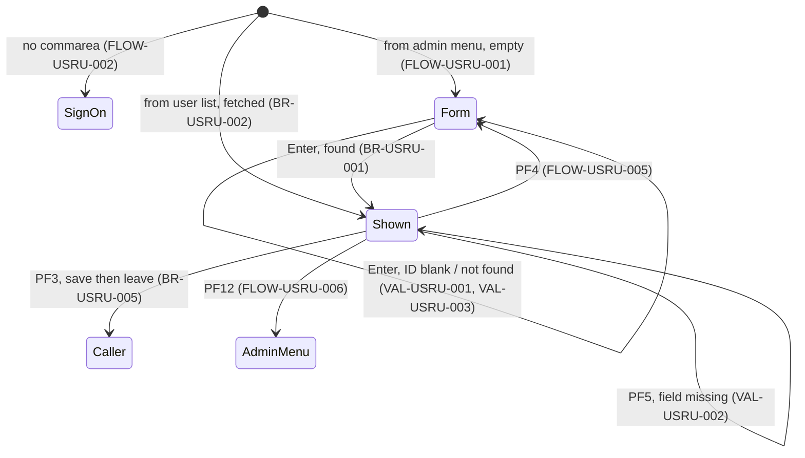

# COUSR02C: User update

## 1. Summary

COUSR02C is option 3 of the admin menu and the `U` action of the user list (transaction `CU02`). The administrator types a user ID and presses Enter; the program reads the user's record from `USRSEC` and shows first name, last name, password (in a dark field) and type. The administrator changes any of them and presses PF5 to save, or PF3 to save and leave. The program re-reads the record, applies the fields that differ and rewrites it; when nothing differs it asks for a change. Opened from the user list, it fetches the selected user at once. As in user add, the values are stored as typed, without validation of the type and with the password in plain text; the stored password is sent to the terminal on every fetch. PF3 saves without showing the outcome.

## 2. Rules at a glance

| ID | Rule |
| :-- | :-- |
| BR-USRU-001 | Enter fetches the user by the typed user ID and shows names, password and type. |
| BR-USRU-002 | Opened from the user list, the selected user is fetched at once. |
| BR-USRU-003 | PF5 saves: the record is read again, every field that differs from the screen is replaced, and the record is rewritten. |
| BR-USRU-004 | If no field differs, nothing is written and `Please modify to update ...` is shown. |
| BR-USRU-005 | PF3 saves as PF5 does and then leaves, whatever the outcome. |
| VAL-USRU-001 | The user ID is required for fetch and save. |
| VAL-USRU-002 | For save, first name, last name, password and type are required, in that order. |
| VAL-USRU-003 | An unknown user ID is reported as `User ID NOT found...` on fetch. |
| VAL-USRU-004 | Only Enter, PF3, PF4, PF5 and PF12 are valid keys. |

## 3. Actors and triggers

- **Actor:** an administrator, by convention; nothing checks it (DEF-USRU-006).
- **Triggers:**
  - admin menu option 3 (`app/cpy/COADM02Y.cpy:36-39`): XCTL from `COADM01C` with 160 bytes, context 0; empty form (FLOW-USRU-001);
  - the user list with `U` on a row: XCTL from `COUSR00C` with 194 bytes, `CDEMO-CU00-USR-SELECTED` set, context 0 (BR-USRL-003); the user is fetched at once (BR-USRU-002).
- **Re-entry trigger:** each interaction ends with "return, next transaction `CU02`" (`app/csd/CARDDEMO.CSD:469-478`, program `app/csd/CARDDEMO.CSD:292-298`).
- **Direct start:** `CU02` on a blank terminal: no commarea, transfer to sign-on (FLOW-USRU-002).
- **Precondition:** `USRSEC` open with read and update allowed (`app/csd/CARDDEMO.CSD:88-99`).

## 4. Interfaces

### 4.1 Screen COUSR2A (mapset COUSR02), 24 x 80

Source: `app/bms/COUSR02.bms:26-164`; symbolic map `app/cpy-bms/COUSR02.CPY`. Mapset `CTRL=(ALARM,FREEKB)`, `EXTATT=YES`. All named fields have `FSET`.

| Row,Col | Field | Len | Direction | Attributes | Content |
| :-- | :-- | --: | :-- | :-- | :-- |
| 1,1-2,79 | header | | out | as the menus | `Tran:` `CU02`, titles, `Date:`, `Prog:` `COUSR02C`, `Time:` |
| 4,35 | (label) | 11 | out | protected, bright, neutral | `Update User` |
| 6,6 | (label) | 14 | out | protected, green | `Enter User ID:` |
| 6,21 | `USRIDIN` | 8 | in/out | **unprotected**, green, underlined, initial cursor | user ID (the key) |
| 8,6 | (label) | 70 | out | protected, yellow | a line of 70 `*` |
| 11,6 | (label) | 11 | out | protected, turquoise | `First Name:` |
| 11,18 | `FNAME` | 20 | in/out | **unprotected**, green, underlined | first name |
| 11,45 | (label) | 10 | out | protected, turquoise | `Last Name:` |
| 11,56 | `LNAME` | 20 | in/out | **unprotected**, green, underlined | last name |
| 13,6 | (label) | 9 | out | protected, turquoise | `Password:` |
| 13,16 | `PASSWD` | 8 | in/out | **unprotected, dark**, green, underlined | password; the stored password is put here on fetch (DEF-USRU-005) |
| 13,25 | (label) | 8 | out | protected, blue | `(8 Char)` |
| 15,6 | (label) | 11 | out | protected, turquoise | `User Type: ` |
| 15,17 | `USRTYPE` | 1 | in/out | **unprotected**, green, underlined | user type |
| 15,19 | (label) | 17 | out | protected, blue | `(A=Admin, U=User)` |
| 23,1 | `ERRMSG` | 78 | out | protected, bright; red, neutral or green as set (§8.3) | message |
| 24,1 | (label) | 58 | out | protected, yellow | `ENTER=Fetch  F3=Save&Exit  F4=Clear  F5=Save  F12=Cancel` (`&&` in the source is one `&`) |

### 4.2 Files

| CICS file | Entity | Operation | Key | Lines |
| :-- | :-- | :-- | :-- | :-- |
| `USRSEC` | ENT-USER-SECURITY | READ UPDATE into `SEC-USER-DATA` (fetch and save) | `SEC-USR-ID` = typed user ID (8) | 322-331 |
| `USRSEC` | ENT-USER-SECURITY | REWRITE from `SEC-USER-DATA`, 80 bytes (save) | record read for update in the same task | 360-366 |

### 4.3 Commarea

ENT-COMMAREA (160 bytes) plus the 34-byte extension `CDEMO-CU02-INFO` (`:50-58`), the same layout as the user list's (ENT-COMMAREA-USER-ADMIN-EXT); the program returns and passes 194 bytes. From the admin menu the extension arrives as spaces.

| Field | Read | Written | Use |
| :-- | :-- | :-- | :-- |
| `CDEMO-PGM-CONTEXT` | yes | yes | first entry / re-entry; 0 before every transfer |
| `CDEMO-FROM-PROGRAM` | yes | yes | PF3 target (the caller: `COUSR00C` or `COADM01C`); set to `COUSR02C` only when leaving |
| `CDEMO-FROM-TRANID` | no | yes | `CU02` when leaving |
| `CDEMO-TO-PROGRAM` | yes | yes | transfer target |
| `CDEMO-CU02-USR-SELECTED` | yes | no | user ID chosen in the list (BR-USRU-002) |
| other extension fields | no | no | passed through, so the list's paging fields go back to `COUSR00C` unchanged |

### 4.4 Console output

When the READ or REWRITE fails with an unexpected response, `RESP:` and `REAS:` followed by the two binary codes are written to the CICS log (`:347, 384`). No user data.

## 5. Data used

| Entity field | Read | Written | How |
| :-- | :-- | :-- | :-- |
| ENT-USER-SECURITY.SEC-USR-ID | key | no (key unchanged) | typed `USRIDIN` |
| ENT-USER-SECURITY.SEC-USR-FNAME, SEC-USR-LNAME | yes, shown | yes, if different | `FNAME`, `LNAME` |
| ENT-USER-SECURITY.SEC-USR-PWD | yes, **sent to the screen** | yes, if different | `PASSWD`, plain text |
| ENT-USER-SECURITY.SEC-USR-TYPE | yes, shown | yes, if different | `USRTYPE`, not validated |
| ENT-USER-SECURITY.SEC-USR-FILLER | yes | rewritten unchanged | - |
| ENT-COMMAREA, ENT-COMMAREA-USER-ADMIN-EXT | yes | yes | §4.3 |

Program-local data with behaviour: `WS-ERR-FLG` (`:40-42`) and `WS-USR-MODIFIED` (`:45-47`).

## 6. Processing flow

**Entry (MAIN-PARA, lines 82-138)**

1. Clear the flags and the message (84-88).
2. No commarea: transfer to sign-on (90-92).
3. Copy the received commarea (94).
4. First entry: mark re-entry, blank the form, cursor on user ID; if a user was selected in the list, put its ID in the user ID field and run the fetch; send the form (95-105).
5. Re-entry: receive the form; Enter (fetch), PF3 (save and leave), PF4 (clear), PF5 (save), PF12 (leave), other (107-131).
6. Return to CICS with next transaction `CU02` and the 194-byte commarea (135-138).

**Fetch (PROCESS-ENTER-KEY, lines 143-172)**

1. User ID blank: VAL-USRU-001 (145-155).
2. Blank the four data fields, read the record for update (157-164). Found: `Press PF5 key to save your updates ...` (neutral) and the form is sent with the data fields still blank (DEF-USRU-008). Not found or error: message, stop.
3. Found: copy first name, last name, password and type from the record to the form, send it again (166-172).

**Save (UPDATE-USER-INFO, lines 177-245)**

1. Check user ID, first name, last name, password, type in that order (VAL-USRU-001, VAL-USRU-002).
2. Read the record for update by the typed user ID (215-217); on success the form is sent once with `Press PF5 key to save your updates ...`. The steps below run even when this read failed (DEF-USRU-002).
3. For each of first name, last name, password, type: if the screen value differs from the record, copy it into the record and note a change (219-234).
4. Change noted: rewrite (SE-USRU-002). No change: `Please modify to update ...` in red (236-243).

## 7. Business rules

#### BR-USRU-001 · Fetch a user
- **When:** Enter (or the first entry from the list), user ID filled in.
- **Then:** the record with key = user ID exactly as typed is read (the program does not upper-case it, so `user0001` is not found unless the terminal translates input to upper case; the CSD sets no such translation for `CU02`). Its first name, last name, password and type are put in the form and the message `Press PF5 key to save your updates ...` is shown in neutral (white) colour. The read takes an update lock that is released when the task ends a moment later (DEF-USRU-009).
- **Source:** `:157-172, 322-339`
- **Fidelity:** must-preserve · **Confidence:** reviewed

#### BR-USRU-002 · Opened from the user list
- **When:** first entry and `CDEMO-CU02-USR-SELECTED` (the list's `CDEMO-CU00-USR-SELECTED`) is not blank.
- **Then:** that ID is put in the user ID field and the fetch of BR-USRU-001 runs; the form is then sent once more. From the admin menu the field is blank (the extension arrives as spaces) and an empty form is shown.
- **Source:** `:95-105`
- **Fidelity:** must-preserve · **Confidence:** reviewed

#### BR-USRU-003 · Save changes
- **When:** PF5 (or PF3), and VAL-USRU-001 and VAL-USRU-002 pass.
- **Then:** the record with key = the user ID now on the screen is read for update; for each of first name, last name, password and type whose screen value differs from the record, the record takes the screen value; if at least one differed, the record is rewritten and `User <id> has been updated ...` is shown in green (user ID up to its first space). The values are stored as typed: no upper-casing of the password, no check that the type is `A` or `U` (DEF-USRU-004). The comparison is with the record as it is now in the file, not as it was fetched, and the user ID on the screen decides which record is changed (DEF-USRU-003, DEF-USRU-007).
- **Source:** `:215-237, 358-376`
- **Fidelity:** must-preserve · **Confidence:** reviewed; message format runtime-verified (GnuCOBOL STRING test)

#### BR-USRU-004 · Nothing to save
- **When:** the save finds no difference.
- **Then:** no rewrite; message `Please modify to update ...` in red, form sent. The update lock is released at task end.
- **Source:** `:238-243`
- **Fidelity:** must-preserve · **Confidence:** reviewed

#### BR-USRU-005 · PF3 saves and leaves
- **When:** PF3.
- **Then:** the save of BR-USRU-003 runs (including its validations and messages), then, whatever its outcome, control goes to `CDEMO-FROM-PROGRAM` (the user list or the admin menu that opened the function; `COADM01C` if blank) by XCTL with context 0. Any message the save produced is overwritten by the next program's screen, so the administrator does not see whether the save worked or was refused (DEF-USRU-001).
- **Source:** `:111-119, 250-261`
- **Fidelity:** must-preserve (save, then leave), defect-decide (silent outcome) · **Confidence:** reviewed

## 8. Validations and messages

#### VAL-USRU-001 · User ID required
- **When:** Enter, PF5 or PF3 with the user ID blank.
- **Then:** `User ID can NOT be empty...`, cursor on user ID, form sent; nothing is read.
- **Source:** `:145-151, 179-185`
- **Fidelity:** must-preserve · **Confidence:** reviewed

#### VAL-USRU-002 · Required fields for save
- **When:** PF5 or PF3, user ID filled in.
- **Then:** first name, last name, password and type are checked in that order; the first blank one is reported with the cursor on it: `First Name can NOT be empty...`, `Last Name can NOT be empty...`, `Password can NOT be empty...`, `User Type can NOT be empty...`. Nothing is read or written.
- **Source:** `:186-209`
- **Fidelity:** must-preserve · **Confidence:** reviewed

#### VAL-USRU-003 · Unknown user
- **When:** the fetch read returns NOTFND.
- **Then:** `User ID NOT found...`, cursor on user ID, form sent with the data fields blank. On save the same message is sent but then replaced (DEF-USRU-002).
- **Source:** `:340-345`
- **Fidelity:** must-preserve · **Confidence:** reviewed

#### VAL-USRU-004 · Valid keys
- **When:** re-entry with a key other than Enter, PF3, PF4, PF5, PF12.
- **Then:** `Invalid key pressed. Please see below...`, form sent with the received values; the program sets no cursor position.
- **Source:** `:127-130`
- **Fidelity:** must-preserve · **Confidence:** reviewed

### 8.1 Flow and keys

#### FLOW-USRU-001 · First entry
- **When:** commarea present and `CDEMO-PGM-CONTEXT` is not 1.
- **Then:** set it to 1, blank the form, cursor on user ID; BR-USRU-002 when a user was selected; send.
- **Source:** `:95-105`

#### FLOW-USRU-002 · No commarea
- **When:** `EIBCALEN` = 0.
- **Then:** XCTL to `COSGN00C` with from-fields `CU02`/`COUSR02C`, context 0 and the (uninitialised) 194-byte commarea (FLOW-SGN-008).
- **Source:** `:90-92, 250-261`

#### FLOW-USRU-003 · Enter
- **Then:** fetch (section 6). A fetch replaces whatever the administrator had changed but not saved.
- **Source:** `:109-110`

#### FLOW-USRU-004 · PF5
- **Then:** save (section 6); the program stays on the form.
- **Source:** `:122-123`

#### FLOW-USRU-005 · PF4, clear
- **Then:** user ID, the four data fields and the message are set to spaces, cursor on user ID, form sent. Nothing is written.
- **Source:** `:120-121, 395-411`

#### FLOW-USRU-006 · PF12, cancel
- **Then:** XCTL to `COADM01C` (always the admin menu, even when opened from the list), from-fields `CU02`/`COUSR02C`, context 0. Nothing is saved.
- **Source:** `:124-126, 250-261`

#### FLOW-USRU-007 · End of every interaction
- **Then:** return to CICS naming `CU02`, with the 194-byte commarea.
- **Source:** `:135-138`

#### FLOW-USRU-008 · Header and send
- **Then:** titles, `CU02`, `COUSR02C`, date `mm/dd/yy`, time `hh:mm:ss`, message; send with erase, cursor on the field whose length was set to -1. One task often sends two or three times; the last send is what the user sees.
- **Source:** `:266-278, 296-315`

### 8.2 Decision table for PF5 (save)

| User ID | Data fields | READ UPDATE | Any field differs | REWRITE | Final message |
| :-- | :-- | :-- | :-- | :-- | :-- |
| blank | any | not done | - | - | `User ID can NOT be empty...` |
| filled | one blank | not done | - | - | first missing field's message |
| filled | all filled | NORMAL | no | not done | `Please modify to update ...` (red) |
| filled | all filled | NORMAL | yes | NORMAL | `User <id> has been updated ...` (green) |
| filled | all filled | NORMAL | yes | other | `Unable to Update User...` (neutral, NUM-USRU-004) |
| filled | all filled | NOTFND or other | (compared with the uninitialised record area, normally yes) | fails (no record held) | `Unable to Update User...` (red; DEF-USRU-002) |

### 8.3 Message catalog

Messages appear in `ERRMSG` (row 23). Colour is the map's red unless noted; after a successful READ in the same task it is neutral until a later message sets it again (NUM-USRU-004). The cursor goes to the first field in map order whose length was set to -1 in the task (NUM-USRU-004), so on the fetch path it is always on the user ID.

| Text (exact) | Cause | Cursor | Item |
| :-- | :-- | :-- | :-- |
| `User ID can NOT be empty...` | user ID blank | user ID | VAL-USRU-001 |
| `First Name can NOT be empty...` | save, first name blank | first name | VAL-USRU-002 |
| `Last Name can NOT be empty...` | save, last name blank | last name | VAL-USRU-002 |
| `Password can NOT be empty...` | save, password blank | password | VAL-USRU-002 |
| `User Type can NOT be empty...` | save, type blank | user type | VAL-USRU-002 |
| `Press PF5 key to save your updates ...` (neutral) | record read | user ID | BR-USRU-001 |
| `User ID NOT found...` | READ NOTFND (red), REWRITE NOTFND (neutral) | user ID | VAL-USRU-003, ERR-USRU-001, ERR-USRU-002 |
| `Unable to lookup User...` | READ other response | user ID on fetch, first name on save | ERR-USRU-001 |
| `Please modify to update ...` (red) | save without change | first name | BR-USRU-004 |
| `User <id> has been updated ...` (green) | rewritten | first name | BR-USRU-003 |
| `Unable to Update User...` | REWRITE other response; neutral after a successful READ, red after a failed one (DEF-USRU-002) | first name, or user ID after a READ NOTFND | ERR-USRU-002 |
| `Invalid key pressed. Please see below...` | wrong key | not set | VAL-USRU-004 |

## 9. Side effects

#### SE-USRU-001 · Read the user record for update
- **What:** READ UPDATE `USRSEC` by the typed 8-character user ID into the 80-byte record, on every fetch and every save. The exclusive lock lasts until the rewrite or the end of the task; it never spans two screens, but it does survive a PF3 transfer in the same task (DEF-USRU-010). `USRSEC` is defined with `STRINGS(1)` in LSR pool 1 (`app/csd/CARDDEMO.CSD:89-91`), so the held request can also hold the file's only VSAM string.
- **Source:** `:322-331`
- **Fidelity:** must-preserve (read), incidental (lock in the fetch path) · **Confidence:** reviewed; lock duration platform-inferred

#### SE-USRU-002 · Rewrite the user record
- **What:** REWRITE `USRSEC` from the 80-byte record after BR-USRU-003 applied the changes. Key and filler are unchanged. `RECOVERY(NONE)`: not backed out if the task abends later.
- **Source:** `:360-366`
- **Fidelity:** must-preserve · **Confidence:** reviewed

## 10. Error handling

#### ERR-USRU-001 · READ responses

| Response | Effect |
| :-- | :-- |
| NORMAL | `Press PF5 key to save your updates ...` (neutral), form sent |
| NOTFND | `User ID NOT found...`, cursor on user ID, error flag |
| other (NOTOPEN in the batch window, ...) | log line, `Unable to lookup User...`, error flag; cursor on the user ID on the fetch path (already -1 at `:153`), on first name on the save path (`:211`) |

On save the error flag does not stop the comparison and rewrite that follow (DEF-USRU-002).
- **Source:** `:333-353`
- **Fidelity:** must-preserve · **Confidence:** reviewed

#### ERR-USRU-002 · REWRITE responses

| Response | Effect |
| :-- | :-- |
| NORMAL | green `User <id> has been updated ...` |
| NOTFND (practically unreachable after a held read) | `User ID NOT found...`, cursor on user ID, neutral colour |
| other (for example INVREQ when no record is held) | log line, `Unable to Update User...`, cursor on first name (on user ID if the READ was NOTFND); neutral when the READ succeeded, red when it failed |

- **Source:** `:368-390`
- **Fidelity:** must-preserve · **Confidence:** reviewed; INVREQ case platform-inferred

#### ERR-USRU-003 · Unchecked commands
- **What:** the RECEIVE MAP response is not tested; SEND and XCTL have no RESP and there is no HANDLE CONDITION. With Clear or a PA key the RECEIVE gets MAPFAIL, the key falls to VAL-USRU-004, and the screen is sent from a map area that nothing filled in this task (low-value fields are not sent).
- **Source:** `:283-291, 258-261, 272-278`
- **Fidelity:** incidental · **Confidence:** platform-inferred

## 11. Interactions

- **Inbound:** `COADM01C` option 3; `COUSR00C` with `U` (selected user ID in the commarea extension).
- **Outbound:** PF3 to `CDEMO-FROM-PROGRAM` (`COUSR00C` or `COADM01C`); PF12 to `COADM01C`; `COSGN00C` without commarea.
- **Shared data:** `USRSEC` (ENT-USER-SECURITY), with sign-on (reads, upper-cases ID and password: a password saved here with lower-case letters locks the user out, DEF-SGN-011), the list, add and delete.
- **Shared invariants (proposed):** PINV-a-signon-admin-02 (upper-case credentials), PINV-a-signon-admin-04 (the hand-over of the selected user ID).

### Module extraction notes

| Boundary | Contract |
| :-- | :-- |
| Entry | XCTL from `COADM01C` (160 bytes) or `COUSR00C` (194 bytes, selected user ID in bytes 187-194 counted from 1). No authorisation check. |
| Exit | XCTL to the caller (PF3) or `COADM01C` (PF12) with the 194-byte commarea, context 0, the list's paging fields unchanged. |
| Data | Rewrites ENT-USER-SECURITY records in place; the key cannot be changed. |

## 12. Numeric, date and format details

#### NUM-USRU-001 · Field comparison
- The comparison of BR-USRU-003 is a byte comparison of fixed-length fields (20, 20, 8, 1), so a change of case or of trailing spaces counts as a change; `Smith` and `SMITH` differ.
- **Source:** `:219-234`
- **Confidence:** reviewed

#### NUM-USRU-002 · Confirmation text
- `User ` + user ID up to the first space + ` has been updated ...`. The key is used exactly as typed, so `AB CD` gives `User AB has been updated ...` and a leading space gives `User  has been updated ...`.
- **Source:** `:372-375`
- **Confidence:** runtime-verified (GnuCOBOL STRING test)

#### NUM-USRU-003 · Header date and time
- Date `mm/dd/yy`, time `hh:mm:ss`, from `FUNCTION CURRENT-DATE`.
- **Source:** `:296-315`

#### NUM-USRU-004 · Cursor and message colour carry-over
- The map is sent with `CURSOR` and no value, so BMS puts the cursor on the first field in map order whose length is -1; the user ID comes before first name. The fetch path sets the user ID to -1 at `:153` and the save path sets first name at `:211`; later `MOVE -1 TO FNAMEL` (`:351, 388`) move the cursor only when the user ID is not already -1.
- A successful READ sets the message colour to neutral (`:338`); only the green confirmation (`:371`) and the red `Please modify` (`:241`) set it again. So REWRITE errors after a successful READ appear in neutral, not in the map's red.
- **Source:** `:150-153, 211, 277, 338, 344, 351, 381, 388`
- **Confidence:** reviewed; BMS symbolic cursor rule platform-inferred

## 13. Known defects and oddities

None of these were changed in this branch (`COUSR02C.cbl` is not touched after the original import; `CHANGELOG.md` "Fixed" lists only batch and JCL fixes).

#### DEF-USRU-001 · PF3 saves silently
- PF3 is "save and exit": it saves (or fails to save, or refuses because a field is blank or nothing changed) and then transfers at once, so the result message is never seen. An administrator who only wanted to leave after a fetch gets `Please modify to update ...` discarded; the visible effect is nil, but the record stays held across the transfer (DEF-USRU-010). One who changed a field gets it saved without confirmation.
- **Source:** `:111-119`
- **Status:** open · **Fidelity:** defect-decide (Q-USRU-001) · **Confidence:** reviewed

#### DEF-USRU-002 · Save continues after a failed read
- When the save's READ UPDATE returns NOTFND or an error, the program still compares and, because the record area was never filled in this task (`SEC-USER-DATA` has no VALUE clauses, `app/cpy/CSUSR01Y.cpy:17-23`; only the key was moved in at `:216`), normally tries a REWRITE without holding a record. CICS rejects it (INVREQ) and the administrator sees `Unable to Update User...` instead of `User ID NOT found...`.
- **Source:** `:215-237, 340-352, 383-389`
- **Status:** open · **Fidelity:** defect-decide · **Confidence:** reviewed (flow), platform-inferred (INVREQ)

#### DEF-USRU-003 · The key on the screen decides which user is changed
- The user ID field stays editable after a fetch. If it is changed before PF5, the program reads the other user and gives it the names, password and type shown on the screen, which were fetched for the first user. There is no "fetched user" kept in the commarea to compare with.
- **Source:** `:215-237`
- **Status:** open · **Fidelity:** defect-decide · **Confidence:** reviewed

#### DEF-USRU-004 · Password and type stored as typed
- The password is not upper-cased (sign-on upper-cases the typed one, BR-SGN-001), so a password changed to `Secret12` can never match (DEF-SGN-011). The type is not checked against `A`/`U` (DEF-USRA-002, DEF-SGN-005); typing `a` turns an administrator into a regular user at the next sign-on.
- **Source:** `:227-234`
- **Status:** open · **Fidelity:** defect-decide (Q-SGN-002, Q-USRA-001) · **Confidence:** reviewed

#### DEF-USRU-005 · [security] The stored password is sent to the terminal
- Every fetch puts the user's plain-text password into the dark password field. It is not visible, but it is in the 3270 data stream and in the terminal buffer, so any administrator (or anyone with an emulator trace) can read every user's password. Because the field is `FSET`, the password also comes back from the terminal on every Enter or PF key and is sent out again on every send that reuses the received values. The password is not needed to change the other fields; the save requires it to be present.
- **Source:** `:169`; `app/bms/COUSR02.bms:130-134`
- **Status:** open · **Fidelity:** defect-decide (Q-USRU-002) · **Confidence:** reviewed; terminal buffer exposure platform-inferred

#### DEF-USRU-006 · [security] No administrator check, no audit, no self-protection
- The program never reads `CDEMO-USER-TYPE`, records nobody's change and lets an administrator change their own type or the last administrator's type to `U`, which leaves nobody able to reach the admin menu. See DEF-ADMN-001.
- **Source:** `:90-133`
- **Status:** open · **Fidelity:** defect-decide (Q-ADMN-001) · **Confidence:** reviewed

#### DEF-USRU-007 · Lost updates between fetch and save
- The fetch's lock ends with the task. Another administrator can change the user between fetch and PF5; the save compares the screen with the current record and overwrites the other change for every field that differs. There is no version check.
- **Source:** `:157-163, 215-237`
- **Status:** open · **Fidelity:** defect-decide (Q-USRU-003) · **Confidence:** reviewed

#### DEF-USRU-008 · Several screen sends per task
- The successful read sends the form with the data fields still blank, then the fetch sends it again filled; a save sends the form after its read and again with the result; the first entry from the list sends a third time. Only the last send is visible after the task ends.
- **Source:** `:105, 171, 339, 242, 376`
- **Status:** open · **Fidelity:** incidental · **Confidence:** reviewed

#### DEF-USRU-009 · Update lock taken for display
- The fetch uses READ UPDATE although it only displays; the lock is released when the task returns. The effect is a short exclusive hold that can make a concurrent update of the same user wait, and, because `USRSEC` has `STRINGS(1)`, possibly a concurrent sign-on or list as well (a plain READ does not wait for a record lock, but it may wait for the file's only string).
- **Source:** `:322-331`
- **Status:** open · **Fidelity:** incidental · **Confidence:** platform-inferred

#### DEF-USRU-010 · Record held across the PF3 transfer
- On PF3, when the save's READ UPDATE succeeded but nothing changed (the usual "just leave" case) or the REWRITE failed, the program transfers by XCTL in the same task while the record is still held. If the caller is `COUSR00C`, its first entry browses `USRSEC` (STARTBR, READNEXT) in that same task (`app/cbl/COUSR00C.cbl:115-118`); with `STRINGS(1)` the browse may have to wait for the string its own task holds. Whether CICS waits, fails the browse or lets it through depends on string management for the LSR pool. When the caller is `COADM01C` the hold ends with the task.
- **Source:** `:111-119, 236-243, 250-261`; `app/csd/CARDDEMO.CSD:89-91`
- **Status:** open · **Fidelity:** defect-decide · **Confidence:** platform-inferred (low)

#### DEF-USRU-011 · [security] No password rules
- Any non-blank value of 1 to 8 characters is accepted as the new password, although the screen label says `(8 Char)`; there is no length, complexity or reuse check (the only check is for blank, `:198`). Same as user add (DEF-USRA-003).
- **Source:** `:198-203, 227-230`; `app/bms/COUSR02.bms:135-139`
- **Status:** open · **Fidelity:** defect-decide (Q-SGN-001) · **Confidence:** reviewed

## 14. Open questions

| ID | Question | For |
| :-- | :-- | :-- |
| Q-USRU-001 | Should PF3 keep "save and exit", or exit without saving (and warn about unsaved changes)? | business |
| Q-USRU-002 | Should the update function show the current password at all, or offer only "set a new password" (which hashing, Q-SGN-001, would require anyway)? | security, business |
| Q-USRU-003 | Is optimistic locking (reject the save if the user changed since the fetch) required in the target? | business |

## 15. Equivalence contract

A reimplementation must reproduce: which record is changed and with which values, when nothing is written, the validation order and messages and their colours, and the navigation of PF3 and PF12. It may differ in screen technology, number of sends and clock values. It should not send the stored password to the client unless the business decides so (Q-USRU-002).

| # | Start state | Input | Expected |
| --: | :-- | :-- | :-- |
| S1 | admin menu | option 3 | empty form, cursor on user ID |
| S2 | form | `USER0001`, Enter | `LAWRENCE`, `THOMAS`, type `U`, password field holds `PASSWORD`; neutral `Press PF5 key to save your updates ...` |
| S3 | form | `user0001`, Enter (terminal without upper-case translation) | `User ID NOT found...` |
| S4 | S2 | PF5 without changes | red `Please modify to update ...`, nothing written |
| S5 | S2 | last name `THOMSON`, PF5 | record rewritten with `THOMSON`; green `User USER0001 has been updated ...` |
| S6 | S2 | first name blank, PF5 | `First Name can NOT be empty...` |
| S7 | user list | `U` on `USER0002` | form filled with `USER0002` at once |
| S8 | S7 | type `A`, PF3 | record rewritten with type `A`; user list shown, no confirmation |
| S9 | S2 | PF12 | admin menu, nothing saved |
| S10 | S2 | user ID changed to `USER0003`, PF5 | `USER0003` gets `LAWRENCE`/`THOMAS`/`PASSWORD`/`U` (DEF-USRU-003) |
| S11 | form | `NOUSER01` with all fields, PF5 | `Unable to Update User...` (DEF-USRU-002) |

These scenarios cannot run locally (no CICS); they become acceptance tests for the target. Review evidence: `evidence/a-signon-admin-review.md`.

## 16. Paragraph coverage

| Paragraph | Lines | Covered by |
| :-- | :-- | :-- |
| (data division) | 33-76 | §4.3, §5 |
| `MAIN-PARA` | 82-138 | FLOW-USRU-001..007, BR-USRU-002, BR-USRU-005, VAL-USRU-004 |
| `PROCESS-ENTER-KEY` | 143-172 | BR-USRU-001, VAL-USRU-001, DEF-USRU-008 |
| `UPDATE-USER-INFO` | 177-245 | BR-USRU-003, BR-USRU-004, VAL-USRU-001, VAL-USRU-002, NUM-USRU-001, NUM-USRU-004, DEF-USRU-002..004, DEF-USRU-010, DEF-USRU-011 |
| `RETURN-TO-PREV-SCREEN` | 250-261 | FLOW-USRU-002, FLOW-USRU-006, BR-USRU-005 |
| `SEND-USRUPD-SCREEN` | 266-278 | FLOW-USRU-008 |
| `RECEIVE-USRUPD-SCREEN` | 283-291 | ERR-USRU-003 |
| `POPULATE-HEADER-INFO` | 296-315 | FLOW-USRU-008, NUM-USRU-003 |
| `READ-USER-SEC-FILE` | 320-353 | SE-USRU-001, ERR-USRU-001, VAL-USRU-003, DEF-USRU-005, DEF-USRU-009 |
| `UPDATE-USER-SEC-FILE` | 358-390 | SE-USRU-002, ERR-USRU-002, NUM-USRU-002 |
| `CLEAR-CURRENT-SCREEN` | 395-398 | FLOW-USRU-005 |
| `INITIALIZE-ALL-FIELDS` | 403-411 | FLOW-USRU-005 |

11 of 11 paragraphs covered (plus the data division row).
