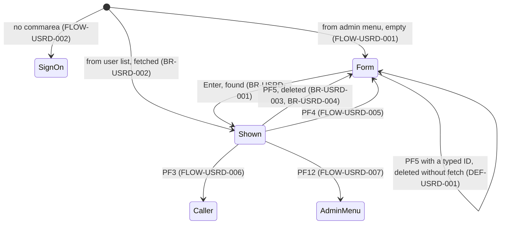

# COUSR03C: User delete

## 1. Summary

COUSR03C is option 4 of the admin menu and the `D` action of the user list (transaction `CU03`). The administrator types a user ID and presses Enter; the program reads the user's record from `USRSEC` and shows first name, last name and type (not the password) with `Press PF5 key to delete this user ...`. PF5 reads the record again and deletes it, then confirms `User <id> has been deleted ...` in green. Opened from the user list, it fetches the selected user at once. There is no separate confirmation: PF5 deletes the user whose ID is in the field, fetched or not. Nothing prevents deleting the signed-on administrator or the last administrator. PF3 returns to the caller, PF12 to the admin menu.

## 2. Rules at a glance

| ID | Rule |
| :-- | :-- |
| BR-USRD-001 | Enter fetches the user by the typed user ID and shows first name, last name and type. |
| BR-USRD-002 | Opened from the user list, the selected user is fetched at once. |
| BR-USRD-003 | PF5 deletes the record whose key is the user ID currently in the field. |
| BR-USRD-004 | After a delete the form is cleared and `User <id> has been deleted ...` is shown in green. |
| VAL-USRD-001 | The user ID is required for fetch and delete. |
| VAL-USRD-002 | An unknown user ID is reported as `User ID NOT found...` on fetch. |
| VAL-USRD-003 | Only Enter, PF3, PF4, PF5 and PF12 are valid keys. |

## 3. Actors and triggers

- **Actor:** an administrator, by convention; nothing checks it (DEF-USRD-004).
- **Triggers:**
  - admin menu option 4 (`app/cpy/COADM02Y.cpy:41-44`): XCTL from `COADM01C` with 160 bytes, context 0; empty form (FLOW-USRD-001);
  - the user list with `D` on a row: XCTL from `COUSR00C` with 194 bytes and `CDEMO-CU00-USR-SELECTED` (BR-USRL-004); the user is fetched at once (BR-USRD-002).
- **Re-entry trigger:** each interaction ends with "return, next transaction `CU03`" (`app/csd/CARDDEMO.CSD:479-488`, program `app/csd/CARDDEMO.CSD:299-305`).
- **Direct start:** `CU03` on a blank terminal: no commarea, transfer to sign-on (FLOW-USRD-002).
- **Precondition:** `USRSEC` open with delete allowed (`app/csd/CARDDEMO.CSD:88-99`, `DELETE(YES)`).

## 4. Interfaces

### 4.1 Screen COUSR3A (mapset COUSR03), 24 x 80

Source: `app/bms/COUSR03.bms:26-148`; symbolic map `app/cpy-bms/COUSR03.CPY`. Mapset `CTRL=(ALARM,FREEKB)`, `EXTATT=YES`. All named fields have `FSET`. Unlike the update screen, the data fields are protected and there is no password field.

| Row,Col | Field | Len | Direction | Attributes | Content |
| :-- | :-- | --: | :-- | :-- | :-- |
| 1,1-2,79 | header | | out | as the menus | `Tran:` `CU03`, titles, `Date:`, `Prog:` `COUSR03C`, `Time:` |
| 4,35 | (label) | 11 | out | protected, bright, neutral | `Delete User` |
| 6,6 | (label) | 14 | out | protected, green | `Enter User ID:` |
| 6,21 | `USRIDIN` | 8 | in/out | **unprotected**, green, underlined, initial cursor | user ID (the key) |
| 8,6 | (label) | 70 | out | protected, yellow | a line of 70 `*` |
| 11,6 | (label) | 11 | out | protected, turquoise | `First Name:` |
| 11,18 | `FNAME` | 20 | out | protected, blue, underlined | first name |
| 13,6 | (label) | 10 | out | protected, turquoise | `Last Name:` |
| 13,18 | `LNAME` | 20 | out | protected, blue, underlined | last name |
| 15,6 | (label) | 11 | out | protected, turquoise | `User Type: ` |
| 15,17 | `USRTYPE` | 1 | out | protected, blue, underlined | user type |
| 15,19 | (label) | 17 | out | protected, blue | `(A=Admin, U=User)` |
| 23,1 | `ERRMSG` | 78 | out | protected, bright; red, neutral or green as set (§8.3) | message |
| 24,1 | (label) | 58 | out | protected, yellow | `ENTER=Fetch  F3=Back  F4=Clear  F5=Delete` (PF12 works but is not listed) |

### 4.2 Files

| CICS file | Entity | Operation | Key | Lines |
| :-- | :-- | :-- | :-- | :-- |
| `USRSEC` | ENT-USER-SECURITY | READ UPDATE into `SEC-USER-DATA` (fetch and delete) | `SEC-USR-ID` = typed user ID (8) | 269-278 |
| `USRSEC` | ENT-USER-SECURITY | DELETE of the record read for update (no key given) | - | 307-311 |

### 4.3 Commarea

ENT-COMMAREA (160 bytes) plus the 34-byte extension `CDEMO-CU03-INFO` (`:50-58`), the same layout as the user list's (ENT-COMMAREA-USER-ADMIN-EXT); the program returns and passes 194 bytes. Used: `CDEMO-PGM-CONTEXT`, `CDEMO-FROM-PROGRAM` (PF3 target, the caller), `CDEMO-TO-PROGRAM`, `CDEMO-CU03-USR-SELECTED` (user chosen in the list); `CDEMO-FROM-TRANID`/`CDEMO-FROM-PROGRAM` = `CU03`/`COUSR03C` when leaving. The rest passes through.

### 4.4 Console output

When the READ or DELETE fails with an unexpected response, `RESP:` and `REAS:` followed by the two binary codes are written to the CICS log (`:294, 330`). No user data.

## 5. Data used

| Entity field | Read | Written | How |
| :-- | :-- | :-- | :-- |
| ENT-USER-SECURITY.SEC-USR-ID | key | deleted | typed `USRIDIN` |
| ENT-USER-SECURITY.SEC-USR-FNAME, SEC-USR-LNAME, SEC-USR-TYPE | yes, shown | deleted | `FNAME`, `LNAME`, `USRTYPE` |
| ENT-USER-SECURITY.SEC-USR-PWD, SEC-USR-FILLER | read with the record | deleted | not shown |
| ENT-COMMAREA, ENT-COMMAREA-USER-ADMIN-EXT | yes | yes | §4.3 |

`WS-USR-MODIFIED` (`:45-47`) is set but never tested (copied from the update program, DEF-USRD-007).

## 6. Processing flow

**Entry (MAIN-PARA, lines 82-137)**

1. Clear the flags and the message (84-88).
2. No commarea: transfer to sign-on (90-92).
3. Copy the received commarea (94).
4. First entry: mark re-entry, blank the form, cursor on user ID; if a user was selected in the list, put its ID in the field and run the fetch; send (95-105).
5. Re-entry: receive the form; Enter (fetch), PF3 (back), PF4 (clear), PF5 (delete), PF12 (admin menu), other (107-130).
6. Return to CICS with next transaction `CU03` and the 194-byte commarea (134-137).

**Fetch (PROCESS-ENTER-KEY, lines 142-169)**

1. User ID blank: VAL-USRD-001.
2. Blank the three data fields; read the record for update (156-162). Found: `Press PF5 key to delete this user ...` (neutral), form sent with the data fields still blank. Not found or error: message, stop.
3. Found: copy first name, last name and type to the form, send again (164-169).

**Delete (DELETE-USER-INFO, lines 174-192)**

1. User ID blank: VAL-USRD-001.
2. Read the record for update by the typed user ID (189-190), then delete it (191). The delete runs whatever the read returned (DEF-USRD-002).

## 7. Business rules

#### BR-USRD-001 · Fetch a user
- **When:** Enter (or the first entry from the list), user ID filled in.
- **Then:** the record with key = user ID exactly as typed is read for update (the program does not upper-case it; whether `user0004` is found depends on the terminal's upper-case translation, which the CSD does not set for `CU03`); first name, last name and type are shown, the password is not. Message `Press PF5 key to delete this user ...` in neutral (white). The lock ends with the task.
- **Source:** `:156-169, 269-286`
- **Fidelity:** must-preserve · **Confidence:** reviewed

#### BR-USRD-002 · Opened from the user list
- **When:** first entry and `CDEMO-CU03-USR-SELECTED` (the list's `CDEMO-CU00-USR-SELECTED`) is not blank.
- **Then:** that ID is put in the user ID field and the fetch of BR-USRD-001 runs; the form is sent once more. From the admin menu the field is blank and an empty form is shown.
- **Source:** `:95-105`
- **Fidelity:** must-preserve · **Confidence:** reviewed

#### BR-USRD-003 · Delete
- **When:** PF5 and the user ID field is filled in.
- **Then:** the record with key = the user ID now in the field is read for update (which sends the form once with `Press PF5 key to delete this user ...`) and then deleted. There is no further confirmation, no check that it is the user shown on the screen, that the user ID is not the signed-on administrator's own (`CDEMO-USER-ID`), or that at least one administrator remains (DEF-USRD-001, DEF-USRD-004). The deletion is physical; nothing is kept.
- **Source:** `:188-192, 307-311`
- **Fidelity:** must-preserve (delete), defect-decide (no confirmation or protection, Q-USRD-001) · **Confidence:** reviewed

#### BR-USRD-004 · Confirmation
- **When:** the DELETE returns NORMAL.
- **Then:** user ID, data fields and message are cleared, cursor on user ID, colour green, message `User <id> has been deleted ...` (user ID up to its first space), form sent.
- **Source:** `:314-322, 349-356`
- **Fidelity:** must-preserve · **Confidence:** reviewed; message format runtime-verified (GnuCOBOL STRING test)

## 8. Validations and messages

#### VAL-USRD-001 · User ID required
- **When:** Enter or PF5 with the user ID blank.
- **Then:** `User ID can NOT be empty...`, cursor on user ID, form sent; nothing is read.
- **Source:** `:144-150, 176-182`
- **Fidelity:** must-preserve · **Confidence:** reviewed

#### VAL-USRD-002 · Unknown user
- **When:** the fetch read returns NOTFND.
- **Then:** `User ID NOT found...`, cursor on user ID, data fields blank. On PF5 the same message is sent but then replaced (DEF-USRD-002).
- **Source:** `:287-292`
- **Fidelity:** must-preserve · **Confidence:** reviewed

#### VAL-USRD-003 · Valid keys
- **When:** re-entry with a key other than Enter, PF3, PF4, PF5, PF12.
- **Then:** `Invalid key pressed. Please see below...`, form sent with the received values; no cursor position set.
- **Source:** `:126-129`
- **Fidelity:** must-preserve · **Confidence:** reviewed

### 8.1 Flow and keys

#### FLOW-USRD-001 · First entry
- **When:** commarea present and `CDEMO-PGM-CONTEXT` is not 1.
- **Then:** set it to 1, blank the form, cursor on user ID; BR-USRD-002 when a user was selected; send.
- **Source:** `:95-105`

#### FLOW-USRD-002 · No commarea
- **When:** `EIBCALEN` = 0.
- **Then:** XCTL to `COSGN00C` with from-fields `CU03`/`COUSR03C`, context 0 and the (uninitialised) 194-byte commarea (FLOW-SGN-008).
- **Source:** `:90-92, 197-208`

#### FLOW-USRD-003 · Enter
- **Then:** fetch (section 6).
- **Source:** `:109-110`

#### FLOW-USRD-004 · PF5
- **Then:** delete (section 6); the program stays on the form, which is cleared only when the DELETE succeeds (BR-USRD-004); after a validation, READ or DELETE failure the received values stay on it.
- **Source:** `:121-122`

#### FLOW-USRD-005 · PF4, clear
- **Then:** user ID, data fields and message set to spaces, cursor on user ID, form sent.
- **Source:** `:119-120, 341-356`

#### FLOW-USRD-006 · PF3, back
- **Then:** XCTL to `CDEMO-FROM-PROGRAM` (the user list or the admin menu; `COADM01C` if blank), from-fields `CU03`/`COUSR03C`, context 0. Nothing is deleted. The user list then starts again at page 1 (FLOW-USRL-001).
- **Source:** `:111-118, 197-208`

#### FLOW-USRD-007 · PF12, admin menu
- **Then:** XCTL to `COADM01C`, from-fields `CU03`/`COUSR03C`, context 0.
- **Source:** `:123-125, 197-208`

#### FLOW-USRD-008 · End of every interaction
- **Then:** return to CICS naming `CU03`, with the 194-byte commarea.
- **Source:** `:134-137`

#### FLOW-USRD-009 · Header and send
- **Then:** titles, `CU03`, `COUSR03C`, date `mm/dd/yy`, time `hh:mm:ss`, message; send with erase and cursor on the field whose length was set to -1. A fetch and a delete each send the form twice (DEF-USRD-006).
- **Source:** `:213-225, 243-262`

### 8.2 Decision table for PF5 (delete)

| User ID | READ UPDATE | DELETE | Final message |
| :-- | :-- | :-- | :-- |
| blank | not done | not done | `User ID can NOT be empty...` |
| filled | NORMAL | NORMAL | green `User <id> has been deleted ...`, form cleared |
| filled | NORMAL | other | `Unable to Update User...` (neutral, NUM-USRD-003) |
| filled | NOTFND or other | attempted without a held record, fails | `Unable to Update User...` (red; DEF-USRD-002) |

### 8.3 Message catalog

Messages appear in `ERRMSG` (row 23). Colour is the map's red unless noted; after a successful READ in the same task it stays neutral until a later message sets it again (NUM-USRD-003). The cursor goes to the first field in map order whose length was set to -1; both the fetch and the delete path set the user ID to -1 first, so every message below leaves the cursor on the user ID (NUM-USRD-003).

| Text (exact) | Cause | Cursor | Item |
| :-- | :-- | :-- | :-- |
| `User ID can NOT be empty...` | user ID blank | user ID | VAL-USRD-001 |
| `Press PF5 key to delete this user ...` (neutral) | record read | user ID | BR-USRD-001 |
| `User ID NOT found...` | READ NOTFND (red), DELETE NOTFND (neutral) | user ID | VAL-USRD-002, ERR-USRD-002 |
| `Unable to lookup User...` | READ other response | user ID | ERR-USRD-001 |
| `User <id> has been deleted ...` (green) | deleted | user ID | BR-USRD-004 |
| `Unable to Update User...` | DELETE other response; neutral after a successful READ, red after a failed one | user ID | ERR-USRD-002, DEF-USRD-003 |
| `Invalid key pressed. Please see below...` | wrong key | not set | VAL-USRD-003 |

## 9. Side effects

#### SE-USRD-001 · Read the user record for update
- **What:** READ UPDATE `USRSEC` by the typed 8-character user ID, on every fetch and before every delete. The lock lasts until the delete or the end of the task. `USRSEC` is defined with `STRINGS(1)` in LSR pool 1 (`app/csd/CARDDEMO.CSD:89-91`), so the held request can also hold the file's only VSAM string.
- **Source:** `:269-278`
- **Fidelity:** must-preserve (read), incidental (lock in the fetch path) · **Confidence:** reviewed; lock duration platform-inferred

#### SE-USRD-002 · Delete the user record
- **What:** DELETE on `USRSEC` without a key, which removes the record held by the preceding READ UPDATE. `RECOVERY(NONE)`: the delete cannot be backed out. Nothing else is deleted or updated: the user's sessions already signed on keep working (their identity is only in the commarea, DEF-SGN-006).
- **Source:** `:307-311`
- **Fidelity:** must-preserve · **Confidence:** reviewed

## 10. Error handling

#### ERR-USRD-001 · READ responses

| Response | Effect |
| :-- | :-- |
| NORMAL | `Press PF5 key to delete this user ...` (neutral), form sent |
| NOTFND | `User ID NOT found...`, cursor on user ID, error flag |
| other (NOTOPEN in the batch window, ...) | log line, `Unable to lookup User...`, error flag; cursor on the user ID (already -1 at `:152` or `:184`; the `MOVE -1 TO FNAMEL` at `:298` does not move it) |

On PF5 the error flag does not stop the delete that follows (DEF-USRD-002).
- **Source:** `:280-300`
- **Fidelity:** must-preserve · **Confidence:** reviewed

#### ERR-USRD-002 · DELETE responses

| Response | Effect |
| :-- | :-- |
| NORMAL | BR-USRD-004 |
| NOTFND (practically unreachable after a held read) | `User ID NOT found...`, cursor on user ID, neutral colour |
| other (for example INVREQ when no record is held) | log line, `Unable to Update User...`, cursor on user ID (set at `:184`); neutral when the READ succeeded, red when it failed |

- **Source:** `:313-336`
- **Fidelity:** must-preserve · **Confidence:** reviewed; INVREQ case platform-inferred

#### ERR-USRD-003 · Unchecked commands
- **What:** the RECEIVE MAP response is not tested; SEND and XCTL have no RESP and there is no HANDLE CONDITION. With Clear or a PA key the RECEIVE gets MAPFAIL, the key falls to VAL-USRD-003, and the screen is sent from a map area that nothing filled in this task.
- **Source:** `:230-238, 205-208, 219-225`
- **Fidelity:** incidental · **Confidence:** platform-inferred

## 11. Interactions

- **Inbound:** `COADM01C` option 4; `COUSR00C` with `D` (selected user ID in the commarea extension).
- **Outbound:** PF3 to `CDEMO-FROM-PROGRAM` (`COUSR00C` or `COADM01C`); PF12 to `COADM01C`; `COSGN00C` without commarea.
- **Shared data:** `USRSEC` (ENT-USER-SECURITY). A deleted user can no longer sign on (VAL-SGN-003); no other file refers to user IDs, so nothing else is affected.
- **Shared invariant (INV-009):** at least one user of type `A` must exist for the admin functions to be reachable; nothing enforces it.

### Module extraction notes

| Boundary | Contract |
| :-- | :-- |
| Entry | XCTL from `COADM01C` (160 bytes) or `COUSR00C` (194 bytes, selected user ID in bytes 187-194 counted from 1). No authorisation check. |
| Exit | XCTL to the caller (PF3) or `COADM01C` (PF12) with the 194-byte commarea, context 0. |
| Data | Physically deletes ENT-USER-SECURITY records; no audit trail. |

## 12. Numeric, date and format details

#### NUM-USRD-001 · Confirmation text
- `User ` + user ID up to the first space + ` has been deleted ...`; `ADMIN003` gives `User ADMIN003 has been deleted ...` (GnuCOBOL STRING test). The key is used exactly as typed, so `AB CD` gives `User AB has been deleted ...` and a leading space gives `User  has been deleted ...`.
- **Source:** `:318-321`
- **Confidence:** runtime-verified

#### NUM-USRD-002 · Header date and time
- Date `mm/dd/yy`, time `hh:mm:ss`, from `FUNCTION CURRENT-DATE`.
- **Source:** `:243-262`

#### NUM-USRD-003 · Cursor and message colour carry-over
- The map is sent with `CURSOR` and no value, so BMS puts the cursor on the first field in map order whose length is -1; the user ID comes before first name. Both the fetch (`:152`) and the delete path (`:184`) set the user ID to -1 before any read, so the later `MOVE -1 TO FNAMEL` (`:298, 334`) never moves the cursor.
- A successful READ sets the message colour to neutral (`:285`); only the green confirmation (`:317`) sets it again. So DELETE errors after a successful READ appear in neutral, not in the map's red.
- **Source:** `:149-152, 181-184, 224, 285, 298, 317, 334`
- **Confidence:** reviewed; BMS symbolic cursor rule platform-inferred

## 13. Known defects and oddities

None of these were changed in this branch (`COUSR03C.cbl` is not touched after the original import; `CHANGELOG.md` "Fixed" lists only batch and JCL fixes).

#### DEF-USRD-001 · No real confirmation; PF5 acts on the typed ID
- The fetch with its `Press PF5 key to delete this user ...` message is optional: typing an ID and pressing PF5 deletes the user at once. After a fetch the ID field stays editable, so PF5 deletes whichever user ID is in the field, not necessarily the one shown.
- **Source:** `:174-192`
- **Status:** open · **Fidelity:** defect-decide (Q-USRD-001) · **Confidence:** reviewed

#### DEF-USRD-002 · Delete continues after a failed read
- When the read before the delete returns NOTFND or an error, the program still issues the DELETE, which fails because no record is held; the administrator sees `Unable to Update User...` instead of `User ID NOT found...`.
- **Source:** `:188-192, 287-299, 329-335`
- **Status:** open · **Fidelity:** defect-decide · **Confidence:** reviewed (flow), platform-inferred (INVREQ)

#### DEF-USRD-003 · "Update" in the delete error message
- A failed delete says `Unable to Update User...` (copied from the update program).
- **Source:** `:332`
- **Status:** open (cosmetic) · **Fidelity:** incidental · **Confidence:** reviewed

#### DEF-USRD-004 · [security] No administrator check, no self or last-admin protection, no audit
- The program never reads `CDEMO-USER-TYPE` or `CDEMO-USER-ID`. An administrator can delete their own user (their session continues until they sign off) and every other administrator, after which nobody can reach the admin menu (only a batch reload of `USRSEC` restores access, `app/jcl/DUSRSECJ.jcl:23-88`). No record of who deleted whom is kept.
- **Source:** `:90-132, 307-311`
- **Status:** open · **Fidelity:** defect-decide (Q-ADMN-001, Q-USRD-002) · **Confidence:** reviewed

#### DEF-USRD-005 · Footer and keys disagree
- The footer offers `F3=Back` and no F12; PF12 is handled (admin menu). In the update program the same footer position reads `F3=Save&Exit` and `F12=Cancel`.
- **Source:** `:123-125`; `app/bms/COUSR03.bms:144-148`
- **Status:** open (cosmetic) · **Fidelity:** incidental · **Confidence:** reviewed

#### DEF-USRD-006 · Several screen sends per task
- The successful read sends the form (data fields still blank on fetch), then the fetch or the delete sends it again; the first entry from the list sends a third time. Only the last send is visible.
- **Source:** `:105, 168, 286, 322`
- **Status:** open · **Fidelity:** incidental · **Confidence:** reviewed

#### DEF-USRD-007 · Unused modification flag
- `WS-USR-MODIFIED` is reset on every task and never used.
- **Source:** `:45-47, 85`
- **Status:** open · **Fidelity:** incidental · **Confidence:** reviewed

## 14. Open questions

| ID | Question | For |
| :-- | :-- | :-- |
| Q-USRD-001 | Should the target require an explicit confirmation of the user shown (and lock the ID field after a fetch)? | business |
| Q-USRD-002 | Should deleting one's own user or the last administrator be refused? | business, security |
| Q-USRD-003 | Should deletes be logical (disable the user) and audited instead of physical? | security |

## 15. Equivalence contract

A reimplementation must reproduce which record is deleted, the validation and messages and their colours, the clearing after a delete, and the navigation of PF3 and PF12. It may differ in screen technology, number of sends and clock values.

| # | Start state | Input | Expected |
| --: | :-- | :-- | :-- |
| S1 | admin menu | option 4 | empty form, cursor on user ID |
| S2 | form | `USER0004`, Enter | `AVERARDO`, `MAZZI`, `U`; neutral `Press PF5 key to delete this user ...` |
| S3 | S2 | PF5 | `USER0004` deleted; green `User USER0004 has been deleted ...`; form empty |
| S4 | form | `USER0005`, PF5 (no fetch) | `USER0005` deleted at once (DEF-USRD-001) |
| S5 | form | `NOUSER01`, Enter | `User ID NOT found...`, cursor on user ID |
| S6 | form | `NOUSER01`, PF5 | `Unable to Update User...` (DEF-USRD-002) |
| S7 | user list | `D` on `ADMIN003` | form filled with `ADMIN003` at once |
| S8 | S7 | PF3 | user list, page 1, nothing deleted |
| S9 | S2 | PF12 | admin menu |
| S10 | signed on as `ADMIN001` | `ADMIN001`, PF5 | `ADMIN001` deleted; session continues |

These scenarios cannot run locally (no CICS); they become acceptance tests for the target. Review evidence: `evidence/a-signon-admin-review.md`.

## 16. Paragraph coverage

| Paragraph | Lines | Covered by |
| :-- | :-- | :-- |
| (data division) | 33-76 | §4.3, §5, DEF-USRD-007 |
| `MAIN-PARA` | 82-137 | FLOW-USRD-001..008, BR-USRD-002, VAL-USRD-003 |
| `PROCESS-ENTER-KEY` | 142-169 | BR-USRD-001, VAL-USRD-001, DEF-USRD-006 |
| `DELETE-USER-INFO` | 174-192 | BR-USRD-003, VAL-USRD-001, DEF-USRD-001, DEF-USRD-002 |
| `RETURN-TO-PREV-SCREEN` | 197-208 | FLOW-USRD-002, FLOW-USRD-006, FLOW-USRD-007 |
| `SEND-USRDEL-SCREEN` | 213-225 | FLOW-USRD-009 |
| `RECEIVE-USRDEL-SCREEN` | 230-238 | ERR-USRD-003 |
| `POPULATE-HEADER-INFO` | 243-262 | FLOW-USRD-009, NUM-USRD-002 |
| `READ-USER-SEC-FILE` | 267-300 | SE-USRD-001, ERR-USRD-001, VAL-USRD-002, NUM-USRD-003 |
| `DELETE-USER-SEC-FILE` | 305-336 | SE-USRD-002, ERR-USRD-002, BR-USRD-004, NUM-USRD-001, DEF-USRD-003 |
| `CLEAR-CURRENT-SCREEN` | 341-344 | FLOW-USRD-005 |
| `INITIALIZE-ALL-FIELDS` | 349-356 | FLOW-USRD-005, BR-USRD-004 |

11 of 11 paragraphs covered (plus the data division row).
