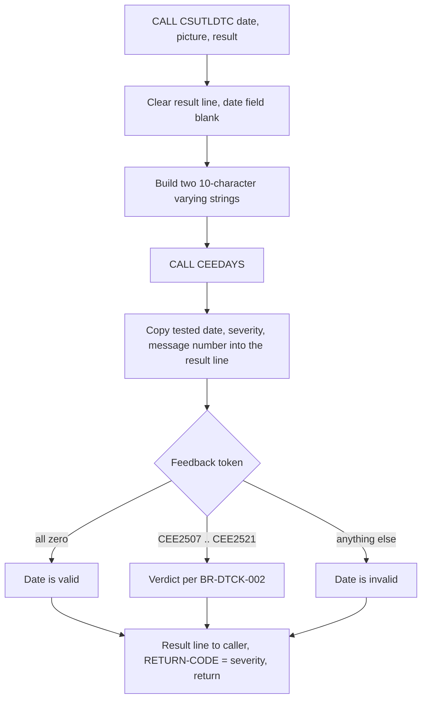
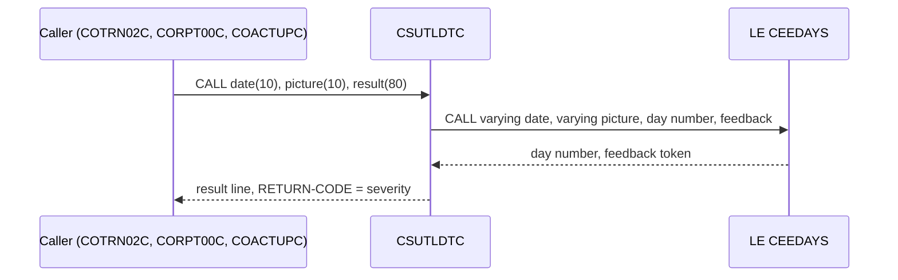

# CSUTLDTC: Date validation subroutine

## 1. Summary

CSUTLDTC checks whether a 10-character date is a real calendar date in a given format. The caller passes the date and a date picture (for example `YYYY-MM-DD`); CSUTLDTC hands both to the IBM Language Environment (LE) service CEEDAYS, which converts a date to a day number and reports a condition when it cannot. CSUTLDTC throws the day number away and returns only an 80-character result line: the condition severity, the LE message number, a 15-character verdict (`Date is valid`, `Datevalue error`, ...), the date tested and the picture used. It also sets the program return code to the severity. It reads and writes no files and keeps no state between calls. It is called by transaction add (`COTRN02C`) and report request (`CORPT00C`) with the picture `YYYY-MM-DD`, and by account update (`COACTUPC`, through the shared paragraph in `CSUTLDPY`) with `YYYYMMDD`.

## 2. Rules at a glance

| ID | Rule |
| :-- | :-- |
| BR-DTCK-001 | The date and the picture are each taken as exactly 10 characters and passed to CEEDAYS. |
| BR-DTCK-002 | The LE feedback code is translated into one of ten fixed 15-character verdicts. |
| BR-DTCK-003 | The result is an 80-character line with severity, message number, verdict, date and picture at fixed positions. |
| BR-DTCK-004 | The program return code is the condition severity (0 when the date is valid). |
| BR-DTCK-005 | The day number computed by CEEDAYS is not returned. |
| BR-DTCK-006 | What counts as a valid date is decided entirely by CEEDAYS (calendar, range 1582-10-15 to 9999-12-31). |
| FLOW-DTCK-001 | One call: clear the result, validate, copy the result to the caller, return. |
| FLOW-DTCK-002 | Callers pass three fields by reference; CSUTLDTC always reads 10, 10 and writes 80 bytes. |

## 3. Actors and triggers

- **Actor:** another program, never a user or a job directly. CSUTLDTC has no CICS transaction, no JCL step and no PROGRAM definition in `app/csd/CARDDEMO.CSD` (no line of the CSD names it); how the CICS region loads it (static link-edit into the callers or a dynamic call with program autoinstall) is not in the repository (Q-DTCK-004).
- **Triggers:** a `CALL 'CSUTLDTC'` with three parameters:
  - transaction add: `app/cbl/COTRN02C.cbl:393-395` (original date) and `app/cbl/COTRN02C.cbl:413-415` (processing date);
  - report request: `app/cbl/CORPT00C.cbl:392-394` (start date) and `app/cbl/CORPT00C.cbl:412-414` (end date);
  - account update: `app/cpy/CSUTLDPY.cpy:293-296` (paragraph `EDIT-DATE-LE`, copied into `COACTUPC` at `app/cbl/COACTUPC.cbl:4232`).
- **Locally:** built as a module (`tools/batch-programs.toml:105-109`) and run by the test driver `tests/unit/cobol/csutldtc_test.cbl:23-26` with the CEEDAYS stand-in `tools/shims/CEEDAYS.cbl` (`tools/batch-programs.toml:120-123`).
- **Preconditions:** none. Any 10 bytes are accepted as date and picture.

## 4. Interfaces

### 4.1 Parameters (linkage)

`PROCEDURE DIVISION USING LS-DATE, LS-DATE-FORMAT, LS-RESULT` (`:88`), all passed by reference (`:84-86`).

| # | Name | Len | Direction | Content |
| --: | :-- | --: | :-- | :-- |
| 1 | `LS-DATE` | 10 | in | The date to check, as text, for example `2022-07-06`. |
| 2 | `LS-DATE-FORMAT` | 10 | in | The LE picture string, for example `YYYY-MM-DD`, padded with spaces. |
| 3 | `LS-RESULT` | 80 | out | The result line (BR-DTCK-003); proposed entity ENT-DATE-CHECK-RESULT. |
| - | `RETURN-CODE` | - | out | Special register set to the severity (BR-DTCK-004). |

The parameters are not changed except `LS-RESULT`. Lengths are fixed by CSUTLDTC, not by the caller (FLOW-DTCK-002).

### 4.2 Call to CEEDAYS

`CALL "CEEDAYS" USING WS-DATE-TO-TEST, WS-DATE-FORMAT, OUTPUT-LILLIAN, FEEDBACK-CODE` (`:116-120`).

| Argument | Layout | Value passed |
| :-- | :-- | :-- |
| `WS-DATE-TO-TEST` | LE varying string: 2-byte binary length + text (`:25-31`) | length 10, text = `LS-DATE` |
| `WS-DATE-FORMAT` | LE varying string (`:33-39`) | length 10, text = `LS-DATE-FORMAT` |
| `OUTPUT-LILLIAN` | `S9(9) BINARY` (`:41`) | set to 0 before the call; CEEDAYS returns the Lilian day number (day 1 = 1582-10-15) |
| `FEEDBACK-CODE` | 12-byte LE condition token (`:60-80`): severity `S9(4) BINARY`, message number `S9(4) BINARY`, 1 control byte, 3-byte facility ID, 4-byte instance-specific information | not initialised; set by CEEDAYS |

### 4.3 Files, screens, console

None. CSUTLDTC opens no file, sends no screen and writes nothing to the console (the `DISPLAY WS-MESSAGE` at `:96` is a comment).

## 5. Data used

No entity of `entities.md` is read or written. Program-local data with behaviour:

| Field | Lines | Use |
| :-- | :-- | :-- |
| `WS-DATE-TO-TEST`, `WS-DATE-FORMAT` | `:25-39` | varying strings passed to CEEDAYS; the `OCCURS 0 TO 256 DEPENDING ON` text part is 10 bytes for every call |
| `OUTPUT-LILLIAN` | `:41` | receives the day number; never used afterwards (BR-DTCK-005) |
| `WS-MESSAGE` | `:42-57` | the 80-byte result line, copied to `LS-RESULT` (BR-DTCK-003) |
| `FEEDBACK-CODE` | `:60-80` | condition token; its first 8 bytes are compared with the nine 88-level values at `:62-70` |

## 6. Processing flow

1. Initialise the result line: severity, message number, verdict, date and picture become spaces; the fixed labels (`Mesg Code:`, `TstDate:`, `Mask used:`) keep their values (`:90-91`).
2. Build the two varying strings with length 10 and copy the date and picture into them; copy the date and the picture into the result line as well; set the day number to 0 (`:105-114`).
3. Call CEEDAYS (`:116-120`).
4. Copy the tested date again into the result line, then the severity and the message number (`:122-124`).
5. Choose the verdict from the feedback token (`:128-149`, BR-DTCK-002).
6. Copy the 80-byte result line to the caller's third parameter, set the return code to the severity and return to the caller (`:97-100`).

## 7. Business rules

#### BR-DTCK-001 · Date and picture are fixed 10-character strings
- **When:** CSUTLDTC is called.
- **Then:** the first 10 bytes at the address of the first parameter are the date and the first 10 bytes at the address of the second parameter are the picture. Both are passed to CEEDAYS with length 10, trailing spaces included (`LENGTH OF LS-DATE` and `LENGTH OF LS-DATE-FORMAT` are both 10). Nothing is trimmed, upper-cased or checked by CSUTLDTC itself.
- **Source:** `:84-85, 105-113`
- **Fidelity:** must-preserve · **Confidence:** runtime-verified (GnuCOBOL with the CEEDAYS stand-in)

#### BR-DTCK-002 · Feedback code to verdict (decision table)
- **When:** CEEDAYS has returned.
- **Then:** the first 8 bytes of the feedback token (severity, message number, control byte, facility `CEE` in EBCDIC `X'C3C5C5'`) select the 15-character verdict, padded with spaces:

| Token bytes 1-8 (hex) | LE message | Verdict (exact, 15 chars) | Meaning (IBM LE) |
| :-- | :-- | :-- | :-- |
| `0000000000000000` | none | `Date is valid  ` | conversion succeeded |
| `000309CB59C3C5C5` | CEE2507 | `Insufficient   ` | not enough data in the date for the picture |
| `000309CC59C3C5C5` | CEE2508 | `Datevalue error` | the date value is not valid (for example 2023-02-29, 2022-04-31, day 00) |
| `000309CD59C3C5C5` | CEE2509 | `Invalid Era    ` | era not recognised (Japanese or Chinese era pictures) |
| `000309D159C3C5C5` | CEE2513 | `Unsupp. Range  ` | date outside the supported range (before 1582-10-15) |
| `000309D559C3C5C5` | CEE2517 | `Invalid month  ` | month not 01-12 |
| `000309D659C3C5C5` | CEE2518 | `Bad Pic String ` | the picture string is not valid |
| `000309D859C3C5C5` | CEE2520 | `Nonnumeric data` | non-digit where the picture wants digits |
| `000309D959C3C5C5` | CEE2521 | `YearInEra is 0 ` | year-in-era is zero (era pictures) |
| any other value | any | `Date is invalid` | catch-all |

The severity in all listed conditions is 3 (`X'0003'`). The first row's 88-level is named `FC-INVALID-DATE` although it means "valid" (DEF-DTCK-002).
- **Source:** `:61-70, 128-149`
- **Fidelity:** must-preserve for the severity and message number that callers test; incidental for the verdict text, which no caller reads (section 11) · **Confidence:** runtime-verified for valid, 2507, 2508, 2513, 2517, 2518, 2520 (`tests/unit/test_date_routines.py:77-99` and the driver runs in section 15); platform-inferred for 2509, 2521 and the catch-all, which the stand-in never returns

#### BR-DTCK-003 · Result line layout
- **When:** every call.
- **Then:** the third parameter receives this 80-byte line (proposed ENT-DATE-CHECK-RESULT):

| Pos | Len | Content | Example (valid date) |
| --: | --: | :-- | :-- |
| 1 | 4 | severity, 4 digits (NUM-DTCK-001) | `0000` |
| 5 | 11 | `Mesg Code: ` (label and one space) | `Mesg Code: ` |
| 16 | 4 | LE message number, 4 digits | `0000` |
| 20 | 1 | space | |
| 21 | 15 | verdict (BR-DTCK-002) | `Date is valid  ` |
| 36 | 1 | space | |
| 37 | 9 | `TstDate: ` (label and one space) | `TstDate: ` |
| 46 | 10 | the 10 bytes of the date as given | `2022-07-06` |
| 56 | 1 | space | |
| 57 | 10 | `Mask used:` (no trailing space) | `Mask used:` |
| 67 | 10 | the 10 bytes of the picture as given | `YYYY-MM-DD` |
| 77 | 4 | spaces | |

Complete example: `0000Mesg Code: 0000 Date is valid   TstDate: 2022-07-06 Mask used:YYYY-MM-DD    `; for 2023-02-29: `0003Mesg Code: 2508 Datevalue error TstDate: 2023-02-29 Mask used:YYYY-MM-DD    `.
- **Source:** `:42-57, 90-91, 97, 107-108, 111-113, 122-124`
- **Fidelity:** must-preserve for positions 1-4 and 16-19 (read by all callers); incidental for the rest · **Confidence:** runtime-verified (`tests/unit/test_date_routines.py:77-89`)

#### BR-DTCK-004 · Return code is the severity
- **When:** every call.
- **Then:** the `RETURN-CODE` special register is set to the severity as a number: 0 for a valid date, 3 for every condition of BR-DTCK-002 (CEEDAYS can in principle return other severities, which would be passed through). None of the three callers looks at it; they test the severity in the result line instead.
- **Source:** `:98`
- **Fidelity:** incidental · **Confidence:** runtime-verified (`tests/unit/test_date_routines.py:79, 97`)

#### BR-DTCK-005 · The day number is discarded
- **When:** CEEDAYS succeeds.
- **Then:** the Lilian day number it returns in `OUTPUT-LILLIAN` is not copied anywhere; the caller learns only valid or not. A caller that needs date arithmetic must compute it itself (account update uses `FUNCTION INTEGER-OF-DATE`, `app/cpy/CSUTLDPY.cpy:346`).
- **Source:** `:41, 114, 119`
- **Fidelity:** must-preserve (the interface returns no day number) · **Confidence:** reviewed

#### BR-DTCK-006 · What is a valid date
- **When:** CEEDAYS evaluates the date against the picture.
- **Then:** CSUTLDTC adds no rule of its own; validity is CEEDAYS's: Gregorian calendar with leap years (2024-02-29 valid, 2023-02-29 not), month 01-12, day within the month, year range 1582-10-15 through 9999-12-31 (an earlier date gives CEE2513, a value of 0000 as year included), digits where the picture has `YYYY`, `MM`, `DD`. Outcomes for the inputs callers send are listed in section 15.
- **Source:** `:116-120`; local stand-in rules `tools/shims/CEEDAYS.cbl:1-11`
- **Fidelity:** must-preserve · **Confidence:** runtime-verified against the stand-in; platform-inferred for IBM LE (the stand-in is not LE; Q-DTCK-001)

## 8. Validations and messages

CSUTLDTC shows nothing to a user; it has no `VAL` items. Its outcomes are the verdicts of BR-DTCK-002, and each caller turns a non-zero severity into its own message:

| Caller | Message on an invalid date | Exception |
| :-- | :-- | :-- |
| `COTRN02C` | `Orig Date - Not a valid date...`, `Proc Date - Not a valid date...` | message number `2513` is accepted as valid (`app/cbl/COTRN02C.cbl:397-427`) |
| `CORPT00C` | `Start Date - Not a valid date...`, `End Date - Not a valid date...` | message number `2513` is accepted as valid (`app/cbl/CORPT00C.cbl:396-426`) |
| `COACTUPC` | `<field name> validation error Sev code: <sev> Message code: <msgno>` | none (`app/cpy/CSUTLDPY.cpy:298-316`) |

### 8.1 Flow

#### FLOW-DTCK-001 · One call
- **When:** the program is called.
- **Then:** clear the result line (FLOW step 1), perform the validation paragraph `A000-MAIN` through `A000-MAIN-EXIT`, copy the result line to the third parameter, set the return code, and return to the caller with `EXIT PROGRAM`. No state carries over to the next call: every field that reaches the caller is set again on every call.
- **Source:** `:88-102, 152-154`
- **Confidence:** runtime-verified

#### FLOW-DTCK-002 · Parameter lengths are fixed by CSUTLDTC
- **When:** a caller passes fields shorter than 10, 10 and 80 bytes.
- **Then:** CSUTLDTC still reads 10 bytes from the first two addresses and writes 80 bytes to the third, so the bytes that follow the caller's fields are read (and, for the result, overwritten). `COTRN02C` and `CORPT00C` pass exactly 10, 10 and 80 (`app/cbl/COTRN02C.cbl:62-69`, `app/cbl/CORPT00C.cbl:129-136`). Account update passes an 8-byte date and an 8-byte picture (`app/cpy/CSUTLDWY.cpy:4, 58-59`), see DEF-DTCK-003; its result area is the 80-byte `WS-DATE-VALIDATION-RESULT` (`app/cpy/CSUTLDWY.cpy:60`).
- **Source:** `:84-86, 97, 105-113`
- **Fidelity:** must-preserve (interface) · **Confidence:** runtime-verified for the 8-byte case with the stand-in (section 15, S14-S15)

## 9. Side effects

None. CSUTLDTC changes only its own working storage, the caller's third parameter and the return code; it reads and writes no file, queue or database.

## 10. Error handling

#### ERR-DTCK-001 · No error path of its own
- **What:** every CEEDAYS condition is reported through the feedback code and ends in a verdict (BR-DTCK-002); CSUTLDTC never abends on a bad date or a bad picture, because it passes a feedback-code argument (LE then returns the condition instead of signalling it). If CEEDAYS itself cannot be called (module not found), the CALL fails and the calling task abends; there is no `ON EXCEPTION` clause.
- **Source:** `:116-120`
- **Fidelity:** must-preserve (no abend on bad input) · **Confidence:** runtime-verified for bad dates and pictures; platform-inferred for the missing-module case

## 11. Interactions

- **Inbound:** `COTRN02C` (transaction add, picture `YYYY-MM-DD`, `app/cbl/COTRN02C.cbl:389-427`), `CORPT00C` (report request, `YYYY-MM-DD`, `app/cbl/CORPT00C.cbl:388-426`), `COACTUPC` (account update, `YYYYMMDD`, `app/cpy/CSUTLDPY.cpy:284-321`). All three read only the severity (positions 1-4) and, for the first two, the message number (positions 16-19); none reads the verdict text, the tested date or the picture.
- **Outbound:** `CEEDAYS` (IBM LE callable service; replaced locally by `tools/shims/CEEDAYS.cbl`).
- **Shared data:** none.

### Module extraction notes

CSUTLDTC is a pure function and the simplest seam in the application. A target replacement (for example a `java.time` date check) must keep this contract for each caller as long as the caller stays COBOL:

| Boundary | Contract |
| :-- | :-- |
| Input | 10-byte date, 10-byte picture; the only pictures used are `YYYY-MM-DD` and `YYYYMMDD` (plus 2 trailing bytes of caller storage, DEF-DTCK-003). |
| Output | 80-byte line of BR-DTCK-003; severity `0000` if and only if the date is valid; message number per BR-DTCK-002 (callers depend on `2513` being distinguishable). |
| Validity | BR-DTCK-006: Gregorian dates 1582-10-15 to 9999-12-31. |
| State | none; safe to call concurrently. |

## 12. Numeric, date and format details

#### NUM-DTCK-001 · Severity and message number as 4 digits
- The severity and message number are 2-byte binary fields in the token (`:72-73`) and are moved into 4-digit unsigned display fields (`:44, 47`) that redefine the 4-character text positions of the result line: `3` becomes `0003`, 2508 becomes `2508`. A negative binary value would lose its sign (unsigned target); LE does not return one.
- **Source:** `:43-47, 72-73, 123-124`

#### NUM-DTCK-002 · Pictures used and what they accept (stand-in)
- With picture `YYYY-MM-DD`, the stand-in accepts only 4 digits, separator, 2 digits, separator, 2 digits. It does not compare the separator characters: `2022/07/06` is valid. A one-digit month or day (`2022-7-6  `) is CEE2520. With `YYYYMMDD`, any bytes after the 8th are ignored.
- **Source:** `tools/shims/CEEDAYS.cbl:1-11`; observed in section 15
- **Confidence:** runtime-verified against the stand-in; whether IBM LE treats separators and trailing bytes the same way is Q-DTCK-001

#### NUM-DTCK-003 · Lilian day number
- `OUTPUT-LILLIAN` is a fullword binary `S9(9)`; day 1 is 1582-10-15. It is computed but discarded (BR-DTCK-005).
- **Source:** `:41, 114`

## 13. Known defects and oddities

#### DEF-DTCK-001 · Tested date in the result line was garbled
- Before the fix, the line after the CEEDAYS call moved the whole varying-string group `WS-DATE-TO-TEST` (2 binary length bytes + text) into the 10-byte `TstDate` field, so the field showed two binary bytes followed by the first 8 characters of the date. Now only the text part is moved (`:122`), and `TstDate:` shows the date as given. No caller reads this field, so the defect had no effect on validation.
- **Source:** `:122`; the old statement is `MOVE WS-DATE-TO-TEST TO WS-DATE` in `git show 8c797e2:app/cbl/CSUTLDTC.cbl`
- **Status:** fixed in branch, commit b5e0139 (`CHANGELOG.md:50`, "CSUTLDTC reports the date it was given", original commit 8122736) · **Fidelity:** incidental · **Confidence:** runtime-verified (`tests/unit/test_date_routines.py:87-89`)

#### DEF-DTCK-002 · Misleading condition name
- The 88-level for the all-zero token, which means "the date is valid", is named `FC-INVALID-DATE`.
- **Source:** `:62, 129-130`
- **Status:** open (naming only) · **Fidelity:** incidental

#### DEF-DTCK-003 · Account update passes 8-byte fields
- `COACTUPC` passes `WS-EDIT-DATE-CCYYMMDD` (8 bytes, followed by the 4-byte binary `WS-EDIT-DATE-BINARY`) and `WS-DATE-FORMAT` (8 bytes `YYYYMMDD`, followed by the result area whose first 4 bytes are spaces after `INITIALIZE`). CEEDAYS therefore gets the date `CCYYMMDD` plus 2 binary bytes and the picture `YYYYMMDD  ` (two trailing spaces). The stand-in ignores the extra bytes and validates the 8 digits (section 15, S14-S15). On IBM LE the result depends on how CEEDAYS treats trailing data beyond the picture (Q-DTCK-002). The `TstDate:` field of the result shows the 2 binary bytes.
- **Source:** `:105-113`; `app/cpy/CSUTLDWY.cpy:4-37, 58-60`; `app/cpy/CSUTLDPY.cpy:290-296`
- **Status:** open · **Fidelity:** defect-decide · **Confidence:** runtime-verified with the stand-in; platform-inferred for LE

#### DEF-DTCK-004 · Out-of-range dates are accepted by two callers
- CSUTLDTC reports dates before 1582-10-15 (including year `0000`) as CEE2513 with severity 3, but `COTRN02C` and `CORPT00C` treat message number 2513 as "valid" and go on (`app/cbl/COTRN02C.cbl:400, 420`, `app/cbl/CORPT00C.cbl:399, 419`). Recorded here because it depends on this program's message numbers; the consequence is specified in those programs' specs.
- **Source:** `:137-138`
- **Status:** open · **Fidelity:** defect-decide

## 14. Open questions

| ID | Question | For |
| :-- | :-- | :-- |
| Q-DTCK-001 | Does IBM LE CEEDAYS with picture `YYYY-MM-DD` accept other separators (`2022/07/06`) and reject one-digit months and days (`2022-7-6`) as the local stand-in does? | mainframe team |
| Q-DTCK-002 | What does CEEDAYS return for an 8-digit date followed by 2 binary bytes with the picture `YYYYMMDD` plus 2 spaces (the account update call, DEF-DTCK-003)? | mainframe team |
| Q-DTCK-003 | Should the target keep the LE message numbers in its interface (callers test for 2513), or return a plain valid/invalid result and move the 2513 exception into the callers' rules? | architecture |
| Q-DTCK-004 | Is CSUTLDTC link-edited statically into `COTRN02C`, `CORPT00C` and `COACTUPC`, or called dynamically (it has no CSD PROGRAM definition)? | mainframe team |

## 15. Equivalence contract

A reimplementation must give the same severity (positions 1-4) and message number (positions 16-19) for every input, and should give the same 80-byte line. It may differ in the return code (no caller reads it).

The scenarios below were run on GnuCOBOL 3.2 (`-std=ibm -fsign=EBCDIC`) against `tools/shims/CEEDAYS.cbl` with the repository driver `tests/unit/cobol/csutldtc_test.cbl` and, for S14-S15, a driver that passes 8-byte fields followed by binary storage. S1-S2, S4, S8, S10, S12 and S13 are also asserted by `tests/unit/test_date_routines.py:77-99`. Because the stand-in is not LE, the expected results for IBM LE are platform-inferred where noted.

| # | Date (10) | Picture (10) | Severity / msg | Verdict | Note |
| --: | :-- | :-- | :-- | :-- | :-- |
| S1 | `2022-07-06` | `YYYY-MM-DD` | `0000` / `0000` | `Date is valid` | full line in BR-DTCK-003 |
| S2 | `2024-02-29` | `YYYY-MM-DD` | `0000` / `0000` | `Date is valid` | leap day |
| S3 | `1582-10-15`, `9999-12-31` | `YYYY-MM-DD` | `0000` / `0000` | `Date is valid` | range limits |
| S4 | `2023-02-29` | `YYYY-MM-DD` | `0003` / `2508` | `Datevalue error` | |
| S5 | `2022-04-31`, `2022-07-00` | `YYYY-MM-DD` | `0003` / `2508` | `Datevalue error` | |
| S6 | `2022-13-01`, `2022-00-10` | `YYYY-MM-DD` | `0003` / `2517` | `Invalid month` | |
| S7 | `1582-10-14`, `0022-01-01`, `0000-01-01` | `YYYY-MM-DD` | `0003` / `2513` | `Unsupp. Range` | accepted by two callers, DEF-DTCK-004 |
| S8 | `1500-01-01` | `YYYY-MM-DD` | `0003` / `2513` | `Unsupp. Range` | |
| S9 | `2022-7-6  ` | `YYYY-MM-DD` | `0003` / `2520` | `Nonnumeric data` | |
| S10 | `2022-0A-01` | `YYYY-MM-DD` | `0003` / `2520` | `Nonnumeric data` | |
| S11 | `2022/07/06` | `YYYY-MM-DD` | `0000` / `0000` | `Date is valid` | stand-in; LE is Q-DTCK-001 |
| S12 | 10 spaces | `YYYY-MM-DD` | `0003` / `2507` | `Insufficient` | |
| S13 | `2022-07-06` | `YYYY-XX-DD` or 10 spaces | `0003` / `2518` | `Bad Pic String` | return code 3 |
| S14 | `20220706` + 2 binary bytes | `YYYYMMDD` + 2 spaces | `0000` / `0000` | `Date is valid` | account update layout; LE is Q-DTCK-002 |
| S15 | `20230229` + 2 binary bytes | `YYYYMMDD` + 2 spaces | `0003` / `2508` | `Datevalue error` | |

Evidence: `evidence/c-transactions-review.md`.

## 16. Paragraph coverage

| Paragraph | Lines | Covered by |
| :-- | :-- | :-- |
| (data division) | 21-86 | §4.1, §4.2, §5, BR-DTCK-003, NUM-DTCK-001, NUM-DTCK-003, DEF-DTCK-002 |
| (procedure division main line) | 88-102 | FLOW-DTCK-001, FLOW-DTCK-002, BR-DTCK-003, BR-DTCK-004 |
| `A000-MAIN` | 103-151 | BR-DTCK-001, BR-DTCK-002, BR-DTCK-005, BR-DTCK-006, ERR-DTCK-001, DEF-DTCK-001, DEF-DTCK-003 |
| `A000-MAIN-EXIT` | 152-154 | FLOW-DTCK-001 |

2 of 2 paragraphs covered, plus the data division and the main line before the first paragraph.
