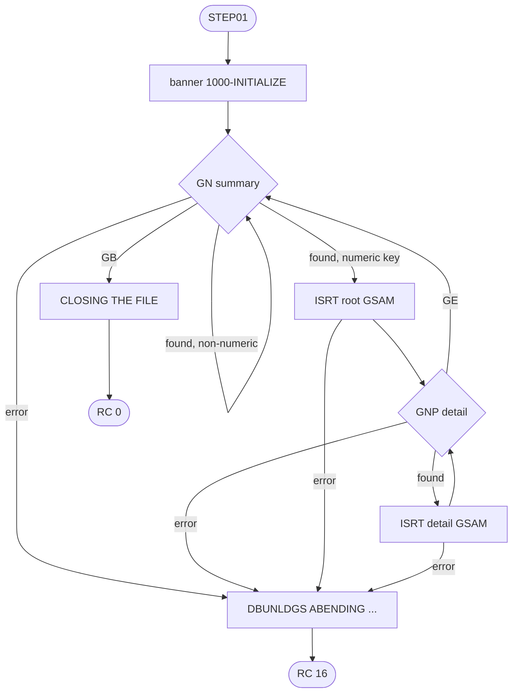
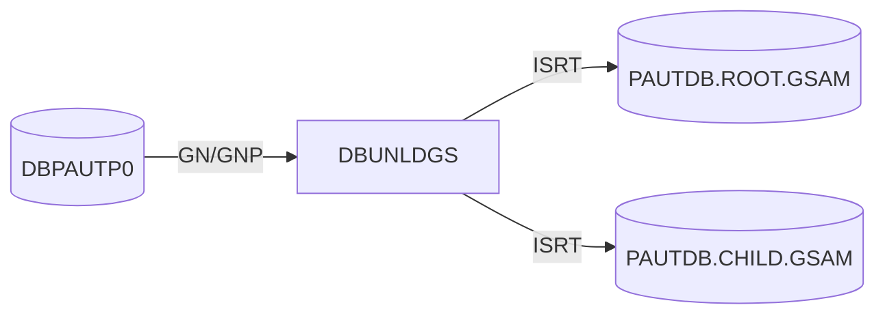

# DBUNLDGS: Pending authorization database unload to GSAM files (UNLDGSAM)

## 1. Summary

An IMS batch (DL/I) program that copies the pending-authorization database `DBPAUTP0` into two GSAM files: one 100-byte record per account summary (ENT-AUTH-SUMMARY) and one 200-byte record per authorization detail (ENT-AUTH-DETAIL). The details follow their summary in the database order, but the detail records carry no account key (DEF-DBUL-001). Summaries whose account key is not a valid packed number are skipped with their details. The program reads only; it prints a start banner and ends with return code 0, or 16 after an IMS error. Nothing in the repository reads the GSAM files (Q-DBUL-001). It is the GSAM variant of PAUDBUNL, which writes ordinary sequential files with the parent key.

## 2. Rules at a glance

| ID | Rule |
| :-- | :-- |
| FLOW-DBUL-001 | Banner, then every summary in database order, then end. |
| BR-DBUL-001 | A summary with a numeric (valid packed) account ID is written to the root GSAM file; any other summary is skipped with its details. |
| BR-DBUL-002 | Every detail of a written summary is written, in key order, to the detail GSAM file, as the bare 200-byte segment. |

## 3. Actors and triggers

- **Trigger:** JCL job `UNLDGSAM`, step `STEP01`, `DFSRRC00` with `PARM='DLI,DBUNLDGS,DLIGSAMP,,,,,,,,,,,N'` (`UNLDGSAM.JCL:26-27`): a DL/I batch region that opens the database itself (DDs `DDPAUTP0`, `DDPAUTX0`, `UNLDGSAM.JCL:42-43`). No schedule runs it; it is an on-demand utility.
- **PSB:** `DLIGSAMP` (`DLIGSAMP.PSB:17-24`): `PAUTBPCB` on `DBPAUTP0` with `PROCOPT=GOTP` (read only), then two GSAM PCBs with `PROCOPT=LS` (load) on `PASFLDBD` and `PADFLDBD`; `CMPAT=NO`, so no I/O PCB is passed and the three PCBs arrive in the order of the `ENTRY 'DLITCBL' USING` list (`:165-167`) (platform-inferred).
- **Preconditions:** the output data sets `AWS.M2.CARDDEMO.PAUTDB.ROOT.GSAM` and `.CHILD.GSAM` already exist (`DISP=(OLD,KEEP,KEEP)`, `UNLDGSAM.JCL:36-40`; job JULGS).

## 4. Interfaces

### 4.1 Database and GSAM calls

| Call | PCB | I/O area | SSA | Source |
| :-- | :-- | :-- | :-- | :-- |
| `GN` | `PAUTBPCB` | `PENDING-AUTH-SUMMARY` | `PAUTSUM0 ` (unqualified) | `:221-225` |
| `GNP` | `PAUTBPCB` | `PENDING-AUTH-DETAILS` | `PAUTDTL1 ` (unqualified) | `:267-270` |
| `ISRT` | `PASFLPCB` (GSAM `PASFLDBD`) | `PENDING-AUTH-SUMMARY` (100) | none | `:302-304` |
| `ISRT` | `PADFLPCB` (GSAM `PADFLDBD`) | `PENDING-AUTH-DETAILS` (200) | none | `:321-323` |

Function codes from `IMSFUNCS.cpy:17-27`; PCB masks `PAUTBPCB.CPY:17-26`, `PASFLPCB.CPY:17-26`, `PADFLPCB.CPY:17-26`.

### 4.2 Output files

| DD | DBD | Record | Content | Source |
| :-- | :-- | :-- | :-- | :-- |
| `PASFILOP` | `PASFLDBD` | 100 bytes, `RECFM=F` | ENT-AUTH-ROOT-FILE: one ENT-AUTH-SUMMARY image | `PASFLDBD.DBD:22-27` |
| `PADFILOP` | `PADFLDBD` | 200 bytes, `RECFM=F` | ENT-AUTH-CHILD-GSAM: one ENT-AUTH-DETAIL image | `PADFLDBD.DBD:22-27` |

### 4.3 Console output (SYSOUT), in order

1. `STARTING PROGRAM DBUNLDGS::`, a line of dashes, `TODAYS DATE            :` + `YYMMDD`, a blank line (`:189-192`).
2. After the details of each written summary: `CHILD SEG FLAG GE : Y` (`:287-288`).
3. At the end: `CLOSING THE FILE` (`:339`).
4. On an error: the lines of ERR-DBUL-001 to ERR-DBUL-003, then `DBUNLDGS ABENDING ...` (`:360`).

### 4.4 Return code

0 at normal end; 16 after any error (ERR-DBUL-004).

## 5. Data used

| Entity field | Read | Written | Use |
| :-- | :-- | :-- | :-- |
| ENT-AUTH-SUMMARY (whole segment) | yes | ENT-AUTH-ROOT-FILE | BR-DBUL-001 |
| ENT-AUTH-SUMMARY.PA-ACCT-ID | yes | - | numeric test (BR-DBUL-001) |
| ENT-AUTH-DETAIL (whole segment) | yes | ENT-AUTH-CHILD-GSAM | BR-DBUL-002 |

## 6. Processing flow

## 7. Business rules

#### FLOW-DBUL-001 · Run outline
- **When:** the step starts.
- **Then:** `ACCEPT` today's date (`YYMMDD`) and `YYDDD` (only the first is used, in the banner); print the banner; repeat the summary loop (BR-DBUL-001) until `GN` returns `GB`; print `CLOSING THE FILE`; `GOBACK`. The GSAM files are closed by IMS at the end of the step (platform-inferred).
- **Source:** `:164-194, 249-252, 338-339`
- **Fidelity:** must-preserve · **Confidence:** reviewed

#### BR-DBUL-001 · Summaries
- **When:** `GN PAUTSUM0` returns spaces. Summaries come in root key order (ascending account ID, HIDAM `DBPAUTP0.dbd:18, 28-30`).
- **Then:** if `PA-ACCT-ID` (`S9(11) COMP-3`) is numeric, insert the 100-byte segment into the root GSAM file (SE-DBUL-001) and read its details (BR-DBUL-002). If it is not numeric (for example the all-spaces root in the sample data), the summary and its details are skipped without a message (DEF-DBUL-002). The `MOVE PA-ACCT-ID TO ROOT-SEG-KEY` (`:239`) runs before the test (`:241`); that it does not raise a data exception on invalid packed bytes depends on the compiler options (platform-inferred).
- **Source:** `:232-248`, `CIPAUSMY.cpy:19`
- **Fidelity:** must-preserve · **Confidence:** reviewed (no abend on the earlier move: platform-inferred)

#### BR-DBUL-002 · Details
- **When:** after a written summary.
- **Then:** `GNP PAUTDTL1` until `GE`; each detail (key order, newest first, COPAUA0C NUM-AUTH-005) is inserted as its 200-byte image into the detail GSAM file (SE-DBUL-002). The parent account is not written with it (DEF-DBUL-001). At `GE` the line `CHILD SEG FLAG GE : Y` is printed.
- **Source:** `:263-295, 319-323`
- **Fidelity:** must-preserve · **Confidence:** reviewed

## 8. Validations and messages

The program has no input to validate; the only check is the numeric test of BR-DBUL-001. Messages: section 4.3.

## 9. Side effects

#### SE-DBUL-001 · Root GSAM records
- One 100-byte record per written summary in DD `PASFILOP`, in account order.
- **Source:** `:300-304`
- **Fidelity:** must-preserve · **Confidence:** reviewed

#### SE-DBUL-002 · Detail GSAM records
- One 200-byte record per detail of a written summary in DD `PADFILOP`, grouped by summary in the same order as the root file.
- **Source:** `:319-323`
- **Fidelity:** must-preserve · **Confidence:** reviewed

## 10. Error handling

#### ERR-DBUL-001 · Summary read error
- `GN` status other than spaces or `GB`: `AUTH SUM  GN FAILED  :` + status, `KEY FEEDBACK AREA    :` + key feedback area, then ERR-DBUL-004.
- **Source:** `:253-256`
- **Fidelity:** must-preserve · **Confidence:** reviewed

#### ERR-DBUL-002 · Detail read error
- `GNP` status other than spaces or `GE`: `GNP CALL FAILED  :` + status, `KFB AREA IN CHILD:` + key feedback, then ERR-DBUL-004.
- **Source:** `:290-294`
- **Fidelity:** must-preserve · **Confidence:** reviewed

#### ERR-DBUL-003 · GSAM insert error
- Root insert status not spaces: `GSAM PARENT FAIL :` + status, `KFB AREA IN GSAM:` + key feedback. Detail insert: the same two texts (DEF-DBUL-004). Then ERR-DBUL-004.
- **Source:** `:311-315, 330-334`
- **Fidelity:** must-preserve · **Confidence:** reviewed

#### ERR-DBUL-004 · End with return code 16
- `DBUNLDGS ABENDING ...`, return code 16, `GOBACK`: the step ends normally with RC 16, not with an abend; the records already inserted stay in the GSAM files (DEF-DBUL-003).
- **Source:** `:357-363`
- **Fidelity:** must-preserve (RC 16) · **Confidence:** reviewed (GSAM content after RC 16: platform-inferred)

## 11. Interactions

- **Upstream:** the database as maintained by COPAUA0C, COPAUS1C and CBPAUP0C.
- **Downstream:** none in the repository. PAUDBLOD reloads from the sequential files of PAUDBUNL (206-byte detail records with key), not from these files.

## 12. Numeric, date and format details

#### NUM-DBUL-001 · Numeric test on the packed key
- `PA-ACCT-ID IS NUMERIC` is true when all 6 bytes hold valid packed digits and a valid sign; a root of spaces (`X'40'`) fails it.
- **Source:** `:241`
- **Fidelity:** must-preserve · **Confidence:** reviewed

## 13. Known defects and oddities

#### DEF-DBUL-001 · Detail records have no parent key
- The program fills `ROOT-SEG-KEY` and `CHILD-SEG-REC` of a 206-byte `OPFIL2-REC` (`:54-56, 237-239, 280`) but inserts the bare 200-byte segment, so the detail file cannot be related to its summary reliably: neither file says how many details belong to a summary, and the only clue, the summary's approved and declined counts, is not kept in step with the details (CBPAUP0C DEF-AUPG-003). The record layout differs from PAUDBUNL's detail file (ENT-AUTH-CHILD-FILE) and PAUDBLOD cannot load it.
- **Source:** `:236-239, 280-282, 321-323` · **Status:** open · **Fidelity:** defect-decide (Q-DBUL-001) · **Confidence:** reviewed

#### DEF-DBUL-002 · Skipped summaries are not reported
- A summary with a non-numeric account ID is skipped with all its details; no message and no count.
- **Source:** `:241-247` · **Status:** open · **Fidelity:** defect-decide (Q-DBUL-002) · **Confidence:** reviewed

#### DEF-DBUL-003 · "ABENDING" is a normal end with return code 16
- ERR-DBUL-004 does not abend, so the output data sets are kept with partial content. The GSAM PCBs are in load mode (`PROCOPT=LS`, `DLIGSAMP.PSB:21-22`) and the DDs are `DISP=(OLD,KEEP,KEEP)` (`UNLDGSAM.JCL:36-40`), so a rerun overwrites them from the beginning; the program has no checkpoint restart. Only the return code 16 shows that the content is incomplete.
- **Source:** `:357-363` · **Status:** open · **Confidence:** platform-inferred

#### DEF-DBUL-004 · Wrong text for detail GSAM errors
- The detail insert error prints `GSAM PARENT FAIL :`, the same text as for the root file.
- **Source:** `:331` · **Status:** open (incidental)

#### DEF-DBUL-005 · Counters never printed; dead code
- The read counters are incremented (and detail reads are added to the summary counters, `:278-279`) but never displayed. `PRM-INFO` (its `ACCEPT` is commented out), the checkpoint ID, `WS-PGMNAME` `IMSUNLOD`, the file definitions and their open and close code are commented out or unused.
- **Source:** `:26-56, 58-94, 123-133, 188, 195-209, 340-353` · **Status:** open (incidental)

## 14. Open questions

| ID | Question | For |
| :-- | :-- | :-- |
| Q-DBUL-001 | What reads the GSAM files, and should the detail record carry its account key like PAUDBUNL's (DEF-DBUL-001)? | mainframe team |
| Q-DBUL-002 | Should summaries with an invalid account ID be reported or unloaded anyway (DEF-DBUL-002)? | operations |

## 15. Equivalence contract

A reimplementation is equivalent when, for the same database content:

- the root file has one 100-byte summary image per summary with a valid packed account ID, in account order;
- the detail file has the 200-byte images of those summaries' details, grouped in the same order and newest first within a summary;
- the return code is 0, or 16 after an IMS error;
- incidental: console texts.

Not runnable locally (IMS). Scenario check on the sample data (ENT-AUTH-SUMMARY sample: 22 roots, 202 details): 21 root records, and all 202 detail records, since the all-spaces root has no details. Review record: `docs/modernization/spec/evidence/e-review.md`.

## 16. Paragraph coverage

| Paragraph | Lines | Covered by |
| :-- | :-- | :-- |
| (data division) | 39-157 | §4.1, §4.2, DEF-DBUL-005 |
| (procedure division header) | 159-161 | §3 |
| `MAIN-PARA` | 164-179 | FLOW-DBUL-001 |
| `1000-INITIALIZE` | 182-194 | FLOW-DBUL-001 |
| `1000-EXIT` | 212-213 | FLOW-DBUL-001 |
| `2000-FIND-NEXT-AUTH-SUMMARY` | 216-257 | BR-DBUL-001, ERR-DBUL-001, NUM-DBUL-001, DEF-DBUL-002 |
| `2000-EXIT` | 258-259 | BR-DBUL-001 |
| `3000-FIND-NEXT-AUTH-DTL` | 263-295 | BR-DBUL-002, ERR-DBUL-002 |
| `3000-EXIT` | 296-297 | BR-DBUL-002 |
| `3100-INSERT-PARENT-SEG-GSAM` | 300-315 | SE-DBUL-001, ERR-DBUL-003 |
| `3100-EXIT` | 316-317 | SE-DBUL-001 |
| `3200-INSERT-CHILD-SEG-GSAM` | 319-334 | SE-DBUL-002, ERR-DBUL-003, DEF-DBUL-004 |
| `3200-EXIT` | 335-336 | SE-DBUL-002 |
| `4000-FILE-CLOSE` | 338-339 | FLOW-DBUL-001 |
| `4000-EXIT` | 354-355 | FLOW-DBUL-001 |
| `9999-ABEND` | 357-363 | ERR-DBUL-004, DEF-DBUL-003 |
| `9999-EXIT` | 365-366 | ERR-DBUL-004 |

15 of 15 paragraphs plus the procedure division header covered.
