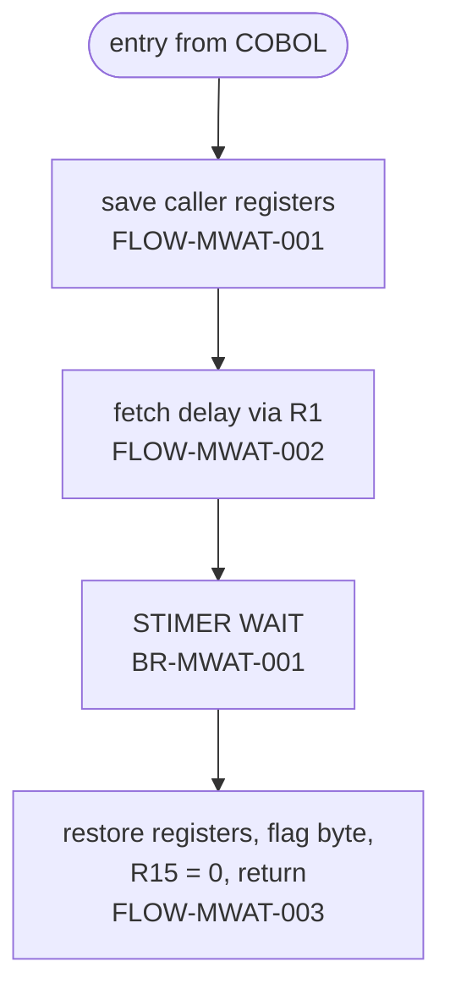

# MVSWAIT: Timed wait subroutine (STIMER)

## 1. Summary

MVSWAIT is a small z/OS assembler subroutine that suspends the calling job step for a given time. The caller passes one fullword holding the delay in hundredths of a second. MVSWAIT copies it into its own storage, issues the z/OS timer service `STIMER WAIT,BINTVL=` through the one-line macro ASMWAIT, restores the caller's registers and returns with 0 in register 15. Its only caller is the batch utility COBSWAIT (job WAITSTEP). Locally the assembler is replaced by a COBOL shim that sleeps for the same interval with `CBL_GC_NANOSLEEP`.

## 2. Rules at a glance

| ID | Rule |
| :-- | :-- |
| BR-MWAT-001 | Wait (real time) for the interval in the caller's fullword, in units of 0.01 second, then return. |
| BR-MWAT-002 | Return code (register 15) is always 0. |

There are no validations (section 8).

## 3. Actors and triggers

- **Caller:** COBSWAIT, `CALL 'MVSWAIT' USING MVSWAIT-TIME` with a `PIC 9(8) COMP` fullword (`app/cbl/COBSWAIT.cbl:30`, `app/cbl/COBSWAIT.cbl:38`). No other program in the repository calls it (`docs/inventory.md:64`).
- **Linkage:** standard z/OS (OS) linkage: on entry register 1 points to the parameter list, 13 to the caller's 72-byte save area, 14 holds the return address and 15 the entry point address.
- **Load module:** found in the job's STEPLIB (`app/jcl/WAITSTEP.jcl:23`); whether the COBOL caller binds it statically or loads it dynamically depends on the caller's `DYNAM` compiler option, which the repository does not fix (platform-inferred).

## 4. Interfaces

### 4.1 Parameter list

| Register / word | Content | Source |
| :-- | :-- | :-- |
| R1 | address of the parameter list | `:20` |
| word 1 of the list | address of the delay fullword; COBOL sets the high-order bit of the last address (end of list) | `:20` |
| delay fullword | 4-byte unsigned binary, big-endian, hundredths of a second (NUM-MWAT-001) | `:21` |

The parameter is only read; MVSWAIT never stores into the caller's data.

### 4.2 Registers on return

| Register | Value on return | Source |
| :-- | :-- | :-- |
| R0-R12, R14 | as on entry (reloaded from the caller's save area) | `:24` |
| R13 | unchanged (never modified) | `:19-27` |
| R15 | 0 | `:26` |
| caller's save area, byte at offset 12 | X'FF' (DEF-MWAT-001) | `:25` |

### 4.3 Console output

None.

## 5. Data used

No entity. Local storage: `BINLBL`, one fullword (`DS F`, 4 bytes, fullword-aligned, no initial value) inside the control section, which receives a copy of the delay (`:22, 28`). The literal pool (`LTORG`, `:29`) is empty: the routine has no literals.

## 6. Processing flow

| Line | Instruction | Effect |
| --: | :-- | :-- |
| 17 | `MVSWAIT  START 0` | Starts the control section MVSWAIT at offset 0. |
| 18 | `USING *,15` | Register 15 (entry point address) is the base register for the whole routine. |
| 19 | `STM 14,12,12(13)` | Saves R14, R15, R0-R12 in the caller's save area, offsets 12-71. |
| 20 | `L 5,0(1)` | R5 = first word of the parameter list = address of the delay fullword. |
| 21 | `L 1,0(5)` | R1 = the delay value. |
| 22 | `ST 1,BINLBL` | Copies the delay into `BINLBL`. |
| 23 | `ASMWAIT BINLBL` | Expands to `STIMER WAIT,BINTVL=BINLBL` (`app/maclib/ASMWAIT.mac:17-20`): the task waits until the interval has passed. |
| 24 | `LM 14,12,12(13)` | Reloads R14, R15, R0-R12 from the caller's save area. |
| 25 | `MVI 12(13),X'FF'` | Sets the first byte of the saved-R14 word in the caller's save area to X'FF'. |
| 26 | `SR 15,15` | R15 = 0. |
| 27 | `BR 14` | Returns to the caller. |
| 28-30 | `BINLBL DS F`, `LTORG`, `END` | Storage, empty literal pool, end of assembly. |

#### FLOW-MWAT-001 · Entry linkage without an own save area
- **When:** the routine is entered.
- **Then:** it saves the caller's registers 14 through 12 in the caller's save area and uses register 15 as its base. It does not get or chain a save area of its own (no `ST 13`, no forward or back chain), which is acceptable for a routine that calls no other program: `STIMER` is a supervisor call and needs no save area from its issuer.
- **Source:** `:17-19`
- **Fidelity:** incidental · **Confidence:** platform-inferred

#### FLOW-MWAT-002 · Parameter fetch through register 1
- **When:** after the entry linkage.
- **Then:** the address of the delay is loaded from the first word of the parameter list, the delay from that address, and the value is stored in `BINLBL`. The word loaded from the list includes the end-of-list high-order bit that COBOL sets; it is used as a base address unchanged, which works because that bit is not part of the address in 24-bit or 31-bit addressing mode. The source has no `AMODE` or `RMODE` statement, so the binder's defaults or the caller's load module attributes apply (platform-inferred).
- **Source:** `:20-22`
- **Fidelity:** incidental · **Confidence:** platform-inferred

#### FLOW-MWAT-003 · Return
- **When:** the wait has ended.
- **Then:** registers 14, 15 and 0 through 12 are reloaded from the caller's save area (so any registers the `STIMER` expansion changed are restored), the flag byte is set (DEF-MWAT-001), register 15 is set to 0 and control returns through register 14. The `MVI` comes after the `LM`, so it changes no register, and register 14 is not reloaded after it.
- **Source:** `:24-27`
- **Fidelity:** must-preserve for the return code; incidental otherwise · **Confidence:** platform-inferred

#### FLOW-MWAT-004 · Local GnuCOBOL shim and how it differs
- **When:** a local build (`tools/batch-programs.toml:130-133`) links COBSWAIT with the COBOL program `tools/shims/MVSWAIT.cbl` instead of the assembler.
- **Then:** the shim receives the same fullword by reference as `PIC 9(8) BINARY` (4 bytes, big-endian under `-std=ibm`), computes nanoseconds = centiseconds x 10,000,000 into `PIC 9(18) BINARY` (8 bytes), calls `CBL_GC_NANOSLEEP` with it, sets `RETURN-CODE` to 0 and returns with `GOBACK`.
- **Differences from the assembler:**
  - The wait is the host's `nanosleep` instead of `STIMER WAIT`; both are real-time waits of the same length for the same value.
  - The shim declares the value as an 8-digit unsigned field. COBSWAIT can only produce 0 to 99,999,999, so the results agree for every value COBSWAIT can pass; the assembler would accept any 32-bit unsigned value, and the shim was not checked with values above 99,999,999.
  - No save areas and no X'FF' flag byte (DEF-MWAT-001); no storage inside the code (DEF-MWAT-002 does not apply).
  - The return code is 0 in both.
- **Source:** `tools/shims/MVSWAIT.cbl:10-17`
- **Fidelity:** incidental · **Confidence:** runtime-verified (`tests/integration/test_waitstep.py:18-26`; local runs with 100, 50, 5 and 0 centiseconds took 1.09, 0.52, 0.11 and 0.05 seconds including process start)

## 7. Business rules

#### BR-MWAT-001 · Wait for the interval
- **When:** called with a delay fullword N.
- **Then:** the calling task is placed in a wait state until N hundredths of a second of real time have passed, then the routine returns. N = 0 gives an interval that has already expired, so the routine returns at once. The routine passes the value unchanged; any upper limit is the `STIMER` service's.
- **Source:** `:21-23`, `app/maclib/ASMWAIT.mac:17-20`
- **Fidelity:** must-preserve (the duration) · **Confidence:** platform-inferred (the z/OS `STIMER` semantics; the local shim's equivalent is runtime-verified, FLOW-MWAT-004)

#### BR-MWAT-002 · Return code 0
- **When:** the routine returns.
- **Then:** register 15 is 0, whatever the outcome of the wait. A COBOL caller therefore finds 0 in `RETURN-CODE` after the call.
- **Source:** `:26-27`
- **Fidelity:** must-preserve · **Confidence:** reviewed (locally `tools/shims/MVSWAIT.cbl:16` gives the same result, runtime-verified)

## 8. Validations and messages

None. The delay is not checked, and the routine issues no message.

## 9. Side effects

None on data. The routine stores only into its own `BINLBL` and into the flag byte of the caller's save area (DEF-MWAT-001); it does not change the caller's parameter.

## 10. Error handling

#### ERR-MWAT-001 · No error handling
- The routine has no error path: register 15 is always 0. A parameter list or parameter address that is not valid would cause a program check (for example abend S0C4) in the `L` instructions, and a failure of the timer service would be handled by z/OS, not by the routine. Neither can happen with the COBSWAIT call.
- **Source:** `:20-26`
- **Fidelity:** incidental · **Confidence:** platform-inferred

## 11. Interactions

- **Inbound:** `CALL 'MVSWAIT' USING MVSWAIT-TIME` from COBSWAIT (`app/cbl/COBSWAIT.cbl:38`), one fullword by reference, delay in hundredths of a second; see `COBSWAIT.md`.
- **Outbound:** the z/OS timer service through the `STIMER` macro (supervisor call), via the ASMWAIT macro (`app/maclib/ASMWAIT.mac:17-20`). No program calls.
- **Local stand-in:** `tools/shims/MVSWAIT.cbl` with the same name and interface (FLOW-MWAT-004).

## 12. Numeric, date and format details

#### NUM-MWAT-001 · Interval format
- The delay is a 4-byte binary fullword, big-endian, read as unsigned by `STIMER BINTVL`. One unit is 0.01 second: 3600 = 36 seconds. From COBSWAIT the value is 0 to 99,999,999 (a `PIC 9(8) COMP` field), at most about 11.6 days. The value is copied without conversion or rounding.
- **Source:** `:21-23, 28`
- **Confidence:** platform-inferred (local shim: nanoseconds = value x 10,000,000, `tools/shims/MVSWAIT.cbl:14`, runtime-verified)

## 13. Known defects and oddities

#### DEF-MWAT-001 · X'FF' written into the caller's save area
- After restoring the registers the routine sets byte 12 of the caller's save area, the first byte of the word holding the caller's register 14, to X'FF' (`:25`). This is the z/OS linkage convention's "returned" flag: the `RETURN` macro with its positional `T` operand (`RETURN (14,12),T`) does the same, so that a dump or trace of the save-area chain shows that the called program has returned. It changes no register (the `LM` has already run) and nothing in COBSWAIT reads it. The source comment on the line asks whether it can be removed. A reimplementation has no equivalent to preserve.
- **Source:** `:24-25`
- **Status:** open · **Fidelity:** incidental (Q-MWAT-001) · **Confidence:** platform-inferred

#### DEF-MWAT-002 · Not reentrant
- The routine stores the delay into `BINLBL`, a fullword inside its own control section (`:22, 28`). If the module were bound reentrant and loaded into read-only storage, the store would cause a protection exception (abend S0C4), and two tasks sharing one copy would share the field. With one batch step per address space, as in WAITSTEP, this has no effect.
- **Status:** open (Q-MWAT-002) · **Confidence:** platform-inferred

#### DEF-MWAT-003 · Misleading comments
- `:21` says "DELAT" for delay, `:22` says "LOAD" for a store, and `:28` calls `BINLBL` a "TIMER EVENT CONTROL BLOCK", although it holds the interval value, not an event control block. Documentation only.
- **Status:** open

## 14. Open questions

| ID | Question | For |
| :-- | :-- | :-- |
| Q-MWAT-001 | Does any mainframe tooling (dump or trace analysis) rely on the X'FF' return flag that MVSWAIT sets in the caller's save area, or can it be dropped (DEF-MWAT-001)? Evidence: `docs/modernization/spec/evidence/d2-batch-utilities-review.md` sections 3 and 5. | mainframe team |
| Q-MWAT-002 | How is MVSWAIT bound in production (`RENT`, `AMODE`, `RMODE`, static or dynamic call from COBSWAIT)? Evidence: `docs/modernization/spec/evidence/d2-batch-utilities-review.md` sections 3 and 5. | mainframe team |

## 15. Equivalence contract

A reimplementation is equivalent when, called with a delay N (0 to 99,999,999 hundredths of a second, the range COBSWAIT can pass), it:

- returns after at least N x 0.01 seconds of real time (a lower bound; scheduling may add to it);
- returns 0 to the caller and changes none of the caller's data.

The X'FF' save-area flag and the register conventions are platform artefacts (DEF-MWAT-001, FLOW-MWAT-003) and need not be reproduced. Runtime evidence for the local shim: `tests/integration/test_waitstep.py:18-26` (0.5 seconds for 50, under 0.45 seconds for 0, return code 0). The assembler cannot run locally; its items are platform-inferred. No spec-only reimplementation is required. The independent review is recorded in `docs/modernization/spec/evidence/d2-batch-utilities-review.md`.

## 16. Paragraph coverage

The primary source is assembler, so the rows are free rows by code range.

| Unit | Lines | Covered by |
| :-- | :-- | :-- |
| (CSECT entry and linkage) | 17-19 | FLOW-MWAT-001 |
| (parameter fetch) | 20-22 | FLOW-MWAT-002, NUM-MWAT-001, DEF-MWAT-003 |
| (timer wait, ASMWAIT macro) | 23 | BR-MWAT-001 |
| (register restore, flag byte and return) | 24-27 | FLOW-MWAT-003, BR-MWAT-002, DEF-MWAT-001, ERR-MWAT-001 |
| (storage, literal pool and end) | 28-30 | NUM-MWAT-001, DEF-MWAT-002, DEF-MWAT-003 |
