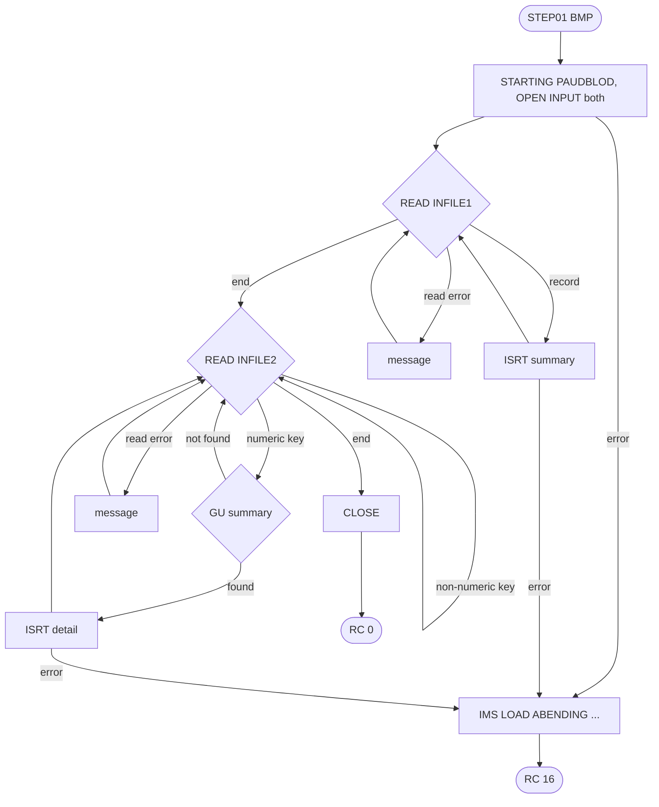
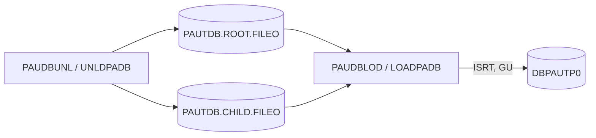

# PAUDBLOD: Pending authorization database reload from sequential files (LOADPADB)

## 1. Summary

An IMS BMP program that loads the pending-authorization database `DBPAUTP0` from the two files written by PAUDBUNL. First it inserts every summary record of the root file (ENT-AUTH-SUMMARY); then, for every record of the detail file, it positions on the summary named by the record's packed account ID and inserts the detail (ENT-AUTH-DETAIL) under it. Segments that already exist are reported and skipped. A detail whose summary is not found is skipped without a message (DEF-PDLD-002). The program takes no checkpoints and ends with return code 0, or 16 after an open or insert error.

## 2. Rules at a glance

| ID | Rule |
| :-- | :-- |
| FLOW-PDLD-001 | Open both files; phase 1 all summaries; phase 2 all details; close. |
| BR-PDLD-001 | Each root record is inserted as a summary; an existing summary (`II`) is reported and kept. |
| BR-PDLD-002 | Each detail record with a numeric parent key is inserted under the summary found by `GU` on that key; an existing detail (`II`) is reported and kept. |
| BR-PDLD-003 | A detail record with a non-numeric parent key, or whose summary is not found, is skipped without a message. |

## 3. Actors and triggers

- **Trigger:** JCL job `LOADPADB`, step `STEP01`, `DFSRRC00` with `PARM='BMP,PAUDBLOD,PSBPAUTB'` (`LOADPADB.JCL:26-27`): a BMP, so the IMS control region must be up and owns the database (the database DDs are commented out, `LOADPADB.JCL:40-41`). On demand; not scheduled (job JLDPA).
- **Inputs:** `INFILE1` = `AWS.M2.CARDDEMO.PAUTDB.ROOT.FILEO`, `INFILE2` = `AWS.M2.CARDDEMO.PAUTDB.CHILD.FILEO` (`LOADPADB.JCL:36-38`), the outputs of UNLDPADB (PAUDBUNL).
- **PSB:** `PSBPAUTB`, `PAUTBPCB` on `DBPAUTP0` with `PROCOPT=AP`, `CMPAT=YES` (`PSBPAUTB.psb:17-20`). A BMP receives the I/O PCB first. `PROCEDURE DIVISION USING IO-PCB-MASK PAUTBPCB` expects that, but `ENTRY 'DLITCBL' USING PAUTBPCB` names only one PCB (DEF-PDLD-001).

## 4. Interfaces

### 4.1 Files

| DD | Record | Content | Source |
| :-- | :-- | :-- | :-- |
| `INFILE1` | 100 bytes | ENT-AUTH-ROOT-FILE: one ENT-AUTH-SUMMARY image | `:26-29, 43-44` |
| `INFILE2` | 206 bytes | ENT-AUTH-CHILD-FILE: `ROOT-SEG-KEY` `S9(11) COMP-3` + `CHILD-SEG-REC` `X(200)` | `:32-35, 45-48` |

### 4.2 Database calls

| Call | I/O area | SSA | Source |
| :-- | :-- | :-- | :-- |
| `ISRT` | `PENDING-AUTH-SUMMARY` | `PAUTSUM0 ` (unqualified) | `:244-247` |
| `GU` | `PENDING-AUTH-SUMMARY` | `PAUTSUM0(ACCNTID EQ` + 6-byte packed key + `)` (NUM-PDLD-001) | `:296-299` |
| `ISRT` | `PENDING-AUTH-DETAILS` | `PAUTDTL1 ` (unqualified, under the current summary) | `:321-324` |

### 4.3 Console output (SYSOUT)

1. `STARTING PAUDBLOD` (`:173`), a line of dashes, `TODAYS DATE            :` + `YYMMDD`, a blank line (`:196-198`).
2. Per root record: two lines of asterisks, then `ROOT INSERT SUCCESS    ` or `ROOT SEGMENT ALREADY IN DB` (`:248-258`).
3. Per detail record with a numeric key: two lines of asterisks; when the summary is found, `GU CALL TO ROOT SEG SUCCESS` and `CHILD SEGMENT INSERTED SUCCESS` or `CHILD SEGMENT ALREADY IN DB` (`:300-306, 326-331`).
4. `CLOSING THE FILE` (`:342`), close errors if any; on an error the lines of section 10 and `IMS LOAD ABENDING ...` (`:363`).

### 4.4 Return code

0 at normal end, also after read and close errors; 16 after an open or insert error (ERR-PDLD-005).

## 5. Data used

| Entity field | Read | Written | Use |
| :-- | :-- | :-- | :-- |
| ENT-AUTH-ROOT-FILE (whole record) | yes | ENT-AUTH-SUMMARY (whole segment) | BR-PDLD-001 |
| ENT-AUTH-CHILD-FILE.ROOT-SEG-KEY | yes | - | BR-PDLD-002 (`GU` key) |
| ENT-AUTH-CHILD-FILE.CHILD-SEG-REC | yes | ENT-AUTH-DETAIL (whole segment) | BR-PDLD-002 |

## 6. Processing flow

## 7. Business rules

#### FLOW-PDLD-001 · Run outline
- **When:** the step starts.
- **Then:** print `STARTING PAUDBLOD` and the banner; open both files (ERR-PDLD-001); read and insert every root record until end of `INFILE1` (status `10`) (BR-PDLD-001); then read and insert every detail record until end of `INFILE2` (BR-PDLD-002); close both files (ERR-PDLD-004); `GOBACK`. IMS commits all inserts at the end of the program; no checkpoint is taken (DEF-PDLD-004).
- **Source:** `:169-215, 222-240, 269-291, 341-356`
- **Fidelity:** must-preserve · **Confidence:** reviewed (commit at program end: platform-inferred)

#### BR-PDLD-001 · Load summaries
- **When:** a root record is read with status `00`.
- **Then:** move it to the summary area and `ISRT` it with an unqualified SSA; IMS places it by its key `ACCNTID`. Status spaces: `ROOT INSERT SUCCESS    `. `II` (the account is already in the database): `ROOT SEGMENT ALREADY IN DB`, the existing segment is kept unchanged and its details from the file are still added in phase 2. Other: ERR-PDLD-003.
- **Source:** `:226-230, 242-263`
- **Fidelity:** must-preserve · **Confidence:** reviewed

#### BR-PDLD-002 · Load details under their summary
- **When:** a detail record is read with status `00` and `ROOT-SEG-KEY` is numeric (valid packed).
- **Then:** `GU PAUTSUM0(ACCNTID EQ key)`. Found: `GU CALL TO ROOT SEG SUCCESS`, then `ISRT PAUTDTL1` with the 200-byte image under that summary; IMS places it by its key `PAUT9CTS`. Status spaces: `CHILD SEGMENT INSERTED SUCCESS`. `II`: `CHILD SEGMENT ALREADY IN DB`, kept unchanged. Other: ERR-PDLD-003. The summary's counts and amounts are not changed by the insert.
- **Source:** `:274-282, 292-314, 318-336`
- **Fidelity:** must-preserve · **Confidence:** reviewed

#### BR-PDLD-003 · Details that are skipped
- **When:** `ROOT-SEG-KEY` is not numeric, or the `GU` does not return spaces (summary not found or any other status).
- **Then:** the detail is not inserted; there is no message apart from the two asterisk lines of the `GU`, and the return code is not affected (DEF-PDLD-002).
- **Source:** `:275, 282, 305-314`
- **Fidelity:** must-preserve · **Confidence:** reviewed

## 8. Validations and messages

The only check of the input is the numeric test of the parent key (BR-PDLD-003). Messages: section 4.3.

## 9. Side effects

#### SE-PDLD-001 · Summaries inserted
- One `PAUTSUM0` per root record not already present.
- **Source:** `:244-247`
- **Fidelity:** must-preserve · **Confidence:** reviewed

#### SE-PDLD-002 · Details inserted
- One `PAUTDTL1` per detail record whose summary exists and whose key is not already present under it.
- **Source:** `:321-324`
- **Fidelity:** must-preserve · **Confidence:** reviewed

## 10. Error handling

#### ERR-PDLD-001 · Open error
- Status not spaces or `00`: `ERROR IN OPENING INFILE1:` (or `INFILE2:`) + status, then ERR-PDLD-005.
- **Source:** `:201-215`
- **Fidelity:** must-preserve · **Confidence:** reviewed

#### ERR-PDLD-002 · Read error
- Status other than `00` or `10`: `ERROR READING ROOT SEG INFILE` (or `ERROR READING CHILD SEG INFILE`); the record is skipped and the next one is read. After a permanent read error every further `READ` fails, end of file is never reached and the loop does not end (DEF-PDLD-003).
- **Source:** `:231-237, 283-289`
- **Fidelity:** must-preserve (skip); defect-decide (loop) · **Confidence:** reviewed (repeating status: platform-inferred)

#### ERR-PDLD-003 · Insert error
- Summary `ISRT` status not spaces or `II`: `ROOT INSERT FAILED  :` + status. Detail `ISRT`: `INSERT CALL FAIL FOR CHILD:` + status and `KFB AREA IN CHILD:` + key feedback. Then ERR-PDLD-005.
- **Source:** `:259-262, 332-336`
- **Fidelity:** must-preserve · **Confidence:** reviewed

#### ERR-PDLD-004 · Close error
- `ERROR IN CLOSING 1ST FILE:` (or `2ND FILE:`) + status; return code stays 0.
- **Source:** `:343-356`
- **Fidelity:** must-preserve · **Confidence:** reviewed

#### ERR-PDLD-005 · End with return code 16
- `IMS LOAD ABENDING ...`, return code 16, `GOBACK`. A normal end, not an abend, so IMS keeps (commits) the segments inserted so far (DEF-PDLD-004).
- **Source:** `:360-366`
- **Fidelity:** must-preserve (RC 16) · **Confidence:** reviewed (commit on normal end: platform-inferred)

## 11. Interactions

- **Upstream:** PAUDBUNL writes both input files. The GSAM files of DBUNLDGS have a different detail layout and are not usable here (DBUNLDGS DEF-DBUL-001).
- **Downstream:** the database used by COPAUA0C, COPAUS0C, COPAUS1C and CBPAUP0C. As a BMP it runs while CICS may update the same database.

## 12. Numeric, date and format details

#### NUM-PDLD-001 · Qualified SSA
- `ROOT-QUAL-SSA` = `PAUTSUM0` + `(` + `ACCNTID ` + `EQ` + `ROOT-SEG-KEY` as `S9(11) COMP-3` (6 bytes, the format of `ACCNTID`, `DBPAUTP0.dbd:30`) + `)`, 26 bytes.
- **Source:** `:113-119, 277`
- **Fidelity:** must-preserve · **Confidence:** reviewed

## 13. Known defects and oddities

#### DEF-PDLD-001 · PCB list of the DLITCBL entry
- A BMP passes the I/O PCB and then `PAUTBPCB`. If IMS enters the program through `ENTRY 'DLITCBL' USING PAUTBPCB`, the program's `PAUTBPCB` mask points at the I/O PCB and every database call goes to the wrong PCB; if it enters through the main entry, `PROCEDURE DIVISION USING IO-PCB-MASK PAUTBPCB` maps them correctly. Which entry is used depends on the link-edit.
- **Source:** `:160-165, 171` · **Status:** open · **Fidelity:** defect-decide (Q-PDLD-001) · **Confidence:** platform-inferred

#### DEF-PDLD-002 · Missing summary skips the detail silently
- An `END-IF` is missing after the success branch of the `GU`: the test meant to report a failed `GU` (`ROOT GU CALL FAIL:`) is nested inside the success branch, where it tests the status of the detail insert instead. So a failed `GU` is never reported and the detail is lost without a message, and `ROOT GU CALL FAIL:` cannot be printed (an insert failure already ended the run in ERR-PDLD-003).
- **Source:** `:305-314` · **Status:** open · **Fidelity:** defect-decide (Q-PDLD-002) · **Confidence:** reviewed

#### DEF-PDLD-003 · A permanent read error loops forever
- ERR-PDLD-002 only prints a message. After an unsuccessful `READ` that is not end of file (status `3x` or `9x`), every further sequential `READ` fails (status `46`, no valid next record, on IBM and GnuCOBOL), so end of file is never reached, the loop never ends and the message is printed without end.
- **Source:** `:226-237, 272-289` · **Status:** open · **Confidence:** platform-inferred

#### DEF-PDLD-004 · No checkpoints; partial loads are committed
- The checkpoint fields exist but no `CHKP` is issued, so the whole load is one unit of work in the BMP; and because ERR-PDLD-005 is a normal end, a failed run keeps the segments inserted before the error. A rerun after a partial load relies on the `II` handling of BR-PDLD-001 and BR-PDLD-002.
- **Source:** `:90-92, 360-366` · **Status:** open · **Fidelity:** defect-decide (Q-PDLD-003) · **Confidence:** reviewed (commit behaviour: platform-inferred)

#### DEF-PDLD-005 · Console volume and dead code
- Two asterisk lines and a status line are printed for every record (about 4 lines per detail). The counters, `PRM-INFO`, `CURRENT-YYDDD`, `WS-PGMNAME` `IMSUNLOD` are unused; commented-out lines that add 2 to the detail key parts are left in the code (`:307-308`).
- **Source:** `:53-92, 129-139, 248-252, 300-308` · **Status:** open (incidental)

## 14. Open questions

| ID | Question | For |
| :-- | :-- | :-- |
| Q-PDLD-001 | With which entry point is PAUDBLOD link-edited, and does it work with the I/O PCB first (DEF-PDLD-001)? | mainframe team |
| Q-PDLD-002 | Should a detail whose summary is missing be reported or fail the run (DEF-PDLD-002)? | operations |
| Q-PDLD-003 | Should the load take checkpoints and fail with a backout on errors (DEF-PDLD-004)? | operations |

## 15. Equivalence contract

A reimplementation is equivalent when, for the same input files and database content:

- every root record not yet present is inserted as a summary, and every detail record whose summary exists and whose key is not yet present is inserted under that summary;
- existing segments are kept unchanged; records with a non-numeric key or a missing summary are skipped (as decided under Q-PDLD-002);
- the return code is 0, or 16 after an open or insert error;
- incidental: console texts and their volume.

Not runnable locally (IMS). Scenario check: an empty database loaded from PAUDBUNL's unload of the sample data (21 summaries, 202 details) gets 21 summaries and 202 details; a second run gives `II` for every record and changes nothing. Review record: `docs/modernization/spec/evidence/e-review.md`.

## 16. Paragraph coverage

| Paragraph | Lines | Covered by |
| :-- | :-- | :-- |
| (data division) | 39-162 | §4.1, NUM-PDLD-001, DEF-PDLD-005 |
| (procedure division header) | 164-165 | §3, DEF-PDLD-001 |
| `MAIN-PARA` | 169-187 | FLOW-PDLD-001, DEF-PDLD-001 |
| `1000-INITIALIZE` | 190-215 | FLOW-PDLD-001, ERR-PDLD-001 |
| `1000-EXIT` | 218-219 | FLOW-PDLD-001 |
| `2000-READ-ROOT-SEG-FILE` | 222-237 | BR-PDLD-001, ERR-PDLD-002, DEF-PDLD-003 |
| `2000-EXIT` | 239-240 | BR-PDLD-001 |
| `2100-INSERT-ROOT-SEG` | 242-263 | BR-PDLD-001, SE-PDLD-001, ERR-PDLD-003 |
| `2100-EXIT` | 264-265 | BR-PDLD-001 |
| `3000-READ-CHILD-SEG-FILE` | 269-289 | BR-PDLD-002, BR-PDLD-003, ERR-PDLD-002 |
| `3000-EXIT` | 290-291 | BR-PDLD-002 |
| `3100-INSERT-CHILD-SEG` | 292-314 | BR-PDLD-002, BR-PDLD-003, DEF-PDLD-002 |
| `3100-EXIT` | 315-316 | BR-PDLD-002 |
| `3200-INSERT-IMS-CALL` | 318-336 | BR-PDLD-002, SE-PDLD-002, ERR-PDLD-003 |
| `3200-EXIT` | 338-339 | BR-PDLD-002 |
| `4000-FILE-CLOSE` | 341-356 | FLOW-PDLD-001, ERR-PDLD-004 |
| `4000-EXIT` | 357-358 | FLOW-PDLD-001 |
| `9999-ABEND` | 360-366 | ERR-PDLD-005, DEF-PDLD-004 |
| `9999-EXIT` | 368-369 | ERR-PDLD-005 |

17 of 17 paragraphs plus the procedure division header covered.
