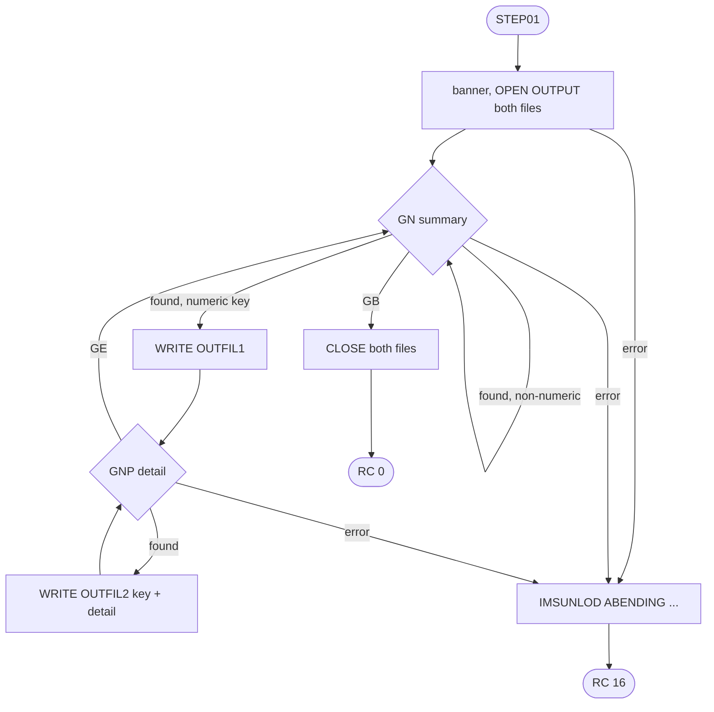
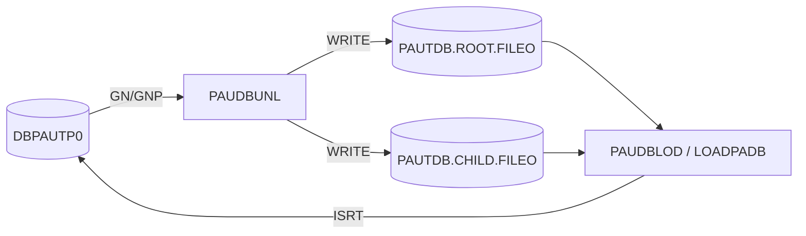

# PAUDBUNL: Pending authorization database unload to sequential files (UNLDPADB)

## 1. Summary

An IMS batch (DL/I) program that copies the pending-authorization database `DBPAUTP0` into two sequential files: one 100-byte record per account summary (ENT-AUTH-SUMMARY) and one 206-byte record per authorization detail (ENT-AUTH-DETAIL), made of the parent's packed account ID and the 200-byte segment. Summaries whose account key is not a valid packed number are skipped with their details. The files are the input of PAUDBLOD (job LOADPADB). The program reads the database only; it ends with return code 0, or 16 after an open or IMS error.

## 2. Rules at a glance

| ID | Rule |
| :-- | :-- |
| FLOW-PDUL-001 | Banner, open both files, every summary in database order, close both files. |
| BR-PDUL-001 | Each summary with a numeric account ID is written as its 100-byte image to `OUTFIL1`. |
| BR-PDUL-002 | A summary whose packed account ID is not numeric is skipped with all its details. |
| BR-PDUL-003 | Each detail of a written summary is written to `OUTFIL2` as account ID (6 bytes packed) + 200-byte image, in key order. |

## 3. Actors and triggers

- **Trigger:** JCL job `UNLDPADB`: `STEP0` deletes the old output data sets, `STEP01` runs `DFSRRC00` with `PARM='DLI,PAUDBUNL,PAUTBUNL,,,,,,,,,,,N'` (`UNLDPADB.JCL:25-39`), a DL/I batch region with its own database DDs (`UNLDPADB.JCL:58-59`). On demand; not scheduled (job JULPA).
- **PSB:** `PAUTBUNL`, one PCB `PAUTBPCB` on `DBPAUTP0`, `PROCOPT=GOTP` (read only), `CMPAT=NO`, so the database PCB is the first and only parameter (`PAUTBUNL.PSB:18-21`, `:153-158`) (platform-inferred).

## 4. Interfaces

### 4.1 Files

| DD | Record | Content | JCL | Source |
| :-- | :-- | :-- | :-- | :-- |
| `OUTFIL1` | 100 bytes, `RECFM=FB` | ENT-AUTH-ROOT-FILE: ENT-AUTH-SUMMARY image | `AWS.M2.CARDDEMO.PAUTDB.ROOT.FILEO`, `DISP=(NEW,CATLG,DELETE)`, `LRECL=100` | `:26-29, 43-44`, `UNLDPADB.JCL:48-51` |
| `OUTFIL2` | 206 bytes, `RECFM=FB` | ENT-AUTH-CHILD-FILE: `ROOT-SEG-KEY` `S9(11) COMP-3` + `CHILD-SEG-REC` `X(200)` | `AWS.M2.CARDDEMO.PAUTDB.CHILD.FILEO`, `LRECL=206` | `:32-35, 45-48`, `UNLDPADB.JCL:53-56` |

### 4.2 Database calls

| Call | I/O area | SSA | Source |
| :-- | :-- | :-- | :-- |
| `GN` | `PENDING-AUTH-SUMMARY` | `PAUTSUM0 ` (unqualified) | `:212-216` |
| `GNP` | `PENDING-AUTH-DETAILS` | `PAUTDTL1 ` (unqualified) | `:257-260` |

### 4.3 Console output (SYSOUT), in order

1. `STARTING PROGRAM PAUDBUNL::`, a line of dashes, `TODAYS DATE            :` + `YYMMDD`, a blank line (`:180-183`).
2. After the details of each written summary: `CHILD SEG FLAG GE : Y` (`:276-277`).
3. At the end: `CLOSING THE FILE` (`:290`), and close errors if any.
4. On an error: the lines of section 10, then `IMSUNLOD ABENDING ...` (`:311`).

### 4.4 Return code

0 at normal end, also after a close error; 16 after an open or IMS error (ERR-PDUL-004).

## 5. Data used

| Entity field | Read | Written | Use |
| :-- | :-- | :-- | :-- |
| ENT-AUTH-SUMMARY (whole segment) | yes | ENT-AUTH-ROOT-FILE | BR-PDUL-001 |
| ENT-AUTH-SUMMARY.PA-ACCT-ID | yes | ENT-AUTH-CHILD-FILE.ROOT-SEG-KEY | BR-PDUL-002, BR-PDUL-003 |
| ENT-AUTH-DETAIL (whole segment) | yes | ENT-AUTH-CHILD-FILE.CHILD-SEG-REC | BR-PDUL-003 |

## 6. Processing flow

## 7. Business rules

#### FLOW-PDUL-001 · Run outline
- **When:** the step starts.
- **Then:** `ACCEPT` today's date (`YYMMDD`) for the banner; open `OUTFIL1` and `OUTFIL2` for output (ERR-PDUL-001); repeat the summary loop until `GN` returns `GB`; close both files (ERR-PDUL-003); `GOBACK`.
- **Source:** `:157-200, 239-242, 289-304`
- **Fidelity:** must-preserve · **Confidence:** reviewed

#### BR-PDUL-001 · Summary records
- **When:** `GN PAUTSUM0` returns spaces and BR-PDUL-002 does not apply. Summaries come in ascending account order (HIDAM root key, `DBPAUTP0.dbd:18, 28-30`).
- **Then:** write the 100-byte summary image to `OUTFIL1` (SE-PDUL-001), then read its details (BR-PDUL-003).
- **Source:** `:223-237`
- **Fidelity:** must-preserve · **Confidence:** reviewed

#### BR-PDUL-002 · Summaries with an invalid account ID are skipped
- **When:** `PA-ACCT-ID` (`S9(11) COMP-3`) is not numeric, that is, its 6 bytes are not valid packed decimal (for example the all-spaces root in the sample data).
- **Then:** nothing is written for the summary and its details are not read; no message (DEF-PDUL-002). The `MOVE PA-ACCT-ID TO ROOT-SEG-KEY` (`:230`) runs before the test (`:232`); that it does not raise a data exception on invalid packed bytes depends on the compiler options (platform-inferred).
- **Source:** `:230-237`, `CIPAUSMY.cpy:19`
- **Fidelity:** must-preserve · **Confidence:** reviewed (no abend on the earlier move: platform-inferred)

#### BR-PDUL-003 · Detail records with parent key
- **When:** after a written summary.
- **Then:** `GNP PAUTDTL1` until `GE`; for each detail write `OUTFIL2` = the summary's `PA-ACCT-ID` (packed, 6 bytes, set before the details are read) + the 200-byte detail image (SE-PDUL-002). Details come in key order, newest first (COPAUA0C NUM-AUTH-005). At `GE` print `CHILD SEG FLAG GE : Y`.
- **Note:** `ROOT-SEG-KEY` is in the FD record area and is set only once per summary; the 2nd and later details of a summary rely on the record area keeping its content after `WRITE` (DEF-PDUL-005, platform-inferred).
- **Source:** `:45-48, 228-230, 253-284`
- **Fidelity:** must-preserve · **Confidence:** reviewed

## 8. Validations and messages

The only check is the numeric test of BR-PDUL-002. Messages: section 4.3.

## 9. Side effects

#### SE-PDUL-001 · Summary file
- `AWS.M2.CARDDEMO.PAUTDB.ROOT.FILEO` is created and catalogued with one record per written summary. The write status is not checked (DEF-PDUL-001).
- **Source:** `:233`, `UNLDPADB.JCL:48-51`
- **Fidelity:** must-preserve · **Confidence:** reviewed

#### SE-PDUL-002 · Detail file
- `AWS.M2.CARDDEMO.PAUTDB.CHILD.FILEO` is created and catalogued with one record per detail of a written summary. The write status is not checked.
- **Source:** `:270-271`, `UNLDPADB.JCL:53-56`
- **Fidelity:** must-preserve · **Confidence:** reviewed

## 10. Error handling

#### ERR-PDUL-001 · Open error
- Status not spaces or `00` after `OPEN OUTPUT`: `ERROR IN OPENING OPFILE1:` (or `OPFILE2:`) + status, then ERR-PDUL-004.
- **Source:** `:186-200`
- **Fidelity:** must-preserve · **Confidence:** reviewed

#### ERR-PDUL-002 · Database read error
- `GN` status other than spaces or `GB`: `AUTH SUM  GN FAILED  :` + status and `KEY FEEDBACK AREA    :` + key feedback. `GNP` status other than spaces or `GE`: `GNP CALL FAILED  :` + status and `KFB AREA IN CHILD:` + key feedback. Then ERR-PDUL-004.
- **Source:** `:243-246, 279-283`
- **Fidelity:** must-preserve · **Confidence:** reviewed

#### ERR-PDUL-003 · Close error
- Status not spaces or `00` after `CLOSE`: `ERROR IN CLOSING 1ST FILE:` (or `2ND FILE:`) + status. The run still ends with return code 0 (DEF-PDUL-003).
- **Source:** `:291-304`
- **Fidelity:** must-preserve · **Confidence:** reviewed

#### ERR-PDUL-004 · End with return code 16
- `IMSUNLOD ABENDING ...`, return code 16, `GOBACK`. A normal end with RC 16, not an abend; the files are not closed by the program and, because the step does not abend, the JCL's normal disposition `CATLG` keeps them with partial content (DEF-PDUL-003).
- **Source:** `:308-314`
- **Fidelity:** must-preserve (RC 16) · **Confidence:** reviewed (dispositions: platform-inferred)

## 11. Interactions

- **Upstream:** the database as maintained by COPAUA0C, COPAUS1C and CBPAUP0C.
- **Downstream:** PAUDBLOD reads both files in LOADPADB (DDs `INFILE1`, `INFILE2`) to reload the database.

## 12. Numeric, date and format details

#### NUM-PDUL-001 · Parent key in the detail record
- `ROOT-SEG-KEY` is `S9(11) COMP-3` (6 bytes), the same format as `PA-ACCT-ID` and the database key `ACCNTID` (`DBPAUTP0.dbd:30`), so PAUDBLOD can use it unchanged in a qualified SSA. It is initialized to zero and then set from `PA-ACCT-ID` for each summary read, before the `IS NUMERIC` test (`:232`), so also for skipped summaries. It lives in the FD record area (DEF-PDUL-005).
- **Source:** `:45-48, 228-232`
- **Fidelity:** must-preserve · **Confidence:** reviewed

## 13. Known defects and oddities

#### DEF-PDUL-001 · Write status not checked
- Neither `WRITE` is followed by a status test. A write failure is not detected by the program; it is reported only if the `CLOSE` also fails (ERR-PDUL-003), and the step ends with return code 0. On z/OS an out-of-space condition can instead end in status `34` or an `Sx37` abend (platform-inferred).
- **Source:** `:233, 271` · **Status:** open · **Fidelity:** defect-decide (Q-PDUL-001) · **Confidence:** reviewed

#### DEF-PDUL-002 · Skipped summaries are not reported
- BR-PDUL-002 skips without a message or count, so a reload from these files silently loses such summaries and their details.
- **Source:** `:232` · **Status:** open · **Fidelity:** defect-decide (Q-PDUL-002) · **Confidence:** reviewed

#### DEF-PDUL-003 · Errors leave catalogued partial files
- ERR-PDUL-004 and ERR-PDUL-003 end the step normally, so the new data sets are catalogued even when incomplete; only the return code (16, or 0 for close errors) tells the operator.
- **Source:** `:296, 303, 308-314`, `UNLDPADB.JCL:49, 54` · **Status:** open · **Fidelity:** defect-decide (Q-PDUL-001) · **Confidence:** reviewed (dispositions: platform-inferred)

#### DEF-PDUL-005 · Parent key depends on the record area after WRITE
- `ROOT-SEG-KEY` is part of the FD record `OPFIL2-REC` (`:45-48`). It is set once per summary (`:228-230`); each detail then moves only `CHILD-SEG-REC` (`:270`) before `WRITE OPFIL2-REC` (`:271`). Under the COBOL rules a record released by `WRITE` is no longer available in the record area (there is no `SAME RECORD AREA` and no working-storage copy). With blocked QSAM output (`RECFM=FB`, `BLKSIZE=0`, `UNLDPADB.JCL:53-56`) the record area can move to the next buffer slot, so the 2nd and later details of a summary can carry an undefined parent key, which PAUDBLOD then skips (non-numeric key) or does not find. GnuCOBOL keeps the record area, so a local run does not show this.
- **Source:** `:45-48, 228-230, 270-271` · **Status:** open · **Fidelity:** defect-decide (Q-PDUL-003) · **Confidence:** platform-inferred

#### DEF-PDUL-004 · Counters never printed; dead fields
- The read counters are incremented (detail reads added to the summary counters, `:268-269`) but never displayed. `PRM-INFO` (its `ACCEPT` is commented out), `CURRENT-YYDDD`, the checkpoint ID and the other work fields are unused; the abend text and `WS-PGMNAME` say `IMSUNLOD`.
- **Source:** `:53-90, 119-129, 179, 225-226` · **Status:** open (incidental)

## 14. Open questions

| ID | Question | For |
| :-- | :-- | :-- |
| Q-PDUL-001 | Should write and close errors and IMS errors make the step fail (abend, so that `DISP=(NEW,CATLG,DELETE)` deletes the partial files) (DEF-PDUL-001, DEF-PDUL-003)? | operations |
| Q-PDUL-002 | Should summaries with an invalid account ID be reported or unloaded (DEF-PDUL-002)? | operations |
| Q-PDUL-003 | Does the production unload write the correct account key on every detail record, that is, does the compiled program keep the record area after `WRITE` (DEF-PDUL-005)? | mainframe team |

## 15. Equivalence contract

A reimplementation is equivalent when, for the same database content:

- `OUTFIL1` has one 100-byte summary image per summary with a valid packed account ID, in account order;
- `OUTFIL2` has, for those summaries in the same order, one record per detail: 6-byte packed account ID + 200-byte image, newest first;
- the return code is 0, or 16 after an open or IMS error;
- incidental: console texts.

Not runnable locally (IMS). Scenario check on the sample data (22 roots, 202 details): 21 summary records and 202 detail records; reloading them with PAUDBLOD gives the same database without the all-spaces root. Review record: `docs/modernization/spec/evidence/e-review.md`.

## 16. Paragraph coverage

| Paragraph | Lines | Covered by |
| :-- | :-- | :-- |
| (data division) | 39-150 | §4.1, NUM-PDUL-001, DEF-PDUL-004 |
| (procedure division header) | 153 | §3 |
| `MAIN-PARA` | 157-170 | FLOW-PDUL-001 |
| `1000-INITIALIZE` | 173-200 | FLOW-PDUL-001, ERR-PDUL-001 |
| `1000-EXIT` | 203-204 | FLOW-PDUL-001 |
| `2000-FIND-NEXT-AUTH-SUMMARY` | 207-247 | BR-PDUL-001, BR-PDUL-002, ERR-PDUL-002 |
| `2000-EXIT` | 248-249 | BR-PDUL-001 |
| `3000-FIND-NEXT-AUTH-DTL` | 253-284 | BR-PDUL-003, SE-PDUL-002, ERR-PDUL-002, DEF-PDUL-005 |
| `3000-EXIT` | 285-286 | BR-PDUL-003 |
| `4000-FILE-CLOSE` | 289-304 | FLOW-PDUL-001, ERR-PDUL-003 |
| `4000-EXIT` | 305-306 | FLOW-PDUL-001 |
| `9999-ABEND` | 308-314 | ERR-PDUL-004, DEF-PDUL-003 |
| `9999-EXIT` | 316-317 | ERR-PDUL-004 |

11 of 11 paragraphs plus the procedure division header covered.
